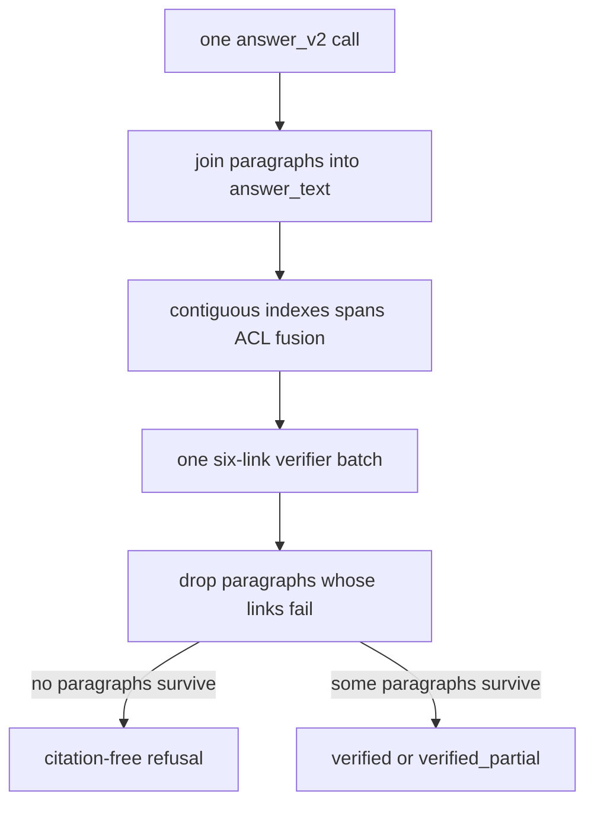

# P06-45 — Paragraph mappings and fail-closed verification (2026-09-15)

Parent index: [phase-06-agent-intelligence-evidence.md](../phase-06-agent-intelligence-evidence.md).

Requirement IDs: `P06-45`, `CIT-PARA-003`, `CIT-SPAN-004`, `CIT-LINK-006`,
`CIT-VERIFY-007`, `CIT-BOUNDS-012`.

## Plan requirement

Quote: implement structured paragraph mappings, exact spans, and
fail-closed verification.

Positive checks: `answer_v2` is registered and hashed; two paragraphs
map to two chunks; two citations can attach to one paragraph; missing
mapping, null/empty span, span/chunk mismatch, and
citation/link/paragraph disagreement fail closed; unsupported verifier
links drop the owning paragraph; all paragraphs removed produce a
citation-free refusal; seventh link and thirteenth citation fail
bounds; General and Web payloads stay unaffected; one answer call and
one verifier call remain unchanged.

Negative checks: `ensure_fusion_source_citations()` is absent from the
live verify path; unsupported prose is not streamed after its link is
removed; `answer_v1.md` is unchanged.

## Verification flow

Company answers require 1-6 paragraphs, at most 6 atomic links, at most
12 citations, and exact 1-1000 character spans. Provider output omits
`answer_text`. Fusion passages are never backfilled as citations.

## Prompt pin

- Version: `answer_v2`
- LF-normalized SHA-256:
  `20d55af652815a9829e477ed9d791d49386923da3c11d5dbdf1faa8081a37765`
- File: [answer_v2.md](../../../apps/agents/src/smart_rag_agents/prompts/answer_v2.md)
- `answer_v1.md` remains immutable and registered for history.

## Files

- [models.py](../../../packages/core/src/smart_rag_core/query_answer/models.py)
- [paragraphs.py](../../../packages/core/src/smart_rag_core/query_answer/paragraphs.py)
- [schemas.py](../../../packages/core/src/smart_rag_core/query_answer/schemas.py)
- [deterministic.py](../../../packages/core/src/smart_rag_core/query_answer/deterministic.py)
- [verifier.py](../../../packages/core/src/smart_rag_core/query_answer/verifier.py)
- [verify.py](../../../apps/agents/src/smart_rag_agents/query/nodes/verify.py)
- [test_answer_paragraph_citations.py](../../../tests/unit/test_answer_paragraph_citations.py)
- [ANSWER_VERIFICATION.md](../../agent/ANSWER_VERIFICATION.md)

## Verification

| Command | Exit |
| --- | ---: |
| `uv run pytest` paragraph/answer/verifier/mock/runtime suites | 0 |
| `uv run ruff check` on P06-45 Python | 0 |
| `uv run pyright` on P06-45 modules | 0 |

Recorded pytest files: `test_answer_paragraph_citations.py`,
`test_answer_verifier.py`, `test_answer_filter_invented.py`,
`test_answer_citations_persist.py`, `test_verifier_gateway.py`,
`test_prompt_registry.py`, `test_query_graph_runtime.py`,
`test_web_research_graph.py`, `test_general_chat_generate.py`,
`test_answer_verifier_integration.py`, `test_answer_verifier_scope.py`,
`test_query_retrieve_state_sync.py`, `test_web_citations.py`,
`test_model_gateway.py`.

## Proven

- Live company verify requires paragraph mappings (`require_paragraphs=True`).
- Verifier-unsupported or omitted links drop the owning paragraph and
  rebuild `answer_text`.
- `ensure_fusion_source_citations` is not imported by `verify.py`.
- General-chat schema still requires `answer_text` and omits `paragraphs`.

## Unverified

- SQL persistence, leaf resolution, and PDF page repair are recorded in
  [p06-46-pdf-citation-persistence-2026-09-15.md](./p06-46-pdf-citation-persistence-2026-09-15.md).
- Inline UI is recorded in
  [p06-47-inline-pdf-citation-ui-2026-09-15.md](./p06-47-inline-pdf-citation-ui-2026-09-15.md).
- Full `scripts/check.py --tier unit` was not run in this packet.

## Handoff for P06-46

Persist `paragraph_index`, exact span, and leaf-resolved PDF viewer page
on ACL-safe citation rows. Do not restore fusion backfill.
