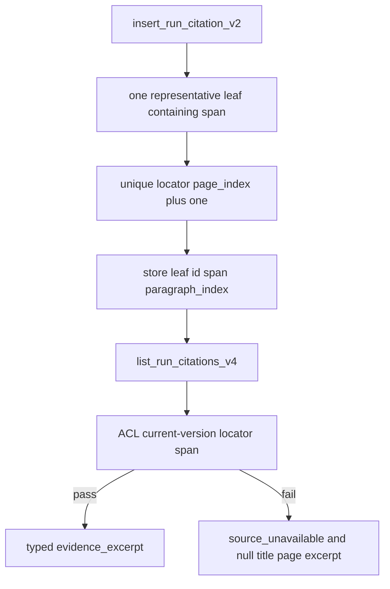

# P06-46 — Persist ACL-safe PDF traces, page repair, and history (2026-09-15)

Parent index: [phase-06-agent-intelligence-evidence.md](../phase-06-agent-intelligence-evidence.md).

Requirement IDs: `P06-46`, `CIT-PAGE-001`, `CIT-TITLE-002`, `CIT-SPAN-004`,
`CIT-LEAF-005`, `CIT-ACL-008`, `CIT-HISTORY-009`, `CIT-LEGACY-010`,
`CIT-COMPAT-011`, `CIT-BOUNDS-012`.

## Plan requirement

Quote: persist unique page-bounded leaves, locator-derived PDF viewer
pages, typed ACL-safe excerpts, and bounded conversation history.

Positive checks: leaf on viewer page 25; parent resolves to one child;
two matching children fail; null/empty/non-contained span fails;
multi-page locators fail; stored `page_number=12` with locator
`page_index=24` returns 25; `page_label` never drives
`pdf_page_number`; exact replay; conflicting replay; citation 13;
foreign run/conversation 404; ACL/delete/current-version strip;
hostile excerpt escape; history batch; legacy null paragraph/span
honesty.

Negative checks: v4 using `page_label` for the displayed page; excerpt
without live ACL/current-version checks; hiding a database integrity
failure as an empty list.

## Persistence flow

## Files

- [20260915140000_pdf_paragraph_citations_v1.sql](../../../supabase/migrations/20260915140000_pdf_paragraph_citations_v1.sql)
- [citations.py](../../../packages/core/src/smart_rag_core/query_answer/citations.py)
- [records.py](../../../packages/core/src/smart_rag_core/query_admission/repository/records.py)
- [repository.py](../../../packages/core/src/smart_rag_core/ingestion/canonical/repository.py)
- [repair_pdf_page_numbers.py](../../../scripts/ops/repair_pdf_page_numbers.py)
- [fastapi_security.py](../../../apps/backend/src/smart_rag_api/schemas/fastapi_security.py)
- [query_runs.py](../../../apps/backend/src/smart_rag_api/services/query_runs.py)
- [conversation_transcript.py](../../../apps/backend/src/smart_rag_api/services/conversation_transcript.py)
- [verify.py](../../../apps/agents/src/smart_rag_agents/query/nodes/verify.py)

## Verification

| Command | Exit |
| --- | ---: |
| `uv run python scripts/ci/check_migrations.py` | 0 |
| `uv run pytest` unit persist/FastAPI/repair/web citation suites | 0; one DB persist test skipped |
| `uv run ruff check` on P06-46 Python | 0 |
| `uv run pyright` on P06-46 modules | 0 |

Hosted expand-only apply used `OPERATOR_SUPABASE_DB_URL` session pooler
port 5432 via libpq `PQexec`. Confirmed
`app.citations.paragraph_index` and `app.insert_run_citation_v2`.
No `supabase db reset`. No DSN was logged.

`tests/contract/test_pdf_paragraph_citations.py` and
`tests/contract/test_citation_acl_recheck.py` were not executed: this
worktree has no non-hosted `SUPABASE_DB_URL`, and
`refuse_hosted_destructive_dsn` forbids pointing those suites at
`*.supabase.co` / pooler hosts. A skipped contract test is not proof.

## Proven

- Passage persist calls `insert_run_citation_v2`; tables keep v1.
- Bound persist failure raises and verify degrades to
  `insufficient_evidence` / `citation_persist_failed`.
- HTTP `CitationResponse` and `ConversationMessage` expose additive
  typed fields. SSE `citation_preview` still omits excerpts.
- Canonical upsert refreshes `page_number`. Repair script is dry-run
  by default and ignores `page_label`.

## Unverified

- SQL leaf/ACL/history contract pytest against a labelled non-hosted
  `SUPABASE_DB_URL`.
- Repair `--apply` against a live version.

## Handoff for P06-47

Typed HTTP fields: `paragraph_index`, `document_title`,
`pdf_page_number`, `evidence_excerpt`, message `run_id`, and message
`citations`. Excerpt is never copied into `provenance`. Inline UI is
recorded in
[p06-47-inline-pdf-citation-ui-2026-09-15.md](./p06-47-inline-pdf-citation-ui-2026-09-15.md).
