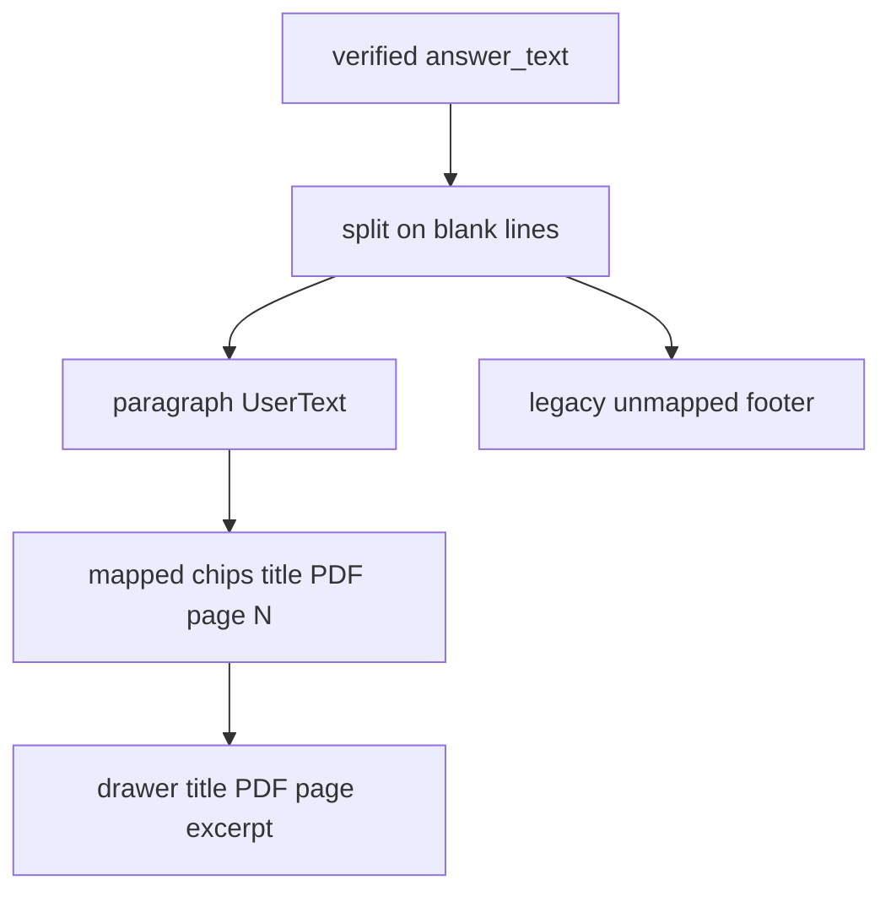

# P06-47 — Render book title, PDF viewer page, and excerpt (2026-09-15)

Parent index: [phase-06-agent-intelligence-evidence.md](../phase-06-agent-intelligence-evidence.md).

Requirement IDs: `P06-47`, `CIT-PAGE-001`, `CIT-TITLE-002`, `CIT-PARA-003`,
`CIT-HISTORY-009`, `CIT-LEGACY-010`.

## Plan requirement

Quote: show book title, PDF viewer page, and exact excerpt beside each
answer paragraph.

Positive checks: two paragraphs keep their own chips; one paragraph can
show two chips; viewer page 25 with printed label 12 displays
`PDF page 25`; drawer title/page/excerpt match; history uses
`ConversationMessage.citations`; legacy rows stay in the labeled footer;
hostile title/excerpt render as text; Arabic excerpt uses `dir="auto"`;
keyboard focus stays in the drawer.

Negative checks: `citationDisplayPage()` / `page_label` for a company PDF
chip; XSS via excerpt HTML; chips before paced-reveal paragraph
visibility; N+1 citation fetches from history.

## Inline mapping

## Proven

- Parser keeps top-level `evidence_excerpt` and strips provenance
  `excerpt`/`span` copies. Invalid page and out-of-range
  `paragraph_index` become null.
- Company PDF chips are `<document_title> · PDF page N`. Missing title
  uses `Source`. Missing page uses `PDF page unavailable`. Printed
  `page_label` is not the chip page.
- Live and historical answers share `AnswerParagraphs`. History chips
  come from the message payload. `useChatQueries` still loads live
  citations once per terminal run.
- Paced reveal hides chips until the owning paragraph prefix is fully
  visible.
- Drawer heading is `<title> — PDF page N`. Supporting passage uses
  `UserText`. No Storage download URL.
- Vitest `597` passed. ESLint, `tsc --noEmit`, and frontend production
  build with public placeholder Auth env exited 0.

## Commands

| Command | Exit |
| --- | --- |
| `pnpm test` (frontend) | 0 (`597` passed) |
| `pnpm lint` (frontend) | 0 |
| `pnpm exec next typegen` then `pnpm typecheck` | 0 |
| `pnpm build` with public placeholder Auth env | 0 |

## Unverified

- Browser walkthrough against a live company-PDF run.
- Playwright E2E for inline chips (no live citation fixture in this
  packet).
- Evaluation scoring remains P06-48.

## Handoff for P06-48

UI mapping and drawer contract are in
[CORE_RAG_SURFACES.md](../../frontend/CORE_RAG_SURFACES.md) and this
file. Score citation accuracy against gold page/span without changing
chip labels to printed `page_label`.
