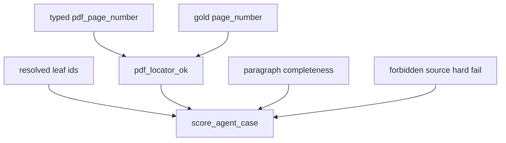

# P06-48 — Prove PDF citation accuracy (2026-09-15)

Parent index: [phase-06-agent-intelligence-evidence.md](../phase-06-agent-intelligence-evidence.md).

Requirement IDs: `P06-48`, `CIT-PAGE-001` through `CIT-BOUNDS-012`.

## Plan requirement

Quote: prove PDF citation accuracy across regression, authorization,
history, UI, and evaluation gates.

Positive checks: AI Agents fixture viewer page 25 versus printed 12;
chip `AI Agents · PDF page 25`; drawer excerpt equals the persisted
span; scoring uses resolved leaves and `pdf_page_number` versus gold
`page_number`; ACL/forbidden sources remain hard failures.

Negative checks: claiming the global ≥98% citation target from this
fixture; opening holdout; treating skipped contract tests as proof;
presenting `page_label` as the viewer page.

## Scoring flow

## Proven

- Fixture title `AI Agents`, unique span on `page_index=24`
  (`PDF page 25`), printed label `12`, duplicate child span on pages 22
  and 23, parent heading `Chapter Refunds`.
- `resolved_citation_ids` ignores retrieved occupancy.
  `pdf_locator_ok((25,), (25,), page_labels=("12",))` is true and
  `pdf_locator_ok((12,), (25,))` is false. Forbidden cited IDs remain a
  hard failure.
- Frontend chip/drawer unit tests and `answer-surface` render
  `AI Agents · PDF page 25` and forbid `p. 12` / `PDF page 12`.
- Quality-gate repair only: `knowledge_scope.py` split to stay under the
  600-line query-vertical cap; `bound_nodes.py` rewritten under the
  300-line stream-owner budget; nested Google-style docstrings added
  where the AST scanner required them. No search-scope product change.
- Approved PDF evaluation was **not** run. Holdout stayed sealed.
  QT-EVAL-002 ≥98% remains **unverified**. Regenerated
  [PHASE4_FREEZE.md](../../evaluation/PHASE4_FREEZE.md) still records
  `no_go` and `holdout_opened` false after the `answer_v2` prompt text
  change (committed freeze hash update is `query_profile_prompt`).

## Commands

Worktree: `C:\Nagdy\Mustafa\Work\Upwork\Demo_Project_3-pdf-citations`
on `fix/pdf-paragraph-citations`. Parent of this packet: `b735f14`.
This packet SHA is the commit that lands this file. Original dirty
worktree `C:\Nagdy\Mustafa\Work\Upwork\Demo_Project_3` was not modified.

| Command | Exit | Notes |
| --- | --- | --- |
| `uv run python -m pytest tests/unit/test_pdf_paragraph_citation_fixture.py tests/unit/test_pdf_agent_citation_scores.py tests/unit/test_private_pdf_eval.py -q` | 0 | 37 passed |
| `uv run python scripts/check.py --tier format` | 0 | after `ruff format` on docstring whitespace |
| `uv run python scripts/check.py --tier lint` | 0 | |
| `uv run python scripts/check.py --tier types` | 0 | Pyright 0 errors |
| `uv run python scripts/check.py --tier unit` | 0 | 1430 passed, 4 skipped |
| `uv run python scripts/check.py --tier contract` | 0 | 272 passed, 255 skipped |
| `uv run python scripts/check.py --tier docs` | 0 | markdownlint, links, Mermaid, action inventory |
| `uv run python scripts/check.py --tier frontend` | 0 | ESLint 0; `tsc --noEmit` 0; Vitest 597 passed; production build 0; Playwright 25 passed, 17 skipped |
| Non-hosted Postgres fixture | no | `SUPABASE_DB_URL` unset; hosted pooler remains refused for contract pytest |
| Approved PDF evaluation | not run | Do not claim 98% |

Unit skips (not citation proof):
`test_answer_citations_persist.py` (`SUPABASE_DB_URL` unset);
two `resource` skips and one symlink skip in `test_structured_table.py`.

Contract skips include
`tests/contract/test_pdf_paragraph_citations.py` and
`tests/contract/test_citation_acl_recheck.py`. A skipped contract test
is not proof of leaf resolution, ACL strip, or history batching against
Postgres.

Playwright `pdf-paragraph-citations.spec.ts` skipped:
`E2E_LIVE_EMAIL` / `E2E_LIVE_PASSWORD` unset. Chip and drawer mapping
are proven by Vitest (`citation-label.test.ts`, `answer-surface.test.tsx`),
not by a live signed-in browser walkthrough.

## Unverified

- Hosted `tests/contract/test_pdf_paragraph_citations.py` and
  `tests/contract/test_citation_acl_recheck.py` until a labelled
  non-hosted Postgres fixture exists.
- Measured citation correctness on the approved evaluation set.
  Fixture unit tests are not that measurement.
- Live company-PDF Ask walkthrough against a real ingested book.
- Playwright citation journey until provisioned live Auth credentials
  are present in the runner environment.

## Handoff

Per-packet commits on `fix/pdf-paragraph-citations` stay un-squashed.
Feature branch was not deleted. User acceptance is still required before
checking the packet complete.

| Git | Value |
| --- | --- |
| P06-44 | `89b0c1a` |
| P06-45 | `b0d516e` |
| P06-46 | `6edb5b8` |
| P06-47 | `b735f14` |
| P06-48 | `d42b4df` |
| CI repair | `ef23c24` |
| PR | [smart-rag#9](https://github.com/Nagdy8888/smart-rag/pull/9) |
| Merge commit | `5434d6f` (parents `75402ce` and `ef23c24`; not squash) |
| PR-fast | all required checks passed after `ef23c24` |
