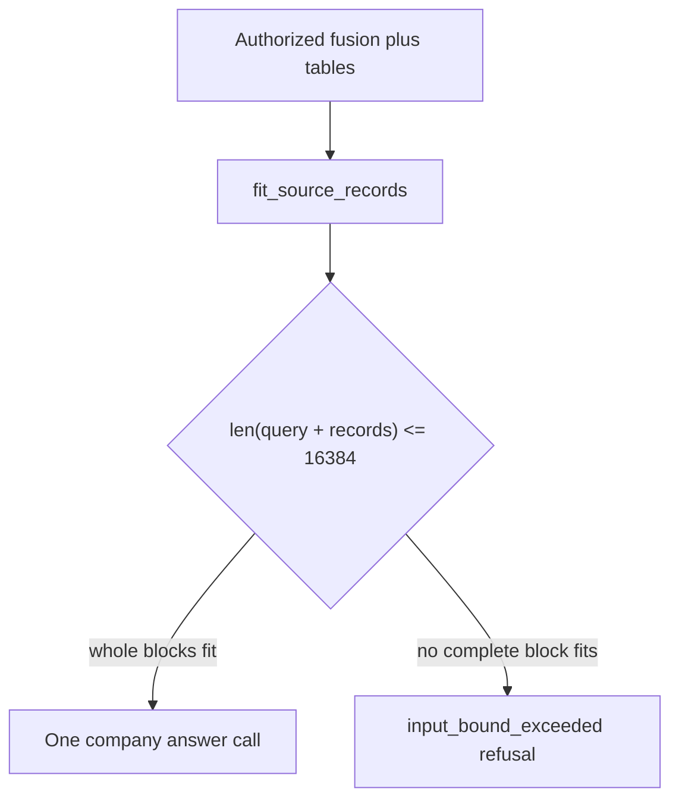

# P06-50 — Bound answer context and answer-stage reserve (2026-09-16)

Parent index:
[phase-06-agent-intelligence-evidence.md](../phase-06-agent-intelligence-evidence.md).

Requirement IDs: `P06-50`.

## Plan requirement

Quote: implement deterministic evidence fitting, exact duplicate
suppression, typed overflow handling, and answer/deadline reserves with
Q15 regressions.

Positive checks: nine Q15-sized passages fit under 16,384; gateway
called once with bounded records and non-zero completion usage; exact
normalized duplicates keep the higher-ranked ID; near-duplicates stay;
fitting is immutable; dropped IDs cannot be cited; tiny budget is typed
non-empty refusal; two calls and eight seconds remain for
answer/verification.

Negative checks: no passage truncation; no fuzzy duplicate drop; no
`gateway_failed` overflow mapping; no eight-second sleeps in tests.

## Fitting flow

`MODEL_INPUT_MAX_CHARS` stays 16,384. Later exact `content_hash`
duplicates drop. StructuredTable/Composite reserve the complete table
block before optional lower-ranked prose.

## Reserve

- `ANSWER_STAGE_RESERVED_MODEL_CALLS = 2`
- `ANSWER_STAGE_MIN_SECONDS = 8.0`
- Optional profile/retrieve spends fail closed with
  `answer_stage_reserve_exhausted` when remaining after spend would be
  below two.
- Remaining wall time under eight seconds is
  `answer_deadline_reserve_exhausted` with a non-empty partial and zero
  provider attempts. Tests inject `QueryGraphDeps.now`.

## Files

- [assembly.py](../../../packages/core/src/smart_rag_core/query_answer/assembly.py)
- [model_types.py](../../../packages/core/src/smart_rag_core/gateways/model_types.py)
- [openai_adapter.py](../../../packages/core/src/smart_rag_core/gateways/openai_adapter.py)
- [mock_model.py](../../../packages/core/src/smart_rag_core/gateways/mock_model.py)
- [usage_caps.py](../../../packages/core/src/smart_rag_core/query_admission/usage_caps.py)
- [retrieve_budget.py](../../../packages/core/src/smart_rag_core/query_admission/retrieve_budget.py)
- [answer.py](../../../apps/agents/src/smart_rag_agents/query/nodes/answer.py)
- [sync_bridge.py](../../../apps/agents/src/smart_rag_agents/query/gateway/sync_bridge.py)
- [test_answer_source_assembly_budget.py](../../../tests/unit/test_answer_source_assembly_budget.py)
- [QUERY_BUDGETS.md](../../agent/QUERY_BUDGETS.md)
- [ANSWER_VERIFICATION.md](../../agent/ANSWER_VERIFICATION.md)

## Verification

| Command | Exit |
| --- | ---: |
| `uv run python -m pytest tests/unit/test_answer_source_assembly_budget.py tests/unit/test_query_graph_runtime.py tests/unit/test_query_admission_ceilings.py tests/unit/test_query_sse_mapping.py -q` | 0 |
| `uv run ruff check` on P06-50 Python | 0 |
| `uv run pyright` on `query_answer` and `query` | 0 |
| `git diff --check` | 0 |

## Proven

- Nine Q15-sized passages (`A` * 2060 plus headers) fit so
  `len(query + records) <= 16384`. The recording gateway is called once
  with bounded records and `output_tokens=7`.
- Two identical normalized texts retain only the higher-ranked ID.
  Near-but-not-identical text is retained. Original fusion evidence is
  unchanged.
- Dropped chunk IDs are stripped by `filter_invented_ids`.
- An 8-character bound yields `input_bound_exceeded`, refused non-empty
  payload, and zero gateway calls. `run_coro` maps
  `ModelInputBoundError` by type to `AnswerError("input_bound_exceeded")`.
- Retrieve remaining=2 is `answer_stage_reserve_exhausted`; remaining=3
  still covers one retrieve kind.
- Company insufficient evidence still never falls back to world
  knowledge or Web.

## Unverified

- Live hosted Q15 overflow against OpenAI. Packet 57 re-runs live
  qualification.
- Grounded claim release (`answer_v3` / `verifier_v2`) is P06-51.

## Handoff

Next coding packet is
[P06-51](../../../.cursor/plans/hybrid-graph-rag/06-phase-agent-intelligence/packets/51-grounded-claim-release.md).
Pin `answer_v3` and `verifier_v2`. Remove live all-fusion citation
backfill. Do not edit `answer_v2.md`.
