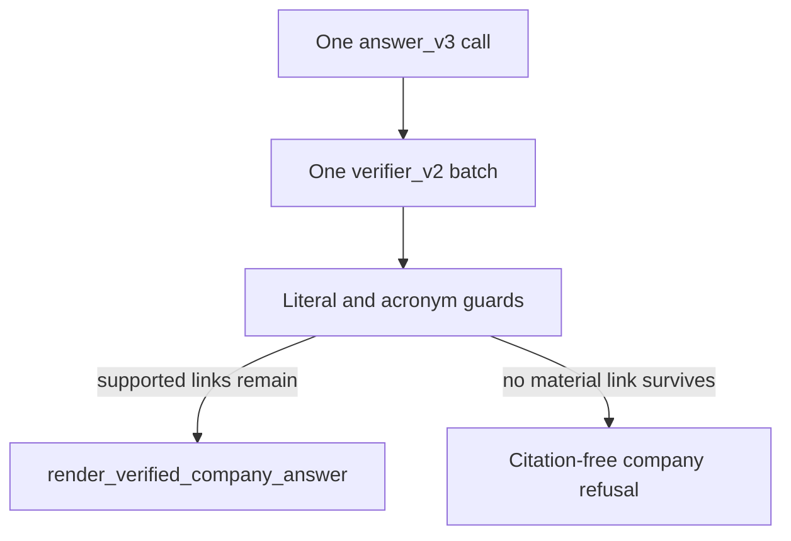

# P06-51 — Grounded claim release (2026-09-16)

Parent index:
[phase-06-agent-intelligence-evidence.md](../phase-06-agent-intelligence-evidence.md).

Requirement IDs: `P06-51`.

## Plan requirement

Quote: version answer/verifier prompts, release only supported atomic
claims, and remove all-fusion citation backfill with MCP regressions.

Positive checks: source-spelled `Model Context Protocol` passes; a
wrong `Method Call Protocol` expansion is rejected even when a mock
verifier marks the cited ID supported; free prose that invents the
expansion cannot stay `verified`; released prose is surviving claims
plus a complete-chain conclusion; one supported link produces one
citation with `atomic_link_id`; v3/v2 hashes match file SHA-256;
general answers stay citation-free.

Negative checks: do not edit `answer_v2.md`; do not copy free-form
`answer_text`; do not backfill every fusion passage.

## Release flow

## Prompt pins

- Current answer: `answer_v3`
  `a72174c1c468ab0721f064aa4d53c0e11813d8cd8d072c4e5cbd593190edc7bc`
- Current verifier: `verifier_v2`
  `591367012fdfcb9f4e5020058dbe1acf9fe87a59a93db1dcba2718af4cba9192`
- Historical `answer_v2` and `verifier_v1` remain registered and
  unchanged.

## Files

- [answer_v3.md](../../../apps/agents/src/smart_rag_agents/prompts/answer_v3.md)
- [verifier_v2.md](../../../apps/agents/src/smart_rag_agents/prompts/verifier_v2.md)
- [release.py](../../../packages/core/src/smart_rag_core/query_answer/release.py)
- [verify.py](../../../apps/agents/src/smart_rag_agents/query/nodes/verify.py)
- [citations.py](../../../packages/core/src/smart_rag_core/query_answer/citations.py)
- [versions.py](../../../packages/core/src/smart_rag_core/query_answer/versions.py)
- [CHANGELOG.md](../../../apps/agents/src/smart_rag_agents/prompts/CHANGELOG.md)
- [ANSWER_VERIFICATION.md](../../agent/ANSWER_VERIFICATION.md)

## Verification

| Command | Exit |
| --- | ---: |
| `uv run python -m pytest` P06-51 suites `-q` | 0 (one Postgres skip) |
| `uv run ruff check` on P06-51 Python | 0 |
| `uv run pyright` on `query_answer`, gateways, and query | 0 |
| `git diff --check` | 0 |

## Proven

- `ensure_fusion_source_citations` is absent from `citations.py` and
  `verify.py`. Empty answers persist no fusion backfill.
- Wrong MCP expansions cannot remain in released company prose.
- One-call and six-link caps are unchanged.
- Company insufficient evidence still never falls back to world
  knowledge or Web.

## Follow-up (2026-09-16 bind/span)

Live MCP after `answer_v3` still refused with `verifier_call_count=0`
because omitted `atomic_links`, omitted paragraphs, paraphrased spans,
and blank-line span collapse emptied the paragraph contract before the
verifier. `bind_company_atomic_links` now synthesizes missing
paragraphs from links (and the inverse), fills `atomic_link_id`, and
replaces missing or non-substring spans with the first non-empty
paragraph of authorized `citation_text`. The live `gateway_answer`
path binds before the generate checkpoint so compacted fusion hashes
cannot drop those spans. Direct `deterministic_check_answer` still
records `citation_span_mismatch` when that bind step is skipped. Wrong
`Method Call Protocol` and `Multi-Channel Protocol` expansions remain
refused.

## Binder repairs (2026-09-22)

`bind_company_atomic_links` repairs three bookkeeping slips before
`apply_paragraph_contract`. None of them widen evidence: a chunk is
added to a link only when a citation already cites it with a span the
contract checks verbatim.

- A parent citation whose span sits inside exactly one shorter evidence
  chunk that is itself contained in the parent text is retargeted to
  that leaf. Zero or several matching leaves keep the parent id.
- A citation whose `atomic_link_id` is missing or not in its paragraph's
  `link_ids` takes that paragraph's first link id.
- Each atomic link's `chunk_ids` is extended with the chunks its
  citations cite, capped at 12.

`paragraph_unmapped` and `citation_link_mismatch` stay fail-closed when
the span is not in an authorized passage. Tests:
`test_binder_retargets_parent_citation_to_unique_leaf`,
`test_binder_repairs_link_id_and_link_chunks`, and
`test_binder_does_not_retarget_when_two_leaves_match`.

## Unverified

- Live hosted Q3 against OpenAI. Packet 57 re-runs live qualification.
- Graceful SSE terminals are P06-52.

## Handoff

Next coding packet is
[P06-52](../../../.cursor/plans/hybrid-graph-rag/06-phase-agent-intelligence/packets/52-graceful-terminals.md).
Map insufficient evidence, refusal, and deadline to one truthful
partial outcome. Do not start transcript SQL in that packet.
