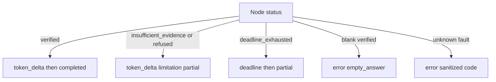

# P06-52 — Graceful terminals (2026-09-16)

Parent index:
[phase-06-agent-intelligence-evidence.md](../phase-06-agent-intelligence-evidence.md).

Requirement IDs: `P06-52`.

## Plan requirement

Quote: map insufficient evidence/refusal/deadline to one truthful
partial outcome and unify visible/accessibility copy.

Positive checks: verified complete is tokens then one `completed`;
verified partial is tokens then one `partial` without a deadline
diagnostic; insufficient evidence/refused is a non-empty refusal
token, limitation `insufficient_evidence`, and one `partial`;
retrieve-time deadline remains `deadline` then `partial`; blank
verified payload is `error` `empty_answer`; a second verify chunk is
a no-op; visible and assertive copy match and are not generic.

Negative checks: mapping company refusal to SSE `error` fails; two
terminals for one run fails; “Something went wrong” for insufficient
evidence fails.

## Terminals

## Files

- [verified.py](../../../apps/backend/src/smart_rag_api/services/sse/mapping/verified.py)
- [mapper.py](../../../apps/backend/src/smart_rag_api/services/sse/mapping/mapper.py)
- [contracts.py](../../../apps/backend/src/smart_rag_api/services/sse/mapping/contracts.py)
- [failure-copy.ts](../../../apps/frontend/src/lib/failure-copy.ts)
- [limitations.ts](../../../apps/frontend/src/lib/limitations.ts)
- [chat-banners.tsx](../../../apps/frontend/src/components/chat/chat-banners.tsx)
- [run-progress-timeline.tsx](../../../apps/frontend/src/components/chat/run-progress-timeline.tsx)
- [SSE.md](../../api/SSE.md)

## Verification

| Command | Exit |
| --- | ---: |
| `uv run python -m pytest` P06-52 SSE suites `-q` | 0 (41 passed, 1 skip) |
| `uv run python -m pytest tests/unit/test_query_sse_mapping.py -q` | 0 (22 passed) |
| `uv run ruff check` on SSE mapping | 0 |
| `uv run pyright` on SSE mapping | 0 |
| `pnpm --filter smart-rag-frontend exec vitest run` listed copy tests | 0 (52 passed) |
| `git diff --check` | 0 |

## Proven

- Generate-time and fusion `insufficient_evidence` emit a non-empty
  refusal token, limitation `insufficient_evidence`, and one `partial`.
- `empty_answer` remains only for a blank supposedly releasable
  verified payload.
- Ordinary `verified_partial` is not labeled a deadline. Answer-stage
  reserve exhaustion still emits `deadline` then `partial`.
- Visible, progress, and assertive copy share
  “Company sources could not support an answer. Narrow the question
  and try again.” “Something went wrong” stays on unknown/server
  faults.

## Unverified

- Live hosted Ask run against company PDFs. Packet 57 re-runs
  qualification.

## Deviations

- Generate-time expected refusals skip `verify_answer`. The mapper
  emits a synthetic `verify_answer` completed status so Ask can
  accept the refusal `token_delta` without changing the client
  hold/release gate.

## Handoff

Next coding packet is
[P06-53](../../../.cursor/plans/hybrid-graph-rag/06-phase-agent-intelligence/packets/53-run-linked-transcript.md).
Add additive transcript-v3 run metadata and ACL-safe citation-detail
contracts. Do not start frontend reload work in that packet.
