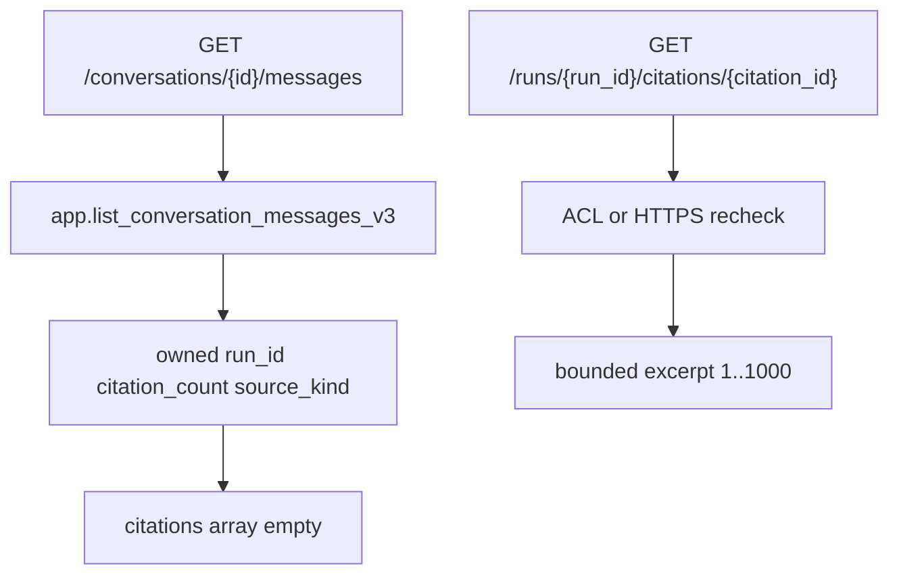

# P06-53 — Run-linked transcript citations (2026-09-16)

Parent index:
[phase-06-agent-intelligence-evidence.md](../phase-06-agent-intelligence-evidence.md).

Requirement IDs: `P06-53`.

## Plan requirement

Quote: add additive transcript-v3 run metadata and ACL-safe bounded
citation-detail contracts.

Positive checks: owned assistant rows expose matching `run_id` and
`citation_count`; v1 and v2 remain callable; mixed company+Web
`source_kind` is null; citation detail is 1–1000 characters and
HTTPS-only for Web; OpenAPI stays additive.

Negative checks: replacing v2 in place fails; transcript listings that
return excerpts fail; choosing one `source_kind` when both kinds exist
fails.

## Transcript contract

## Files

- [20260916100000_conversation_transcript_run_links_v3.sql](../../../supabase/migrations/20260916100000_conversation_transcript_run_links_v3.sql)
- [conversation_transcript.py](../../../apps/backend/src/smart_rag_api/services/conversation_transcript.py)
- [query_runs.py](../../../apps/backend/src/smart_rag_api/services/query_runs.py)
- [fastapi_security.py](../../../apps/backend/src/smart_rag_api/schemas/fastapi_security.py)
- [records.py](../../../packages/core/src/smart_rag_core/query_admission/repository/records.py)
- [FASTAPI_SECURITY.md](../../api/FASTAPI_SECURITY.md)
- [openapi.foundation.json](../../api/openapi.foundation.json)

## Hosted apply (no secrets, no private rows)

Project `smart-rag` / `qsjivtwtmlmtksufqjik` confirmed before apply.
Remote history already included `list_conversation_messages`,
`list_conversation_messages_v2`, and `list_run_citations_v4`. Canonical
SQL remains one repo file. Hosted history records sliced MCP names
because a single payload is easier to review.

| Slice | Result |
| --- | --- |
| `conversation_transcript_messages_v3` | success |
| `get_run_citation_detail_v1` | success |

Privileges proven on project `qsjivtwtmlmtksufqjik` via catalog queries:

| Check | Result |
| --- | --- |
| v1, v2, and v3 `list_conversation_messages*` present | true |
| `app.get_run_citation_detail_v1` present | true |
| `app_api` EXECUTE on v1, v2, v3, and detail | true |
| `anon` / `authenticated` / `app_worker` EXECUTE | false |

Bodies of v1/v2 were not replaced. No DSN was pasted. No apply to
staging/production besides this development project.

## Verification

| Command | Exit |
| --- | ---: |
| `uv run python scripts/ci/check_migrations.py` | 0 (87 files) |
| `uv run python scripts/ci/check_openapi.py` | 0 (second run) |
| `uv run python -m pytest` listed contract/unit suites `-q` | 0 (19 passed, 16 skipped: no local `SUPABASE_DB_URL`) |
| `uv run ruff check` on P06-53 Python | 0 |
| `uv run pyright` on FastAPI + query_admission | 0 |
| `git diff --check` | 0 |

## Proven

- Transcript HTTP schema exposes `run_id`, `citation_count` 0..50, and
  `source_kind`. List `citations` stays `[]`.
- `GET /runs/{run_id}/citations/{citation_id}` is registered and additive.
- Hosted v1 and v2 remain granted beside v3.
- Restricted-read audit on company detail uses `purpose=preview`.
- Web detail omits excerpt and URL unless the locator is fragment-free
  HTTPS.

## Unverified

- Live Postgres contract tests skipped locally; hosted catalog proves
  RPC presence and grants, not row-level transcript fixtures.
- Frontend Sources restore remains Packet 54.

## Rollback

Stop calling `list_conversation_messages_v3` and
`get_run_citation_detail_v1` in application code. Do not down-migrate
the expand-only functions.
