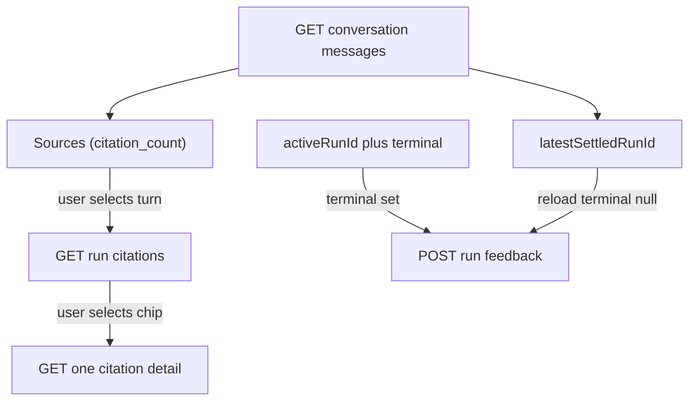

# P06-54 — Restore frontend citations, feedback, and delete safety (2026-09-16)

Parent index:
[phase-06-agent-intelligence-evidence.md](../phase-06-agent-intelligence-evidence.md).

Requirement IDs: `P06-54`.

## Plan requirement

Quote: restore per-turn citations and feedback after reload and add
accessible conversation deletion confirmation.

Positive checks: historical run IDs do not alter active run pointers;
details fetch only on selection; each historical assistant shows its
own count and opens its own run; hostile titles/excerpts remain text;
remount restores Company and Web Sources; switching conversations does
not retain old citations; historical feedback targets the correct run
once; delete dialog appears before DELETE; Cancel sends zero requests;
Confirm sends one; focus returns to Cancel first.

Negative checks: fetching citation detail for every transcript row
fails; binding feedback to a live reconnect pointer after reload
fails; Confirm sending two DELETEs fails.

## Restore identities

## Files

- [chat-restore.ts](../../../apps/frontend/src/lib/chat-restore.ts)
- [use-chat-queries.ts](../../../apps/frontend/src/components/chat/hooks/use-chat-queries.ts)
- [use-chat-restore.ts](../../../apps/frontend/src/components/chat/hooks/use-chat-restore.ts)
- [use-conversation-actions.tsx](../../../apps/frontend/src/components/chat/hooks/use-conversation-actions.tsx)
- [chat-app.tsx](../../../apps/frontend/src/components/chat/chat-app.tsx)
- [answer-surface.tsx](../../../apps/frontend/src/components/chat/answer-surface.tsx)
- [CORE_RAG_SURFACES.md](../../frontend/CORE_RAG_SURFACES.md)

## Commands

| Command | Exit |
| --- | ---: |
| `pnpm --filter smart-rag-frontend exec vitest run src/components/chat/hooks/use-chat-queries.test.tsx src/components/chat/answer-surface.test.tsx src/components/chat-app.test.tsx src/components/chat/hooks/use-conversation-actions.test.tsx src/lib/api.test.ts src/lib/chat-restore.test.ts src/lib/chat-history.test.ts src/lib/architecture-budget.test.ts` | 0 (172 passed) |
| `pnpm --filter smart-rag-frontend exec eslint .` | 0 |
| `pnpm --filter smart-rag-frontend run typecheck` | 0 |
| `pnpm --filter smart-rag-frontend build` | 0 |
| `pnpm --filter smart-rag-frontend exec playwright test tests/e2e/core-rag-surfaces.spec.ts` | 0 (3 passed, 3 skipped without live JWT/FastAPI) |
| `git diff --check` | 0 |
| `uv run python .cursor/plans/hybrid-graph-rag/scripts/verify_plan_integrity.py --update` | 0 (213 canonical files) |
| `uv run python .cursor/plans/hybrid-graph-rag/scripts/verify_plan_integrity.py` | 0 (213 canonical files) |

## Proven

ChatApp stays at 311/320 physical lines by extracting restore/feedback
and the delete dialog. Transcript parsers keep `citations: []`. Sources
open one list then one detail. Feedback ignores a reconnect pointer
while `terminal` is null. ConfirmDialog title is `Delete conversation?`
with Cancel focused.

## Unverified

Authenticated Playwright journeys skipped without `E2E_LIVE_EMAIL` /
`E2E_LIVE_PASSWORD` and a reachable local FastAPI. Unauthenticated
redirect/404 specs passed.

## Deviations

None. Packet 55 Postgres work was not started.
