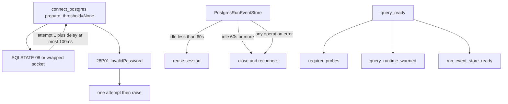

# P06-55 — Postgres reconnect, idle SSE retirement, and query readiness (2026-09-16)

Parent index:
[phase-06-agent-intelligence-evidence.md](../phase-06-agent-intelligence-evidence.md).

Requirement IDs: `P06-55`.

## Plan requirement

Quote: add bounded transient reconnect behavior, stale SSE connection
retirement, and honest query-runtime readiness.

Positive checks: active reuse within 60 seconds; 61-second idle
replacement; stale connection discarded; no ambiguous write replay;
transient fail-then-success uses two attempts; permanent auth failure
uses one; warmup and event-store recovery restore `query_ready`; public
readiness stays sanitized; `/health/live` stays process liveness.

Negative checks: retrying `InvalidPassword` fails; replaying a terminal
append after transport failure fails; putting exception text on
`GET /health/ready` fails.

## Reconnect and readiness

## Implementation

`connect_postgres` keeps `prepare_threshold=None` and adds keyword-only
`max_attempts=2`, `retry_budget_seconds=1.0`, injectable clock, and
injectable sleep. Structured logs include only `operation`, `attempt`,
and `reason=transient_connect`.

`PostgresRunEventStore` opens through `connect_postgres`, reuses idle
sessions for less than 60 seconds, discards on error after a best-effort
rollback, retries read-only `list_after` once before any row, and never
replays append.

`query_ready` requires required dependencies plus
`query_runtime_warmed` and `run_event_store_ready`. Lifespan sets the
warmup flag only after a successful Hybrid/checkpointer/graph warmup.
Public `/health/ready` still returns `{status, query_ready, detail}`
with coarse `ok` / `not_query_ready`.

## Commands

| Command | Result |
| --- | --- |
| `uv run python -m pytest tests/unit/test_postgres_dsn.py tests/unit/test_query_sse_event_store.py tests/unit/test_readiness.py tests/contract/test_sse_resume.py -q` | 39 passed, 1 skipped |
| `uv run ruff check packages/core/src/smart_rag_core/settings/postgres_connect.py packages/core/src/smart_rag_core/sse/store.py apps/backend/src/smart_rag_api/services/readiness.py tests/unit/test_postgres_dsn.py tests/unit/test_query_sse_event_store.py tests/unit/test_readiness.py` | 0 |
| `uv run pyright packages/core/src/smart_rag_core/settings/postgres_connect.py packages/core/src/smart_rag_core/sse/store.py apps/backend/src/smart_rag_api/services/readiness.py` | 0 |
| `git diff --check` | 0 |
| `uv run python .cursor/plans/hybrid-graph-rag/scripts/verify_plan_integrity.py --update` | 0 (213 canonical files) |
| `uv run python .cursor/plans/hybrid-graph-rag/scripts/verify_plan_integrity.py` | 0 (213 canonical files) |

## Proven

Idle reuse, 61-second replacement, discard-without-append-replay, two
attempt transient connect, one-attempt `28P01`, warmup/store clearing
and restoring `query_ready`, and sanitized public ready are unit-proven.
Resume contract collection ran; hosted live resume skipped without a
local `SUPABASE_DB_URL`.

## Unverified

Hosted SSE resume against the cloud project. Worker/Compose Exa
lifecycle remains Packet 56.

## Deviations

None.
