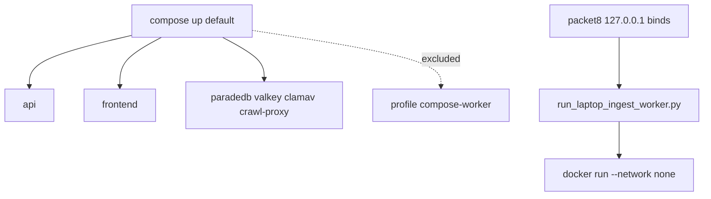

# P06-56 — Host-worker parser topology and Exa lifecycle (2026-09-16)

Parent index:
[phase-06-agent-intelligence-evidence.md](../phase-06-agent-intelligence-evidence.md).

Requirement IDs: `P06-56`.

## Plan requirement

Quote: use the approved local host-worker parser topology and prove
sequential Exa runs without cross-loop cleanup errors.

Positive checks: default stack excludes the incompatible worker; raw
socket absent; parser has no egress; host overlay binds loopback only;
scripts use `run_laptop_ingest_worker.py`; unrelated PIDs are not
killed; two sequential Web runs succeed; a closed gateway is replaced;
create/request/close share one event-loop identity; zero unhandled task
exceptions.

Negative checks: mounting `/var/run/docker.sock` fails; killing an
unrelated reused PID fails; reusing a closed Exa client across loops
fails.

## Topology

## Implementation

Compose `worker` uses profile `compose-worker`. `parser-sandbox` uses
`network_mode: none`. Packet8 publishes `127.0.0.1:54329`,
`127.0.0.1:13310`, and `127.0.0.1:18080`. `dev.ps1` builds the parser
image, starts sidecars plus packet8, and records gitignored PID/start
time. `stop.ps1` kills that PID only on a launcher match.
`verify-local.ps1` never `compose exec worker`.

`ExaSearchGateway` opens a fresh `httpx.AsyncClient` per attempt.
`closed` is read-only after `aclose`. `refresh_web_search_deps`
recreates missing, wrong-type, closed, or key-changed gateways.

## Commands

| Command | Result |
| --- | --- |
| `uv run python -m pytest tests/unit/test_exa_search_gateway.py tests/unit/test_web_research_graph.py tests/unit/test_query_graph_deps.py tests/unit/test_worker_lease_heartbeat.py tests/unit/test_parser_sandbox.py tests/contract/test_parser_sandbox.py tests/contract/test_compose_topology.py -q` | 94 passed |
| `uv run ruff check packages/core/src/smart_rag_core/gateways/exa_search.py apps/agents/src/smart_rag_agents/query apps/worker/src scripts/ops/run_laptop_ingest_worker.py tests/unit/test_exa_search_gateway.py tests/unit/test_web_research_graph.py tests/unit/test_query_graph_deps.py` | 0 |
| `uv run pyright packages/core/src/smart_rag_core/gateways/exa_search.py apps/agents/src/smart_rag_agents/query apps/worker/src scripts/ops/run_laptop_ingest_worker.py` | 0 |
| `docker compose --env-file .env.example config --quiet` | 0; services omit worker |
| `git diff --check` | 0 |
| `uv run python .cursor/plans/hybrid-graph-rag/scripts/verify_plan_integrity.py --update` | 0 (213 canonical files) |
| `uv run python .cursor/plans/hybrid-graph-rag/scripts/verify_plan_integrity.py` | 0 (213 canonical files) |

## Proven

Default Compose config lists `valkey-limits`, `crawl-proxy`, `paradedb`,
`valkey-cache`, `api`, `clamav`, and `frontend` only. Overlay config is
quiet. Sequential Exa searches, closed-gateway refresh, loop-identity
close, and unrelated-PID mismatch are unit-proven.

## Unverified

Live `dev.ps1` start/stop of the workstation stack was not executed in
this packet so an already-running Docker session would not be restarted.

## Deviations

None for socket, parser isolation, or Exa lifecycle. Live start/stop
remains operator-run with the updated scripts.
