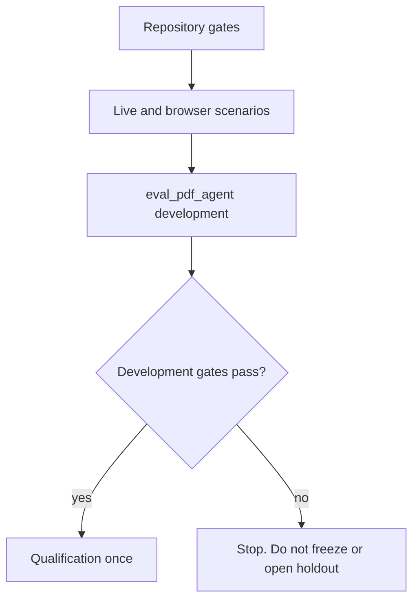

# P06-57 — Integrated qualification (2026-09-16)

Parent index:
[phase-06-agent-intelligence-evidence.md](../phase-06-agent-intelligence-evidence.md).

Requirement IDs: `P06-57`. Leftover `P06-17` was executed as written
and remains **pending**. `P06-18` was not opened.

## Plan requirement

Quote: run full deterministic/live/browser gates and existing P06-17
development/qualification without opening holdout.

Positive checks: fast/Compose/OpenAPI/migrations/integrity/pre-commit;
MCP acronym with a citation containing `Model Context Protocol`;
four-approach comparison with non-zero completion tokens; unsupported
company refusal with no Web/general fallback; Company and Web citations
plus feedback after reload; sequential Web without event-loop cleanup
errors; cancel terminal; delete Cancel/Confirm; idle SSE after 60s;
synthetic PDF Hybrid Ready via the host worker; `holdout_opened=false`.

Negative checks: opening holdout; weakening thresholds; a live-only
fixture that hides a failed owning packet.

## Gate flow



## Repository gates

HEAD at evidence write: `4db6496`. Branch
`fix/rag-reliability-and-citations`. `git status --short` showed no
private label/ID paths.

| Command | Exit |
| --- | ---: |
| `uv run python scripts/check.py --tier fast` | 0 |
| `docker compose --env-file .env.example config --quiet` | 0 |
| `uv run python scripts/ci/check_openapi.py` | 0 |
| `uv run python scripts/ci/check_migrations.py` | 0 |
| `uv run python .cursor/plans/hybrid-graph-rag/scripts/verify_plan_integrity.py` | 0 (213 canonical files) |
| `uv run pre-commit run --all-files` | 0 |

Fast-tier notes: Pyright ratchet 0; 1485 unit passed / 4 skipped; 294
contract passed / 248 skipped; frontend 631 Vitest passed; Playwright
25 passed / 17 skipped. Default Compose services omit a running
`worker`. Parser sandbox remains `network_mode: none`.

A types-tier repair landed first as
`4db6496 fix(rag): keep optional citation spans string-safe in verifier tests`
(P06-51 owning packet).

## Live and browser scenarios

Sanitized identifiers only. No passwords, DSNs, or unrestricted PDF
text.

| Scenario | Result |
| --- | --- |
| MCP acronym | Run `8c019076-8494-465e-99da-78193e948359`. STATUS Partial. Sources (1). Citation detail contains `Model Context Protocol`. Never Method/Modular/Multi-Channel Protocol. |
| Four-approach comparison | Run `4df23412-b115-4738-85df-0ab564749173`. Completed / Verified and ready. Composite. 3617 prompt / 1323 completion. Sources (4). Covers democratic, manager, hierarchical, and actor-critic. No `gateway_failed` / `empty_answer`. |
| Unsupported company | Run `59e39af1-a14c-4791-98ac-c03817b8a2ea`. STATUS Partial. Company documents / Composite. Sources (0). Visible insufficient-evidence copy. No Web/general fallback. |
| Company reload | After `/` reload and conversation switch, Sources (4) and Give feedback remained bound to the settled Comparison run. |
| Web reload | After `/` reload, Exa conversation restored transcript Sources (5) and Sources (6) plus Give feedback. |
| Sequential Web | Runs `5e7a5f48-8e73-4d9d-8aaf-db742f288f12` then `3eb96a49-ea8d-4ce8-a3fc-bf29a701a076`. Both Completed Web research. Request logs for those two runs had no Event-loop-closed errors. |
| Cancel | Run `a73e7198-2c4f-45c4-8ec8-bceba43712e8`. STATUS Cancelled. Stop gone. Send restored. |
| Delete | Dialog title `Delete conversation?`. Cancel preserved the Atlantis conversation. Confirm showed `Conversation deleted. Reads, resume, and citations are denied.` |
| Idle SSE >60s | Waited 65s, then general `What is 2 plus 2?` run `bab5127e-501f-4789-920e-d3cf4e9657fd` Completed with 267 prompt / 17 completion and no 500. |
| Synthetic PDF Hybrid Ready | Host worker `scripts/ops/run_laptop_ingest_worker.py`. Document title `P06-57 synthetic hybrid fixture` reached Search ready / Graph ineligible. Default Compose `worker` stayed stopped. Parser image `smart-rag-parser-sandbox:local` with `network_mode: none`. |

## Leftover P06-17

Command:

```powershell
uv run python scripts/eval_pdf_agent.py --live --split development
```

Exit 2. Stdout tokens only:

- `blocked=frozen_profile_and_human_seal_required`
- `human_sealed=true`
- `long_document_runtime=denied`
- `judge_prompt=eval_pdf_judge_v1`
- `eval_judge_v1_reused=false`
- `holdout_opened=false`
- `content_class=real_company`

`FROZEN_LONG_DOCUMENT_PROFILE_SHA256` stays empty. This overlay did not
freeze `hybrid_long_document_v1`, did not rewrite rejected candidate
digests, and did not run qualification under a denied runtime. Prompt
pins already on the branch remain `answer_v3`
`a72174c1c468ab0721f064aa4d53c0e11813d8cd8d072c4e5cbd593190edc7bc` and
`verifier_v2`
`591367012fdfcb9f4e5020058dbe1acf9fe87a59a93db1dcba2718af4cba9192`.
PDF judge pin stays `eval_pdf_judge_v1`
`d4dffe01c4b29b2feef68a3ce0ad44458d88aea9cb490aebbe37e8e7c775a5b5`.

P06-17 and P06-18 wrapper checkboxes stay unchecked. Phase 6 stays
pending.

## Deviations

None for overlay live/browser/repo gates. Leftover P06-17 hit its
documented stop route instead of a metrics pass. Repair remains a new
long-document candidate under P06-17, not a live-only fixture here.
