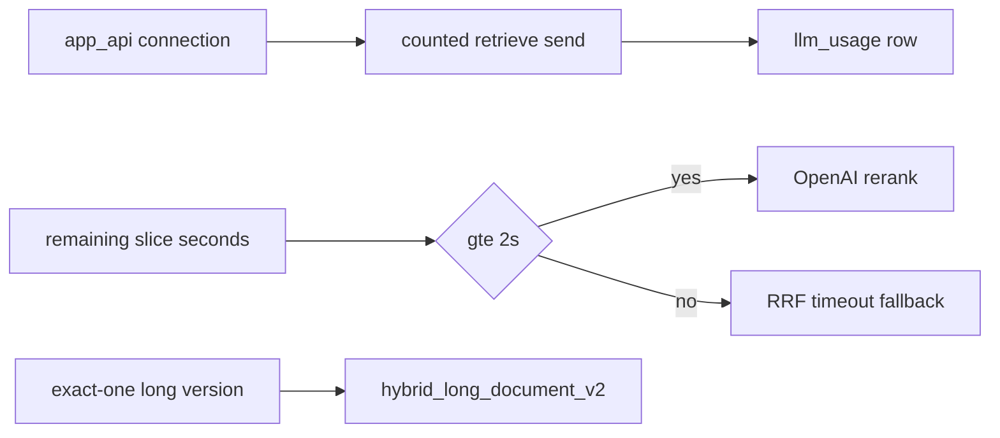

# P06-62 — Retrieve accounting and long-document profile (2026-09-17)

Parent index:
[phase-06-agent-intelligence-evidence.md](../phase-06-agent-intelligence-evidence.md).

Requirement ID: `P06-62`.

## Plan requirement

Quote: repair retrieve-time durable call accounting and qualify a
measured immutable long-document profile.

Positive checks: embedding and rerank persist to `llm_usage` when a
connection is supplied; missing connection on a bound run fails closed;
rerank starts only with `RERANK_RESERVED_SECONDS` remaining in the
retrieve slice; `hybrid_long_document_v2` has a non-empty SHA-256 that
is not the failed v1 digest; `hybrid_default_v1` bytes are unchanged.

Negative checks: loading unfrozen `hybrid_long_document_v1` fails;
using the answer-stage eight-second reserve for retrieval fails; profile
JSON cannot carry sample-PDF identifier keys.

## Files changed

- `packages/core/src/smart_rag_core/retrieval/hybrid_run/budget.py`
- `packages/core/src/smart_rag_core/retrieval/context.py`
- `packages/core/src/smart_rag_core/retrieval/frozen_profile.py`
- `packages/core/src/smart_rag_core/retrieval/frozen/hybrid_long_document_v2.json`
- `packages/core/src/smart_rag_core/retrieval/profiles.py`
- `packages/core/src/smart_rag_core/retrieval/lightrag_adapter.py`
- `apps/agents/src/smart_rag_agents/query/nodes/shared.py`
- `tests/unit/test_retrieve_budget_accounting.py`
- `tests/unit/test_long_document_profile.py`
- [PDF_HYBRID_EVALUATION.md](../../evaluation/PDF_HYBRID_EVALUATION.md)
- [QUERY_BUDGETS.md](../../agent/QUERY_BUDGETS.md)
- [HYBRID_RETRIEVAL_CONTRACT.md](../../retrieval/HYBRID_RETRIEVAL_CONTRACT.md)
- [ADR-hybrid-long-document-profile.md](../../adr/ADR-hybrid-long-document-profile.md)

## Verification

| Command | Exit |
| --- | --- |
| `uv run python -m pytest tests/unit/test_retrieve_budget_accounting.py tests/unit/test_long_document_profile.py -q` | 0 |
| `uv run python scripts/check.py --tier docs` | 0 |
| `git diff --check` | 0 (CRLF warnings only) |

## Proven

- Bound retrieve with reservation ids and no connection raises
  `retrieve_accounting_connection_missing`.
- Bound retrieve with a connection calls `execute_counted_model_call`.
- Remaining retrieve-slice seconds below 2.0 skip OpenAI rerank with
  `rerank_timeout`.
- `hybrid_long_document_v2` digest
  `9565a14152c9c530ad5a07ba221f9d944a872c6b6f417e71ef30cab0486c95b1`
  is runtime-allow-listed for exact-one long documents.
- Failed v1 digest
  `d9e154747a88a94c0c75e87935a1f977e1c1802e2e80f9e12825bd24e1d15d22`
  stays denied.

## Unverified

- Live `llm_usage` rows on a hosted Ask run after this pin.
- Live Recall@10 / grounded-fact correctness of v2 (Packet 64).

## Rollback

Clear `FROZEN_LONG_DOCUMENT_PROFILE_SHA256`, restore the previous
`counted_retrieve_send` skip-when-unconnected path, and remove the
2s rerank gate. `hybrid_default_v1` does not need rollback.

## Handoff to P06-63

Remove source-selector false refusals and make the one correction
materially different and revalidated.
