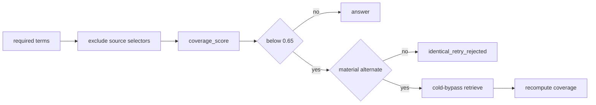

# P06-63 — Coverage and correction semantics (2026-09-17)

Parent index:
[phase-06-agent-intelligence-evidence.md](../phase-06-agent-intelligence-evidence.md).

Requirement ID: `P06-63`.

## Plan requirement

Quote: exclude source-selector false refusals and require a measured,
revalidated correction.

Positive checks: coverage ignores source-selector tokens; term matching
uses `arabic_norm_v1`; an identical cached retry is rejected; a permitted
retry uses a different query and recomputes coverage; the refuse
threshold stays `0.65`.

Negative checks: treating a document title as a required answer fact
fails; applying correction twice fails; retrying the exact cached ranking
query fails; lowering the threshold without labeled evidence fails;
company insufficient evidence never falls back to Web or general
knowledge.

## Files changed

- `packages/core/src/smart_rag_core/retrieval/coverage_score.py`
- `packages/core/src/smart_rag_core/retrieval/hybrid_run/retriever.py`
- `packages/core/src/smart_rag_core/query_routing/correction.py`
- `packages/core/src/smart_rag_core/query_routing/models/plan.py`
- `packages/core/src/smart_rag_core/query_routing/models/results.py`
- `packages/core/src/smart_rag_core/query_routing/branch_channels/hybrid.py`
- `apps/agents/src/smart_rag_agents/query/nodes/correction.py`
- `apps/agents/src/smart_rag_agents/query/runtime/adapters_hybrid.py`
- `tests/unit/test_coverage_score.py`
- `tests/unit/test_query_correction.py`
- [COVERAGE_CALIBRATION.md](../../evaluation/COVERAGE_CALIBRATION.md)
- [QUERY_ROUTING.md](../../agent/QUERY_ROUTING.md)

## Verification

| Command | Exit |
| --- | --- |
| `uv run python -m pytest tests/unit/test_coverage_score.py tests/unit/test_query_correction.py -q` | 0 |
| `uv run python scripts/check.py --tier docs` | 0 |
| `git diff --check` | 0 (CRLF warnings only) |

## Proven

- Selector titles are dropped from required-term coverage.
- Coverage keys use retrieval normalization.
- Same-route retry requires a ranking-different query and cache bypass.
- Post-retry coverage below `0.65` is `insufficient_evidence`.
- Threshold override `0.40` still raises `holdout_driven_threshold_change`.

## Unverified

- Live 100-question impact of selector exclusion and retry (Packet 64).

## Rollback

Restore required-term casefold matching, same-query retry, and the
previous correction node terminal. `hybrid_default_v1` is unchanged.

## Handoff to P06-64

Qualify disjoint documents and query classes, rerun the 100-question
regression, and publish redacted evidence.
