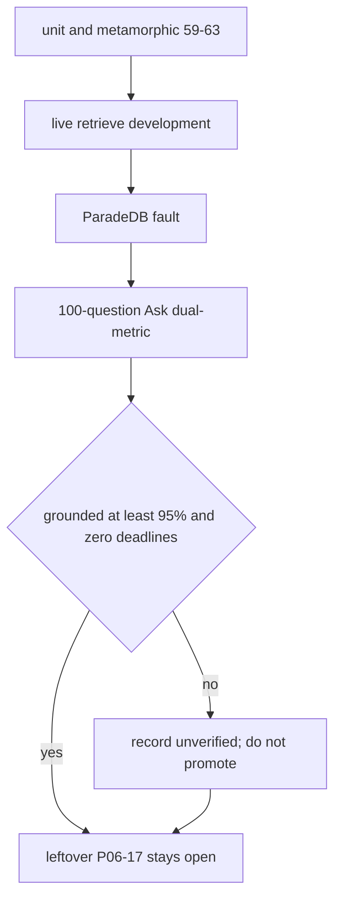

# P06-64 — Live qualification and redacted evidence (2026-09-17)

Parent index:
[phase-06-agent-intelligence-evidence.md](../phase-06-agent-intelligence-evidence.md).

Requirement ID: `P06-64`. Leftover `P06-17` remains **pending**. `P06-18`
was not opened. `holdout_opened=false`.

## Plan requirement

Quote: qualify disjoint retrieval classes, rerun the company-document
regression, and publish redacted evidence.

Positive checks: dual-metric report with strict phrase, grounded fact,
deadline failures, and stage buckets; ACL leaks zero; BM25 outage
explicit; generalization claimed only with disjoint real documents.

Negative checks: promoting on strict score alone; hardcoding sample-PDF
gold in production; opening holdout; claiming generalization without
disjoint documents.

## Dual-metric Ask (rebuilt API)

| Metric | Value |
| --- | --- |
| Questions | 100 |
| Fresh conversations | 100 |
| Strict pass | 35 |
| Grounded fact pass | 35 |
| Deadline failures | 4 |
| Verifier refusal after fusion | 5 |
| Wrong phrasing | 50 |
| Partial | 3 |
| Error terminals | 3 |
| Sample promoted | false |
| Generalization claimed | false |
| `holdout_opened` | false |

Reasons: `grounded_fact_below_95`, `deadline_failures`,
`generalization_unverified`.

Verifier refusals fell from 33 (historical mislabel) to 5. Wrong phrasing
is the first-failing product miss. Remaining candidate work belongs with
P06-61, deadline residuals with P06-62. This packet does not hide those
gates.

## Live retrieve development

`hybrid_long_document_v2` digest
`9565a14152c9c530ad5a07ba221f9d944a872c6b6f417e71ef30cab0486c95b1`.
Recall@10 `0.0`, ACL leaks `0`, gold absent from all channels, gates
`false`. ParadeDB fault: `bm25_fallback=retrieval_timeout`,
`dense_term_degraded=true`.

Disjoint real documents besides this sample were unavailable.

## Files changed

- `packages/core/src/smart_rag_core/evaluation/accuracy_promotion.py`
- `packages/core/src/smart_rag_core/evaluation/company_ask_regression.py`
- `scripts/run_company_ask.py`
- `scripts/rescore_company_ask.py`
- `scripts/ci/check_migrations.py`
- `docs/deployment/phase-10/packet2-migration-hash.json`
- `tests/unit/test_accuracy_promotion.py`
- `tests/unit/test_sample_gold_not_in_production.py`
- [COMPANY_DOCUMENTS_RAG_100.md](../../evaluation/COMPANY_DOCUMENTS_RAG_100.md)
- [PDF_HYBRID_EVALUATION.md](../../evaluation/PDF_HYBRID_EVALUATION.md)
- [DUAL_METRIC_SCORING.md](../../evaluation/DUAL_METRIC_SCORING.md)

## Verification

| Command | Exit |
| --- | --- |
| Packet 59–63 unit/metamorphic pytest | 0 |
| `uv run python scripts/eval_pdf_hybrid.py --fault paradedb` | 0 |
| `uv run python scripts/eval_pdf_hybrid.py --split development --live` | 0 (`gates_pass=false`) |
| 100-question Ask dual-metric | 0 (not promoted) |
| `uv run python scripts/ci/check_migrations.py` | 0 (88 files) |
| `uv run python scripts/ci/check_pyright_baseline.py` | 0 (0 errors) |
| `uv run python .cursor/plans/hybrid-graph-rag/scripts/verify_plan_integrity.py` | 0 (220 files) |
| `git diff --check` | 0 (CRLF warnings only) |
| `uv run python scripts/check.py --tier docs` | 0 |
| `uv run python scripts/check.py --tier fast` | 0 |

## Proven

- Dual-metric counts, deadline failures, and stage buckets are published.
- ACL leaks on the CLI retrieve split are zero.
- BM25 outage is a named degradation.
- Production modules do not embed the sample ISBN or book title.
- Holdout stays sealed. P06-17/P06-18/Phase 6 stay incomplete.

## Unverified

- Generalization to other real documents.
- Sample grounded-fact ≥95% with zero deadlines.
- Hybrid Recall@10 ≥85% on the sealed development split.

## Rollback

Keep `hybrid_default_v1`. Unpin `hybrid_long_document_v2` only by restoring
the prior allow-list. Delete the live Ask runner and promotion module.

## Handoff

Leftover P06-17 remains open. Wrapper packet 64 stays **unchecked**
because grounded fact is 35% and four deadline failures remain. Dominant
remaining miss is wrong phrasing (P06-61). Git delivery of this branch
follows this evidence file. Do not treat 35% as a launch gate.
