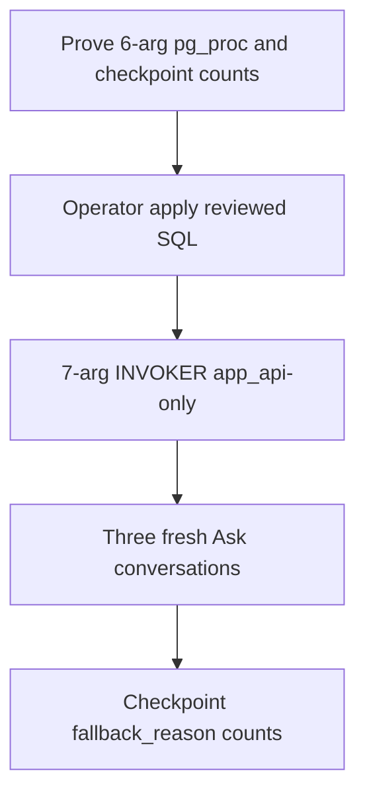

# P06-66 — Deploy the reviewed seven-argument term RPC (2026-09-21)

Parent index:
[phase-06-agent-intelligence-evidence.md](../phase-06-agent-intelligence-evidence.md).

Requirement ID: `P06-66`. Hosted project `smart-rag`
`qsjivtwtmlmtksufqjik`.

## Plan requirement

Quote: deploy the reviewed seven-argument term RPC and prove live
`term_unavailable` is gone.

Positive checks: Hybrid branch `fallback_reason` in
`{none, bm25_unavailable, retrieval_timeout, timeout}`; smoke
`term_unavailable=0`; seven-argument `SECURITY INVOKER` with fixed
`search_path` and `app_api`-only execute; P06-61 hosted application no
longer unverified.

Negative checks: seven-argument call before deploy is undefined-function;
`SECURITY DEFINER` or dropped ACL/current-version predicates fail; a
smoke that still records `term_unavailable` fails.

## Pre-deploy proof

| Check | Result |
| --- | --- |
| `to_regprocedure` 7-arg | false |
| `to_regprocedure` 6-arg | true |
| `prosecdef` | false |
| Grants | `EXECUTE:app_api` only |
| 7-arg `SELECT` | `42883` undefined-function |
| Company Hybrid branches (7 days) | 257 |
| `term_unavailable` | 0 (share `0.0`) |
| `null` / none | 256 |
| `retrieval_timeout` | 1 |

Historical Ask checkpoints do **not** show `term_unavailable`. Those
runs called the six-argument overload. The live outage for current
`TermRetriever.retrieve` is the missing seven-argument signature.

Reviewed SQL `E'\\x00'` cannot `CREATE FUNCTION` on hosted Postgres 17
(`invalid byte sequence for encoding "UTF8": 0x00`). The NUL filter was
rewritten to `chr(0)` and recorded as a review defect. ACL and
current-version predicates are unchanged.

File SHA-256 after the defect fix:
`1be4e03df7a92a5aa0aa4ebd9e4b905186ff44ce6f4b4dd8a70e21bada7803f3`.
Tree hash in
[packet2-migration-hash.json](../../deployment/phase-10/packet2-migration-hash.json)
is `01aa330dec1aacb794622c77c07b15ef750c5d3ae0101700d01e4a83da7fce71`.

## Hosted signature after apply

| Check | Result |
| --- | --- |
| Signature | `app.retrieve_term_candidates(uuid,text,bigint,text,integer,text,text[])` |
| `pronargs` | 7 |
| `prosecdef` | false |
| `search_path` | `pg_catalog, app, extensions, search` |
| `functiondef_md5` | `ad1db6b68caa0ec1236b9c6d5caa6770` |
| `EXECUTE` `app_api` | true |
| `EXECUTE` `PUBLIC` | false |
| `caller_can_read_document` | true |
| current-version predicate | true |
| `schema_migrations` `20260917120000` | 1 |
| 6-arg call after apply | 0 rows (invalid caller; not undefined) |
| 7-arg call after apply | 0 rows (invalid caller; not undefined) |

Apply path:
`uv run python scripts/ops/apply_term_candidates_extra_terms.py --apply`
with `OPERATOR_SUPABASE_DB_URL` and `SET ROLE postgres`. Credentials were
not printed.

## Smoke A

Three fresh-conversation Ask questions (paraphrase, named entity,
acronym) through `scripts/run_company_ask.py`. Private gold stayed under
`.private-eval/`. Local API `query_ready=true`.

| Run id | Scope | Terminal |
| --- | --- | --- |
| `dce9c8f7-2ce1-4943-a379-3ce8205ce73a` | `company_documents` | partial |
| `6ba76675-19bc-4536-aae0-4714ba314b44` | `company_documents` | partial |
| `7a7d17c7-8af2-440a-9998-c89f55e10e91` | `company_documents` | partial |

Checkpoint Hybrid branches for those conversations: 6.
`term_unavailable=0`. Reasons: `null`/none 5, `retrieval_timeout` 1.
Allowed set only. Local ParadeDB was healthy, so BM25 stayed available
and did not emit `bm25_unavailable`. Term no longer masks a BM25
reason: the one named fallback was `retrieval_timeout`.

Prompt pins `answer_v3` / `verifier_v2`. Profiles `hybrid_default_v1`
`def45b691e64707d07d3c7ea47f45eb1b23b5d2d2546c37a19a514f316c5940c` and
`hybrid_long_document_v2`
`9565a14152c9c530ad5a07ba221f9d944a872c6b6f417e71ef30cab0486c95b1`.
Base code commit `d1376ad`.

## Files changed

- `supabase/migrations/20260917120000_retrieve_term_candidates_extra_terms_v1.sql`
  (`chr(0)` compile fix only)
- `scripts/ops/apply_term_candidates_extra_terms.py`
- `docs/deployment/phase-10/packet2-migration-hash.json`
- `tests/unit/test_term_candidates.py`
- [p06-61-term-bm25-candidate-repair-2026-09-17.md](./p06-61-term-bm25-candidate-repair-2026-09-17.md)

No `terms.py` or `channels.py` edits. No document rename or reindex.

## Verification

| Command | Exit |
| --- | --- |
| `uv run python scripts/ops/apply_term_candidates_extra_terms.py` | 0 (pre-deploy proof) |
| Hosted 7-arg `SELECT` before apply | `42883` |
| `uv run python scripts/ops/apply_term_candidates_extra_terms.py --apply` | 0 |
| `uv run python -m pytest tests/unit/test_term_candidates.py -q` | 0 |
| `uv run python scripts/ci/check_migrations.py` | 0 (88 files) |
| `uv run python scripts/run_company_ask.py` smoke A | 0 (`term_unavailable=0`) |
| `git diff --check` | 0 |

## Proven

- Hosted seven-argument extra-terms RPC is live, invoker, and
  `app_api`-only.
- Smoke Hybrid branches have zero `term_unavailable`.
- P06-61 hosted application is no longer unverified.

## Unverified

- Owner/admin document title rename and one canonical reindex (P06-67).
- ID-only Hybrid diagnostics on `BranchResult` (P06-68).

## Rollback

Drop the seven-argument overload and restore the six-argument function
from `20260814130000_hybrid_retrieval_v1.sql`. Do not delete documents.

## Handoff to P06-67

Add owner/admin `app.update_document_title` and `PATCH /documents/{id}`,
rename exactly one copy, requeue exactly one `hybrid_index`, and prove
`exact_one` scope plus search-term count delta.
