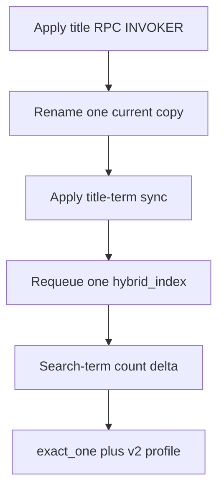

# P06-67 — Owner/admin document title rename and one canonical reindex (2026-09-21)

Parent index:
[phase-06-agent-intelligence-evidence.md](../phase-06-agent-intelligence-evidence.md).

Requirement ID: `P06-67`. Hosted project `smart-rag`
`qsjivtwtmlmtksufqjik`.

## Plan requirement

Quote: add owner/admin `app.update_document_title` and
`PATCH /documents/{id}`, rename exactly one copy, requeue exactly one
`hybrid_index`, and prove `exact_one` scope plus a search-term count
delta.

Positive checks: owner/admin rename; member forbidden; foreign/deleted
indistinguishable not-found; empty/over-long titles rejected; OpenAPI
includes PATCH; hosted `pg_proc` has the RPC; live exact-one current
title match; exactly one hybrid_index queued; no sample-PDF literals in
production files; duplicate copies remain current.

Negative checks: member PATCH 403; foreign and deleted share not-found;
empty/whitespace titles 422; a second-copy reindex or delete fails the
packet; encoding the canonical title in Python/SQL tests fails.

## Hosted signatures

| Function | Args | `prosecdef` | `EXECUTE` | `functiondef_md5` |
| --- | ---: | --- | --- | --- |
| `app.update_document_title` | 5 | false | `app_api` only | `2a39108aed9e6a8414200d526f03baf7` |
| `app.sync_document_title_search_terms` | 2 | true | `app_api` + `app_worker` | `fe02ef41063655d0d49fdb5208fddd12` |

`update_document_title` is `SECURITY INVOKER` with
`search_path=pg_catalog, app`. Column-level `UPDATE (title, updated_at)`
plus RLS let `app_api` write the title. Unauthorized or deleted ids
return NULL. Empty or over-long titles raise `documents:invalid_title`.
Members raise `documents:forbidden`. The RPC now calls
`sync_document_title_search_terms`.

`delete_visible_document` was not changed.

## Live counts

| Check | Before refresh | After refresh |
| --- | ---: | ---: |
| Current documents | 11 | 11 |
| Current rows with the new title | 1 | 1 |
| Current 24-character titles | 4 | 4 |
| Versions for the renamed document | 1 | 1 |
| Version status | `graph_ineligible` | `graph_ineligible` |
| `hybrid_verified_at` present | true | true |
| Search terms on that version | 3871 | 4913 |
| hybrid_index jobs queued | 1 | 1 completed |

Search-term delta is `+1042`. Identifiers live only in gitignored
`.private-eval/canonical-copy.json`.

A first attempt that forced the version to `uploaded` failed
`missing_or_stale_scan`. The version was restored to `graph_ineligible`.
`mark_parsing_for_index` now refreshes title terms for already-indexed
statuses and returns `indexed` without re-parse. Worker log:
`hybrid_index` then `hybrid_index_done`.

## Smoke B (operator-DSN scope probe)

Same three questions as Smoke A. Diagnostics persistence is P06-68, so
this packet calls production `resolve_retrieval_scope` over the operator
DSN with `SET ROLE app_api`.

| Check | Result |
| --- | --- |
| Questions | 3 |
| `exact_one` | 3 |
| Restricted version matches renamed copy | 3 |
| Selector text absent from ranking query | 3 |
| `retrieval_profile_id` | `hybrid_long_document_v2` for all 3 |

## Verification

| Command | Exit |
| --- | --- |
| `uv run python scripts/check.py --tier unit` | 0 (1536 passed, 4 skipped) |
| `uv run pytest tests/contract/test_document_title_rpc.py -q` | 0 (2 skipped: local Supabase unreachable) |
| `uv run python scripts/ci/check_openapi.py` | 0 |
| `uv run python scripts/ci/check_migrations.py` | 0 (90 reviewed files) |
| `uv run ruff check` on packet Python | 0 |
| `git diff --check` | 0 |

## Proven

- Owner/admin `PATCH /documents/{document_id}` and
  `app.update_document_title` exist.
- Exactly one current copy was renamed. Four current copies retain the
  old 24-character title. No copy was deleted. No sixth upload.
- Exactly one `hybrid_index` completed. Search-term count changed.
- Smoke B is `exact_one` on the renamed version with
  `hybrid_long_document_v2`.
- Production Python does not embed the sample title or hash.

## Unverified

- Local contract RPC execution (Supabase unreachable in this run).
- Ask-path checkpoint diagnostics are proven in
  [p06-68-stage-diagnostics-2026-09-21.md](./p06-68-stage-diagnostics-2026-09-21.md).
- 100-question accuracy (P06-72).

## Rollback

Disable `PATCH /documents/{document_id}` and stop calling
`app.update_document_title` in application code. Keep the renamed live
title. Do not down-migrate. Do not delete documents.

## Handoff to P06-68

Persist ID-only `HybridBranchDiagnostics` on `BranchResult`, add the
operator-DSN stage export, and remove hardcoded attribution from
`run_company_ask.py`.
