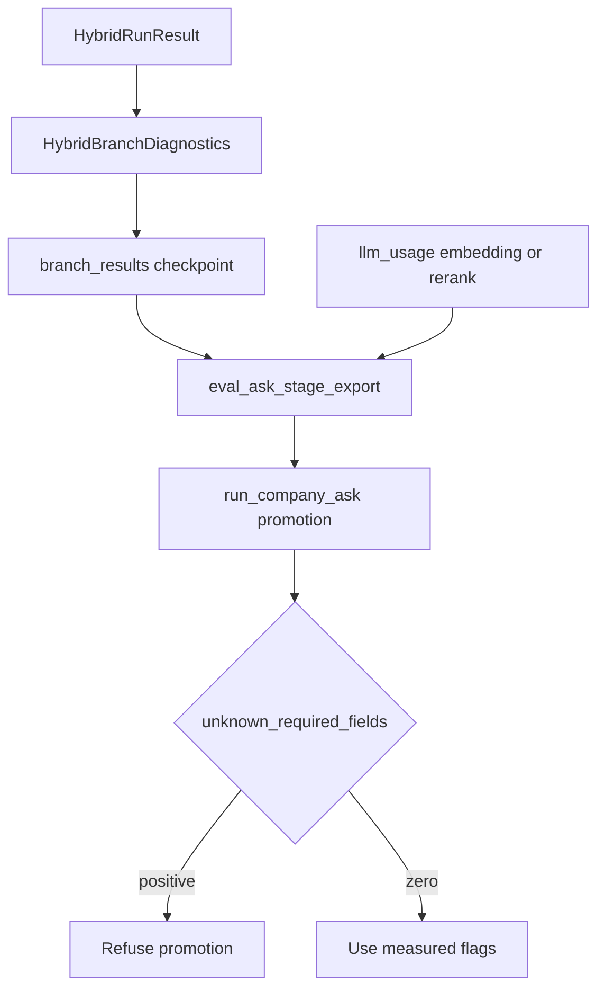

# P06-68 — Persist ID-only Hybrid diagnostics (2026-09-21)

Parent index:
[phase-06-agent-intelligence-evidence.md](../phase-06-agent-intelligence-evidence.md).

Requirement ID: `P06-68`. Quote: persist ID-only
`HybridBranchDiagnostics` on `BranchResult`, export them from
checkpoints, and stop treating missing promotion fields as passes.

Positive checks: diagnostics contain UUIDs and bounded
numeric/enumerated metadata only; a three-question Ask run yields
measured `source_resolution`, channel IDs, `fallback_reason`,
`rerank_fallback`, profile id, and accounting flags with zero
`unknown`; missing required fields block promotion; checkpoints without
diagnostics still validate.

Negative checks: a text field on `HybridBranchDiagnostics` fails;
hardcoded `bm25_degraded_explicit=True` or `rerank_accounting_ok=True`
in the runner fails; `unknown_required_fields > 0` blocks promotion.

## Field list and caps

`HybridBranchDiagnostics` is frozen and `extra=forbid`. Fields:

| Field | Bound |
| --- | --- |
| `source_resolution` | enumerated token |
| `retrieval_profile_id` | frozen profile id |
| `fallback_reason` | named reason or `none` |
| `rerank_fallback` | named reason or `none` |
| `rerank_call_count` | 0 or 1 |
| `embedding_call_count` | 0 or 1 |
| `first_evidence_ms` | milliseconds |
| `dense_ids` | UUID strings, max 100 |
| `bm25_ids` | UUID strings, max 75 |
| `term_ids` | UUID strings, max 30 |
| `fused_ids` | UUID strings, max 100 |
| `selected_ids` | UUID strings, max 12 |
| coverage components | optional 0.0–1.0 |
| `effective_route` | executed branch family |

No query, title, snippet, passage, answer, or citation text is stored.
Unit tests reject an extra text field, over-cap ID lists, and non-UUID
IDs. Serialization of the same row is byte-identical.

Successful retrieve now persists `fallback_reason=none` on diagnostics
even when `BranchResult.fallback_reason` stays empty. Missing
`source_resolution` or profile id omits diagnostics instead of
inventing values.

## Live three-question smoke

Local API rebuilt with this packet, `query_ready=true`. Same three
private gold rows as Smoke A/B. Fresh conversations. Stage export
written under gitignored `.private-eval/`.

| Run id | `source_resolution` | Profile | `fallback_reason` | `rerank_fallback` | Unknown fields |
| --- | --- | --- | --- | --- | ---: |
| `030fadb7-fb44-4d89-b5c2-a6aaa56be2ff` | `exact_one` | `hybrid_long_document_v2` | `retrieval_empty` | `none` | 0 |
| `54157c4d-cbe6-4bbf-ad84-6a40544a3843` | `exact_one` | `hybrid_long_document_v2` | `retrieval_empty` | `none` | 0 |
| `1710b15f-e740-4511-850f-da0304cda669` | `exact_one` | `hybrid_long_document_v2` | `retrieval_empty` | `none` | 0 |

Aggregate: `unknown_required_fields=0`. `bm25_degraded_explicit=true`
because no run hid a BM25 outage behind `term_unavailable`.
`rerank_accounting_ok=false` because each run has an embedding
`llm_usage` row, no rerank row, and `rerank_fallback=none`. That is
measured, not a hardcoded pass. Channel ID lists are present and empty.
`effective_route=hybrid` from checkpoint diagnostics, never
`runs.route_family`.

A first promotion print treated measured `0` as missing because
`0 or question_count` is truthy on the count. The runner now keeps a
measured zero. Recomputed reasons:
`grounded_fact_below_95,rerank_accounting_unproven,generalization_unverified`.
No `unknown_required_fields`.

Retrieval ranking was not changed. Empty channels are a later-packet
isolation input, not a diagnostics defect.

## Promotion unknown-field test

`tests/unit/test_accuracy_promotion.py` proves
`unknown_required_fields=2` appends `unknown_required_fields` and sets
`sample_promoted=false`. The runner no longer contains
`bm25_degraded_explicit=True`, `rerank_accounting_ok=True`, or
`SourceResolutionStage.UNSCOPED.value`.

## Verification

| Command | Exit |
| --- | --- |
| `uv run python -m pytest tests/unit/test_hybrid_branch_diagnostics.py tests/unit/test_accuracy_promotion.py -q` | 0 (16 passed) |
| `uv run ruff check` on packet Python | 0 |
| `uv run python scripts/run_company_ask.py` three-question smoke | 0 |
| `uv run python scripts/check.py --tier docs` | 0 |
| `git diff --check` | 0 |

## Proven

- ID-only Hybrid diagnostics persist on `BranchResult`.
- Operator-DSN export joins checkpoint diagnostics and `llm_usage`.
- Missing required fields are `unknown` and block promotion.
- The Ask runner records `run_id` and joins the export.

## Unverified

- Human-approved aliases and slice gold (P06-69).
- Why the scoped copy returned empty channels (P06-70).
- 100-question accuracy (P06-72).

## Rollback

Drop optional `BranchResult.hybrid_diagnostics` and restore the prior
Ask runner that did not join checkpoint diagnostics. Do not delete
documents or down-migrate.

## Handoff to P06-69

Human-approve aliases for the 100 Ask facts, seal gold chunk IDs for
the 12-question slice, reseal flagged CLI locator labels, and pass the
label gate. The coding model cannot be the gold reviewer.
