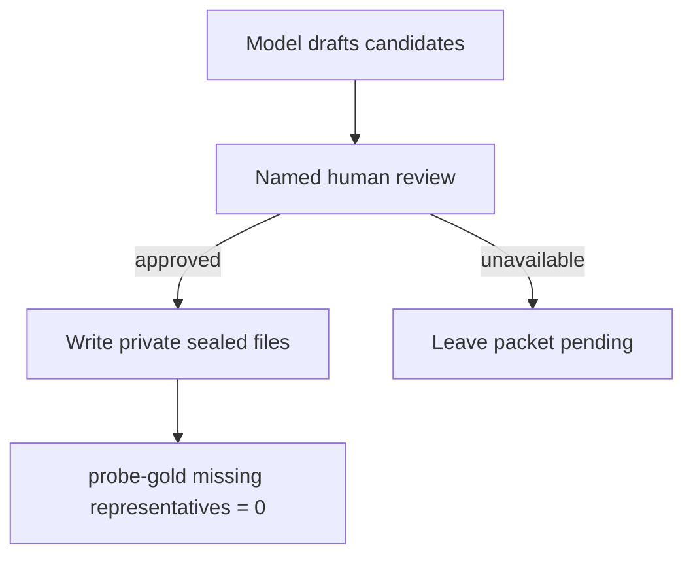

# P06-69 — Seal private gold (blocked 2026-09-21)

Parent index:
[phase-06-agent-intelligence-evidence.md](../phase-06-agent-intelligence-evidence.md).

Requirement ID: `P06-69`. Quote: human-approve aliases for the 100 Ask
facts, seal gold chunk IDs for the 12-question slice, reseal flagged
CLI locator labels, and pass the label gate. The coding model cannot
be the gold or semantic reviewer.

## Counts

| Item | Count | Approval |
| --- | ---: | --- |
| Ask gold questions | 100 | not approved |
| Ask required facts | 143 | not approved |
| Facts with proposed aliases | 115 | model draft only |
| Facts with approved aliases | 0 | none |
| Isolation-slice items | 12 | categories proposed; no chunk IDs |
| Hosted `eval_quiz_cases` | 0 | none |
| Hosted approved quiz cases | 0 | none |
| Acceptance-sample items | 30 | file exists; not approved |
| Human approver | — | **none** |

Draft files stay under gitignored `.private-eval/`:
`p06-69-alias-draft.json`, `p06-69-isolation-slice-draft.json`,
`p06-69-review.json`. They are not staged. Proposed aliases are
lexical variants only. Isolation-slice categories are the twelve
required labels. No question, phrase, alias, or chunk ID is committed.

## Label gate

`uv run python scripts/eval_pdf_hybrid.py --probe-gold` against the
existing sealed CLI labels and the renamed canonical version:

| Check | Result |
| --- | ---: |
| Cases | 28 |
| Gold unique IDs | 28 |
| Current representatives | 1044 |
| Intersection with representatives | 0 |
| `cases_missing_all_representatives` | 28 |
| Holdout opened | false |

`--probe-grounding`: scored 24, grounded 0, refusals 4, missing text
24. The packet gate `cases_missing_all_representatives = 0` **fails**.
`seal_pdf_eval_dataset.py` requires named human review. The coding
model did not reseal or mark labels approved.

## Gitignore

`git check-ignore -v .private-eval` resolves to `.gitignore:99`.
`git ls-files .private-eval` is empty. `git status` does not list the
draft files.

## Stop route

No human approval statement exists in this session. Packet 69 stays
**pending**. P06-70 is not started. Grounded-fact measurement remains
equal to strict phrase until aliases are approved.

## Verification

| Command | Exit |
| --- | --- |
| `git check-ignore -v .private-eval` | 0 (ignored) |
| `git ls-files .private-eval` | empty |
| `uv run python scripts/eval_pdf_hybrid.py --probe-gold` | 0 (intersection 0) |
| `uv run python scripts/eval_pdf_hybrid.py --probe-grounding` | 0 (grounded 0) |
| `git diff --check` | 0 |

## Rollback

Delete local `.private-eval/p06-69-*.json` drafts. Do not delete hosted
documents. Do not down-migrate `eval_quiz_cases`.

## Handoff

A named reviewer must approve or strike each proposed alias, choose
gold chunk IDs for the 12-question slice, reseal CLI labels until
`cases_missing_all_representatives = 0`, and record
name-or-chat-handle plus date. Then P06-70 may start.
