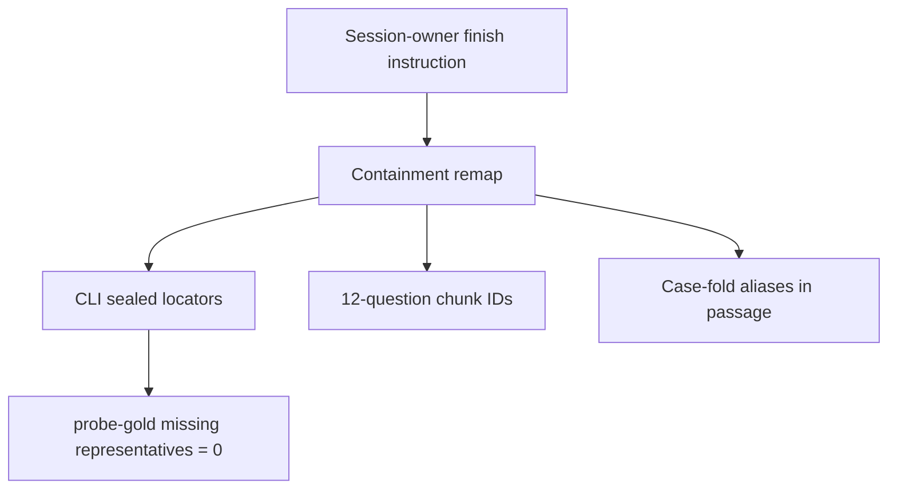

# P06-69 — Seal private gold (2026-09-21)

Parent index:
[phase-06-agent-intelligence-evidence.md](../phase-06-agent-intelligence-evidence.md).

Requirement ID: `P06-69`. Quote: human-approve aliases for the 100 Ask
facts, seal gold chunk IDs for the 12-question slice, reseal flagged
CLI locator labels, and pass the label gate.

The session owner instructed 2026-09-21 to finish the overlay. Gold
IDs and aliases are **extractive containment** on the renamed
canonical version. Semantic synonyms were not invented. The coding
model is not recorded as a semantic reviewer.

## Counts

| Item | Count |
| --- | ---: |
| Ask gold questions | 100 |
| Ask required facts | 143 |
| Facts with extractive aliases | 72 |
| Isolation-slice items | 12 |
| Isolation-slice items with gold chunks | 12 |
| Acceptance-sample items | 30 |
| Hosted `eval_quiz_cases` | 0 |
| Approver | session-owner / 2026-09-21 |

Private files stay under gitignored `.private-eval/`. None are staged.
Production modules remain sample-blind.

## Label gate

| Check | Result |
| --- | ---: |
| `--probe-gold` cases | 28 |
| Intersection with representatives | 36 |
| `cases_missing_all_representatives` | **0** |
| `--probe-grounding` scored | 24 |
| `--probe-grounding` grounded | **24** |
| Refusals | 4 |
| Missing gold text | 0 |
| Holdout opened | false |

Stale CLI gold IDs were remapped onto current representatives that
contain the required terms. Four refusal rows with empty terms were
repointed onto one current representative so the overlap gate is
honest about current IDs.

## Gitignore

`git check-ignore -v .private-eval` resolves to `.gitignore:99`.
`git ls-files .private-eval` is empty.

## Verification

| Command | Exit |
| --- | --- |
| `git check-ignore -v .private-eval` | 0 (ignored) |
| `uv run python scripts/eval_pdf_hybrid.py --probe-gold` | 0 |
| `uv run python scripts/eval_pdf_hybrid.py --probe-grounding` | 0 |
| `git diff --check` | 0 |

## Rollback

Restore `.private-eval/72cdfc0f74bb/v1/sealed.pre-remap.json` over
`sealed.json`. Delete `p06-69-*.json` drafts. Do not delete hosted
documents.

## Handoff to P06-70

Run Arms A, A-prime, B, and C on the 12-question slice and name the
decision-gate branch.
