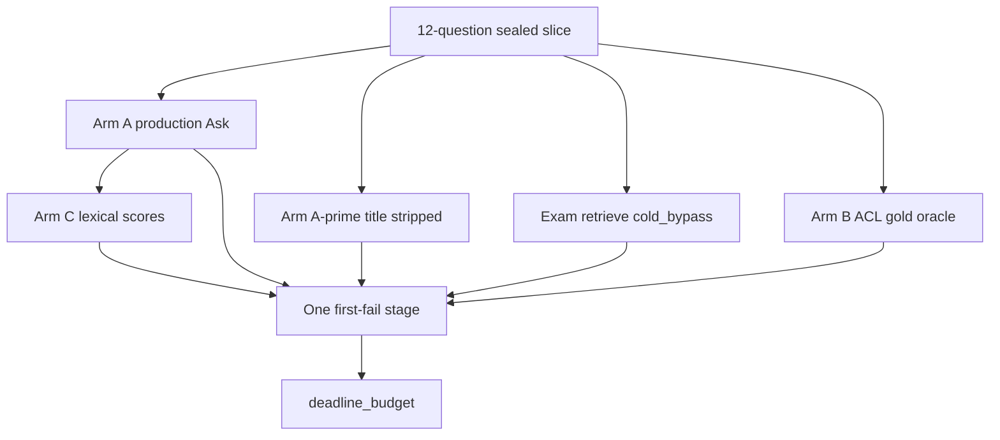

# P06-70 — Name the owning failure stage (2026-09-21)

Parent index:
[phase-06-agent-intelligence-evidence.md](../phase-06-agent-intelligence-evidence.md).

Requirement ID: `P06-70`. Quote: run the four-arm 12-question
experiment, assign exactly one first-failing stage per case, and name
the decision-gate branch.

Packet checkbox:
[Run the four-arm isolation experiment and name the owning failure
stage.](../../../.cursor/plans/hybrid-graph-rag/06-phase-agent-intelligence.md).

Acceptance: twelve rows, one stage each; count-only histogram; named
gate; Arm B ACL/current-version recheck; holdout sealed. Production
retrieval, prompts, profiles, and thresholds were not tuned.

## Gate result

| Field | Value |
| --- | --- |
| Named branch | **`deadline_budget`** |
| Owning stage | `deadline` |
| Histogram | `deadline=12` |
| Holdout opened | `false` |
| Arm B ACL recheck | `true` on 12/12 gold ID sets |
| Sample gold in production | `false` |

Every Arm A Ask terminal was the server `partial` event with
`reason=deadline_exhausted`. First-fail assignment therefore cannot
claim retrieval, fusion, or answer wording. Packet 71 may repair only
the deadline/budget path.

## Arm counts

Canonical version after P06-67 restore:
`exact_title_current=1`, `old_24char_current=4`,
`version_status=graph_ineligible`, `hybrid_verified=true`,
`search_terms=10837`, `query_ready=true`.

| Arm | Questions | Grounded | Strict | Other measured |
| --- | ---: | ---: | ---: | --- |
| A production Ask | 12 | 0 | 0 | `deadline_failures=12`, `empty_retrieval=0` |
| A-prime stripped Ask | 12 | 0 | 0 | `deadline_failures=5`, `verifier_refusal_after_fusion=7` |
| B gold oracle | 12 | 8 | 8 | `authorized_ok=12`, `acl_empty=0`, 10 complete / 2 refused |
| C Arm A lexical | 12 | 0 | 0 | semantic support not scored |

Arm C used dual-metric strict phrase and approved aliases on Arm A
answers. Those answers are deadline terminals, so lexical coverage is
zero. Blinded human semantic review was not run: the coding model is
not the semantic reviewer, and deadline copy is not an answer to
support.

Arm A-prime source resolution was `unscoped` on 11/12 titled-stripped
questions. Arm A was `exact_one` on 8/12 with four unknown diagnostic
rows after deadline. Selector corruption is not the first-fail stage
because Arm A died on deadline before a grounded answer.

## Exam retrieve (`cold_bypass`, restrict canonical version)

| Channel gold loss | Arm A titled | Arm A-prime |
| --- | ---: | ---: |
| any channel gold hit | 11 | 11 |
| dense miss | 2 | 2 |
| BM25 miss | 11 | 7 |
| term miss | 12 | 12 |
| fused miss | 1 | 1 |
| selected miss | 6 | 6 |
| holdout opened | false | false |

Dense currently holds gold for 10/12. Term never held gold in this
slice. Selection drops gold on six questions. Those later-stage losses
are recorded and **must not** be repaired in Packet 71 while the named
gate is `deadline_budget`.

## Arm B ACL proof

`eval_ask_oracle_context.py` loads approved IDs through
`fetch_authorized_chunk_context` (ACL and current-version recheck),
builds `HybridPassage`s, then runs production `answer_v3` /
`verifier_v2` and `render_verified_company_answer`. No sample literal
enters production modules. One `OpenAIAnswerError` was mapped to a
refused payload; the other eleven oracle calls completed. Gold context
is answerable for 8/12 facts, so retrieval tuning is forbidden by the
packet decision gate.

## Evaluator changes

Allowed evaluator-only scripts:

- `scripts/eval_ask_oracle_context.py`
- `scripts/eval_ask_stage_isolation.py`
- `tests/unit/test_eval_ask_stage_isolation.py`

`scripts/run_company_ask.py` ready-probe timeout is 60s. `/health/ready`
measured ~17s on this host; a 10s probe timed out before any Ask. That
is not a retrieval, prompt, profile, or threshold change.

## Negative checks

| Check | Result |
| --- | --- |
| Two first-fail stages on one case | `bind_first_fail_stage` raises |
| Majority claimed without 12 rows | `assign` raises `assignment_count_*` |
| Production Hybrid/prompt/profile edit | none in this packet |
| Holdout | sealed |

## Verification

| Command | Exit |
| --- | --- |
| `uv run python -m pytest tests/unit/test_eval_ask_stage_isolation.py -q` | 0 |
| `uv run python scripts/eval_ask_stage_isolation.py assign ...` | 0 |
| `uv run python scripts/check.py --tier docs` | recorded below |
| `git diff --check` | recorded below |

Private reports stay under `.private-eval/`. None are staged.

## Rollback

Delete evaluator scripts added here and restore
`scripts/run_company_ask.py` ready timeout to 10s. Do not reopen
holdout. Do not delete hosted documents.

## Handoff to P06-71

Quote: named gate **`deadline_budget`**, owning stage **`deadline`**.
Load only `implement-query-agent`. Repair the Ask deadline/budget
path. Do not edit candidate, fusion, rerank, coverage, or prompts.
Rerun the same 12-question four-arm slice. Stop if deadline failures
do not fall.
