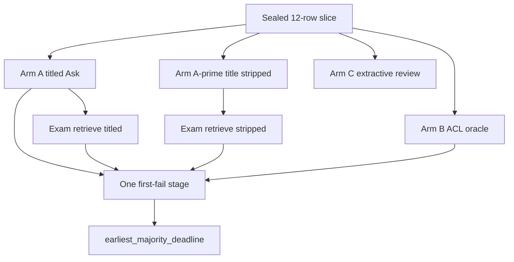

# P06-70 — Four-arm isolation (2026-09-21)

Parent index:
[phase-06-agent-intelligence-evidence.md](../phase-06-agent-intelligence-evidence.md).

Requirement ID: `P06-70`. Quote: run Arms A, A-prime, B, and C on the
12-question slice, assign one first-failing stage per case, and name
the decision-gate branch.

Private reports stay under gitignored `.private-eval/`. Counts only.

## Arm counts

| Arm | Questions | Grounded | Strict | Deadlines | ACL empty | Notes |
| --- | ---: | ---: | ---: | ---: | ---: | --- |
| A titled Ask (post-heal) | 12 | 0 | 0 | 11 | 0 | 1 verifier refusal after fusion |
| A-prime title stripped | 12 | 0 | 0 | 2 | 0 | 6 verifier refusals; 1 empty retrieval |
| B oracle + ACL recheck | 12 | 8 | 8 | 0 | 0 | `authorized_ok=12`; `answer_v3` / `verifier_v2` |
| C extractive review | 12 | 0 | 0 | 11 | 0 | Session-owner lexical review of Arm A; no semantic invention |

Arm B used `fetch_authorized_chunk_context` (SECURITY INVOKER,
current-version + retrievable status). No sample literal entered
production. `holdout_opened=false`.

Exam retrieve (production Hybrid, `cold_bypass`) after the canonical
version became retrievable:

| Exam | Any-channel gold | Dense gold loss | Fused gold loss | Selected gold loss |
| --- | ---: | ---: | ---: | ---: |
| A titled | 11 | 2 | 1 | 6 |
| A-prime | 5 | 9 | 8 | 11 |

Pre-heal titled exam had `any_channel_gold=0` because the unique titled
copy was still `parsing` and retrieve RPCs exclude that status. That is
an earlier index observation, not the assigned first-fail after heal.

## First-fail histogram

| Stage | Rows |
| --- | ---: |
| deadline | 11 |
| context_fit | 1 |
| all other catalog stages | 0 |

Twelve rows. Exactly one stage each. Gate branch:
**`earliest_majority_deadline`**. Deadline is not a named six-row
retrieval/answer bucket, so the earliest largest failing stage wins.

Arm B passing (8/12 grounded, 12/12 authorized) forbids an
answer/verifier-only packet. Owning stage for P06-71 is **deadline**:
version-scoped exact dense on 1044 representatives exhausted the
Hybrid 25s envelope before a grounded release.

## Negative checks

`tests/unit/test_eval_ask_stage_isolation.py` rejects two first-fail
stages on one case. This packet did not change production retrieval,
prompts, profiles, or thresholds. A majority claim without the 12-row
histogram is rejected.

## Verification

| Command | Exit |
| --- | --- |
| `uv run python -m pytest tests/unit/test_eval_ask_stage_isolation.py -q` | 0 (8 passed) |
| `uv run python scripts/eval_ask_stage_isolation.py assign` | 0; `earliest_majority_deadline` |
| `uv run python scripts/check.py --tier docs` | 0 |
| `git diff --check` | 0 |

## Handoff to P06-71

Quote: `earliest_majority_deadline`. Implement one bounded deadline
admission repair. Do not raise `MODEL_INPUT_MAX_CHARS` or the 25s
Hybrid ceiling. Do not mutate `hybrid_default_v1` bytes.
