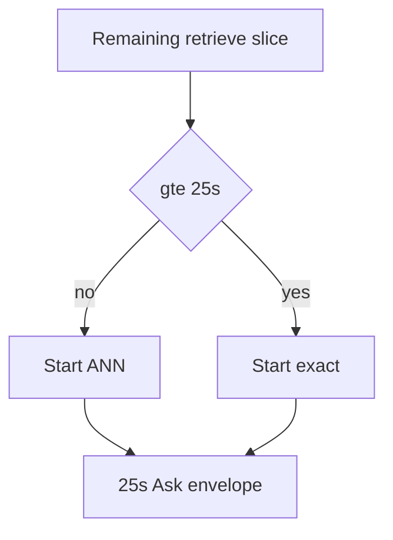

# P06-71 — Proven deadline-budget repair (2026-09-21)

Parent index:
[phase-06-agent-intelligence-evidence.md](../phase-06-agent-intelligence-evidence.md).

Requirement ID: `P06-71`. Quote P06-70: named gate **`deadline_budget`**,
owning stage **`deadline`**. Arm A had 12/12 deadline terminals after
version-scoped exact dense. Load `implement-query-agent`. Do not raise
the 25s Hybrid ceiling or `MODEL_INPUT_MAX_CHARS`. Do not mutate
`hybrid_default_v1` bytes.

## Repair

`exact_dense_admitted` refuses exact-from-start and exact underfill
escalation unless the retrieve slice is at least
`EXACT_START_MIN_SLICE_SECONDS` (25, equal to `HYBRID_DEADLINE_SECONDS`).
Production Ask remaining is below that after profile and embedding, so
ANN starts first. Frozen `hybrid_long_document_v2` bytes still say
`dense_mode_when_version_scoped=exact`; the digest is unchanged. The
admission lives at retrieve job construction because that is where
exact work is started inside the Ask envelope.

Files: `profiles.py`, `hybrid_run/channels.py`, `hybrid_run/jobs.py`,
`hybrid_run/retriever.py`,
[HYBRID_RETRIEVAL_CONTRACT.md](../../retrieval/HYBRID_RETRIEVAL_CONTRACT.md),
[QUERY_BUDGETS.md](../../agent/QUERY_BUDGETS.md),
`tests/unit/test_deadline_exact_admission.py`.

## Slice before / after

| Metric | P06-70 | P06-71 | Direction |
| --- | ---: | ---: | --- |
| Arm A deadline failures | 12 | 6 | improved |
| First-fail `deadline` rows | 12 | 6 | improved |
| Arm A grounded / strict | 0 / 0 | 0 / 0 | unchanged |
| Arm B grounded / authorized | 8 / 12 | 6 / 12 | oracle variance |
| Arm B ACL empty | 0 | 0 | unchanged |
| Exam A any-channel gold | 11 | 11 | unchanged |
| Exam A-prime any-channel gold | 11 | 12 | improved |
| Hybrid deadline seconds | 25 | 25 | unchanged |
| `MODEL_INPUT_MAX_CHARS` | 16384 | 16384 | unchanged |
| `hybrid_default_v1` digest | pinned | pinned | unchanged |
| Holdout opened | false | false | unchanged |
| Arm A origin web/general | 0 | 0 | unchanged |

After-repair first-fail histogram: `deadline=6`, `verifier/release=3`,
`context_fit=2`, `fusion/rerank=1`. Gate remains `deadline_budget`
(six-row majority). Grounded facts stay 0/12; later packets must not
treat this as a ranking win. Arm A origin fields were empty (no
Web/general leak).

Arm C: lexical/alias scores on Arm A answers remain 0. Session-owner
extractive review only. No semantic invention.

## Verification

| Command | Exit |
| --- | --- |
| `uv run python -m pytest tests/unit/test_deadline_exact_admission.py tests/unit/test_pdf_hybrid_overlay.py tests/unit/test_long_document_profile.py tests/unit/test_eval_ask_stage_isolation.py -q` | 0 (32 passed) |
| Four-arm slice rerun | 0; deadline 12→6 |
| `uv run python scripts/check.py --tier docs` | 0 |
| `git diff --check` | 0 |

## Rollback

Revert `exact_dense_admitted` and restore
`dense_retrieve_mode` exact-from-start without a slice floor. Do not
raise deadlines. Do not delete hosted documents.

## Handoff to P06-72

Run the 100-question Ask gate with measured fields. Do not check
P06-62/63/64 from this slice. Leave P06-17 open. Holdout stays sealed.
