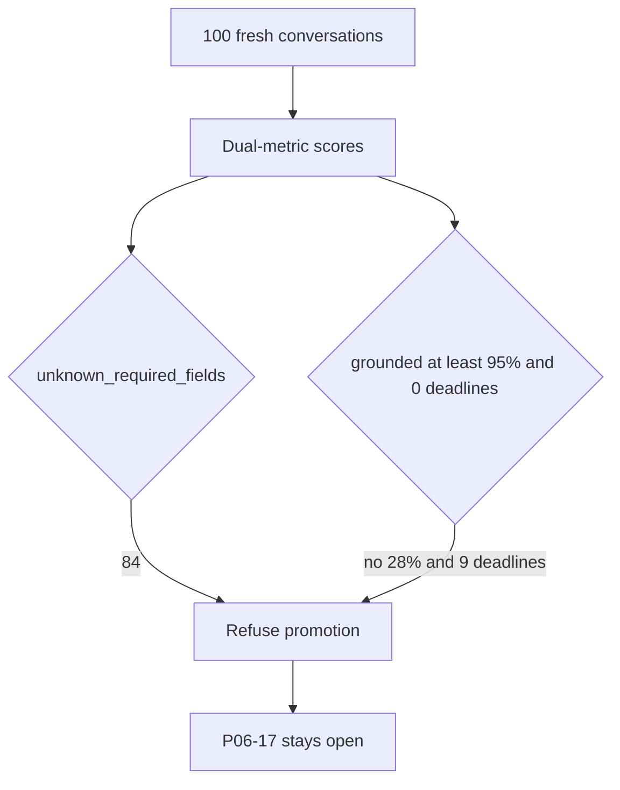

# P06-72 — Live qualification (2026-09-21)

Parent index:
[phase-06-agent-intelligence-evidence.md](../phase-06-agent-intelligence-evidence.md).

Requirement ID: `P06-72`. Quote: run 100 fresh Ask questions with
measured fields, publish redacted counts, and leave leftover P06-17
open. This packet records gates. It does not hide a failed owning
stage.

P06-71 quoted gate **`deadline_budget`**. The 12-question slice
improved deadlines 12→6. This 100-question run is the overlay
qualification, not promotion.

## Dual-metric Ask

Local Compose API rebuilt with P06-71 exact-admission, hosted
Supabase, `query_ready=true`. Gold and credentials stayed under
gitignored `.private-eval/`. Each question used a fresh conversation.
The coding model is not the semantic reviewer.

| Metric | Value |
| --- | ---: |
| Questions | 100 |
| Fresh conversations | 100 |
| Strict pass | 28 |
| Grounded fact pass | 28 |
| Grounded fact rate | 0.28 |
| Deadline failures | 9 |
| Verifier refusal after fusion | 33 |
| Wrong phrasing | 24 |
| Partial | 2 |
| Error terminals | 4 |
| Client timeout terminals | 1 |
| Empty retrieval | 0 |
| Origin web/general leaks | 0 |
| `unknown_required_fields` | 84 |
| `rerank_accounting_ok` | false |
| `bm25_degraded_explicit` | false |
| Sample promoted | false |
| Generalization claimed | false |
| `holdout_opened` | false |

Promotion reasons: `grounded_fact_below_95`, `deadline_failures`,
`bm25_degradation_not_explicit`, `rerank_accounting_unproven`,
`unknown_required_fields`, `generalization_unverified`.

Interim gate (grounded ≥90% and zero deadlines) **failed**. Strict
score is reported separately and is not a promotion input.

## First-fail histogram (dual-metric outcomes)

| Outcome | Count |
| --- | ---: |
| `strict_phrase` | 28 |
| `verifier_refusal_after_fusion` | 33 |
| `wrong_phrasing` | 24 |
| `deadline` | 9 |
| `error` | 4 |
| `partial` | 2 |

## Measured retrieve diagnostics

94 of 100 runs exported complete ID-only diagnostics. Six runs
(four HTTP errors, one client timeout, one missing checkpoint) have
14 unknown fields each (`unknown_required_fields=84`). Those six are
not treated as passes.

| Field | Histogram |
| --- | --- |
| `source_resolution` | `exact_one=94`, `unknown=6` |
| `effective_route` | `hybrid=94`, `unknown=6` |
| `retrieval_profile_id` | `hybrid_long_document_v2=94`, `unknown=6` |
| `fallback_reason` | `none=94`, `unknown=6` |
| `rerank_fallback` | `rerank_timeout=93`, `none=1`, `unknown=6` |
| `retrieval_empty` | `false=94`, unset=6 |
| embedding call count 1 | 94 |
| rerank call count 1 | 1 |

P06-62/63/64 stay **unchecked**. Rerank almost always timed out into
RRF, so retrieve accounting is unproven. Coverage/correction still
owns 33 verifier refusals. Live qualification did not reach 95%
grounded or zero deadlines.

Blinded semantic support was not scored. Cost USD is unverified
(no signed per-call table on this run). Runner wall time for the
resumed 98 questions was 5611868 ms. Citations stayed on the
company-documents path; origin fields were empty, not Web or general.

## Wrapper and leftover

| Item | Result |
| --- | --- |
| P06-17 | remains incomplete |
| P06-18 | not opened |
| Phase 6 | `pending` |
| P06-62 / P06-63 / P06-64 | remain unchecked |
| Holdout | sealed |

Disjoint real PDFs besides this sample were not supplied.

## Evaluator runner

`scripts/run_company_ask.py` retries conversation create on read
timeout and records a timeout row instead of aborting the 100-question
loop. That is not a retrieval, prompt, profile, or threshold change.

## Verification

| Command | Exit |
| --- | --- |
| `uv run python scripts/run_company_ask.py --gold .private-eval/pdf-gold-100.json ...` | 0 (counts above; not an accuracy pass) |
| `uv run python scripts/check.py --tier fast` | 0 |
| `docker compose --env-file .env.example config --quiet` | 0 |
| `uv run python scripts/ci/check_openapi.py` | 0 |
| `uv run python scripts/ci/check_migrations.py` | 0 |
| `uv run python .cursor/plans/hybrid-graph-rag/scripts/verify_plan_integrity.py` | 0 |
| `git diff --check` | 0 |

## Rollback

Leave this evidence in place. Do not check P06-62/63/64 from these
counts. Do not open holdout. Do not delete hosted documents.

## Handoff to git delivery

Push `fix/honest-rag-accuracy`, open the PR, and repair CI. Post-merge
30-question acceptance remains a separate todo. This overlay does not
claim the 95% grounded gate.
