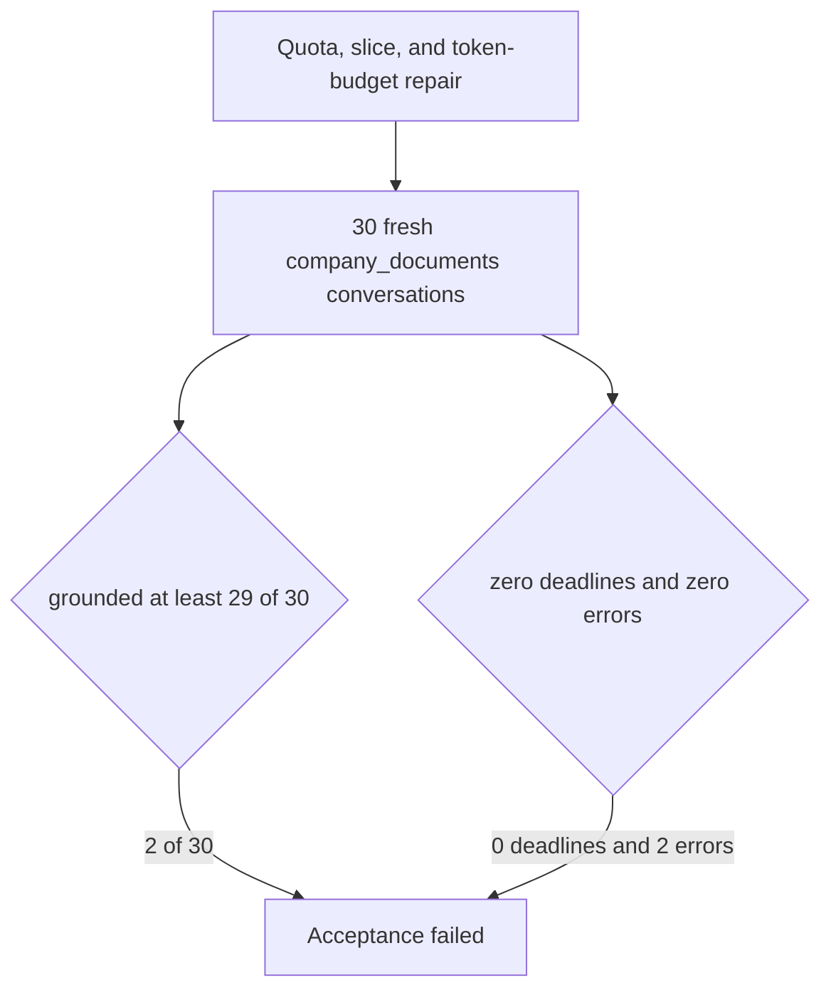

# Post-fix 30-question acceptance (2026-09-22)

Parent index:
[phase-06-agent-intelligence-evidence.md](../phase-06-agent-intelligence-evidence.md).
Prior failed gate:
[p06-post-merge-acceptance-2026-09-21.md](./p06-post-merge-acceptance-2026-09-21.md).
Decision record:
[ADR-ask-evidence-budget-repair.md](../../adr/ADR-ask-evidence-budget-repair.md).

Scored on branch `fix/ask-evidence-budget-repair` after the budget,
slice, and quota commits through `c5bac3c`. The frozen sample stays
under gitignored `.private-eval/`. This record is counts only.

## Verdict

**Fail.** Grounded facts are 2/30. The pass gate is at least 29/30
grounded, with zero deadlines and zero errors. Deadlines are 0.
Errors are 2. Blinded semantic support was not scored.

| Metric | 2026-09-21 | 2026-09-22 | Gate |
| --- | ---: | ---: | --- |
| Questions | 30 | 30 | 30 |
| Strict pass | 3 | 2 | reported only |
| Grounded fact pass | 3 | 2 | at least 29 |
| Verifier refusal after fusion | 9 | 8 | |
| Partial | 8 | 11 | |
| Wrong phrasing | 4 | 7 | |
| Deadline failures | 4 | 0 | 0 |
| Error terminals | 2 | 2 | 0 |
| Empty retrieval | 0 | 0 | |
| Origin web/general | 0 | 0 | 0 |
| `term_unavailable` | 0 | 0 | 0 |
| `unknown_required_fields` | 28 | 28 | 0 |
| Sample promoted | false | false | |
| `holdout_opened` | false | false | false |

Answer status on this run: `completed` 12, `verified_partial` 8,
`insufficient_evidence` 8, `error` 2. The scorer's outcome buckets
above are the acceptance counts. A completed terminal is not a
grounded-fact pass.

Rerank `call_count == 1` and `fallback == none` on 26/30.
`rerank_schema_invalid` on 2. The other 2 are the error terminals
(`unknown`). Deadline failures are 0, inside the repair ceiling of 4.
`rerank_accounting_ok` is false because those 4 runs are not clean
rerank accounting. Source resolution was `exact_one` on 1 run and
`unscoped` on 27. Profile `hybrid_long_document_v2` on 1 run and
`hybrid_default_v1` on 27.

Coverage score was `1.00` on 13 measured runs and `0.90` on 15.
Runs with `coverage_score < 0.65`: 0. The gold page was in fusion
evidence on 22 of the 28 runs that stored fusion. The two error runs
stored no Hybrid coverage and no correction.

Deterministic citation failures on measured runs:
`paragraph_unmapped` 3, `paragraph_index_invalid` 2,
`citation_link_mismatch` 1, `unauthorized_or_missing_table` 1.

The 28 unknown fields are the two error terminals (14 required fields
each). `bm25_degraded_explicit` is false.

## Smoke runs

Known-answer smoke is 12 questions, disjoint from this 30-question
sample. Counts only.

| Run | Strict | Grounded | Verifier refusal after fusion | Deadline | Error |
| --- | ---: | ---: | ---: | ---: | ---: |
| smoke-p1 | 4 | 4 | 3 | 0 | 1 |
| smoke-p2 | 2 | 2 | 6 | 0 | 1 |
| smoke-p3 warm | 3 | 3 | 6 | 0 | 1 |
| smoke-p4 attempt 1 | 3 | 3 | 6 | 1 | 1 |
| smoke-p4 attempt 2 | 2 | 2 | 5 | 1 | 1 |
| smoke-p4 attempt 3 | 2 | 2 | 4 | 0 | 1 |

smoke-p3 warm: `rerank_call_count == 1` and `rerank_fallback == none`
on 10/12. smoke-p4 attempt 1 also showed `ka-10` on
`hybrid_long_document_v2` / `exact_one` and `ka-11` on
`hybrid_default_v1`. The negative-control smoke question stayed
`error` on every attempt.

## Deployed pins

| Pin | Value |
| --- | --- |
| Branch | `fix/ask-evidence-budget-repair` |
| Code through | `c5bac3c` |
| API image id | `sha256:27627fb62674089295b5542e4d9bbf4a1dd0c6121b3f90d42c82d4a4983f990b` |
| `final_token_budget` | 6000 |
| `MODEL_INPUT_MAX_CHARS` | 32768 |
| `RETRIEVAL_SLICE_SECONDS` | 10 |
| `RERANK_RESERVED_SECONDS` | 3 |
| `hybrid_default_v1` SHA-256 | `37343b15449600a4e756e7f72b9282cf709713019e033fe470a9b91fa21f0ec0` |
| `hybrid_long_document_v2` SHA-256 | `1b356c0de0972ee42758f1ef9f0a7a47b283ec779f97fbe9af8f04e490dffd7a` |
| Sample rows | 30 |
| `query_ready` | true |
| Generalization | unverified |

Local check tiers before this run: format pass, lint pass, types pass
(0 Pyright errors), unit 1568 passed and 4 skipped, contract 294
passed and 252 skipped (`SUPABASE_DB_URL` unset; DB-backed tests are
opt-in), docs pass on the tree before this file. One ClamAV contract
test failed on a signature database older than one day; `freshclam`
updated `daily.cld` to version 28131 and the contract tier then passed.

## Open failures

- smoke-p4 missed its gate on three attempts. Best grounded result was
  3/12. Live answer fitting used `max_input_chars` 32768, and fusion
  still held the expected pages on the questions that were inspected.
  The packet stays unchecked. Losses after the budget were citation
  binding, citation persist mapped to `insufficient_evidence`, and the
  negative-control `error`.
- This 30-question gate is 2/30 grounded. That does not meet 29/30.
- No measured run had `coverage_score == 0.6`. The support-confidence
  fallback change is not applied.
- Citation deterministic failures above are text-artifact shaped.
  Grounded is below 27/30, so the optional PDF reflow packet is in
  scope after this record and must not block merge if it is still open.
  The reflow re-ingest counts are in
  [p06-post-fix-v2-acceptance-2026-09-22.md](./p06-post-fix-v2-acceptance-2026-09-22.md).
- Two runs ended before a Hybrid coverage score was stored.

## Follow-ups

Not part of this repair: term-channel hit rate, BM25 field weighting,
`answer_v4`, and per-stage millisecond timings on `HybridRunResult`.
