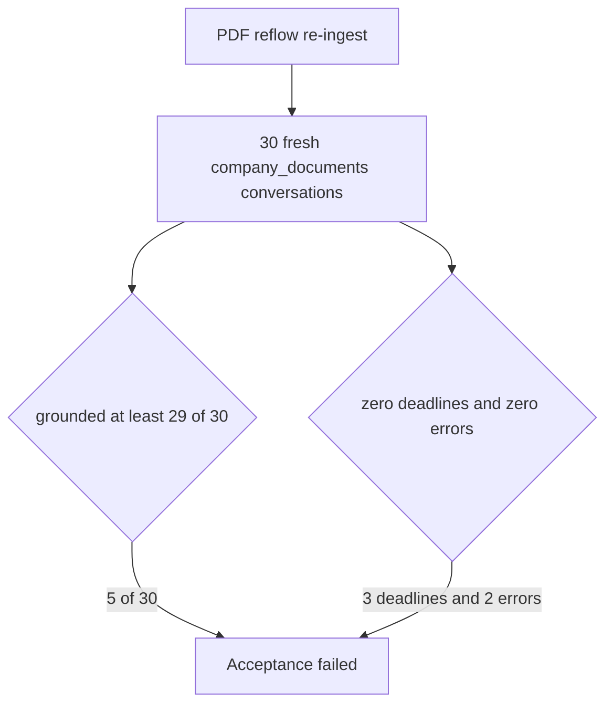

# Post-fix-v2 30-question acceptance (2026-09-22)

Parent index:
[phase-06-agent-intelligence-evidence.md](../phase-06-agent-intelligence-evidence.md).
Prior repair gate:
[p06-post-fix-acceptance-2026-09-22.md](./p06-post-fix-acceptance-2026-09-22.md).
Decision record:
[ADR-ask-evidence-budget-repair.md](../../adr/ADR-ask-evidence-budget-repair.md).

Scored on branch `fix/ask-evidence-budget-repair` after PDF line reflow
(`parser_v1_pdf_reflow_v3`) and one re-ingest of the canonical book.
The frozen sample stays under gitignored `.private-eval/`. This record
is counts only.

## Verdict

**Fail.** Grounded facts are 5/30. The pass gate is at least 29/30
grounded, with zero deadlines and zero errors. Deadlines are 3.
Errors are 2. Blinded semantic support was not scored. Grounded
facts moved from 2/30 on the same-day repair gate to 5/30 after
reflow. That is still short of the gate.

| Metric | 2026-09-21 | 2026-09-22 | 2026-09-22 v2 | Gate |
| --- | ---: | ---: | ---: | --- |
| Questions | 30 | 30 | 30 | 30 |
| Strict pass | 3 | 2 | 5 | reported only |
| Grounded fact pass | 3 | 2 | 5 | at least 29 |
| Verifier refusal after fusion | 9 | 8 | 8 | |
| Partial | 8 | 11 | 11 | |
| Wrong phrasing | 4 | 7 | 1 | |
| Deadline failures | 4 | 0 | 3 | 0 |
| Error terminals | 2 | 2 | 2 | 0 |
| Empty retrieval | 0 | 0 | 0 | |
| Origin web/general | 0 | 0 | 0 | 0 |
| `term_unavailable` | 0 | 0 | 0 | 0 |
| `unknown_required_fields` | 28 | 28 | 28 | 0 |
| Sample promoted | false | false | false | |
| `holdout_opened` | false | false | false | false |

Answer status on this run: `completed` 11, `verified_partial` 6,
`insufficient_evidence` 8, `deadline_exhausted` 3, `error` 2.
A completed terminal is not a grounded-fact pass.

Rerank `call_count == 1` and `fallback == none` on 27/30.
`rerank_timeout` on 1. The other 2 are the error terminals
(`unknown`). Deadline failures are 3, inside the repair ceiling of 4
and above the pass gate of 0. `rerank_accounting_ok` is false.
Source resolution was `exact_one` on 1 run, `unscoped` on 27, and
`unknown` on 2. Profile `hybrid_long_document_v2` on 1 run,
`hybrid_default_v1` on 27, and `unknown` on 2.

Coverage score was `1.00` on 14 measured runs, `0.95` on 2, and
`0.90` on 12. Runs with `coverage_score < 0.65`: 0. The gold page
was in fusion evidence on 21 of the 28 runs that stored fusion. The
two error runs stored no Hybrid coverage and no correction. No run
had `coverage_score == 0.6`.

Deterministic citation failures on measured runs:
`citation_link_mismatch` 5, `paragraph_unmapped` 4,
`paragraph_index_invalid` 3.

The 28 unknown fields are the two error terminals (14 required fields
each). `bm25_degraded_explicit` is false.

## Re-ingest

The canonical book was soft-deleted, then uploaded again through the
document library with the same title. The parser sandbox image could
not import `query_answer` (that package loads `tiktoken`, which the
no-network image does not install). The shared paragraph separator
now lives in `smart_rag_core.text_constants` and is re-exported by
`query_answer.versions`. After that image rebuild, indexing finished.

| Pin | Value |
| --- | --- |
| Stored version status | `graph_ineligible` |
| `is_current` | true |
| Library search status | Search ready |
| Library graph status | Graph ineligible |
| Parser version on chunks | `parser_v1_pdf_reflow_v3` |
| Chunks | 1016 |
| Embedded rows | 1015 |
| BM25 job | completed |
| Owner `false_positive` families | `credentials` 1, `health` 14 |

`graph_ineligible` is the searchable terminal for this book. The
library shows Search ready. The same detector families were recorded
as false positives on the earlier ingest of this file.

## Deployed pins

| Pin | Value |
| --- | --- |
| Branch | `fix/ask-evidence-budget-repair` |
| Code through | `dfccf8d` |
| API image id | `sha256:27627fb62674089295b5542e4d9bbf4a1dd0c6121b3f90d42c82d4a4983f990b` |
| Sample rows | 30 |
| `query_ready` | true |
| Generalization | unverified |

## Open failures

- Grounded facts are 5/30. The gate remains 29/30.
- Deadline failures are 3. The same-day repair gate had 0.
- Error terminals remain 2, with no stored Hybrid coverage.
- Citation deterministic failures above are still present after reflow.
- This packet does not block the merge.

Later diagnostic on a separate 50-question set:
[KNOWN_ANSWER_50_REVIEW_2026-09-22.md](../../evaluation/KNOWN_ANSWER_50_REVIEW_2026-09-22.md).
