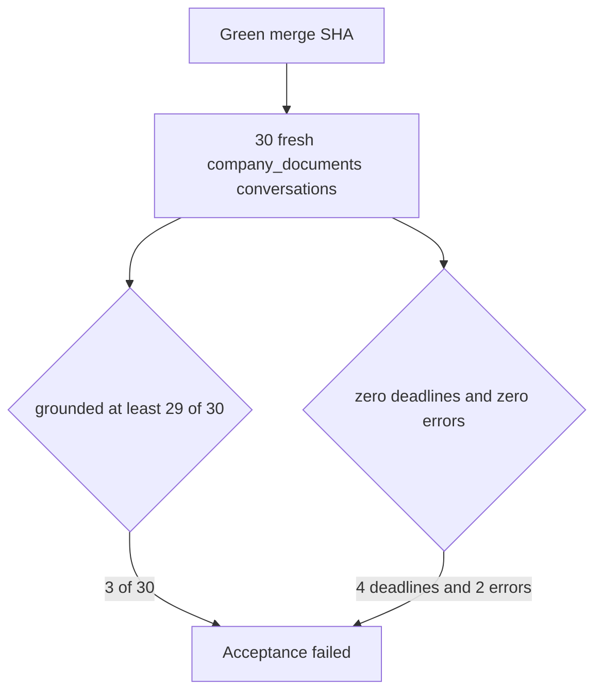

# Post-merge 30-question acceptance (2026-09-21)

Parent index:
[phase-06-agent-intelligence-evidence.md](../phase-06-agent-intelligence-evidence.md).

Scored after merge `32ac337bdfdce0b790ad22d6c7e2971d7e240bec` on `main`.
PR fast and Main workflows for that SHA are green. The frozen sample
stays under gitignored `.private-eval/`. This record is counts only.

## Verdict

**Fail.** Grounded facts are 3/30. The pass gate is at least 29/30
grounded and at least 29/30 blinded semantic support, with zero
deadlines, errors, ACL leaks, Web/general origins, unknown stage
fields, and `term_unavailable`. Blinded semantic support was not
scored: the coding model is not the reviewer.

| Metric | Value | Gate |
| --- | ---: | --- |
| Questions | 30 | 30 |
| Strict pass | 3 | reported only |
| Grounded fact pass | 3 | at least 29 |
| Verifier refusal after fusion | 9 | |
| Partial | 8 | |
| Wrong phrasing | 4 | |
| Deadline failures | 4 | 0 |
| Error terminals | 2 | 0 |
| Empty retrieval | 0 | |
| Origin web/general | 0 | 0 |
| `term_unavailable` | 0 | 0 |
| `unknown_required_fields` | 28 | 0 |
| Sample promoted | false | |
| `holdout_opened` | false | false |

The 28 unknown fields are the two error terminals (14 required fields
each). The other 28 runs exported diagnostics. Those runs used
`effective_route=hybrid`. Source resolution was `exact_one` on 1 run
and `unscoped` on 27. Rerank fallback was `rerank_timeout` on 22,
`none` on 6, and `unknown` on 2. Selected and fused IDs were present
on the 28 measured runs. `bm25_degraded_explicit` is false because
this sample did not take the ParadeDB outage path.

`scripts/verify-local.ps1` stopped because `/health/ready` returned
`query_ready=true` instead of the Phase 1 substring `unconfigured`.
That ready payload is the one this acceptance run requires.

## Deployed pins

| Pin | Value |
| --- | --- |
| Merge SHA | `32ac337bdfdce0b790ad22d6c7e2971d7e240bec` |
| API image created | 2026-09-21T19:40:51Z |
| Answer / verifier prompts | `answer_v3` / `verifier_v2` |
| Profile | `hybrid_long_document_v2` |
| Term RPC | 7 arguments, `seven_arg_present=true` |
| Term functiondef md5 | `ad1db6b68caa0ec1236b9c6d5caa6770` |
| Canonical version status | `graph_ineligible` |
| `hybrid_verified_at` | 2026-09-21 14:06:36Z |
| Sample rows | 30 |
| Generalization | unverified |

## Stop

No further sample-blind repair is started from this run. The largest
outcome bucket is verifier refusal after fusion (9/30), not a single
majority stage. Questions in this frozen sample do not carry a
document title, so production stayed unscoped. Injecting the sample
title or gold phrases into production code is forbidden. A human
reviewer who is not the coding model still has to score blinded
semantic support before any later repair can claim the 29/30 gate.
