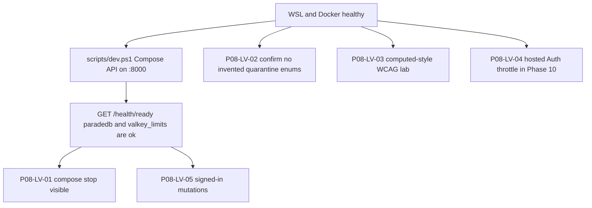

# Phase 8 — later live verification

Checklist for items left **unverified-live** after the 2026-08-17 host-uvicorn
run. Do not treat a skip as a pass. Do not add `X-Test-*` headers or a
test-auth bypass. Do not `db reset`. Do not invent FastAPI paths.

Canonical evidence:
[phase-08-frontend-integration-evidence.md](./phase-08-frontend-integration-evidence.md).
Journey map: [PHASE8_JOURNEY_MATRIX.md](../frontend/PHASE8_JOURNEY_MATRIX.md).
Local start: [LOCAL_SETUP.md](./LOCAL_SETUP.md). Docs index: [docs/README.md](../README.md).

Already proven that day (do not re-litigate unless the stack changed):

- `tests/contract/test_thin_developer_ui_live.py` — 5 passed (handshake, JWT
  chat/idempotency/delete, five Composite streams, aal1 MFA required, TOTP
  aal2 reserve + user-JWT Storage POST). `signed_url` stayed null.
- Playwright cwd `apps/frontend` — 29 passed, 0 skipped (live `/health/ready`
  panel, GoTrue sign-in, Auto chrome, document 404 without title leak, usage
  403 without budget sliders).



## Shared prerequisites

1. Docker Desktop engine answers `docker info`.
2. `.\scripts\dev.ps1` succeeds (pinned Supabase CLI + Compose). Prefer the
   **Compose API** on `http://127.0.0.1:8000`, not host uvicorn, so ParadeDB
   and Valkey can report `ok`.
3. If TOTP enroll returns 422, restart Auth only:
   `pnpm exec supabase stop`; `pnpm exec supabase start`. No `db reset`.
4. Playwright helper: `apps/frontend/tests/e2e/live-auth.ts` (GoTrue admin
   create + `/login`). Never print `supabase status` JSON (it contains keys).

## Items

### P08-LV-01 — Compose ParadeDB/Valkey stop visible on ready

**Why skipped:** Host uvicorn reported `paradedb=unconfigured` and
`valkey_limits=unconfigured`. The test only stops a dependency that is
already `ok`.

**Command:**

```powershell
uv run python -m pytest tests/contract/test_thin_developer_ui_live.py::test_live_compose_outage_visible_on_ready -q -rs --tb=short
```

**Pass:** Exit 0, not skipped. After Compose `stop paradedb` and/or
`valkey-limits`, `GET /health/ready` shows that name as `down`. The test
starts the service again in `finally`.

**Fail/skip:** Still `unconfigured` means the process under test is not the
Compose API. Fix the stack; do not mock `ok`.

### P08-LV-02 — Abandoned / expired / oversize quarantine enums

**Why unverified:** Those labels are **not** distinct public JSON enums on
`GET /ingestion/versions/{id}/status`. The UI prints the server `status`
string. Inventing them would be a contract lie.

**Command:**

```powershell
pnpm --filter smart-rag-frontend test -- src/lib/ingestion-status.test.ts
```

Also search generated OpenAPI / version-status schema for
`abandoned`, `expired`, and `oversize` as enum members. Absence is the
honest result.

**Pass:** Tests still refuse invented enums. OpenAPI still has no those
members. Record the schema path and date.

**Fail:** Only if the API later publishes those enums and the UI does not
render the server string.

### P08-LV-03 — Live WCAG lab measurement of computed styles

**Why unverified:** Token contrast is proven in
`apps/frontend/src/lib/contrast.test.ts`. No lab pass measured
`getComputedStyle` on every shipped surface.

**Surfaces:** `/login`, `/` (signed in), `/documents`, `/graph`, `/tables`,
`/team`, `/usage`. Tokens: `docs/frontend/STITCH_BRIEF.md` /
`apps/frontend/src/lib/design-tokens.ts`.

**Pass:** Record contrast ratios for text/muted/accent/danger on canvas and
surface from computed CSS, all ≥ WCAG AA 4.5:1 for normal text (warning-on-
white may stay as the existing unit-test exception). No new blur, CDN fonts,
or `dangerouslySetInnerHTML`.

**Fail:** Computed color differs from tokens in a way that drops below AA.

### P08-LV-04 — Hosted Auth throttling (GAP-07-20)

**Why unverified:** FastAPI does **not** throttle browser-direct
`signInWithPassword`. Proof belongs to hosted GoTrue / Phase 10
(`local_auth_throttling_proven=False` in
[API_UI_MAPPING.md](../frontend/API_UI_MAPPING.md)).

**Do not:** Claim login rate limits from FastAPI. Do not add a FastAPI login
throttle to “make the test pass”.

**Pass:** Phase 10 records hosted Auth throttle behavior with the real
provider. Until then this row stays **unverified-live**.

### P08-LV-05 — Signed-in Next chrome against live mutations

**Why unverified:** Vitest covers clients. Playwright live covered Auto
chrome, document 404, and usage 403. No signed-in Playwright mutation pass
hit live FastAPI for graph/tables/tools/curation.

**Existing clients only** (do not invent paths):

| Surface | Client | HTTP |
| --- | --- | --- |
| Graph | `searchGraphEntities`, `inspectGraph` | `GET /graph/entities/search`, `POST /graph/inspect` |
| Tables | `listTables`, `analyzeTable` | `GET /tables`, `POST /tables/analyze` |
| Tools | `listTools`, `seedTool`, `enableTool`, `setToolPermission` | `GET /tools`, `POST /admin/tools`, enable/permissions |
| Curation | `listEntityRules`, `upsertEntityRule`, `approveEntityRule`, `revokeEntityRule` | `/admin/graph/entity-rules` |

Reuse `signInLiveMember` from `live-auth.ts`. Server 403 for a member is
success for authorization, not a reason to forge a role header.

**Pass:** New or extended Playwright (or live Python using the same HTTP)
records 2xx or expected 403/404 without leaking snippets, storage paths, or
unauthorized graph titles. Hop cap stays 3; inspect node cap stays 200.

## Results log

Fill a row when an item is re-run. Do not backfill a skip as proven.

| ID | Date | Command | Exit | Result | Notes |
| --- | --- | --- | --- | --- | --- |
| P08-LV-01 | | | | pending | Need Compose API with ParadeDB/Valkey `ok` |
| P08-LV-02 | | | | pending | Confirm enums still absent |
| P08-LV-03 | | | | pending | Computed-style lab, not token unit tests |
| P08-LV-04 | | | | pending | Phase 10 hosted Auth |
| P08-LV-05 | | | | pending | Signed-in live mutations |

## Failure modes

- WSL unresponsive: Docker diagnose hangs on `wsl.exe -l -v`. Restart
  `WSLService` elevated, then Docker Desktop, then `.\scripts\dev.ps1`.
- Compose frontend image build typechecks `tests/e2e`. Keep
  `live-auth.ts` in the same change as imports of it.
- Host uvicorn on `:8000` will skip P08-LV-01. Stop it before Compose API
  bind, or pick one process.
- Printing `supabase status` JSON leaks local keys. Use the CLI; do not
  paste output into tickets.
