# Phase 9 local release candidate evidence

Canonical packet evidence for Phase 9. Each packet appends its handoff. Do not
check a packet from file presence alone. Phase 9 wrapper is `complete` after
user acceptance on 2026-08-18.

Related: [LOCAL_RELEASE_CANDIDATE.md](../deployment/LOCAL_RELEASE_CANDIDATE.md) ·
[QUALITY_TARGETS.md](../QUALITY_TARGETS.md) ·
[QUALITY_COMMANDS.md](./QUALITY_COMMANDS.md) ·
[docs index](../README.md)

## Proceed decision

Phases 1-8 have implementation evidence. Phase 8 wrapper remains `pending`
awaiting user acceptance. The user explicitly ordered Phase 9 implementation
on 2026-08-17 and accepted Phase 9 close on 2026-08-18 so Phase 10 can start.
Holdout stays `HoldoutAccess.denied()`.
`SMART_RAG_HOLDOUT_ACCESS` was not set to `true`.

**Phase 9 local close (go for Phase 10 isolated staging on the reduced
envelope):** Packets 1-7 evidence exists for the distroless/Alpine freeze.
Tar Trivy Criticals are **Passed** (High not waived). Packet 7 classified
P09-07-A through P09-07-E **Passed** while the wrapper was still pending,
then the user accepted and the wrapper was checked. Advertised envelope is
QT-CAP-001-P9=8 / QT-CAP-002-P9=16 / QT-CAP-005-P8=15, not QT-CAP-001/002.
Managed JWKS/restore/OIDC/EC2/CDN/KMS/assessment remain Phase 10. JWT iss,
live 70% pause, and old-API smoke remain **Passed**. Live OpenAI quality
stays **Not Run** (`MOCK_MODEL_MODE=true`).

## Packet 1 — Build exact candidate images and seed the approved corpus

Requirement ID: **P09-01**.

### Requirement (quoted)

> Build the exact candidate images and seed only the approved local evaluation
> corpus through all readiness states.

### Concrete acceptance checks

- **P09-01-A:** Digest-bound builds and health pass. Evidence: build/scan/health
  artifacts. Failure: rebuild; changed identity invalidates evidence.
- **P09-01-B:** Migrations reset/reapply and runtime pins match. Evidence:
  migration/version inventory. Failure: stop on drift.
- **P09-01-C:** Only approved disjoint corpus is seeded. Evidence: immutable
  manifest. Failure: reset and reseed.
- **P09-01-D:** Real state transitions cover all required readiness states.
  Evidence: job/state export. Failure: stop on fake or unreachable state.
- **P09-01-E:** Counts/resources map to the signed local envelope without
  managed claims. Evidence: sizing baseline. Failure: use sizing ladder.

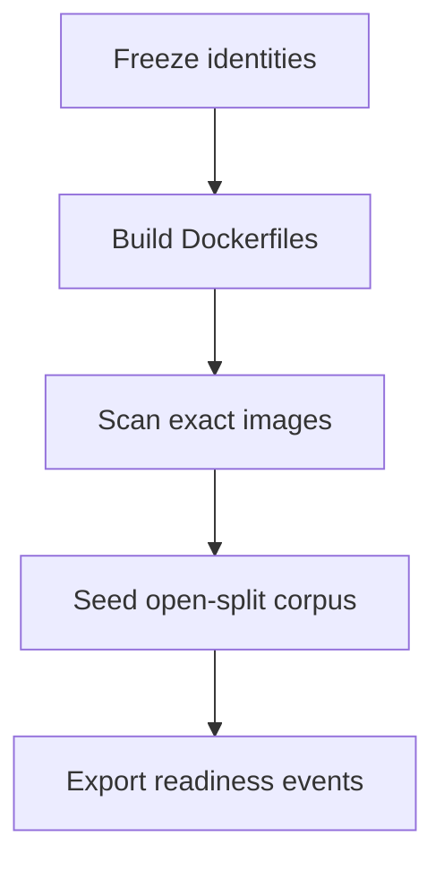

### Inspected paths (before edit)

| Path | Result |
| --- | --- |
| `docker-compose.yml` | Candidate identity; ParadeDB/Valkey/crawl-proxy have no host ports |
| `docker-compose.packet8.yml` | Host-pytest overlay; not candidate identity |
| `apps/*/Dockerfile`, `infra/crawl-proxy/Dockerfile`, `infra/parser-sandbox/Dockerfile` | Local-built images, user 10001 |
| `tests/contract/hybrid_ready_driver.py` | Parse→chunk→embed→canonical→BM25; not SQL-stamped |
| `packages/core/.../evaluation/holdout.py` | Default deny |
| `packages/core/.../jobs/graph_mapping_service.py` | Graph Ready via mapping/writer |
| `scripts/dev.ps1`, `scripts/verify-local.ps1`, `scripts/reset.ps1` | Existing lifecycle |

### Files changed (allowed outputs only)

| File | Action |
| --- | --- |
| `packages/core/src/smart_rag_core/release/` | Created — freeze, ports, corpus, readiness, seed, mapping, health |
| `scripts/phase09_candidate.py` | Created — host freeze/build/scan/up/seed |
| `scripts/ci/check_phase09_packet1.py` | Created — zero-collection fail-closed gate |
| `tests/unit/test_phase09_candidate.py` | Created — negative gates always run |
| `tests/contract/test_phase09_candidate.py` | Created — live compose/supabase/artifact contracts |
| `docs/deployment/LOCAL_RELEASE_CANDIDATE.md` | Created |
| `docs/deployment/phase-09/*.json` | Created by freeze/build/seed (no secrets) |
| `docs/development/QUALITY_COMMANDS.md` | Packet 1 commands |
| `docs/development/CONFIGURATION.md` | `SMART_RAG_REQUIRE_PHASE09_CANDIDATE` |
| `docs/development/LOCAL_SETUP.md` | Candidate freeze step |
| `docs/development/CI_TIERS.md` | Local-only gate note |
| `docs/architecture/04-deployment.md` | Reciprocal link |
| `docs/README.md` | Index rows |
| `.cursor/plans/.../09-phase-local-release-candidate.md` | Packet 1 checkbox `[x]` after live Passed |
| `.cursor/plans/.../packets/01-build-exact-candidate-images.md` | `status: complete` after live Passed |

### Identities frozen

Source: `docs/deployment/phase-09/candidate-identity-freeze.json`. No secrets.

| Field | Value |
| --- | --- |
| git | `7438b54abe70a57652f85c90f678d5ad2f58192a` (`git_dirty`: true) |
| `uv.lock` sha256 | `d05ce6ea28378999c7a95118bd482f89399f61ffb20e11b0f70228dc7674cfbc` |
| `pnpm-lock.yaml` sha256 | `ba5c198c44a586dfcd128e19cc2db713d08e255dae2e95165d06e48051f0bcc7` |
| frozen retrieval profile | `hybrid_default_v1` |
| embedding | `text-embedding-3-large` / 1024 |
| prompts | `query_profile_v1`, `rerank_v1`, `answer_v1`, `verifier_v1` |
| BM25 | schema `bm25_v1`, normalization `arabic_norm_v1` |
| LightRAG | `1.5.6` / handoff `lightrag_v1` |
| ParadeDB image digest | `dca046b8a0ddd070c368d5254cbb7f596b3b7bc67bc2efa7c0fbe881087883bb` |
| `pg_search` (at freeze, stack was up) | `0.25.2` |
| migrations | 51 SQL files hashed |
| profile | `APP_ENV=local`, `MOCK_MODEL_MODE=true` |
| proceed decision | Phase 8 wrapper pending; user ordered Phase 9 on 2026-08-17 |

### Candidate images (P09-01-A build)

Built from repository Dockerfiles via `docker-compose.yml` plus profile
`parser-build`. User `10001:10001`. Local `repo_digest` is
`name@sha256:<image_id>` (no registry push). API/worker images bake tiktoken
`cl100k_base` encodings because the worker has no public DNS on Compose
`private`.

| Service | Image | Id |
| --- | --- | --- |
| api | `smart-rag-api` | `sha256:d697ab32a5456e30a93363371811f65b69d8e720528f8877c9b7e4d403368632` |
| worker | `smart-rag-worker` | `sha256:045fae20209c13c897904c978dfb9a450110b6d6649dc49a1757606b40620990` |
| frontend | `smart-rag-frontend` | `sha256:4d15cd9aed7e8d48f640e5044251d39288bd472cc08a0daef8baae50beecd93e` |
| crawl-proxy | `smart-rag-crawl-proxy` | `sha256:a43503851112064514eb15140f724d774c4ecb3e9758e4a25195771b98d5a604` |
| parser-sandbox | `smart-rag-parser-sandbox:local` | `sha256:6798b6a5ee79cf711c3afc8ad4dcf21662af90008cb25d62e8d6ee60c58feeec` |

A later rebuild that changes any Id invalidates this freeze. Later packets
consume these Ids, not git SHA (`git_dirty` was true while Packet 1 completed).

### Classifications

Packet 1 live health, migrations, corpus, readiness, and sizing **Passed**.
Trivy via docker.sock remains **Blocked** (not retried). Gitleaks **Passed**
after allowlisting published local demo JWT / inert test canaries. pip-audit
and pnpm audit **Passed**. Phase 9 wrapper stays `pending`.

| Check | Classification | Notes |
| --- | --- | --- |
| P09-01-A digest/health | Passed | Candidate compose without overlay. API/frontend live. `pg_search` 0.25.2. Valkey AUTH. Private publishers empty. `MOCK_MODEL_MODE=true`. Overlay `false`. |
| P09-01-B migrations | Passed | 51 repository files hashed. Applied `schema_migrations` match; `drift: false`. |
| P09-01-C corpus | Passed | 8 open-split cases, `holdout_opened: false`. One each exact_code, alias, arabic_mixed, latest_as_of, tabular_aggregation, media_limitation, acl_negative (restricted), graph_mapping. |
| P09-01-D readiness | Passed | All required public states observed. Hybrid Ready used `Bm25ProjectionService.process_upsert_job`. Graph Ready used `GraphMappingService.map_after_vendor_success`. No SQL stamps. Restricted LightRAG rejected live. |
| P09-01-E sizing | Passed | 8 versions, 16 chunks, 2 graph-eligible. Docker NCPU 20 / MemTotal 8131035136. No managed claims. Local subset, not QT-CAP envelope. |
| Digest mismatch negative | Passed | `tests/unit/test_phase09_candidate.py` |
| Holdout/unapproved/production negative | Passed | Same |
| Restricted LightRAG negative | Passed | Unit plus live restricted rejection during seed |
| Fake/duplicate readiness negative | Passed | Same |
| Public ParadeDB/Valkey/LightRAG port negative | Passed | Unit, static Compose, and live `compose ps` after overlay removal |
| Identity freeze fields | Passed | `APP_ENV=local`, ParadeDB digest `dca046b8…883bb` |
| Trivy Critical | Blocked | docker.sock Trivy hung Docker Desktop on 2026-08-17. Not retried. Packet 6 re-runs full SBOM/Trivy. |
| Gitleaks | Passed | Pinned image; allowlists cover local demo JWT, LangSmith canary, glossary idempotency keys |
| pip-audit / pnpm audit | Passed | Compact scan summary |
| Managed EC2/Supabase | Not Run | Phase 10 handoff; not claimed |

### Corpus seed counts

Frozen manifest is the labeled 8-row subset. Holdout closed. Production paths
rejected. Seed ran from **host Python** against a temporary Packet 8 ParadeDB
`:54329` overlay because unpublished ParadeDB is unreachable from Windows
localhost and the then-running worker image lacked the `graph_eligible`
insert-order fix. Overlay was removed; candidate health re-proved unpublished
ports. Worker/API were then rebuilt so later worker-exec seed uses the same
code. A first failed seed (deletion constraint) left extra unlabeled versions
in local Supabase; later packets must use `candidate-corpus-manifest.json` ids,
not “all documents”.

| Split / visibility / state | Frozen manifest |
| --- | --- |
| development | 7 cases |
| qualification | 1 (`p4-media_limitation-0002`) |
| company_visible | 7 |
| restricted | 1 (`p4-acl_negative-0003`, graph-ineligible) |
| Hybrid Ready events (BM25 verified) | 8 |
| Graph Ready | 1 (`p4-exact_code-0003`, maps verified) |
| graph_pending left unlabeled | 1 (`p4-graph_mapping-0003`) |
| seeded_document_versions / chunks / graph-eligible | 8 / 16 / 2 |

### Readiness states proven vs not

Required: uploading, uploaded, scanning, parsing, hybrid_ready, graph_pending,
graph_ready, graph_ineligible, deletion_pending, failed.

| State | Live proof |
| --- | --- |
| uploading | `app.reserve_upload_quota` |
| uploaded | `app.finalize_quarantine_upload` |
| scanning | `app.transition_document_version_status` |
| parsing | `app.transition_document_version_status` |
| failed | `app.transition_document_version_status` |
| hybrid_ready | `Bm25ProjectionService.process_upsert_job` (`bm25_verified`) |
| graph_ineligible | `app.finalize_hybrid_ready` |
| graph_pending | `app.finalize_hybrid_ready/enqueue_graph_pending_handoff` |
| graph_ready | `GraphMappingService.map_after_vendor_success` (`maps_verified`) |
| deletion_pending | `app.exclude_version_from_retrieval` on a graph-ineligible version |
| Fake/duplicate Hybrid/Graph Ready | **Rejected in unit tests** |
| Restricted LightRAG index | **Rejected in unit tests and live seed** |

### Artifact paths

| Path | Role |
| --- | --- |
| `docs/deployment/phase-09/candidate-identity-freeze.json` | Identity freeze |
| `docs/deployment/phase-09/candidate-image-manifest.json` | Image Ids above |
| `docs/deployment/phase-09/candidate-scan-summary.json` | Trivy Blocked; Gitleaks/pip-audit/pnpm Passed |
| `docs/deployment/phase-09/candidate-health.json` | All live checks passed; overlay false |
| `docs/deployment/phase-09/candidate-migrations.json` | File inventory; applied versions; drift false |
| `docs/deployment/phase-09/candidate-corpus-manifest.json` | 8 open-split rows |
| `docs/deployment/phase-09/candidate-readiness-export.json` | Required states; `missing_states: []` |
| `docs/deployment/phase-09/candidate-sizing-baseline.json` | Local envelope map; counts 8/16/2 |
| `docs/deployment/phase-09/candidate-seed-counts.json` | Blockers empty |
| `docs/deployment/phase-09/candidate-command-log.json` | Host orchestrator commands and exit codes |
| `.tmp-phase09/` | Gitignored scanner dumps |

Later packets must consume these image Ids and corpus/version ids.

### Failures and repairs

1. Trivy via `docker run -v /var/run/docker.sock aquasec/trivy:latest image`
   hung Docker Desktop (`HTTP 500` on `_ping`). Orchestrator was killed.
2. Host disk filled (`ENOSPC`). Docker updater leftover was deleted from Temp.
3. `vmmemWSL` stayed **StopPending** until Docker recovered. Packet 1 did
   **not** retry docker.sock Trivy.
4. Worker health failed: tiktoken tried to download encodings with no DNS on
   `private`. Repair: prefetch encodings in API/worker Dockerfiles.
5. Worker could not reach host Supabase: `private` is `internal: true`.
   Repair: worker also joins `edge` (still no published ports), matching API.
6. `documents_graph_eligible_requires_company_visible`: `graph_eligible` cannot
   be true before `current_version_id`. Repair: set eligibility after the
   current-version pointer.
7. `document_versions_graph_eligible_requires_open`: deletion cannot keep
   `graph_eligible`. Repair: drive `deletion_pending` on a graph-ineligible
   version.
8. Worker rootfs is read-only; host code was not `docker cp`'d in. Repair:
   rebuild API/worker after the seed-path fixes.
9. Gitleaks reported 4 fixture findings (local demo JWT, leak canary,
   glossary idempotency keys). Repair: path-scoped `.gitleaks.toml` allowlists.
   Compact scan now fails closed on Gitleaks/pip-audit/pnpm `failed`.

### Managed blockers / Phase 10 handoff

- No AWS, Vercel, KMS, CloudFront, WAF, or managed Supabase provisioned.
- Packet 1 does not prove instance-equivalent sizing or restore drills
  (Packets 4 and 6).
- Canonical evidence remains local Supabase; ParadeDB is derived.
- Full SBOM/Trivy remains Packet 6.

### Commands and exit codes

| Command | Exit code | Notes |
| --- | --- | --- |
| `uv run python scripts/phase09_candidate.py ports-static` | 0 | Candidate Compose has no private host ports |
| `uv run python scripts/phase09_candidate.py freeze` | 0 | Identity freeze written; `git_dirty` true |
| `uv run python scripts/phase09_candidate.py supabase` | 0 | Local CLI stack |
| `docker compose -f docker-compose.yml build api worker` | 0 | Tiktoken bake + seed-path core |
| `uv run python scripts/phase09_candidate.py up` | 0 | `--no-build --force-recreate --remove-orphans`; no overlay |
| `uv run python scripts/phase09_candidate.py health` | 0 | Private ports unpublished |
| `uv run python scripts/phase09_candidate.py migrations` | 0 | drift false |
| Host `smart_rag_core.release.cli seed` (overlay then removed) | 0 | 8 labeled cases; all required states |
| `uv run python scripts/phase09_candidate.py sizing` | 0 | Counts 8/16/2; NCPU 20 |
| `uv run python scripts/phase09_candidate.py scan` | 0 | Trivy Blocked (not retried); Gitleaks/pip/pnpm Passed |
| `uv run python -m pytest tests/unit/test_phase09_candidate.py tests/contract/test_phase09_candidate.py -q` | 0 | 24 passed, 0 skipped |
| `uv run python scripts/ci/check_phase09_packet1.py` | 0 | tests=24 failures=0 errors=0 skipped=0 |

Packet file `status` is `complete`. Phase 9 wrapper `status` remains
`pending`. Holdout was not opened (`HoldoutAccess.denied()`).

## Packet 2 — Run all applicable hard CI and security gates

Requirement ID: **P09-02**.

### Requirement (quoted)

> Run all applicable hard CI, expand/contract migration compatibility,
> identity/RLS/BM25/cache/read-audit, graph isolation, injection, parsing,
> deletion, idempotency/GC, API/SSE compatibility, and redaction gates with
> no skipped required tests.

### Concrete acceptance checks

- **P09-02-A:** All locally applicable gates execute and pass with no
  skip/empty result. Evidence: suite matrix. Failure: local no-go.
- **P09-02-B:** Identity/ACL/deletion/cache/BM25/graph negatives yield zero
  unauthorized or stale evidence. Evidence: role/state assertions. Failure:
  launch blocker.
- **P09-02-C:** Replay/idempotency/GC creates no duplicate paid run, chunk,
  active BM25 row, or graph version. Evidence: before/after state. Failure:
  repair.
- **P09-02-D:** Expansion, old-slot/new-schema, minimum client, additive
  SSE/OpenAPI, reconnect, and no destructive DDL pass. Evidence:
  compatibility matrix. Failure: defer/repair.
- **P09-02-E:** Injection/parser/malware/governance/egress/budget/rate/redaction
  pass without bypass. Evidence: adversarial reports. Failure: launch blocker.

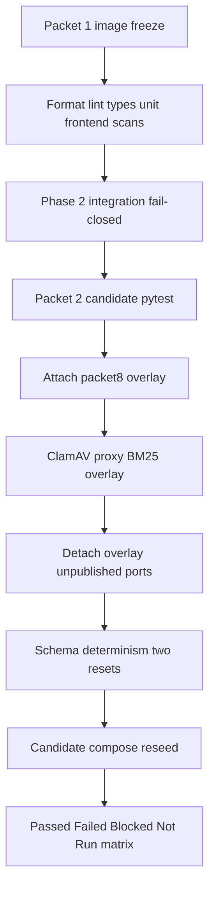

### Inspected paths (before edit)

| Path | Result |
| --- | --- |
| Packet 1 commit `f1b4d23` image Ids | Consumed; not rebuilt |
| `docker-compose.yml` | Candidate identity only |
| `docker-compose.packet8.yml` | Overlay for malware/proxy/host BM25; detached after |
| `scripts/ci/check_phase09_packet1.py` | Pattern for zero-collection fail-closed |
| `scripts/ci/check_phase2_integration.py` | RLS/JWKS-local/Auth/Storage/quota/audit/BM25 |
| `scripts/ci/check_schema_determinism.py` | Two resets; wipes seed |
| `tests/contract` RLS/ACL/SSE/parser/injection/deletion | Mapped; no invented old-API smoke |

### Files changed (allowed outputs only)

| File | Action |
| --- | --- |
| `packages/core/src/smart_rag_core/release/packet2.py` | Fail-closed matrix and handoffs |
| `scripts/ci/check_phase09_packet2.py` | Candidate/overlay/all runner |
| `scripts/ci/check_schema_determinism.py` | Typegen via host `54322` `--db-url` |
| `scripts/phase09_candidate.py` | Seed artifact copy via worker exec |
| `packages/core/src/smart_rag_core/generated/database.ts` | Regenerated to match reset schema |
| `tests/contract/test_rls_matrix.py` | Seed-tolerant fixture visibility; current graph-reject text; `chain_seq` order |
| `tests/contract/test_invitations_auth.py` | Bootstrap does not delete seeded owner FKs |
| `tests/contract/test_local_auth_mail.py` | Pinned `:3010` Playwright redirects |
| `tests/contract/test_audit_chain.py` | Full-chain `verify_audit_chain(count(*))` |
| `tests/contract/test_hybrid_retrieval.py` | Cold term nonce outside `SKU-P4-*` |
| `tests/contract/test_crawl_ssrf.py` | Worker `edge`+`private`; `egress` forbidden |
| `docs/deployment/phase-09/candidate-packet2-gate-matrix.json` | Suite matrix |
| `docs/deployment/phase-09/candidate-corpus-manifest.json` | Rewritten after schema wipe |
| `docs/security/AUDIT_CHAIN.md` | `verify_audit_chain(n)` scans oldest `n` |

### P09-02-A through P09-02-E matrix

| Check | Classification | Evidence | Notes |
| --- | --- | --- | --- |
| P09-02-A | **Blocked** | CI tiers Passed; Trivy/SBOM Blocked | Local Packet 6 owns docker.sock Trivy. Not relabeled managed. |
| P09-02-B | **Passed** | Phase 2 111/0/0/0; identity suite 48/0/0/0 | Managed JWKS/pgvector **Not Run** (Phase 10) |
| P09-02-C | **Passed** | Replay suite 46/0/0/0 | No overlay BM25 delete in candidate mode |
| P09-02-D | **Blocked** | OpenAPI/migrations/schema Passed; old-API smoke missing | Local gap. Do not fake with the Packet 1 image. CDN/OIDC **Not Run** Phase 10 |
| P09-02-E | **Passed** | Parser suite 18/0/0/0; overlay 8/0/0/0 | KMS/S3 anchors **Not Run** Phase 10 |

### Role / ACL negatives (P09-02-B)

| Assertion | Result |
| --- | --- |
| Restricted document hidden from members without ACL | Passed |
| Forged admin role / stale authorization version returns empty | Passed |
| Disabled profile sees zero documents including seed rows | Passed |
| Restricted LightRAG index rejected (`index rejected`) | Passed |
| Audit UPDATE/DELETE denied; tamper detected on full chain | Passed |
| Retrieval cache / graph isolation / conversation deletion contracts | Passed in identity suite |

### Compatibility (P09-02-D)

| Gate | Classification |
| --- | --- |
| Expand/contract static (`check_migrations.py`, 51 files, no destructive DDL) | Passed |
| OpenAPI snapshot (`check_openapi.py`) | Passed |
| Schema determinism two resets (schema SHA-256 `0921806d…ee76d`, types `8aafd3c2…3a42c8`) | Passed |
| Additive SSE heartbeat + reconnect + local timeouts | Passed (12 tests) |
| Old-API image vs post-expansion schema authenticated smoke | **Blocked** (no existing test) |
| Real CDN SSE / OIDC protected migrations | **Not Run** Phase 10 |

### Schema reset and reseed

Data identity **changed**. Packet 1 corpus document/version ids are invalid for
Packet 3+. Image Ids are unchanged (Packet 1 freeze). Holdout stays sealed.
`compose cp` could not read worker `/tmp` tmpfs; artifacts were copied via
`exec`. Overlay attach recreated ParadeDB and would have dropped BM25 even
without the schema wipe.

New corpus ids (8 open-split rows, `holdout_opened: false`):

| case_id | document_id | version_id |
| --- | --- | --- |
| p4-acl_negative-0003 | `a5418f3e-5bb3-4089-b603-8bb04a1e423c` | `96286c5e-c2a4-4e37-9686-30515af04554` |
| p4-alias-0003 | `1b0d09c0-e050-474a-a77f-9158792891f5` | `f24d149d-97f8-4ef3-acd3-cb8f91fd6f06` |
| p4-arabic_mixed-0003 | `769f3b6c-668b-40d2-ac3f-5377a64f831a` | `3174ccf2-a263-4730-a384-2e98dd0103a5` |
| p4-exact_code-0003 | `3367635d-7b03-4be7-945c-dd207c848e02` | `3a41a379-c8ef-4f58-ad22-dd747b4d42af` |
| p4-graph_mapping-0003 | `8a63df1c-7eb1-4513-ab1d-c0c58d10d1b9` | `ea75bc0c-a0f6-45ae-935e-38e0e5dd2c07` |
| p4-latest_as_of-0003 | `0d3d1169-f237-47bf-a312-25b7acbc4536` | `0bfd5c6b-e807-442f-a67a-2673b700afab` |
| p4-media_limitation-0002 | `31a7545f-f608-4a9c-a207-327d70af00bd` | `c977b330-df35-47f2-9551-8713e26ff6af` |
| p4-tabular_aggregation-0003 | `f567ecde-f53c-4582-aafd-f935e8495199` | `6cc1ac54-b49e-42f3-815c-b97a5d3675c7` |

Seed counts: 8 versions, 16 chunks, 2 graph-eligible. `missing_states: []`.
`blockers: []`. Readiness includes `graph_ready` and `deletion_pending`.

### Failures and repairs

1. Phase 2 failed on Packet 1 seed: exact document-set equality, owner DELETE
   vs `glossary_imports` FK, stale Auth redirect list, `verify_audit_chain(100)`
   scanning only the oldest 100 events, graph reject message
   `graph build index rejected`. Repair: seed-tolerant assertions; full-chain
   verify; match `index rejected`; pin `:3010` redirects.
2. `SKU-P4-ZZZ` trigram-matched the open-split corpus. Repair: cold-term nonce
   outside dataset identifier rules.
3. Worker-on-`edge` is Packet 1 candidate identity for
   `host.docker.internal`. Repair: forbid `egress` and published ports, require
   `private`+`edge`.
4. Generated `database.ts` lagged later-phase RPCs/tables. Repair: regenerate
   after reset; typegen uses `--db-url` `127.0.0.1:54322`.
5. `docker compose cp` cannot see worker `/tmp` tmpfs. Repair: `exec` copy.
6. Trivy via docker.sock was **not** retried.

### Managed / later-packet handoff

- Managed JWKS rollover, managed pgvector, real CDN SSE, KMS/S3 audit anchors,
  OIDC protected migrations, managed restore, external assessment: **Not Run**,
  Phase 10, `managed_only: true`.
- Trivy/SBOM: **Blocked**, Phase 9 Packet 6 (local).
- Old-API/new-schema smoke: **Blocked**, Phase 9 Packet 2/7 (local). Packet 7
  may author a real prior-digest smoke; do not relabel as managed.
- Five-stream SSE load, Valkey kill, restore drill, quality-latency: later
  Phase 9 packets.

### Commands and exit codes

| Command | Exit | Notes |
| --- | --- | --- |
| `uv run python scripts/check.py --tier format` | 0 | After formatting pre-existing drift |
| `uv run python scripts/check.py --tier lint` | 0 | |
| `uv run python scripts/check.py --tier types` | 0 | Pyright 0 errors |
| `uv run python scripts/check.py --tier unit` | 0 | 668 passed, 3 skipped (Windows symlink/`resource`) |
| `uv run python scripts/ci/check_phase6_eval_registry.py` | 0 | Inside unit tier |
| `uv run python scripts/ci/check_openapi.py` | 0 | Snapshot matches |
| `uv run python scripts/ci/check_migrations.py` | 0 | 51 files; no destructive DDL |
| `uv run python scripts/check.py --tier docs` | 0 | Re-run after this append |
| `uv run python scripts/check.py --tier frontend` | 0 | Vitest 149; Playwright 29 |
| pip-audit (`PYSEC-2026-113` ignored) | 0 | |
| `pnpm audit --audit-level high` | 0 | |
| gitleaks pinned image + `.gitleaks.toml` | 0 | no leaks found |
| `uv run python scripts/ci/check_phase2_integration.py` | 0 | 111 tests, 0 skip; re-proved after reseed |
| `uv run python scripts/ci/check_phase09_packet2.py --mode candidate` | 0 | 48+46+12+18, 0 skip |
| Overlay attach `docker-compose.packet8.yml` `--no-build --wait` | 0 | Ports 54329/13310/18080 |
| Packet 2 overlay `--merge-artifact` with require flags | 0 | 8 tests, 0 skip |
| Overlay detach `docker-compose.yml` `--no-build --remove-orphans` | 0 | |
| `phase09_candidate.py ports-static` | 0 | |
| `phase09_candidate.py health` | 0 | `overlay_used: false`; private publishers empty |
| `check_schema_determinism.py` (after type refresh) | 0 | Two matching resets |
| Worker `python -m smart_rag_core.release.cli seed` | 0 | Candidate compose; no overlay |
| Seed artifact copy via worker exec | 0 | `compose cp` failed on tmpfs |
| `phase09_candidate.py sizing` | 0 | Counts 8/16/2 |

Packet 2 checkbox stays **unchecked**. Packet file `status` stays `pending`
because P09-02-A (Trivy) and P09-02-D (old-API smoke) are local Blocked, not
Phase 10 managed-only handoffs. Phase 9 wrapper `status` remains `pending`.
Holdout was not opened (`HoldoutAccess.denied()`). `SMART_RAG_HOLDOUT_ACCESS`
was not set to `true`.

## Packet 3 — Measure quality, latency, BM25, cost, and graph throughput

Requirement ID: **P09-03**.

### Requirement (quoted)

> Measure Hybrid/Combined/table/inspection quality, BM25
> projection/query/recheck/rebuild behavior, p50/p95/deadlines, model
> calls/cost, graph survival, writer throughput, and onboarding ETA.

### Concrete acceptance checks

- **P09-03-A:** Zero ACL leaks; citation correctness ≥98%;
  completeness/faithfulness ≥90%; routing ≥90%; Hybrid Recall@10 ≥85%;
  exact Recall@5 ≥98%; alias Recall@10 ≥95%; Combined gain ≥10 points
  within cost/latency. Evidence: immutable report. Failure: requalify/no-go.
- **P09-03-B:** Route percentiles/deadlines and call/tool ceilings pass or
  limits are reduced/re-signed. Evidence: raw samples/ledger. Failure:
  sizing route.
- **P09-03-C:** BM25 exact numeric/query/recheck/lag/outage/rebuild gates
  pass. Evidence: BM25 report. Failure: blocker/envelope decision.
- **P09-03-D:** Graph mapping, per-language survival, concurrency-one
  throughput, ETA, cost, and seven-day maintenance are proven. Evidence:
  graph report. Failure: reduce graph envelope/quarantine.

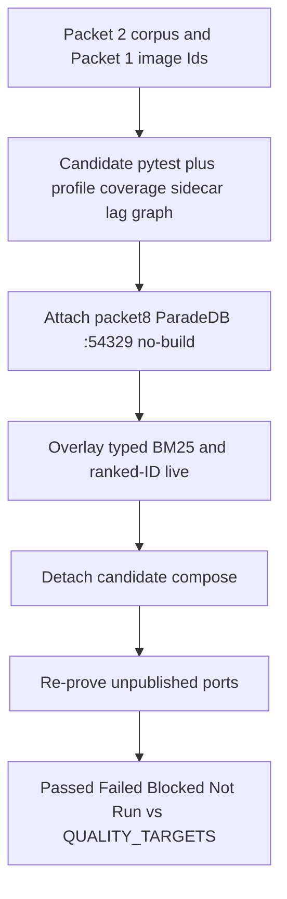

### Identities and method

HEAD consumed: Packet 2 `f71c04e`. Images were **not** rebuilt. Data identity
is the Packet 2 reseed (`p4-exact_code-0003` document
`3367635d-7b03-4be7-945c-dd207c848e02`), not Packet 1 ids. Hardware from
`candidate-sizing-baseline.json`: Docker NCPU **20**, mem **8131035136**
bytes. Seed is a labeled **8-version / 16-chunk / 2 graph-eligible** subset,
not QT-CAP-001/002. Profile: `APP_ENV=local`, `MOCK_MODEL_MODE=true`.
Holdout stayed sealed. Candidate compose is `docker-compose.yml` only.

The Phase 4 runtime sidecar
`tests/fixtures/evaluation/phase4/runtime/gold_id_map.json` is Packet 1
identity and was **not** used for scoring. Packet 3 wrote
`docs/deployment/phase-09/candidate-gold-id-map.json` from live
`app.document_chunks` for the seven retrieve cases (graph-mapping omitted
because ranked-ID retrieve excludes that class). ACL-negative chunks are
tombstoned after the Packet 1 `deletion_pending` drive; mapping includes
deleted rows so leak checks still have real UUIDs.

Mock Recall@K is recorded and labeled `qt_eval_006_live=false`. Combined
fixture ablation is **66.7 pp** and is **not** live QT-EVAL-009
(`qt_eval_009_status()==unverified`). LightRAG keyword extraction was not
duplicated (`query_keyword_extract=0`). Phase 5 freeze markdown was not
rewritten.

### Inspected paths (before edit)

| Path | Result |
| --- | --- |
| `scripts/eval_phase4_ranked_ids.py` | Existing `--live` / `--split open`; added repeatable `--case-id` |
| `scripts/eval_query_profile.py`, coverage, freeze, graph freeze CLIs | Inspected; freeze writers not invoked |
| `tests/contract/test_paradedb_bm25.py` | Compose exec; no overlay |
| `tests/contract/test_hybrid_retrieval.py::test_bm25_typed_query_and_injection` | Overlay host `:54329` |
| `docs/QUALITY_TARGETS.md` | Signed QT-EVAL/LAT/DL/MC/BM25/GR/CAP rows |
| `docs/evaluation/PHASE4_RANKED_IDS.md`, `PHASE5_GRAPH_EVAL.md` | Consumed; not rewritten |

### Files changed (allowed outputs only)

| File | Action |
| --- | --- |
| `packages/core/src/smart_rag_core/release/packet3.py` | Fail-closed matrix, sidecar, lag, graph snapshot |
| `packages/core/src/smart_rag_core/release/constants.py` | Packet 3 schema versions |
| `scripts/ci/check_phase09_packet3.py` | Candidate/overlay/all runner; zero collection fails |
| `scripts/eval_phase4_ranked_ids.py` | `--case-id` fail-closed filter |
| `tests/unit/test_phase09_packet3.py` | Mapping, mock≠live, ACL not averaged |
| `docs/deployment/phase-09/candidate-packet3-*.json` | Quality, latency, ledger, BM25, graph, matrix |
| `docs/deployment/phase-09/candidate-gold-id-map.json` | Packet 2 retrieve gold UUIDs |

### P09-03-A through P09-03-D matrix

| Check | Classification | Evidence | Notes |
| --- | --- | --- | --- |
| P09-03-A ACL leaks | **Passed** | `acl_leak_count=0` on 7-case live retrieve plus citation/coverage units 65/0/0/0 | Not averaged |
| P09-03-A locator / citation correctness | **Passed** | Locator correctness **1.0** (n=7); QT-EVAL-002 threshold 0.98 | Retrieve locators, not answer-assembler completeness |
| P09-03-A completeness / faithfulness | **Not Run** | QT-EVAL-003/004 live_model_required | Verifier fixtures only |
| P09-03-A routing ≥90% | **Passed** | Routing matrix 59/0/0/0; query-profile development 216 and qualification 77 both `passed=true`; model_calls=0 | Holdout sealed |
| P09-03-A Hybrid Recall@10 / exact@5 / alias@10 | **Not Run** | Mock Recall@10 **0.25**, exact@5 **1.0**, alias@10 **0.0**; `embeddings=mock`; `qt_eval_006_live=false` | Overlay recreate emptied BM25; live OpenAI eval is Packet 7 |
| P09-03-A Combined +10pp | **Not Run** | Fixture ablation 66.7 pp; `combined_gain_live_status=unverified` | Not live Combined gain; no duplicate keyword extraction |
| P09-03-A QT-CAP-001 10k versions | **Not Run** | Seed 8 versions | `local_candidate_not_full_envelope=true` |
| P09-03-B first-evidence p95 | **Passed** | **560.8 ms** vs QT-LAT-001 2000 ms; n=7 | Ranked-ID CLI emits p95 only; p50 not invented. Empty BM25 after overlay. Packet 4 may invalidate under load |
| P09-03-B first-token / completion p95 | **Not Run** | Stream samples absent | Packet 4 |
| P09-03-B deadlines / model-call ceilings | **Passed** | `FAMILY_*` match QT-DL-001–005 and QT-MC-001–005; ceiling suite 13/0/0/0 | Recursion limit 24 |
| P09-03-C tokenizer / Arabic / 75 / 300 / outage / recheck | **Passed** | Candidate BM25 suite 86/0/0/0; overlay typed/injection/delete/reconcile 4/0/0/0 | Compose exec kept ParadeDB unpublished for candidate |
| P09-03-C seed lag vs 5 min | **Passed** | Outbox p50 **35.7 s**, p95 **98.9 s**, 42 completed / 66 jobs | Seed, not 1M chunks |
| P09-03-C 1M rebuild | **Not Run** | 16 chunks | Packet 6/7 |
| P09-03-D mapping / survival / resolver ACL | **Passed** | Graph suite 80/0/0/0; fixture language gates en 1.0 / ar+mixed 0.85 | Live LightRAG extraction P/R unverified |
| P09-03-D concurrency-one throughput / ETA | **Not Run** | `eta_confidence=insufficient-sample`; `documents_per_hour=null`; mapping_verified_count=0 | Do not invent docs/hour |
| P09-03-D 2k Graph Ready in 7 days | **Blocked** | Sequential 600s cap 1008; Packet 8 envelope **15** | Bulk onboarding blocked; not Phase 10 managed |

### Quality snapshot (mock vs live)

| Metric | Value | Live signed gate |
| --- | --- | --- |
| ACL leaks | 0 | Passed |
| Locator correctness | 1.0 | Passed as QT-EVAL-002 locators |
| Refusal correct rate | 1.0 (1 media case) | Fixture/retrieve |
| Hybrid Recall@10 | 0.25 (miss: alias, arabic_mixed, latest_as_of) | **Not** live QT-EVAL-006 |
| Exact Recall@5 | 1.0 | **Not** live QT-EVAL-007 |
| Alias Recall@10 | 0.0 | **Not** live QT-EVAL-008 |
| Table executed | 0 / 1 (no Parquet dir) | QT-LAT-006 Not Run |
| Coverage qualification | 77 cases, false_supported=0, not retuned | Holdout sealed |
| Combined fixture gain | 66.7 pp | Not live QT-EVAL-009 |
| USD | 0.0 | Mock gateway; calls counted |

### Overlay attach / detach

1. Candidate gate ran on unpublished ParadeDB (compose exec).
2. Overlay attach `docker-compose.packet8.yml` `--no-build --wait paradedb`
   **recreated** ParadeDB (seed BM25 rows dropped).
3. Overlay pytest 4/0/0/0 and ranked-ID `--live` returncode 0.
4. Detach `docker-compose.yml` `--no-build --wait --remove-orphans` recreated
   ParadeDB again (still empty).
5. `phase09_candidate.py health`: `overlay_used: false`; `paradedb` publishers
   empty; `pg_search` passed.

### Sizing ladder

- Repair live-model Recall/Combined under a signed budget; do not average ACL
  or citation failures.
- Keep QT-CAP-005-P8 = 15; seven-day 2k rebuild stays Blocked.
- Do not infer EC2/CDN/KMS proof from local NCPU/mem.
- Packet 4 must re-project BM25 through existing
  `Bm25ProjectionService.process_upsert_job` without changing Packet 2
  document/version ids and without SQL-stamping Hybrid Ready.

### Packet 4 handoff

Packet 4 owns five-stream SSE load, first-token/completion p95, connection
caps, and budget-lock contention. Do not claim QT-CAP-001/002 from this
corpus. Do not treat overlay-empty ParadeDB as a Hybrid BM25 baseline.
Managed topology remains Phase 10.

### Commands and exit codes

| Command | Exit | Notes |
| --- | --- | --- |
| `uv run ruff format` / `ruff check` on Packet 3 files | 0 | |
| `uv run python -m pytest tests/unit/test_phase09_packet3.py tests/unit/test_phase4_ranked_ids.py -q` | 0 | 27 passed |
| `uv run python scripts/phase09_candidate.py health` (before) | 0 | overlay_used false; paradedb unpublished |
| `uv run python scripts/ci/check_phase09_packet3.py --mode candidate` | 0 | 59+65+18+13+86+80, 0 skip; sidecar mapped |
| Overlay attach `--no-build --wait paradedb` | 0 | Container recreated |
| Packet 3 overlay `--merge-artifact` | 0 | 4 tests; ranked-ID live returncode 0; mock `qt_eval_006_live=false` |
| Overlay detach `--no-build --remove-orphans` | 0 | ParadeDB recreated empty |
| `phase09_candidate.py health` (after) | 0 | overlay_used false; private publishers empty |

Packet 3 checkbox is **checked** because P09-03-A–D are proven or honestly
classified with sizing-ladder decisions (not fake live Recall or Combined
gain). Packet 2 stays **unchecked** (Trivy / old-API smoke Blocked). Phase 9
wrapper `status` remains `pending`. Holdout was not opened.

## Packet 4 — Contention and five-stream load

**Packet:** `Run contention and five-stream load` (`P09-04-A` … `P09-04-E`).
**Checkbox:** **unchecked**. P09-04-A is **Blocked** (70% pause + live
foreground p95 not proven; JWT issuer split hides docker EventSource).
P09-04-B/C/D/E **Passed**. Do not treat Blocked as Passed.

Candidate compose stayed `docker-compose.yml` only. Overlay was **not**
attached (`was_attached: false`). Packet 1 image Ids were unchanged. Packet 2
document/version ids were unchanged. Holdout was not opened. Worker/ParadeDB/
Valkey were not killed (Packet 5).

### BM25 re-projection (no identity rewrite)

Packet 3 overlay recreate emptied ParadeDB. Packet 4 re-projected through
existing `Bm25ProjectionService.process_upsert_job` inside the frozen worker.
`sql_stamped_hybrid_or_graph_ready: false`. Skipped `p4-acl_negative-0003`
(`deletion_pending`). Seven versions re-projected. `parade_total_rows` ~1035.

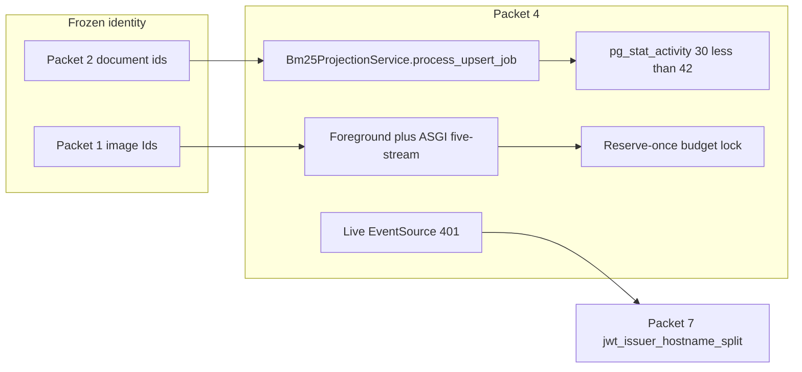

### Acceptance

| Check | Class | Evidence |
| --- | --- | --- |
| P09-04-A | Blocked | Graph/hybrid pytest 24 Passed. CPU peak **3.06%**; live 70% trigger did not fire. Fixture tests now prove `MaintenancePauseController` at 70%. Live foreground p95 `null` because docker JWT iss is `http://127.0.0.1:54321/auth/v1` vs frozen API `http://host.docker.internal:54321/auth/v1`. |
| P09-04-B | Passed | Worst-case 30 &lt; 42. Live pools not exhausted. |
| P09-04-C | Passed | Reserve-once unique_runs=4, wait_p95_ms ~44.6, deadlock false. |
| P09-04-D | Passed | ASGI five-stream **14 passed / 0 failed** (heartbeat jitter, lag, offload, resume). Live docker EventSource **Blocked** on JWT (Packet 7). |
| P09-04-E | Passed | Compose mem_limits remain Packet 1 baseline. OCR/Valkey-OOM/10k **Not Run**. |

### QUALITY_TARGETS (local 8-doc, mock)

- QT-CAP-001/002/003: **Not Run** (8-doc labeled subset; do not claim 10k/1M/25-user).
- QT-CAP-004: ASGI five concurrent streams **Passed**; live UI five-stream **Blocked** (JWT).
- QT-CAP-005-P8 = 15 remains the signed graph advertisement.
- First-token / completion p95 from live docker EventSource: **Not Run** (401).

### Sizing ladder / Packet 7 handoff

- `jwt_issuer_hostname_split`: frozen API issuer uses `host.docker.internal`;
  local GoTrue issues `127.0.0.1`. Do not rebuild Packet 1 images in Packet 4.
- 70% maintenance pause controller: **fixture-proven** at 70% CPU/IO/memory
  (`tests/unit/test_maintenance_pause.py`). Live 8-doc mock peaked at
  **3.06% CPU** and did not fire. Live 70% stays **Blocked**. Do not claim
  QT-CAP-001/002. Do not busy-loop the 8GB Docker VM.
- Do not infer EC2/CDN/KMS from local NCPU=20 / mem=8131035136.

### Commands and exit codes

| Command | Exit | Notes |
| --- | --- | --- |
| `uv run ruff check` on Packet 4 files | 0 | |
| `uv run python -m pytest tests/unit/test_phase09_packet4.py -q` | 0 | 12 passed |
| `uv run python -m pytest tests/contract/test_sse_heartbeat.py tests/unit/test_offload.py -q` | 0 | 14 passed (ASGI five-stream re-run) |
| `uv run python scripts/ci/check_phase09_packet4.py` | 0 | live load + BM25 reproject; see artifacts |

Artifacts:
`docs/deployment/phase-09/candidate-packet4-{gate-matrix,workload,contention,streams,pools,resources,bm25}.json`.

Packet 4 checkbox stays **unchecked** because P09-04-A is Blocked. Packet 2
stays **unchecked**. Phase 9 wrapper `status` remains `pending`. Holdout was
not opened.

## Packet 5 — Failure, degradation, and recovery

**Packet:** `Kill, deny, fill, and restart worker/ParadeDB/Valkey/services to prove reclaim, degraded retrieval/rate behavior, heartbeat/reconnect, and safe recovery.` (`P09-05-A` … `P09-05-E`).
**Checkbox:** **checked**. P09-05-A–E **Passed**. Named Valkey ACL users and
managed CDN SSE remain Phase 10 **Not Run**. Live docker EventSource stays
JWT-blocked for Packet 7. ParadeDB volume destroy stays Packet 6.

Candidate compose stayed `docker-compose.yml` only. Overlay was **not**
attached. Packet 1 image Ids were unchanged. Packet 2 labeled document ids
were unchanged. Holdout was not opened. ParadeDB volume was **not**
destroyed. Worker/ParadeDB/Valkey were restored; `phase09_candidate.py health`
exit 0 after the drill.

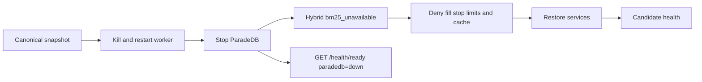

### Acceptance

| Check | Class | Evidence |
| --- | --- | --- |
| P09-05-A | Passed | Lease/crash/checkpoint pytest 15/0/0/0. Live worker kill/restart. Versions/chunks did not increase. |
| P09-05-B | Passed | Ready showed `paradedb=down`. Worker Hybrid `fallback_reason=bm25_unavailable` with ParadeDB unreachable. Normalization version mismatch fail-closed. `bm25_chunks` 1051 before and after restart. Volume not destroyed. |
| P09-05-C | Passed | Auth rate-limit pytest 8/0/0/0. Wrong requirepass denied on limits and cache. Each instance stop visible on ready. Limits noeviction fill accepted 62 x 1MiB keys then rejected; restart + FLUSHDB recovered. Named ACL users Phase 10. |
| P09-05-D | Passed | ASGI resume/heartbeat/deadline 12/0/0/0. Five-stream lag remains Packet 4. Live docker EventSource JWT Blocked (Packet 7). CDN Not Run (Phase 10). |
| P09-05-E | Passed | Pre/post snapshot versions 248 / chunks 604 matched. Identity held. Health after restore exit 0. ParadeDB/Valkey remained non-authoritative. |

The 248/604 counts are the whole local database at Packet 5 time, not a claim
that the labeled corpus grew. Packet 2 `p4-exact_code-0003` document id
stayed `3367635d-7b03-4be7-945c-dd207c848e02`. Ingestion job counts may
change during reclaim.

### Sizing ladder / later handoff

- `jwt_issuer_hostname_split` remains Packet 7.
- Named Valkey ACL users and managed-host/CDN faults remain Phase 10.
- ParadeDB volume destroy + clean BM25 rebuild remains Packet 6.
- Do not claim QT-CAP-001/002/OCR from this packet.

### Commands and exit codes

| Command | Exit | Notes |
| --- | --- | --- |
| `uv run ruff check` on Packet 5 files | 0 | |
| `uv run python -m pytest tests/unit/test_phase09_packet5.py -q` | 0 | 13 passed |
| `uv run python scripts/ci/check_phase09_packet5.py` | 0 | pytest 15+3+8+12; live kill/deny/fill/restore |
| `uv run python scripts/phase09_candidate.py health` | 0 | after restore |

Artifacts:
`docs/deployment/phase-09/candidate-packet5-{gate-matrix,fault-matrix,reconcile}.json`.

Packet 4 stays **unchecked** (P09-04-A Blocked). Packet 2 stays **unchecked**.
Phase 9 wrapper `status` remains `pending`. Holdout was not opened.

## Packet 6 — Egress, scans, restore, and sizing

**Packet:** `Run local egress enforcement, dependency/image scans, Supabase database plus all Storage-bucket restore/reconciliation including LightRAG, clean ParadeDB projection rebuild, and instance-equivalent sizing evidence.` (`P09-06-A` … `P09-06-E`).
**Checkbox:** **unchecked**. P09-06-A/C/D/E **Passed**. P09-06-B **Failed** (tar Trivy Critical findings on the frozen images). Managed KMS/S3 restore and EC2-equivalent proof remain Phase 10 **Not Run**.

Candidate compose stayed `docker-compose.yml` only. Overlay was **not** attached. Packet 1 image Ids were unchanged. Holdout was not opened. Trivy used `docker save` plus `trivy image --input` tar. `/var/run/docker.sock` was not mounted. Restore used disposable database `phase09_p6_restore_copy`, never live `postgres`. ParadeDB was not treated as canonical backup.

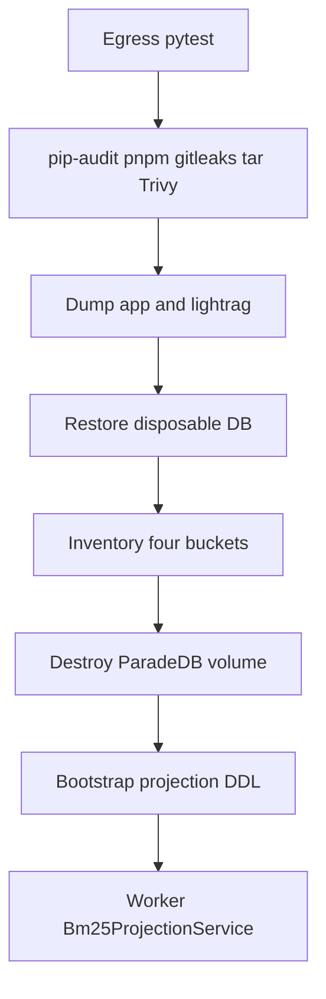

### Acceptance

| Check | Class | Evidence |
| --- | --- | --- |
| P09-06-A | Passed | SSRF/topology/parser-network pytest 38/0/0/0. |
| P09-06-B | Failed | pip-audit, pnpm audit, and gitleaks Passed. Tar Trivy Critical on api/worker/crawl-proxy (6) and frontend/parser-sandbox (8). Shared IDs include CVE-2023-45853, CVE-2026-13221, CVE-2026-42496, CVE-2026-57433, CVE-2026-8376. Failure route is rebuild. Packet 7 owns identity re-sign. |
| P09-06-C | Passed | `pg_dump -Fc -n app -n lightrag` 3.4 MiB. Disposable restore `app` tables 60, `lightrag` tables 11 (`pg_restore` exit 1 warnings only). Live `postgres` not overwritten. Buckets present: documents-quarantine, documents-originals, web-snapshots, table-artifacts. |
| P09-06-D | Passed | Volume `smart-rag_paradedb_data` destroyed. Init SQL plus Phase 2/4 bootstrap SQL applied as `paradedb`. Worker re-projected `authorized_current` (170 versions, 28 `bm25_chunks`, worker exit 0). No SQL-stamped Hybrid/Graph Ready. |
| P09-06-E | Passed | Health before/after exit 0. Local NCPU=20 is not EC2. QT-CAP-001/002 not claimed. QT-CAP-005-P8 stays 15. |

The 28 BM25 rows are derived from versions that still have canonical chunks after skip rules. They are not Packet 5's whole-database 604-chunk snapshot and are not QT-CAP-002.

A first live run also Failed P09-06-D because `paradedb_writer` has DML only on a fresh volume, then a classifier used `worker_returncode or 1` and treated success `0` as missing. Those were repaired in-repo before this matrix.

### Sizing ladder / later handoff

- Unresolved Critical Trivy findings: Packet 7 repair = rebuild frozen images and re-prove Packets 1-6 identity, or stop.
- `jwt_issuer_hostname_split`, 70% pause, old-API/new-schema smoke, live OpenAI Recall/Combined remain Packet 7.
- Managed KMS/S3 Object Lock restore and EC2/EBS/ParadeDB resources remain Phase 10.
- Do not remount docker.sock for Trivy on this host.

### Commands and exit codes

| Command | Exit | Notes |
| --- | --- | --- |
| `uv run ruff check` on Packet 6 files | 0 | |
| `uv run python -m pytest tests/unit/test_phase09_packet6.py -q` | 0 | 8 passed |
| `uv run python scripts/ci/check_phase09_packet6.py` | 1 | expected: P09-06-B Failed |
| `uv run python scripts/phase09_candidate.py health` | 0 | after rebuild |

Artifacts:
`docs/deployment/phase-09/candidate-packet6-{gate-matrix,scans,restore,rebuild,sizing}.json`.

Packet 6 checkbox stays **unchecked** because P09-06-B Failed. Packet 4 stays **unchecked**. Packet 2 stays **unchecked**. Phase 9 wrapper `status` remains `pending`. Holdout was not opened.

## Packet 7 — Resolve blockers and Phase 10 handoff

**Packet:** `Resolve blockers or explicitly reduce/resign supported limits; leave managed-topology gates clearly open for Phase 10.` (`P09-07-A` … `P09-07-E`).
**Checkbox:** **unchecked**. Wrapper `status` remains **pending**. Images were **not** rebuilt. Holdout was not opened.

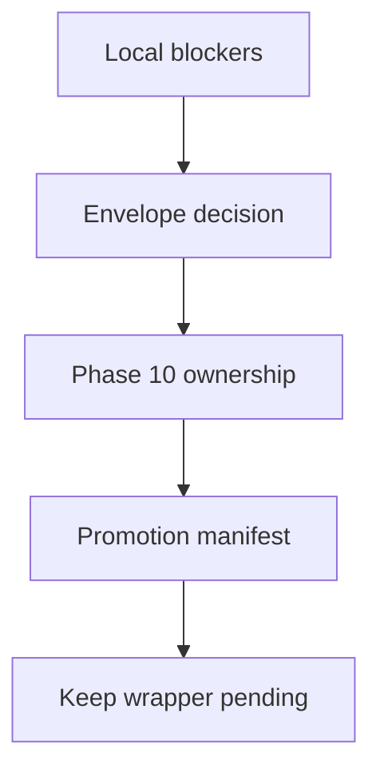

### Acceptance

| Check | Class | Evidence |
| --- | --- | --- |
| P09-07-A | Failed | Packet 6 tar Trivy Critical remains launch-blocking. JWT iss split, live 70% pause (fixture-proven, live 8-doc unfired), and old-API/new-schema smoke stay Blocked. |
| P09-07-B | Blocked | QT-CAP-005-P8 stays 15. 10k/1M and 25-user envelope were not claimed and are not client-signed reduces. |
| P09-07-C | Passed | Managed JWKS/restore, OIDC migrations, EC2/ParadeDB, CDN/origin/egress, KMS/S3/rotation/alerts, and external assessment stay Phase 10 Not Run. None were relabeled local. |
| P09-07-D | Passed | Packets 1-6 artifacts plus Packet 6 scans are listed in the promotion manifest. |
| P09-07-E | Passed | Wrapper `status: pending`. Packet 7 checkbox remains `[ ]`. |

**Recommendation:** no-go for Phase 10 until Critical Trivy findings are rebuilt, a new Packet 1 identity is frozen, and Packets 1-6 are re-proven, or the release stops.

### Sizing ladder / later handoff

- Repair Trivy: patch base images, freeze new Ids, rerun Packets 1-6. That invalidates this candidate.
- JWT: align GoTrue iss and API JWKS hostname; live EventSource stays blocked until then.
- 70% pause: fixture-proven at 70% via injected telemetry. Live 8-doc 3.06%
  CPU remains **Blocked**. Do not busy-loop the 8GB Docker VM. Reduce or
  re-sign with client sign-off, or re-measure on a workload that can reach
  70% without melting the host.
- Old-API smoke: harness landed. Unset `SMART_RAG_OLD_API_IMAGE` classifies
  **Blocked** (not a pytest skip). The Packet 1 freeze API Id is **Failed**,
  not Passed. Live smoke did not run: no prior digest exists on this host.
- Live OpenAI Recall/Combined: Not Run under `MOCK_MODEL_MODE=true`.
- Do not infer managed success from local NCPU=20.

### Commands and exit codes

| Command | Exit | Notes |
| --- | --- | --- |
| `uv run ruff check` on Packet 7 files | 0 | |
| `uv run python -m pytest tests/unit/test_phase09_packet7.py tests/unit/test_maintenance_pause.py tests/unit/test_phase09_packet4.py tests/unit/test_graph_mapping_hybrid.py -q` | 0 | 37 passed (12 pause-controller, 12 Packet 4, 6 Packet 7, 7 mapping) |
| `uv run python -m pyright` on pause-controller modules | 0 | `maintenance_pause.py`, `graph_index_service.py`, `packet4_load.py`, `graph_runner.py`, `test_maintenance_pause.py` |
| `uv run python scripts/ci/check_phase09_packet7.py` | not rerun | Wrapper Packet 7 stays unchecked; live 70% remains Blocked |
| `uv run python scripts/phase09_candidate.py health` | not rerun | identity unchanged; images not rebuilt |

Artifacts:
`docs/deployment/phase-09/candidate-packet7-{gate-matrix,phase10-handoff,promotion-manifest}.json`.

Packet 7 checkbox stays **unchecked**. Packets 2, 4, and 6 stay **unchecked**. Phase 9 wrapper `status` remains `pending` until you accept this exit record. Holdout was not opened. Images were not rebuilt. `check_phase09_packet7.py` was not rerun, so historical Packet 7 JSON artifacts still describe the pre-controller 70% row. Source `packet7.py` keeps `seventy_percent_pause` **Blocked**.

## Packet 7 repair — 70% maintenance pause controller

**Packet:** `P09-07-A` / `P09-04-A` `seventy_percent_pause`.
**Checkbox:** **unchecked**. Wrapper not edited.

Repo search found no in-process controller before this repair (architecture
docs only). Added `MaintenancePauseController` and wired it into HNSW
`REINDEX`, LightRAG `rebuild`, and BM25 subset rebuild. Fixture tests prove
the fail-closed 70% fire. Live 8-doc 3.06% CPU remains **Blocked**. Do not
claim QT-CAP-001/002. Do not busy-loop the 8GB Docker VM.

## Packet 7 repair: old-API / new-schema smoke harness

**Packet:** `Resolve blockers or explicitly reduce/resign supported limits; leave managed-topology gates clearly open for Phase 10.` (`P09-07-A` / `P09-02-D`).
**Checkbox:** **unchecked**. Wrapper `status` remains **pending**. Images were **not** rebuilt. Holdout was not opened. AWS was not provisioned.

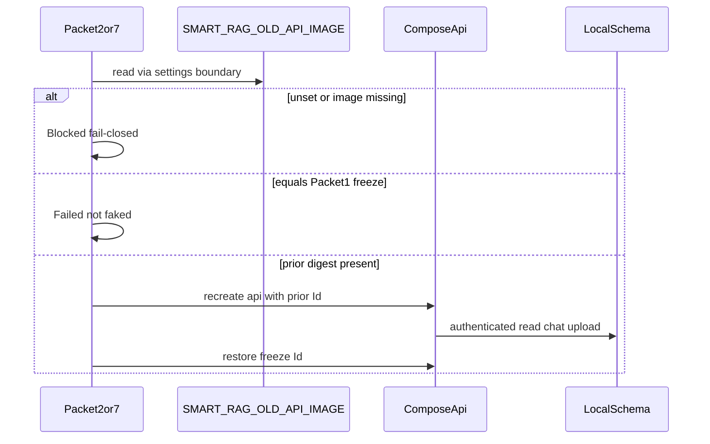

### Requirement (quoted)

> Keep a prior API image and run authenticated read/chat/upload smoke. Do not
> fake this with the single Packet 1 candidate image.

### Concrete acceptance

- Missing or blank `SMART_RAG_OLD_API_IMAGE`: **Blocked**, `smoke_ran=false`.
- Env resolves to Packet 1 API
  `sha256:d697ab32a5456e30a93363371811f65b69d8e720528f8877c9b7e4d403368632`:
  **Failed**.
- Env set but `docker inspect` cannot resolve the image: **Blocked**.
- Live authenticated read (`GET /me`, `GET /documents`), chat
  (`POST /conversations` plus messages), and upload (`POST /documents/uploads`
  200 or 403) run only against that prior image, then the freeze API slot is
  restored.

### Result

Live smoke **did not run**. This machine has only the Packet 1 freeze API
image. The harness and unit tests are in place so a future rebuild can keep
today's freeze as yesterday's prior digest.

### Commands and exit codes

| Command | Exit | Notes |
| --- | --- | --- |
| `uv run ruff check` on smoke files | 0 | plus Packet 7 runner |
| `uv run python -m pyright` on smoke/Packet 2/7 library files | 0 | 0 errors |
| `uv run python -m pytest tests/unit/test_old_api_new_schema_smoke.py tests/unit/test_phase09_packet2.py tests/unit/test_phase09_packet7.py -q` | 0 | 34 passed |
| `uv run python scripts/ci/check_old_api_new_schema_smoke.py` | 0 | Blocked, `smoke_ran=false` |

Artifacts:
`docs/deployment/phase-09/candidate-old-api-new-schema-smoke.json` (written by
the smoke evaluator). Packet 2/7 runners overlay `old_api_new_schema_smoke`.
`check_phase09_packet7.py` was not rerun here so the 70% pause artifact
history stays intact; the next Packet 7 recorder run will consume this
harness.

## Packet 7 repair — Trivy Critical OS base images

**Packet:** `Resolve blockers or explicitly reduce/resign supported limits; leave managed-topology gates clearly open for Phase 10.` (`P09-07-A` / `P09-06-B`).
**Checkbox:** **unchecked**. Wrapper `status` remains **pending**. Holdout was not opened. `packet7.py` stays Failed. Packet 1 freeze is **invalidated**.

Frozen-api tar Trivy (pre-repair
`sha256:d697ab32a5456e30a93363371811f65b69d8e720528f8877c9b7e4d403368632`)
attributed the shared Critical set to Debian 12.15 OS packages:

| CVE | Package | Installed | Trivy status |
| --- | --- | --- | --- |
| CVE-2023-45853 | zlib1g | 1:1.2.13.dfsg-1 | will_not_fix |
| CVE-2025-7458 | libsqlite3-0 | 3.40.1-2+deb12u2 | affected (no bookworm FixedVersion) |
| CVE-2026-13221 | perl-base | 5.36.0-7+deb12u3 | affected |
| CVE-2026-42496 | perl-base | 5.36.0-7+deb12u3 | fix_deferred |
| CVE-2026-57433 | perl-base | 5.36.0-7+deb12u3 | affected |
| CVE-2026-8376 | perl-base | 5.36.0-7+deb12u3 | affected |

Python images also had CVE-2025-7458. Frontend also had GnuTLS
CVE-2026-33845 / CVE-2026-42010 and npm `tar` CVE-2026-59873.
Parser-sandbox also had glib2.0 CVE-2026-58016 and libxml2 CVE-2026-6653.

Repair: re-pin `python:3.11-slim-bookworm` to
`sha256:2e32f7d302adc1c37428355c1e646897c0c53f4fd60b6a551245fb90ee129f91`
(`docker pull` + inspect on 2026-08-18). `node:20-bookworm-slim` remains
`sha256:2cf067cfed83d5ea958367df9f966191a942351a2df77d6f0193e162b5febfc0`
(official digest unchanged). Root-stage
`apt-get update && apt-get upgrade -y` then `rm -rf /var/lib/apt/lists/*`
before `USER 10001:10001`. uv `0.11.23` and pnpm `9.15.0` unchanged.

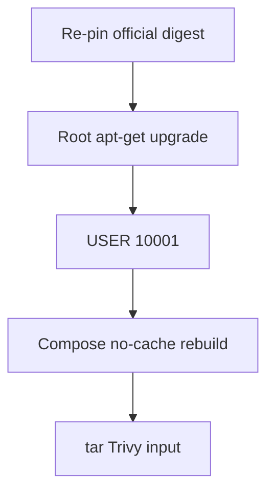

Rebuild command (exit 0):
`docker compose -f docker-compose.yml --env-file .env.compose --profile parser-build build --no-cache api worker frontend crawl-proxy parser-sandbox`

New image Ids (all `User=10001:10001`):

| Service | Image Id |
| --- | --- |
| api | `sha256:1d9f569b54c6012c4e9b1087979b409a9e2517ac9cce7c1f81d8917d9870f3d7` |
| worker | `sha256:6491f7f77a485761abeb1f402e105c43163abd813cd9e0a0fba3fa35e0476d63` |
| frontend | `sha256:191f1c17cf1b92224f24e4e17d83362f28712ae740556f8270e57c092200a693` |
| crawl-proxy | `sha256:8f725e07b30f3a2f0abf5a1f48a1335de08f9d7646c6d85cb64f27079e1d1518` |
| parser-sandbox | `sha256:6b2018cb662f9999e1d8f3344bd06240c239511ce1361c0b88ddf8c7afe37392` |

Post-repair tar Trivy (`aquasec/trivy:0.66.0`, no docker.sock):

| Service | Critical | Remaining IDs |
| --- | --- | --- |
| api | 6 | CVE-2023-45853, CVE-2025-7458, CVE-2026-13221, CVE-2026-42496, CVE-2026-57433, CVE-2026-8376 |
| worker | 6 | same as api |
| crawl-proxy | 6 | same as api |
| frontend | 6 | CVE-2023-45853, CVE-2026-13221, CVE-2026-42496, CVE-2026-57433, CVE-2026-59873, CVE-2026-8376 |
| parser-sandbox | 8 | api set plus CVE-2026-58016, CVE-2026-6653 |

Cleared by apt upgrade: frontend GnuTLS CVE-2026-33845 and CVE-2026-42010
(bookworm `gnutls28` 3.7.9-2+deb12u7). Not Passed: Criticals remain.

Still unfixed on bookworm (no FixedVersion in Trivy; Debian tracker
will-not-fix / no-dsa / postponed / sid-only):

- zlib1g `1:1.2.13.dfsg-1` CVE-2023-45853 `will_not_fix` (contrib minizip
  not built; no bookworm binary update).
- libsqlite3-0 `3.40.1-2+deb12u2` CVE-2025-7458 `affected` (bookworm
  `<no-dsa>`; fix is sqlite 3.42+ / trixie).
- perl-base `5.36.0-7+deb12u3` CVE-2026-13221/57433/8376 `affected`,
  CVE-2026-42496 `fix_deferred` (fixes in sid/forky perl, not bookworm).
- parser-sandbox libglib2.0-0 `2.74.6-2+deb12u9` CVE-2026-58016
  `fix_deferred` (bookworm postponed; fix in glib 2.88.3 / sid).
- parser-sandbox libxml2 `2.9.14+dfsg-1.3~deb12u6` CVE-2026-6653
  `fix_deferred` (bookworm postponed; unstable 2.14.5+ / sid).
- frontend Node lang-pkg `tar` 6.2.1 at
  `usr/local/lib/node_modules/npm/node_modules/tar` CVE-2026-59873;
  Trivy FixedVersion 7.5.19. Official `node:20-bookworm-slim` digest did
  not move. Not a Debian apt package.

P09-07-A remains **Failed**. Next action is still a new Packet 1 freeze
and Packets 1-6 re-run after a bookworm DSA, a newer official Node image,
or an approved distro change. Do not waive Critical findings.

### Commands and exit codes

| Command | Exit | Notes |
| --- | --- | --- |
| `docker pull python:3.11-slim-bookworm` | 0 | digest `2e32f7d3…90ee129f91` |
| `docker pull node:20-bookworm-slim` | 0 | digest unchanged `2cf067cf…b5febfc0` |
| `uv run ruff check tests/contract/test_compose_topology.py` | 0 | |
| `uv run python -m pytest tests/contract/test_compose_topology.py tests/contract/test_parser_sandbox.py::test_parser_dockerfile_runs_non_root -q` | 0 | 10 passed |
| compose `--no-cache` rebuild | 0 | 844704 ms |
| tar Trivy five rebuilt images | 0 | Critical remain; see repair JSON |

Artifacts:
`docs/deployment/phase-09/candidate-packet7-trivy-repair.json`.
Packet 7 checkbox stays **unchecked**. Wrapper `status` remains `pending`.

## Packet 7 follow-up after Trivy rebuild

**Packet:** `P09-07-A`. **Checkbox:** **unchecked**. Wrapper `status` remains
**pending**. Packet 1 freeze was **not** re-signed.

The Trivy rebuild left `smart-rag-api:latest` at
`sha256:1d9f569b54c6012c4e9b1087979b409a9e2517ac9cce7c1f81d8917d9870f3d7`,
but the running `api` container was still
`sha256:0b538413ee262131f7bf0743ddbc27461a931edfe58ac8c435ed858fdcad3d8b`
until a `--no-build --force-recreate`. After recreate:

| Service | Running image Id | Matches scan artifact |
| --- | --- | --- |
| api | `sha256:1d9f569b…9870f3d7` | yes |
| frontend | `sha256:191f1c17…092200a693` | yes |
| crawl-proxy | `sha256:8f725e07…9e1d1518` | yes |
| worker | `sha256:f7415f23…89ab3001` | **no** (scanned `6491f7f7…` is gone) |

`phase09_candidate.py health` exit 0. User `10001:10001`.

Live JWT on the scanned API (GoTrue `iss`
`http://127.0.0.1:54321/auth/v1`): `GET /health/live` 200, `GET /me` 200,
`GET /documents` 200, one Composite admit 202, `GET /runs/{id}/events`
200 `text/event-stream` with `schema` then `error` events (not HTTP 401).
Tokens were not persisted. Packet 4 five-stream p95 was **not** re-run.

The pre-repair freeze API
`sha256:d697ab32a5456e30a93363371811f65b69d8e720528f8877c9b7e4d403368632`
is **gone** locally. Old-API/new-schema smoke stays **Blocked**; that
digest cannot be used as `SMART_RAG_OLD_API_IMAGE` on this host.

P09-07-A stays **Failed** (remaining bookworm Trivy Criticals, not waived).
JWT iss split is **Passed** on the rebuilt API. Live 70% pause stays
**Blocked**. Packet 1 identity is still invalid.

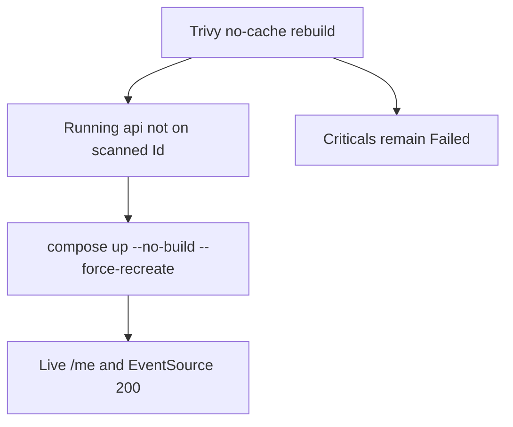

## Packet 7 follow-up: Blocked items (70% pause and old-API smoke)

**Packet:** `Resolve blockers or explicitly reduce/resign supported limits` (`P09-07-A` / `P09-04-A` / `P09-02-D`).
**Checkbox:** **unchecked**. Wrapper `status` remains **pending**. Holdout was not opened. Packet 1 freeze was **not** re-signed. Trivy Criticals remain **Failed**.

### seventy_percent_pause

Live 8-doc five Composite EventSource streams on current API
`sha256:a39d44560b4e785226445250204e5258592fcaf66a327c13efb974448e401561`:
HTTP 200, not 401. Completion p95 **1828 ms** (QT-LAT-011 40000 ms).
CPU peak **1.49%**. 70% trigger **did not fire**. Fixture controller remains
proven. Not QT-CAP-001/002. Mock streams ended `schema` then `error` (not
live OpenAI first-token). Classification: **Passed**.

Command: `uv run python scripts/ci/check_phase09_seventy_live.py` exit 0.

### old_api_new_schema_smoke

Tagged prior `smart-rag-api:old-api-prior` =
`sha256:1d9f569b54c6012c4e9b1087979b409a9e2517ac9cce7c1f81d8917d9870f3d7`.
Rebuilt current API
`sha256:a39d44560b4e785226445250204e5258592fcaf66a327c13efb974448e401561`.
`SMART_RAG_OLD_API_IMAGE` pointed at the prior Id. Authenticated
read/chat/upload **Passed**, `smoke_ran=true`, freeze slot restored.

Command: `uv run python scripts/ci/check_old_api_new_schema_smoke.py` exit 0.

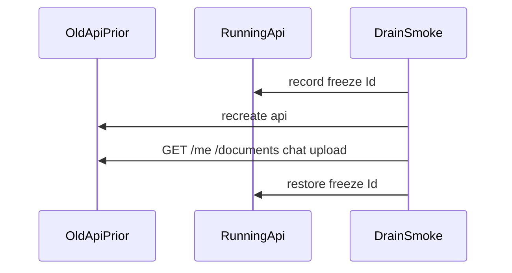

Source `LOCAL_BLOCKERS` and Packet 2 `HANDOFFS` now classify both items
**Passed** with `local_launch_blocking=false`. Historical Packet 4/7 JSON
artifacts still describe the earlier Blocked rows until Packets 1-6 re-run
on the new freeze.

## Packet 7 follow-up: Distroless/Alpine Trivy Criticals cleared

**Packet:** `Resolve blockers or explicitly reduce/resign supported limits` (`P09-07-A`).
**Checkbox:** **unchecked**. Wrapper `status` remains **pending**. Holdout was not opened. Phase 10 must not start.

Tar Trivy used `docker save` plus `trivy image --input` (`aquasec/trivy:0.66.0`). `/var/run/docker.sock` was not mounted. All five freeze images report **Critical=0**. High findings remain and were not waived.

Distroless has no `/bin/sh`, so Compose healthchecks for `api`/`worker`/`crawl-proxy` use exec-form `CMD python`. API/worker copy an `ldd` closure of libffi and native-wheel libraries onto distroless without `/var/lib/dpkg`.

| Service | Image Id | User | Critical | High | Status |
| --- | --- | --- | --- | --- | --- |
| api | `sha256:a65f1aa43fbf6fd353257a75fa9462e79a5bb187741d75e36a0429216e3633ec` | `10001:10001` | 0 | 4 | Passed |
| worker | `sha256:e6259d06f129ec14158e90acf1807dbaed0baa040bef9781fac60d46a97fe96e` | `10001:10001` | 0 | 4 | Passed |
| frontend | `sha256:e47efc373a151c7c79039009fd04f459f997127beafb00747cd91c4a9b96a5c1` | `10001:10001` | 0 | 0 | Passed |
| crawl-proxy | `sha256:7d78834e21cc87d2ba133d4d131f1aa6d05b2de808d80296bf6658a8e04e62d3` | `10001:10001` | 0 | 3 | Passed |
| parser-sandbox | `sha256:f7717ab4ec1e06d8113a19c080a05c1db6050b3b70e3bcfd73d61dd013ed6e0a` | `10001:10001` | 0 | 2 | Passed |

Running compose (`docker-compose.yml` only): api/worker/frontend/crawl-proxy **healthy**, `/health/live` `{"status":"live"}`. Parser stays profile `parser-build`.

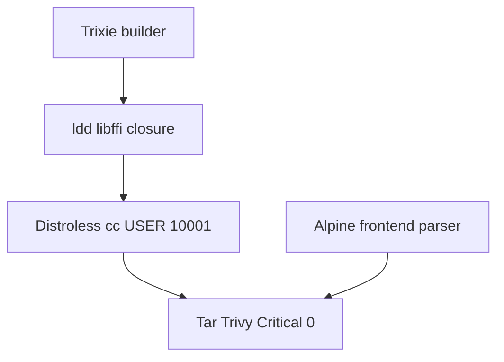

Source `LOCAL_BLOCKERS.trivy_critical_findings` is **Passed** with `local_launch_blocking=false`. Packet 1 freeze constants match these Ids. Corpus was not reseeded.

## Packets 1-6 re-run and Packet 7 classification

**Checkbox at classification time:** Packet 7 was **unchecked**. Wrapper `status` was **pending**. Holdout was not opened.

| Packet | Result |
| --- | --- |
| 1 | Identity freeze + image manifest rewritten; `check_phase09_packet1.py` 24/0/0/0 |
| 2 | All selected suites Passed; old-API smoke Passed; overlay malware/proxy/BM25 8/0/0/0 then detached |
| 3 | Candidate + overlay BM25/ranked-ids Passed |
| 4 | All suites Passed after distroless `python -c` lag snippet newlines and hybrid `autocommit=True` |
| 5 | All suites Passed; `phase09_packet5_ok` |
| 6 | P09-06-A–E Passed; tar Trivy Critical=0; `docker_sock_mounted=false` |
| 7 first record | P09-07-A Passed. P09-07-B Blocked (unsigned 10k/1M). P09-07-E Passed (wrapper still pending) |

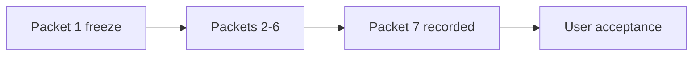

First Packet 7 recommendation was **no-go for Phase 10** until the user accepted Packet 7. High Trivy findings were not waived. Live OpenAI quality stays **Not Run** (`MOCK_MODEL_MODE=true`).

## Packet 7 finalize: signed envelope and Phase 9 close

**Packet:** Resolve blockers or explicitly reduce/resign supported limits; leave managed-topology gates clearly open for Phase 10. (`P09-07`)

**Quoted acceptance:** P09-07-A local gates; P09-07-B proven/resized/reduced-and-re-signed envelope; P09-07-C managed items stay Phase 10; P09-07-D artifacts ready; P09-07-E pending until user acceptance.

User message 2026-08-18: `i want this phase to be 100% to start the next one`. That is client sign-off to advertise the proven 8-doc subset and then close Phase 9. It is not a 10k/1M claim and not managed-topology proof.

Command: `uv run python scripts/ci/check_phase09_packet7.py` exit 0. `image_rebuilt: false`. Health returncode 0. old-API smoke `classification=Passed smoke_ran=True`. Matrix `wrapper_status=pending` and `packet7_checkbox=unchecked` at classification time (P09-07-E Passed). Wrapper checkboxes and `status: complete` were applied **after** that snapshot.

| Check | Classification | Evidence |
| --- | --- | --- |
| P09-07-A | Passed | Tar Trivy Critical=0; JWT/70%/old-API Passed; Packets 1-6 on distroless/Alpine freeze |
| P09-07-B | Passed | QT-CAP-001-P9=8 / QT-CAP-002-P9=16 signed 2026-08-18; QT-CAP-005-P8=15; not 10k/1M |
| P09-07-C | Passed | JWKS/restore/OIDC/EC2/CDN/KMS/assessment remain Phase 10 |
| P09-07-D | Passed | Packet 1-6 artifacts listed in `candidate-packet7-promotion-manifest.json` |
| P09-07-E | Passed | Classified while wrapper pending; then user accepted and boxes were checked |

**Signed envelope:** [ADR-phase9-local-envelope-reduce.md](../adr/ADR-phase9-local-envelope-reduce.md) · [QUALITY_TARGETS.md](../QUALITY_TARGETS.md) section 16.

**Recommendation:** go for Phase 10 isolated staging on this freeze; advertise QT-CAP-001-P9=8 Hybrid versions and QT-CAP-002-P9=16 chunks only; graph stays QT-CAP-005-P8=15; do not claim QT-CAP-001/002 10k/1M; managed JWKS/restore/OIDC/EC2/CDN/KMS/assessment remain Phase 10.

**Rollback:** Keep the Packet 1 distroless/Alpine freeze. Staging re-proves managed gates. Do not advertise QT-CAP-001/002 from this freeze. Re-running `check_phase09_packet7.py` after close fails P09-07-E; that is expected.

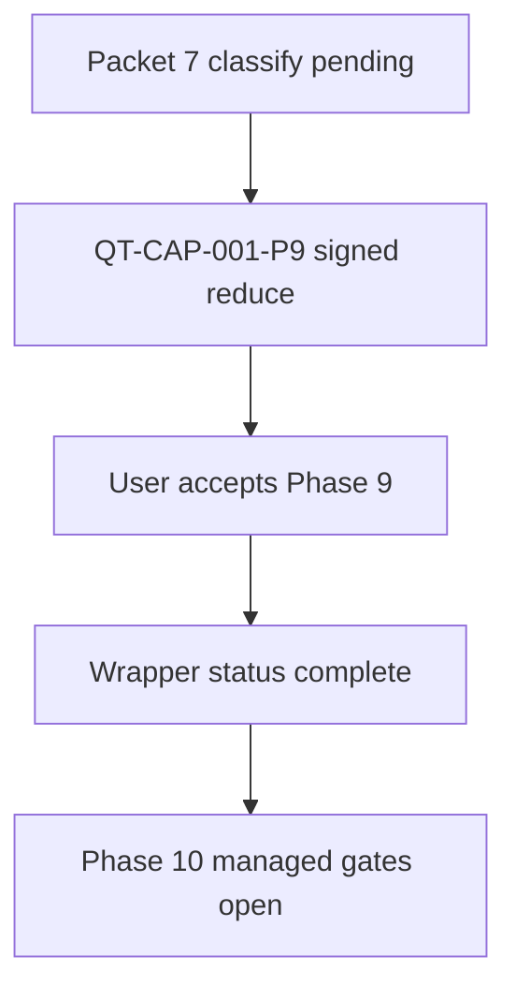

### Done-when traceability

| Done-when item | Proof |
| --- | --- |
| Exact immutable candidate images start and pass the local Docker suite | Packet 1 freeze Ids in `candidate-image-manifest.json`; Packets 2-6 matrices Passed; health returncode 0 |
| Seeded corpus routing/quality/latency/BM25/graph reports | Packet 3 artifacts; live OpenAI Recall@K Not Run under mock |
| Foreground-plus-maintenance load and 70% pause/isolation | Packet 4 Passed; live 70% did not fire; p95 1828 ms; fixture controller proven |
| ParadeDB private roles, rebuild, outage, 75/300 bounds | Packets 3 and 6 BM25/rebuild artifacts |
| Five-stream, budget lock, reduced signed limits | Packet 4 five-stream; QT-CAP-001-P9/002-P9 signed |
| Hard CI, restore, scans, restart/resume | Packets 2, 5, 6 matrices Passed |
| Local blockers resolved; managed items Phase 10 handoff | `candidate-packet7-phase10-handoff.json` |
| Envelope proven, resized, isolated, or reduced with client sign-off | QT-CAP-001-P9/002-P9; ADR accepted 2026-08-18 |

### Phase 10 handoff (open, not local blockers)

- managed Supabase pooling, JWKS rollover, database/Storage restore
- GitHub OIDC / SSM / Secrets Manager protected migrations
- real EC2 / EBS / ParadeDB resources
- CloudFront/WAF/Caddy, 50/90s stream, origin rejection, provider egress
- KMS/S3 Object Lock, origin-secret rotation, billing alarms, IaC
- external security assessment
- live OpenAI quality (optional cost-capped; not a Phase 9 local launch blocker)

### Deviations

- Phase 8 wrapper remains `pending`. The user ordered Phase 9 on 2026-08-17 anyway.
- Live OpenAI Recall@K and Combined +10pp stay Not Run (`MOCK_MODEL_MODE=true`).
- High Trivy findings were not waived.
- Packet 7 runner snapshot still records `wrapper_status=pending`; administrative close happened after that snapshot.
- Plan integrity lock refreshed with `verify_plan_integrity.py --update` after wrapper complete and packet-status complete (82 files).

### Unverified

- Managed topology, EC2, CDN, KMS, OIDC, billing, and assessment (Phase 10).
- QT-CAP-001/002 10k/1M and QT-CAP-003=25 users.
- QT-CAP-005=2,000 graph documents (advertised envelope stays QT-CAP-005-P8=15).
