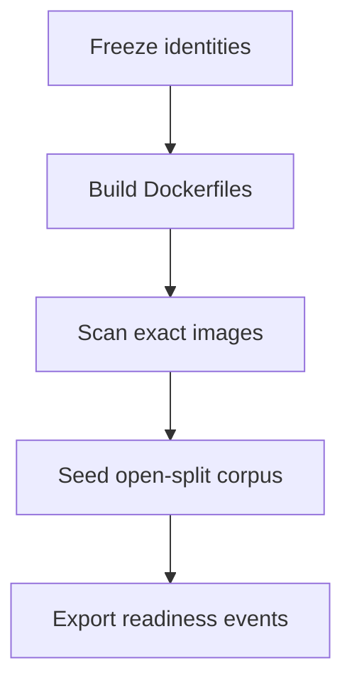
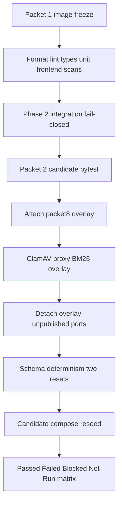

# Phase 9 local release candidate evidence

Canonical packet evidence for Phase 9. Each packet appends its handoff. Do not
check a packet from file presence alone. Phase 9 wrapper remains `pending`.

Related: [LOCAL_RELEASE_CANDIDATE.md](../deployment/LOCAL_RELEASE_CANDIDATE.md) ·
[QUALITY_TARGETS.md](../QUALITY_TARGETS.md) ·
[QUALITY_COMMANDS.md](./QUALITY_COMMANDS.md) ·
[docs index](../README.md)

## Proceed decision

Phases 1–8 have implementation evidence. Phase 8 wrapper remains `pending`
awaiting user acceptance. The user explicitly ordered Phase 9 implementation
on 2026-08-17. Holdout stays `HoldoutAccess.denied()`.
`SMART_RAG_HOLDOUT_ACCESS` was not set to `true`.

## Packet 1 — Build exact candidate images and seed the approved corpus

Requirement ID: **P09-01**.

### Requirement (quoted)

> Build the exact candidate images and seed only the approved local evaluation
> corpus through all readiness states.

### Concrete acceptance checks

- **P09-01-A:** Digest-bound builds and health pass. Evidence: build/scan/health
  artifacts. Failure: rebuild; changed identity invalidates evidence.
- **P09-01-B:** Migrations reset/reapply and runtime pins match. Evidence:
  migration/version inventory. Failure: stop on drift.
- **P09-01-C:** Only approved disjoint corpus is seeded. Evidence: immutable
  manifest. Failure: reset and reseed.
- **P09-01-D:** Real state transitions cover all required readiness states.
  Evidence: job/state export. Failure: stop on fake or unreachable state.
- **P09-01-E:** Counts/resources map to the signed local envelope without
  managed claims. Evidence: sizing baseline. Failure: use sizing ladder.

### Inspected paths (before edit)

| Path | Result |
| --- | --- |
| `docker-compose.yml` | Candidate identity; ParadeDB/Valkey/crawl-proxy have no host ports |
| `docker-compose.packet8.yml` | Host-pytest overlay; not candidate identity |
| `apps/*/Dockerfile`, `infra/crawl-proxy/Dockerfile`, `infra/parser-sandbox/Dockerfile` | Local-built images, user 10001 |
| `tests/contract/hybrid_ready_driver.py` | Parse→chunk→embed→canonical→BM25; not SQL-stamped |
| `packages/core/.../evaluation/holdout.py` | Default deny |
| `packages/core/.../jobs/graph_mapping_service.py` | Graph Ready via mapping/writer |
| `scripts/dev.ps1`, `scripts/verify-local.ps1`, `scripts/reset.ps1` | Existing lifecycle |

### Files changed (allowed outputs only)

| File | Action |
| --- | --- |
| `packages/core/src/smart_rag_core/release/` | Created — freeze, ports, corpus, readiness, seed, mapping, health |
| `scripts/phase09_candidate.py` | Created — host freeze/build/scan/up/seed |
| `scripts/ci/check_phase09_packet1.py` | Created — zero-collection fail-closed gate |
| `tests/unit/test_phase09_candidate.py` | Created — negative gates always run |
| `tests/contract/test_phase09_candidate.py` | Created — live compose/supabase/artifact contracts |
| `docs/deployment/LOCAL_RELEASE_CANDIDATE.md` | Created |
| `docs/deployment/phase-09/*.json` | Created by freeze/build/seed (no secrets) |
| `docs/development/QUALITY_COMMANDS.md` | Packet 1 commands |
| `docs/development/CONFIGURATION.md` | `SMART_RAG_REQUIRE_PHASE09_CANDIDATE` |
| `docs/development/LOCAL_SETUP.md` | Candidate freeze step |
| `docs/development/CI_TIERS.md` | Local-only gate note |
| `docs/architecture/04-deployment.md` | Reciprocal link |
| `docs/README.md` | Index rows |
| `.cursor/plans/.../09-phase-local-release-candidate.md` | Packet 1 checkbox `[x]` after live Passed |
| `.cursor/plans/.../packets/01-build-exact-candidate-images.md` | `status: complete` after live Passed |

### Identities frozen

Source: `docs/deployment/phase-09/candidate-identity-freeze.json`. No secrets.

| Field | Value |
| --- | --- |
| git | `7438b54abe70a57652f85c90f678d5ad2f58192a` (`git_dirty`: true) |
| `uv.lock` sha256 | `d05ce6ea28378999c7a95118bd482f89399f61ffb20e11b0f70228dc7674cfbc` |
| `pnpm-lock.yaml` sha256 | `ba5c198c44a586dfcd128e19cc2db713d08e255dae2e95165d06e48051f0bcc7` |
| frozen retrieval profile | `hybrid_default_v1` |
| embedding | `text-embedding-3-large` / 1024 |
| prompts | `query_profile_v1`, `rerank_v1`, `answer_v1`, `verifier_v1` |
| BM25 | schema `bm25_v1`, normalization `arabic_norm_v1` |
| LightRAG | `1.5.6` / handoff `lightrag_v1` |
| ParadeDB image digest | `dca046b8a0ddd070c368d5254cbb7f596b3b7bc67bc2efa7c0fbe881087883bb` |
| `pg_search` (at freeze, stack was up) | `0.25.2` |
| migrations | 51 SQL files hashed |
| profile | `APP_ENV=local`, `MOCK_MODEL_MODE=true` |
| proceed decision | Phase 8 wrapper pending; user ordered Phase 9 on 2026-08-17 |

### Candidate images (P09-01-A build)

Built from repository Dockerfiles via `docker-compose.yml` plus profile
`parser-build`. User `10001:10001`. Local `repo_digest` is
`name@sha256:<image_id>` (no registry push). API/worker images bake tiktoken
`cl100k_base` encodings because the worker has no public DNS on Compose
`private`.

| Service | Image | Id |
| --- | --- | --- |
| api | `smart-rag-api` | `sha256:d697ab32a5456e30a93363371811f65b69d8e720528f8877c9b7e4d403368632` |
| worker | `smart-rag-worker` | `sha256:045fae20209c13c897904c978dfb9a450110b6d6649dc49a1757606b40620990` |
| frontend | `smart-rag-frontend` | `sha256:4d15cd9aed7e8d48f640e5044251d39288bd472cc08a0daef8baae50beecd93e` |
| crawl-proxy | `smart-rag-crawl-proxy` | `sha256:a43503851112064514eb15140f724d774c4ecb3e9758e4a25195771b98d5a604` |
| parser-sandbox | `smart-rag-parser-sandbox:local` | `sha256:6798b6a5ee79cf711c3afc8ad4dcf21662af90008cb25d62e8d6ee60c58feeec` |

A later rebuild that changes any Id invalidates this freeze. Later packets
consume these Ids, not git SHA (`git_dirty` was true while Packet 1 completed).

### Classifications

Packet 1 live health, migrations, corpus, readiness, and sizing **Passed**.
Trivy via docker.sock remains **Blocked** (not retried). Gitleaks **Passed**
after allowlisting published local demo JWT / inert test canaries. pip-audit
and pnpm audit **Passed**. Phase 9 wrapper stays `pending`.

| Check | Classification | Notes |
| --- | --- | --- |
| P09-01-A digest/health | Passed | Candidate compose without overlay. API/frontend live. `pg_search` 0.25.2. Valkey AUTH. Private publishers empty. `MOCK_MODEL_MODE=true`. Overlay `false`. |
| P09-01-B migrations | Passed | 51 repository files hashed. Applied `schema_migrations` match; `drift: false`. |
| P09-01-C corpus | Passed | 8 open-split cases, `holdout_opened: false`. One each exact_code, alias, arabic_mixed, latest_as_of, tabular_aggregation, media_limitation, acl_negative (restricted), graph_mapping. |
| P09-01-D readiness | Passed | All required public states observed. Hybrid Ready used `Bm25ProjectionService.process_upsert_job`. Graph Ready used `GraphMappingService.map_after_vendor_success`. No SQL stamps. Restricted LightRAG rejected live. |
| P09-01-E sizing | Passed | 8 versions, 16 chunks, 2 graph-eligible. Docker NCPU 20 / MemTotal 8131035136. No managed claims. Local subset, not QT-CAP envelope. |
| Digest mismatch negative | Passed | `tests/unit/test_phase09_candidate.py` |
| Holdout/unapproved/production negative | Passed | Same |
| Restricted LightRAG negative | Passed | Unit plus live restricted rejection during seed |
| Fake/duplicate readiness negative | Passed | Same |
| Public ParadeDB/Valkey/LightRAG port negative | Passed | Unit, static Compose, and live `compose ps` after overlay removal |
| Identity freeze fields | Passed | `APP_ENV=local`, ParadeDB digest `dca046b8…883bb` |
| Trivy Critical | Blocked | docker.sock Trivy hung Docker Desktop on 2026-08-17. Not retried. Packet 6 re-runs full SBOM/Trivy. |
| Gitleaks | Passed | Pinned image; allowlists cover local demo JWT, LangSmith canary, glossary idempotency keys |
| pip-audit / pnpm audit | Passed | Compact scan summary |
| Managed EC2/Supabase | Not Run | Phase 10 handoff; not claimed |

### Corpus seed counts

Frozen manifest is the labeled 8-row subset. Holdout closed. Production paths
rejected. Seed ran from **host Python** against a temporary Packet 8 ParadeDB
`:54329` overlay because unpublished ParadeDB is unreachable from Windows
localhost and the then-running worker image lacked the `graph_eligible`
insert-order fix. Overlay was removed; candidate health re-proved unpublished
ports. Worker/API were then rebuilt so later worker-exec seed uses the same
code. A first failed seed (deletion constraint) left extra unlabeled versions
in local Supabase; later packets must use `candidate-corpus-manifest.json` ids,
not “all documents”.

| Split / visibility / state | Frozen manifest |
| --- | --- |
| development | 7 cases |
| qualification | 1 (`p4-media_limitation-0002`) |
| company_visible | 7 |
| restricted | 1 (`p4-acl_negative-0003`, graph-ineligible) |
| Hybrid Ready events (BM25 verified) | 8 |
| Graph Ready | 1 (`p4-exact_code-0003`, maps verified) |
| graph_pending left unlabeled | 1 (`p4-graph_mapping-0003`) |
| seeded_document_versions / chunks / graph-eligible | 8 / 16 / 2 |

### Readiness states proven vs not

Required: uploading, uploaded, scanning, parsing, hybrid_ready, graph_pending,
graph_ready, graph_ineligible, deletion_pending, failed.

| State | Live proof |
| --- | --- |
| uploading | `app.reserve_upload_quota` |
| uploaded | `app.finalize_quarantine_upload` |
| scanning | `app.transition_document_version_status` |
| parsing | `app.transition_document_version_status` |
| failed | `app.transition_document_version_status` |
| hybrid_ready | `Bm25ProjectionService.process_upsert_job` (`bm25_verified`) |
| graph_ineligible | `app.finalize_hybrid_ready` |
| graph_pending | `app.finalize_hybrid_ready/enqueue_graph_pending_handoff` |
| graph_ready | `GraphMappingService.map_after_vendor_success` (`maps_verified`) |
| deletion_pending | `app.exclude_version_from_retrieval` on a graph-ineligible version |
| Fake/duplicate Hybrid/Graph Ready | **Rejected in unit tests** |
| Restricted LightRAG index | **Rejected in unit tests and live seed** |

### Artifact paths

| Path | Role |
| --- | --- |
| `docs/deployment/phase-09/candidate-identity-freeze.json` | Identity freeze |
| `docs/deployment/phase-09/candidate-image-manifest.json` | Image Ids above |
| `docs/deployment/phase-09/candidate-scan-summary.json` | Trivy Blocked; Gitleaks/pip-audit/pnpm Passed |
| `docs/deployment/phase-09/candidate-health.json` | All live checks passed; overlay false |
| `docs/deployment/phase-09/candidate-migrations.json` | File inventory; applied versions; drift false |
| `docs/deployment/phase-09/candidate-corpus-manifest.json` | 8 open-split rows |
| `docs/deployment/phase-09/candidate-readiness-export.json` | Required states; `missing_states: []` |
| `docs/deployment/phase-09/candidate-sizing-baseline.json` | Local envelope map; counts 8/16/2 |
| `docs/deployment/phase-09/candidate-seed-counts.json` | Blockers empty |
| `docs/deployment/phase-09/candidate-command-log.json` | Host orchestrator commands and exit codes |
| `.tmp-phase09/` | Gitignored scanner dumps |

Later packets must consume these image Ids and corpus/version ids.

### Failures and repairs

1. Trivy via `docker run -v /var/run/docker.sock aquasec/trivy:latest image`
   hung Docker Desktop (`HTTP 500` on `_ping`). Orchestrator was killed.
2. Host disk filled (`ENOSPC`). Docker updater leftover was deleted from Temp.
3. `vmmemWSL` stayed **StopPending** until Docker recovered. Packet 1 did
   **not** retry docker.sock Trivy.
4. Worker health failed: tiktoken tried to download encodings with no DNS on
   `private`. Repair: prefetch encodings in API/worker Dockerfiles.
5. Worker could not reach host Supabase: `private` is `internal: true`.
   Repair: worker also joins `edge` (still no published ports), matching API.
6. `documents_graph_eligible_requires_company_visible`: `graph_eligible` cannot
   be true before `current_version_id`. Repair: set eligibility after the
   current-version pointer.
7. `document_versions_graph_eligible_requires_open`: deletion cannot keep
   `graph_eligible`. Repair: drive `deletion_pending` on a graph-ineligible
   version.
8. Worker rootfs is read-only; host code was not `docker cp`'d in. Repair:
   rebuild API/worker after the seed-path fixes.
9. Gitleaks reported 4 fixture findings (local demo JWT, leak canary,
   glossary idempotency keys). Repair: path-scoped `.gitleaks.toml` allowlists.
   Compact scan now fails closed on Gitleaks/pip-audit/pnpm `failed`.

### Managed blockers / Phase 10 handoff

- No AWS, Vercel, KMS, CloudFront, WAF, or managed Supabase provisioned.
- Packet 1 does not prove instance-equivalent sizing or restore drills
  (Packets 4 and 6).
- Canonical evidence remains local Supabase; ParadeDB is derived.
- Full SBOM/Trivy remains Packet 6.

### Commands and exit codes

| Command | Exit code | Notes |
| --- | --- | --- |
| `uv run python scripts/phase09_candidate.py ports-static` | 0 | Candidate Compose has no private host ports |
| `uv run python scripts/phase09_candidate.py freeze` | 0 | Identity freeze written; `git_dirty` true |
| `uv run python scripts/phase09_candidate.py supabase` | 0 | Local CLI stack |
| `docker compose -f docker-compose.yml build api worker` | 0 | Tiktoken bake + seed-path core |
| `uv run python scripts/phase09_candidate.py up` | 0 | `--no-build --force-recreate --remove-orphans`; no overlay |
| `uv run python scripts/phase09_candidate.py health` | 0 | Private ports unpublished |
| `uv run python scripts/phase09_candidate.py migrations` | 0 | drift false |
| Host `smart_rag_core.release.cli seed` (overlay then removed) | 0 | 8 labeled cases; all required states |
| `uv run python scripts/phase09_candidate.py sizing` | 0 | Counts 8/16/2; NCPU 20 |
| `uv run python scripts/phase09_candidate.py scan` | 0 | Trivy Blocked (not retried); Gitleaks/pip/pnpm Passed |
| `uv run python -m pytest tests/unit/test_phase09_candidate.py tests/contract/test_phase09_candidate.py -q` | 0 | 24 passed, 0 skipped |
| `uv run python scripts/ci/check_phase09_packet1.py` | 0 | tests=24 failures=0 errors=0 skipped=0 |

Packet file `status` is `complete`. Phase 9 wrapper `status` remains
`pending`. Holdout was not opened (`HoldoutAccess.denied()`).

## Packet 2 — Run all applicable hard CI and security gates

Requirement ID: **P09-02**.

### Requirement (quoted)

> Run all applicable hard CI, expand/contract migration compatibility,
> identity/RLS/BM25/cache/read-audit, graph isolation, injection, parsing,
> deletion, idempotency/GC, API/SSE compatibility, and redaction gates with
> no skipped required tests.

### Concrete acceptance checks

- **P09-02-A:** All locally applicable gates execute and pass with no
  skip/empty result. Evidence: suite matrix. Failure: local no-go.
- **P09-02-B:** Identity/ACL/deletion/cache/BM25/graph negatives yield zero
  unauthorized or stale evidence. Evidence: role/state assertions. Failure:
  launch blocker.
- **P09-02-C:** Replay/idempotency/GC creates no duplicate paid run, chunk,
  active BM25 row, or graph version. Evidence: before/after state. Failure:
  repair.
- **P09-02-D:** Expansion, old-slot/new-schema, minimum client, additive
  SSE/OpenAPI, reconnect, and no destructive DDL pass. Evidence:
  compatibility matrix. Failure: defer/repair.
- **P09-02-E:** Injection/parser/malware/governance/egress/budget/rate/redaction
  pass without bypass. Evidence: adversarial reports. Failure: launch blocker.

### Inspected paths (before edit)

| Path | Result |
| --- | --- |
| Packet 1 commit `f1b4d23` image Ids | Consumed; not rebuilt |
| `docker-compose.yml` | Candidate identity only |
| `docker-compose.packet8.yml` | Overlay for malware/proxy/host BM25; detached after |
| `scripts/ci/check_phase09_packet1.py` | Pattern for zero-collection fail-closed |
| `scripts/ci/check_phase2_integration.py` | RLS/JWKS-local/Auth/Storage/quota/audit/BM25 |
| `scripts/ci/check_schema_determinism.py` | Two resets; wipes seed |
| `tests/contract` RLS/ACL/SSE/parser/injection/deletion | Mapped; no invented old-API smoke |

### Files changed (allowed outputs only)

| File | Action |
| --- | --- |
| `packages/core/src/smart_rag_core/release/packet2.py` | Fail-closed matrix and handoffs |
| `scripts/ci/check_phase09_packet2.py` | Candidate/overlay/all runner |
| `scripts/ci/check_schema_determinism.py` | Typegen via host `54322` `--db-url` |
| `scripts/phase09_candidate.py` | Seed artifact copy via worker exec |
| `packages/core/src/smart_rag_core/generated/database.ts` | Regenerated to match reset schema |
| `tests/contract/test_rls_matrix.py` | Seed-tolerant fixture visibility; current graph-reject text; `chain_seq` order |
| `tests/contract/test_invitations_auth.py` | Bootstrap does not delete seeded owner FKs |
| `tests/contract/test_local_auth_mail.py` | Pinned `:3010` Playwright redirects |
| `tests/contract/test_audit_chain.py` | Full-chain `verify_audit_chain(count(*))` |
| `tests/contract/test_hybrid_retrieval.py` | Cold term nonce outside `SKU-P4-*` |
| `tests/contract/test_crawl_ssrf.py` | Worker `edge`+`private`; `egress` forbidden |
| `docs/deployment/phase-09/candidate-packet2-gate-matrix.json` | Suite matrix |
| `docs/deployment/phase-09/candidate-corpus-manifest.json` | Rewritten after schema wipe |
| `docs/security/AUDIT_CHAIN.md` | `verify_audit_chain(n)` scans oldest `n` |

### P09-02-A through P09-02-E matrix

| Check | Classification | Evidence | Notes |
| --- | --- | --- | --- |
| P09-02-A | **Blocked** | CI tiers Passed; Trivy/SBOM Blocked | Local Packet 6 owns docker.sock Trivy. Not relabeled managed. |
| P09-02-B | **Passed** | Phase 2 111/0/0/0; identity suite 48/0/0/0 | Managed JWKS/pgvector **Not Run** (Phase 10) |
| P09-02-C | **Passed** | Replay suite 46/0/0/0 | No overlay BM25 delete in candidate mode |
| P09-02-D | **Blocked** | OpenAPI/migrations/schema Passed; old-API smoke missing | Local gap. Do not fake with the Packet 1 image. CDN/OIDC **Not Run** Phase 10 |
| P09-02-E | **Passed** | Parser suite 18/0/0/0; overlay 8/0/0/0 | KMS/S3 anchors **Not Run** Phase 10 |

### Role / ACL negatives (P09-02-B)

| Assertion | Result |
| --- | --- |
| Restricted document hidden from members without ACL | Passed |
| Forged admin role / stale authorization version returns empty | Passed |
| Disabled profile sees zero documents including seed rows | Passed |
| Restricted LightRAG index rejected (`index rejected`) | Passed |
| Audit UPDATE/DELETE denied; tamper detected on full chain | Passed |
| Retrieval cache / graph isolation / conversation deletion contracts | Passed in identity suite |

### Compatibility (P09-02-D)

| Gate | Classification |
| --- | --- |
| Expand/contract static (`check_migrations.py`, 51 files, no destructive DDL) | Passed |
| OpenAPI snapshot (`check_openapi.py`) | Passed |
| Schema determinism two resets (schema SHA-256 `0921806d…ee76d`, types `8aafd3c2…3a42c8`) | Passed |
| Additive SSE heartbeat + reconnect + local timeouts | Passed (12 tests) |
| Old-API image vs post-expansion schema authenticated smoke | **Blocked** (no existing test) |
| Real CDN SSE / OIDC protected migrations | **Not Run** Phase 10 |

### Schema reset and reseed

Data identity **changed**. Packet 1 corpus document/version ids are invalid for
Packet 3+. Image Ids are unchanged (Packet 1 freeze). Holdout stays sealed.
`compose cp` could not read worker `/tmp` tmpfs; artifacts were copied via
`exec`. Overlay attach recreated ParadeDB and would have dropped BM25 even
without the schema wipe.

New corpus ids (8 open-split rows, `holdout_opened: false`):

| case_id | document_id | version_id |
| --- | --- | --- |
| p4-acl_negative-0003 | `a5418f3e-5bb3-4089-b603-8bb04a1e423c` | `96286c5e-c2a4-4e37-9686-30515af04554` |
| p4-alias-0003 | `1b0d09c0-e050-474a-a77f-9158792891f5` | `f24d149d-97f8-4ef3-acd3-cb8f91fd6f06` |
| p4-arabic_mixed-0003 | `769f3b6c-668b-40d2-ac3f-5377a64f831a` | `3174ccf2-a263-4730-a384-2e98dd0103a5` |
| p4-exact_code-0003 | `3367635d-7b03-4be7-945c-dd207c848e02` | `3a41a379-c8ef-4f58-ad22-dd747b4d42af` |
| p4-graph_mapping-0003 | `8a63df1c-7eb1-4513-ab1d-c0c58d10d1b9` | `ea75bc0c-a0f6-45ae-935e-38e0e5dd2c07` |
| p4-latest_as_of-0003 | `0d3d1169-f237-47bf-a312-25b7acbc4536` | `0bfd5c6b-e807-442f-a67a-2673b700afab` |
| p4-media_limitation-0002 | `31a7545f-f608-4a9c-a207-327d70af00bd` | `c977b330-df35-47f2-9551-8713e26ff6af` |
| p4-tabular_aggregation-0003 | `f567ecde-f53c-4582-aafd-f935e8495199` | `6cc1ac54-b49e-42f3-815c-b97a5d3675c7` |

Seed counts: 8 versions, 16 chunks, 2 graph-eligible. `missing_states: []`.
`blockers: []`. Readiness includes `graph_ready` and `deletion_pending`.

### Failures and repairs

1. Phase 2 failed on Packet 1 seed: exact document-set equality, owner DELETE
   vs `glossary_imports` FK, stale Auth redirect list, `verify_audit_chain(100)`
   scanning only the oldest 100 events, graph reject message
   `graph build index rejected`. Repair: seed-tolerant assertions; full-chain
   verify; match `index rejected`; pin `:3010` redirects.
2. `SKU-P4-ZZZ` trigram-matched the open-split corpus. Repair: cold-term nonce
   outside dataset identifier rules.
3. Worker-on-`edge` is Packet 1 candidate identity for
   `host.docker.internal`. Repair: forbid `egress` and published ports, require
   `private`+`edge`.
4. Generated `database.ts` lagged later-phase RPCs/tables. Repair: regenerate
   after reset; typegen uses `--db-url` `127.0.0.1:54322`.
5. `docker compose cp` cannot see worker `/tmp` tmpfs. Repair: `exec` copy.
6. Trivy via docker.sock was **not** retried.

### Managed / later-packet handoff

- Managed JWKS rollover, managed pgvector, real CDN SSE, KMS/S3 audit anchors,
  OIDC protected migrations, managed restore, external assessment: **Not Run**,
  Phase 10, `managed_only: true`.
- Trivy/SBOM: **Blocked**, Phase 9 Packet 6 (local).
- Old-API/new-schema smoke: **Blocked**, Phase 9 Packet 2/7 (local). Packet 7
  may author a real prior-digest smoke; do not relabel as managed.
- Five-stream SSE load, Valkey kill, restore drill, quality-latency: later
  Phase 9 packets.

### Commands and exit codes

| Command | Exit | Notes |
| --- | --- | --- |
| `uv run python scripts/check.py --tier format` | 0 | After formatting pre-existing drift |
| `uv run python scripts/check.py --tier lint` | 0 | |
| `uv run python scripts/check.py --tier types` | 0 | Pyright 0 errors |
| `uv run python scripts/check.py --tier unit` | 0 | 668 passed, 3 skipped (Windows symlink/`resource`) |
| `uv run python scripts/ci/check_phase6_eval_registry.py` | 0 | Inside unit tier |
| `uv run python scripts/ci/check_openapi.py` | 0 | Snapshot matches |
| `uv run python scripts/ci/check_migrations.py` | 0 | 51 files; no destructive DDL |
| `uv run python scripts/check.py --tier docs` | 0 | Re-run after this append |
| `uv run python scripts/check.py --tier frontend` | 0 | Vitest 149; Playwright 29 |
| pip-audit (`PYSEC-2026-113` ignored) | 0 | |
| `pnpm audit --audit-level high` | 0 | |
| gitleaks pinned image + `.gitleaks.toml` | 0 | no leaks found |
| `uv run python scripts/ci/check_phase2_integration.py` | 0 | 111 tests, 0 skip; re-proved after reseed |
| `uv run python scripts/ci/check_phase09_packet2.py --mode candidate` | 0 | 48+46+12+18, 0 skip |
| Overlay attach `docker-compose.packet8.yml` `--no-build --wait` | 0 | Ports 54329/13310/18080 |
| Packet 2 overlay `--merge-artifact` with require flags | 0 | 8 tests, 0 skip |
| Overlay detach `docker-compose.yml` `--no-build --remove-orphans` | 0 | |
| `phase09_candidate.py ports-static` | 0 | |
| `phase09_candidate.py health` | 0 | `overlay_used: false`; private publishers empty |
| `check_schema_determinism.py` (after type refresh) | 0 | Two matching resets |
| Worker `python -m smart_rag_core.release.cli seed` | 0 | Candidate compose; no overlay |
| Seed artifact copy via worker exec | 0 | `compose cp` failed on tmpfs |
| `phase09_candidate.py sizing` | 0 | Counts 8/16/2 |

Packet 2 checkbox stays **unchecked**. Packet file `status` stays `pending`
because P09-02-A (Trivy) and P09-02-D (old-API smoke) are local Blocked, not
Phase 10 managed-only handoffs. Phase 9 wrapper `status` remains `pending`.
Holdout was not opened (`HoldoutAccess.denied()`). `SMART_RAG_HOLDOUT_ACCESS`
was not set to `true`.
