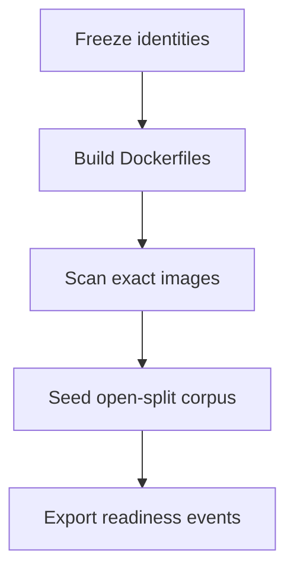

# Phase 9 local release candidate evidence

Canonical packet evidence for Phase 9. Each packet appends its handoff. Do not
check a packet from file presence alone. Phase 9 wrapper remains `pending`.

Related: [LOCAL_RELEASE_CANDIDATE.md](../deployment/LOCAL_RELEASE_CANDIDATE.md) ·
[QUALITY_TARGETS.md](../QUALITY_TARGETS.md) ·
[QUALITY_COMMANDS.md](./QUALITY_COMMANDS.md) ·
[docs index](../README.md)

## Proceed decision

Phases 1–8 have implementation evidence. Phase 8 wrapper remains `pending`
awaiting user acceptance. The user explicitly ordered Phase 9 implementation
on 2026-08-17. Holdout stays `HoldoutAccess.denied()`.
`SMART_RAG_HOLDOUT_ACCESS` was not set to `true`.

## Packet 1 — Build exact candidate images and seed the approved corpus

Requirement ID: **P09-01**.

### Requirement (quoted)

> Build the exact candidate images and seed only the approved local evaluation
> corpus through all readiness states.

### Concrete acceptance checks

- **P09-01-A:** Digest-bound builds and health pass. Evidence: build/scan/health
  artifacts. Failure: rebuild; changed identity invalidates evidence.
- **P09-01-B:** Migrations reset/reapply and runtime pins match. Evidence:
  migration/version inventory. Failure: stop on drift.
- **P09-01-C:** Only approved disjoint corpus is seeded. Evidence: immutable
  manifest. Failure: reset and reseed.
- **P09-01-D:** Real state transitions cover all required readiness states.
  Evidence: job/state export. Failure: stop on fake or unreachable state.
- **P09-01-E:** Counts/resources map to the signed local envelope without
  managed claims. Evidence: sizing baseline. Failure: use sizing ladder.

### Inspected paths (before edit)

| Path | Result |
| --- | --- |
| `docker-compose.yml` | Candidate identity; ParadeDB/Valkey/crawl-proxy have no host ports |
| `docker-compose.packet8.yml` | Host-pytest overlay; not candidate identity |
| `apps/*/Dockerfile`, `infra/crawl-proxy/Dockerfile`, `infra/parser-sandbox/Dockerfile` | Local-built images, user 10001 |
| `tests/contract/hybrid_ready_driver.py` | Parse→chunk→embed→canonical→BM25; not SQL-stamped |
| `packages/core/.../evaluation/holdout.py` | Default deny |
| `packages/core/.../jobs/graph_mapping_service.py` | Graph Ready via mapping/writer |
| `scripts/dev.ps1`, `scripts/verify-local.ps1`, `scripts/reset.ps1` | Existing lifecycle |

### Files changed (allowed outputs only)

| File | Action |
| --- | --- |
| `packages/core/src/smart_rag_core/release/` | Created — freeze, ports, corpus, readiness, seed, mapping, health |
| `scripts/phase09_candidate.py` | Created — host freeze/build/scan/up/seed |
| `scripts/ci/check_phase09_packet1.py` | Created — zero-collection fail-closed gate |
| `tests/unit/test_phase09_candidate.py` | Created — negative gates always run |
| `tests/contract/test_phase09_candidate.py` | Created — live compose/supabase/artifact contracts |
| `docs/deployment/LOCAL_RELEASE_CANDIDATE.md` | Created |
| `docs/deployment/phase-09/*.json` | Created by freeze/build/seed (no secrets) |
| `docs/development/QUALITY_COMMANDS.md` | Packet 1 commands |
| `docs/development/CONFIGURATION.md` | `SMART_RAG_REQUIRE_PHASE09_CANDIDATE` |
| `docs/development/LOCAL_SETUP.md` | Candidate freeze step |
| `docs/development/CI_TIERS.md` | Local-only gate note |
| `docs/architecture/04-deployment.md` | Reciprocal link |
| `docs/README.md` | Index rows |
| `.cursor/plans/.../09-phase-local-release-candidate.md` | Packet 1 checkbox only after Passed |
| `.cursor/plans/.../packets/01-build-exact-candidate-images.md` | `status: complete` only after Passed |

### Identities frozen

Source: `docs/deployment/phase-09/candidate-identity-freeze.json`. No secrets.

| Field | Value |
| --- | --- |
| git | `7c31763ed47d9d2a81f53877d9b5ced4865e6d09` (`git_dirty`: true) |
| `uv.lock` sha256 | `d05ce6ea28378999c7a95118bd482f89399f61ffb20e11b0f70228dc7674cfbc` |
| `pnpm-lock.yaml` sha256 | `ba5c198c44a586dfcd128e19cc2db713d08e255dae2e95165d06e48051f0bcc7` |
| frozen retrieval profile | `hybrid_default_v1` |
| embedding | `text-embedding-3-large` / 1024 |
| prompts | `query_profile_v1`, `rerank_v1`, `answer_v1`, `verifier_v1` |
| BM25 | schema `bm25_v1`, normalization `arabic_norm_v1` |
| LightRAG | `1.5.6` / handoff `lightrag_v1` |
| ParadeDB image digest | `dca046b8a0ddd070c368d5254cbb7f596b3b7bc67bc2efa7c0fbe881087883bb` |
| `pg_search` (at freeze, stack was up) | `0.25.2` |
| migrations | 51 SQL files hashed |
| profile | `APP_ENV=local`, `MOCK_MODEL_MODE=true` |
| proceed decision | Phase 8 wrapper pending; user ordered Phase 9 on 2026-08-17 |

### Candidate images (P09-01-A build)

Built from repository Dockerfiles via `docker-compose.yml` plus profile
`parser-build`. User `10001:10001`. Local `repo_digest` is
`name@sha256:<image_id>` (no registry push).

| Service | Image | Id |
| --- | --- | --- |
| api | `smart-rag-api` | `sha256:a1484eb1c3184ca2f02dd9ca474ec491f0d2466c20a22fcb5199091dfb709708` |
| worker | `smart-rag-worker` | `sha256:ef958f14c5d3d5dab17316657338fd5bf8b137e39c856af2ed45f722c6ae2413` |
| frontend | `smart-rag-frontend` | `sha256:4d15cd9aed7e8d48f640e5044251d39288bd472cc08a0daef8baae50beecd93e` |
| crawl-proxy | `smart-rag-crawl-proxy` | `sha256:a43503851112064514eb15140f724d774c4ecb3e9758e4a25195771b98d5a604` |
| parser-sandbox | `smart-rag-parser-sandbox:local` | `sha256:6798b6a5ee79cf711c3afc8ad4dcf21662af90008cb25d62e8d6ee60c58feeec` |

A later rebuild that changes any Id invalidates this freeze.

### Classifications

Packet 1 wrapper checkbox stays **unchecked**. Live seed/health did not pass.
Unit negatives passed independently of Docker.

| Check | Classification | Notes |
| --- | --- | --- |
| P09-01-A digest/health | Blocked | Images built and frozen. Runtime health and unpublished-port proof blocked after Docker Desktop/WSL became unresponsive. Trivy compact status is Blocked (real attempt hung the engine). pip-audit and pnpm audit Passed. |
| P09-01-B migrations | Blocked | 51 repository files hashed. Applied `schema_migrations` unavailable (`connection timeout expired` to local Supabase). No drift claimed or disproved. |
| P09-01-C corpus | Passed (unit) / Blocked (seed) | Holdout/production rejection unit-tested. Worker seed not run; no `candidate-corpus-manifest.json`. Planned seed is 8 labeled open-split cases (one per required class), not 10k versions. |
| P09-01-D readiness | Passed (unit) / Blocked (live) | Fake/duplicate rejection unit-tested. No job/state export. No SQL stamps were used. |
| P09-01-E sizing | Passed (unit) / Blocked (live) | Model forbids managed claims; Compose `mem_limit` recorded. Docker `NCPU`/`MemTotal` null; seeded counts 0. Local candidate is not the QT-CAP envelope. |
| Digest mismatch negative | Passed | `tests/unit/test_phase09_candidate.py` |
| Holdout/unapproved/production negative | Passed | Same |
| Restricted LightRAG negative | Passed | Same |
| Fake/duplicate readiness negative | Passed | Same |
| Public ParadeDB/Valkey/LightRAG port negative | Passed | Unit plus static candidate Compose (no host ports on private services) |
| Identity freeze fields | Passed | Collected from this repo |
| Trivy Critical | Blocked | Attempted via `aquasec/trivy` docker.sock; hung Docker Desktop HTTP 500. Not invented as a pass. Packet 6 re-runs full SBOM/Trivy. |
| Gitleaks | Blocked | Docker engine unresponsive; not invoked after the hang. |
| Managed EC2/Supabase | Not Run | Phase 10 handoff; not claimed |

### Corpus seed counts

Live seed **did not run**. Expected worker seed (when Docker recovers): one
open-split case each for exact_code, alias, arabic_mixed, latest_as_of,
tabular_aggregation, media_limitation, acl_negative (restricted /
graph-ineligible), graph_mapping (company_visible / graph-eligible). Holdout
closed. Production paths rejected.

| Split / visibility / state | Live count |
| --- | --- |
| development + qualification | 0 seeded |
| company_visible / restricted | 0 seeded |
| Hybrid Ready / Graph Ready / others | 0 seeded |

### Readiness states proven vs not

Required: uploading, uploaded, scanning, parsing, hybrid_ready, graph_pending,
graph_ready, graph_ineligible, deletion_pending, failed.

| State | Live proof |
| --- | --- |
| All required public states | **Not proven** (seed blocked) |
| Fake/duplicate Hybrid/Graph Ready | **Rejected in unit tests** |
| Restricted LightRAG index | **Rejected in unit tests** |

### Artifact paths

| Path | Role |
| --- | --- |
| `docs/deployment/phase-09/candidate-identity-freeze.json` | Identity freeze |
| `docs/deployment/phase-09/candidate-image-manifest.json` | Image Ids |
| `docs/deployment/phase-09/candidate-scan-summary.json` | Compact scans (Trivy Blocked) |
| `docs/deployment/phase-09/candidate-health.json` | Health Blocked (`compose ps` failed) |
| `docs/deployment/phase-09/candidate-migrations.json` | File inventory; applied versions empty |
| `docs/deployment/phase-09/candidate-corpus-manifest.json` | **Missing** — seed blocked |
| `docs/deployment/phase-09/candidate-readiness-export.json` | **Missing** — seed blocked |
| `docs/deployment/phase-09/candidate-sizing-baseline.json` | Local envelope map; Docker resources null; counts 0 |
| `docs/deployment/phase-09/candidate-seed-counts.json` | **Missing** — seed blocked |
| `docs/deployment/phase-09/candidate-command-log.json` | Commands / exit codes |
| `.tmp-phase09/` | Gitignored full Trivy dumps (none written after hang) |

Later packets must consume the freeze files above. Do not run Packet 2 until
health, migrations-applied, corpus, and readiness artifacts exist for these
image Ids.

### Failures and repairs

1. Trivy via `docker run -v /var/run/docker.sock aquasec/trivy:latest image`
   hung Docker Desktop (`HTTP 500` on `_ping`). Orchestrator was killed.
2. Host disk filled (`ENOSPC`). Docker updater
   `Docker Desktop Updater-233772 (236836).exe` (245 MiB) was deleted from
   Temp. About 2.4 GiB free remained afterward.
3. `com.docker.service` required UAC to restart. WSL `vmmemWSL` PID 18776
   stayed **StopPending**; `taskkill /F` did not clear it. `wsl --shutdown`
   timed out. Local ports 8000/3000/54321/54322 were closed.
4. Repair for Packet 1 completion: reboot Windows, confirm `docker info`
   reports NCPU ≥ 1, keep ≥ 5 GiB free, then
   `uv run python scripts/phase09_candidate.py up` through `seed` **without**
   rebuilding unless `docker inspect` cannot find the frozen Ids. Do **not**
   retry docker.sock Trivy until Packet 6.

### Managed blockers / Phase 10 handoff

- No AWS, Vercel, KMS, CloudFront, WAF, or managed Supabase provisioned.
- Packet 1 does not prove instance-equivalent sizing or restore drills
  (Packets 4 and 6).
- Canonical evidence remains local Supabase; ParadeDB is derived.

### Commands and exit codes

| Command | Exit code | Notes |
| --- | --- | --- |
| `uv run python scripts/phase09_candidate.py ports-static` | 0 | Candidate Compose has no private host ports |
| `uv run python scripts/phase09_candidate.py freeze` | 0 | Identity freeze written |
| `uv run python scripts/phase09_candidate.py supabase` | 0 | Was up before the hang |
| `uv run python scripts/phase09_candidate.py build` | 0 | Five images, user 10001 |
| `uv run python scripts/phase09_candidate.py scan` (during hang) | 0 then engine 500 | First Trivy attempt |
| `uv run python scripts/phase09_candidate.py up` | 1 | Engine unresponsive |
| `uv run python scripts/phase09_candidate.py scan` (after hang) | 0 | Trivy/Gitleaks Blocked; pip-audit/pnpm Passed |
| `uv run python scripts/phase09_candidate.py migrations` | 1 | Supabase connection timeout; file inventory written |
| `uv run python scripts/phase09_candidate.py health` | 1 | `docker compose ps` failed |
| `uv run python scripts/phase09_candidate.py sizing` | 0 | Counts 0; Docker resources null; no managed claims |
| `uv run python -m pytest tests/unit/test_phase09_candidate.py -q` | 0 | 15 passed |
| `uv run python -m pytest tests/contract/test_phase09_candidate.py -q` | 0 | Live checks skipped; image/identity artifacts asserted |
| `uv run python scripts/ci/check_phase09_packet1.py` | 0 | 23 tests, 0 failures, 6 skipped |
| `uv run python scripts/check_docs.py` | 0 | After this evidence update, re-run |
| `pnpm exec markdownlint-cli2` on Packet 1 docs | 0 | Before this evidence expansion |

Packet file `status` remains `pending`. Phase 9 wrapper `status` remains
`pending`. Holdout was not opened.
