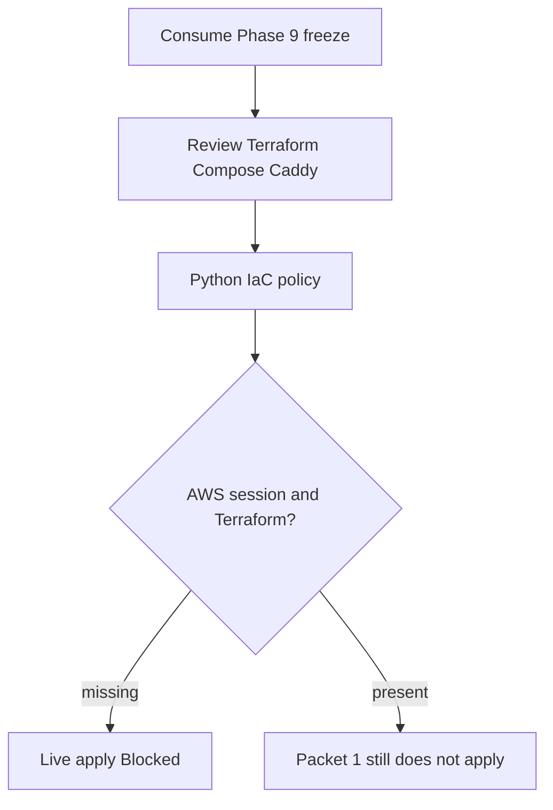
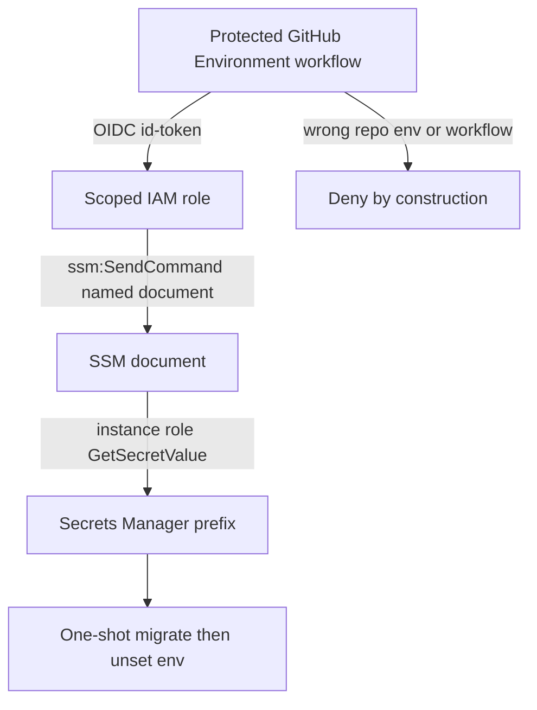
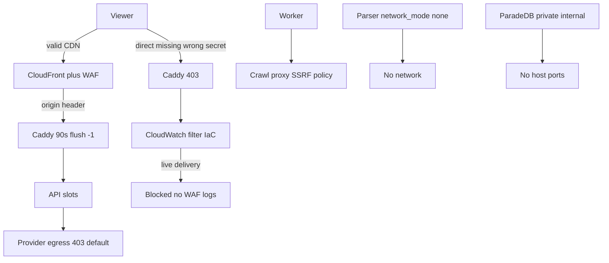
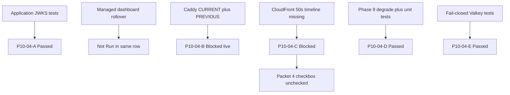
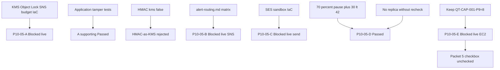
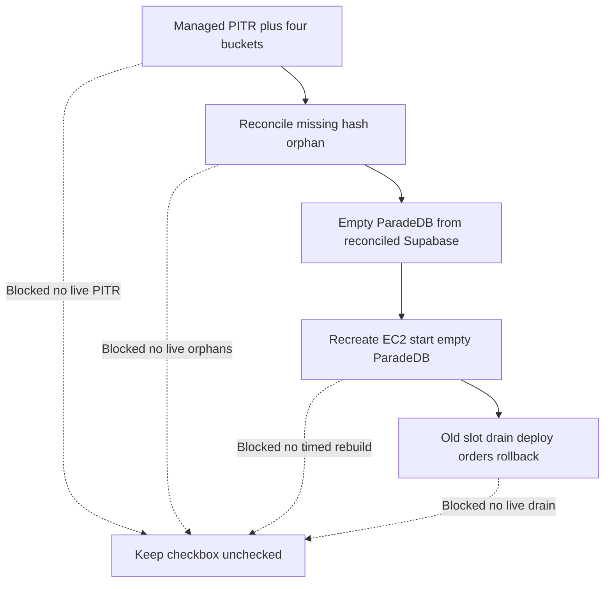
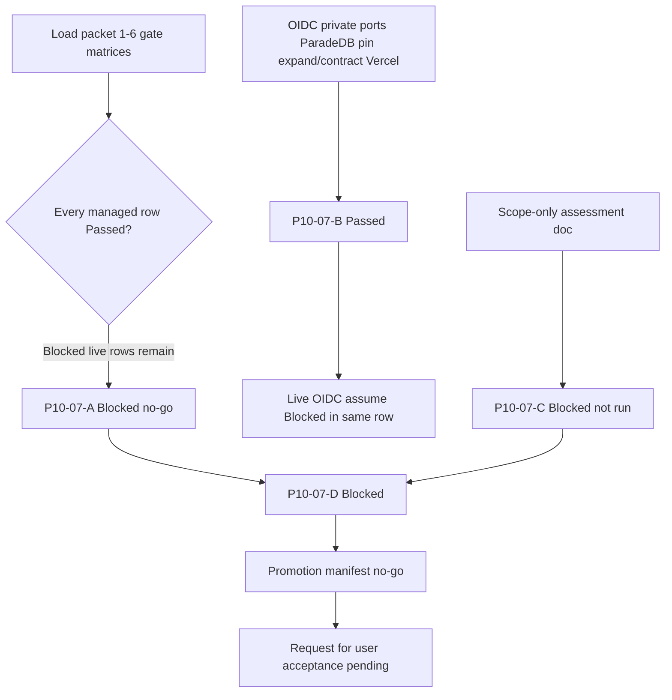

# Phase 10 managed staging evidence

Canonical packet evidence for Phase 10. Each packet appends its handoff. Do
not check a packet from file presence alone. Phase 10 wrapper stays
`pending`. Live AWS/Supabase/Vercel/SES apply is **Blocked** in Packet 1.

Related: [MANAGED_STAGING.md](../deployment/MANAGED_STAGING.md) ·
[QUALITY_COMMANDS.md](./QUALITY_COMMANDS.md) ·
[docs index](../README.md)

## Packet 1 — Provision isolated managed staging from reviewed IaC

Requirement ID: **P10-01**.

### Requirement (quoted)

> Provision isolated managed Supabase, SES sandbox, CloudFront/WAF, EC2
> blue/green services plus digest-pinned private ParadeDB, private
> Valkey/proxy networks, and Vercel staging from reviewed IaC.

### Concrete acceptance checks

- **P10-01-A:** Intended managed plan/features/regions and exact Phase 9
  artifacts match. Evidence: inventory. Failure: stop drift.
- **P10-01-B:** EC2 is rebuildable/encrypted/IMDSv2/SSM-only with controlled
  ingress. Evidence: IaC/runtime assertions. Failure: blocker.
- **P10-01-C:** ParadeDB/Valkey/LightRAG/private services have hard
  limits/credentials/no public path. Evidence: network scan. Failure: stop.
- **P10-01-D:** Vercel/SES separation exposes no secret. Evidence: environment
  scan. Failure: rotate/remove.
- **P10-01-E:** Only synthetic/redacted data exists. Evidence: manifest.
  Failure: purge/incident.



### Inspected paths (before edit)

| Path | Result |
| --- | --- |
| `docs/deployment/phase-09/candidate-packet7-promotion-manifest.json` | Exact image ids consumed |
| `docs/deployment/phase-09/candidate-corpus-manifest.json` | `holdout_opened: false` |
| `infra/ec2/` | Did not exist; created reviewed IaC |
| `infra/caddy/Caddyfile` | Local 90s contract; staging Caddy is `infra/ec2/Caddyfile` |
| Terraform / OpenTofu | Not installed. Policy parses committed files |
| `aws sts get-caller-identity` | Failed / session expired. Did not run `aws login` |

### Files changed (allowed outputs only)

| File | Action |
| --- | --- |
| `packages/core/src/smart_rag_core/release/phase10_*.py` | Created — constants, topology parser, classifier |
| `scripts/ci/check_phase10_packet1.py` | Created — zero-collection fail-closed gate |
| `scripts/phase10_staging.py` | Created — inventory / assert-iac / classify / probe |
| `tests/unit/test_phase10_packet1.py` | Created — negatives always run |
| `tests/contract/test_phase10_packet1.py` | Created — committed IaC/inventory/corpus |
| `infra/ec2/` | Created — Terraform, Compose, Caddy, user-data, inventory |
| `docs/deployment/phase-10/packet1-*.json` | Created by the Packet 1 gate (no secrets) |
| `docs/deployment/MANAGED_STAGING.md` | Created |
| `docs/deployment/STREAMING_TIMEOUTS.md` | CloudFront 90s now asserted in IaC |
| `docs/architecture/04-deployment.md` | Staging mermaid matches IaC |
| `docs/architecture/02-containers.md` | Staging mermaid matches IaC |
| `docs/adr/ADR-private-service-tls.md` | Staging revisit: TLS still omitted on private Docker net |
| `.cursor/plans/.../10-phase-managed-staging.md` | Wrapper remains pending; Packet 1 checkbox unchecked |

### Identities frozen

No secrets. Live project/distribution ids are absent because apply is Blocked.

| Field | Value |
| --- | --- |
| Phase 9 api | `sha256:a65f1aa43fbf6fd353257a75fa9462e79a5bb187741d75e36a0429216e3633ec` |
| Phase 9 worker | `sha256:e6259d06f129ec14158e90acf1807dbaed0baa040bef9781fac60d46a97fe96e` |
| Phase 9 frontend | `sha256:e47efc373a151c7c79039009fd04f459f997127beafb00747cd91c4a9b96a5c1` |
| Phase 9 crawl-proxy | `sha256:7d78834e21cc87d2ba133d4d131f1aa6d05b2de808d80296bf6658a8e04e62d3` |
| Phase 9 parser-sandbox | `sha256:f7717ab4ec1e06d8113a19c080a05c1db6050b3b70e3bcfd73d61dd013ed6e0a` |
| ParadeDB | `sha256:dca046b8a0ddd070c368d5254cbb7f596b3b7bc67bc2efa7c0fbe881087883bb` |
| Valkey | `sha256:a038175878d66b9d274fbf8be73c0305e93798b83917647f167e18cef3c71eec` |
| Envelope | QT-CAP-001-P9=8, QT-CAP-002-P9=16, QT-CAP-005-P8=15 |
| AWS / Supabase region | intended `us-east-1` |
| `MOCK_MODEL_MODE` | `true` locally; holdout denied |
| IaC policy sha256 | `bf09959e2f70b89b10851245691992d28a4e4dcae79b2d476a6eff6fa2dcac1f` |

### Classifications

Packet 1 **does not** mark the wrapper complete. P10-01-B runtime and
P10-01-C network scan are **Blocked**, so the Packet 1 checkbox stays
unchecked.

| Check | Classification | Notes |
| --- | --- | --- |
| P10-01-A inventory | Passed | Intended Pro / us-east-1 / PITR / Supavisor / Phase 9 ids match. Live projects not created |
| P10-01-B EC2 | Blocked | IaC policy Passed (encrypted, IMDSv2 hop 1, SSM-only, CloudFront prefix list). Runtime assertions Blocked: no Terraform/OpenTofu, AWS session expired |
| P10-01-C private path | Blocked | Compose/IaC policy Passed (no host ports, digest pins, limits, credentials via env). No network scan artifact |
| P10-01-D Vercel/SES | Passed | Committed allow-list is API URL, Supabase URL, publishable key only. Live Vercel/SES apply Blocked |
| P10-01-E synthetic data | Passed | Phase 9 open-split corpus identity; `holdout_opened: false`; production flags false. Live staging seed not applied |

### Commands and exit codes

```powershell
uv run ruff format packages/core/src/smart_rag_core/release/phase10_constants.py packages/core/src/smart_rag_core/release/phase10_topology.py packages/core/src/smart_rag_core/release/phase10_packet1.py scripts/ci/check_phase10_packet1.py scripts/phase10_staging.py tests/unit/test_phase10_packet1.py tests/contract/test_phase10_packet1.py
uv run ruff check packages/core/src/smart_rag_core/release/phase10_constants.py packages/core/src/smart_rag_core/release/phase10_topology.py packages/core/src/smart_rag_core/release/phase10_packet1.py scripts/ci/check_phase10_packet1.py scripts/phase10_staging.py tests/unit/test_phase10_packet1.py tests/contract/test_phase10_packet1.py
uv run python -m pytest tests/unit/test_phase10_packet1.py tests/contract/test_phase10_packet1.py -q
uv run python scripts/ci/check_phase10_packet1.py
```

| Command | Exit | Notes |
| --- | --- | --- |
| `uv run ruff format` on Packet 1 Python | 0 | 7 files left unchanged after the first format |
| `uv run ruff check` on Packet 1 Python | 0 | All checks passed |
| `uv run pyright` on Packet 1 Python | 0 | 0 errors |
| `uv run python -m pytest tests/unit/test_phase10_packet1.py tests/contract/test_phase10_packet1.py -q` | 0 | 16 passed, 0 skipped |
| `uv run python scripts/ci/check_phase10_packet1.py` | 0 | tests=16 failures=0 errors=0 skipped=0; IaC policy Passed; live apply Blocked |

Artifacts: `docs/deployment/phase-10/packet1-{gate-matrix,inventory,iac-policy,live-providers,negatives}.json`.

Packet 1 checkbox stays **unchecked** because P10-01-B runtime and P10-01-C
network scan are Blocked. Packet file `status` stays `pending`. Phase 10
wrapper `status` remains `pending`. Holdout was not opened.

### Live hosted Supabase (2026-08-18, not local)

User directed Packet 1 to use **Supabase online, not local**. Org Free-plan
limit blocked a new us-east-1 Pro project. User approved reuse of hosted
**smart-rag** `qsjivtwtmlmtksufqjik` (eu-central-1, Free, no PITR). ADR:
[ADR-phase10-hosted-supabase-reuse.md](../adr/ADR-phase10-hosted-supabase-reuse.md).
Live actuals (no secrets):
[packet1-live-supabase.json](../deployment/phase-10/packet1-live-supabase.json).

- `pg_search` is **not** installed. `vector` is installed.
- Storage buckets exist; `storage.objects` is empty. `app.documents` is empty.
- Advisor: RLS disabled on `app.revoked_sessions` and
  `app.mfa_recovery_requests` (not auto-enabled).
- Legacy anon JWT is HS256. FastAPI HS256 forbid remains. Asymmetric JWKS
  on this project is **unproven**.
- Remaining repo migrations after Phase 2 are applied to this hosted
  project (not local). Intended freeze constants were **not** rewritten.
- `query_memory_store_reaper_v1` is now recorded on hosted
  `schema_migrations`. Duplicate earlier `apply_migration` races left
  duplicate name rows; objects largely exist. LangSmith claim/record
  RPCs `app.claim_langsmith_deletion_requests` and
  `app.record_langsmith_deletion_attempt` are present.
- `vercel-public-env.json` `live_values` stays `{}` (contract forbids
  committing live keys).

### Live AWS apply (2026-08-18)

`terraform apply` in `infra/ec2` created isolated staging resources in
us-east-1. Inventory:
[packet1-live-aws.json](../deployment/phase-10/packet1-live-aws.json).
ADR for instance type:
[ADR-phase10-free-tier-ec2.md](../adr/ADR-phase10-free-tier-ec2.md).

- Instance `i-0abe79350a3880e87` **t3.micro** running, EIP `52.206.156.176`.
- IMDSv2 `HttpTokens=required`, hop limit 1. Both gp3 volumes encrypted.
- Origin SG HTTPS 443 from CloudFront prefix list `pl-3b927c52` only. No SSH.
- CloudFront `dzm8yijuajwge.cloudfront.net`. WAF associated.
- SES identity created for `staging-alerts@example.invalid` (unverified).
- Compose/Caddy/ParadeDB init files **are** on `/opt/smart-rag` (SSM copy
  2026-08-18). Docker 25.0.14 is active. The stack was **not** started:
  instance has 916Mi RAM and Compose `mem_limit`s exceed 1Gi.
- SSM was `ConnectionLost`, then `Online` after reboot. `sshd` was listening
  on `0.0.0.0:22` (security group still denied public 22); `sshd` is now
  disabled. Remaining listen: `127.0.0.1:44923` (SSM).
- AWS operator credentials: local profile `Nagdy-iam` (IAM user `Muna`) in
  `%USERPROFILE%\.aws\credentials` — **not** in git. Access keys were pasted
  in chat and must be rotated. Do not put those keys on the instance.
- EIP probe from a workstation (not a P10-01-C qualifying scan):
  `52.206.156.176` tcp 22/80/443/5432/6379/8000/8080/8443 all `open=false`.
  Artifact:
  [packet1-live-network-scan.json](../deployment/phase-10/packet1-live-network-scan.json).
  P10-01-C stays **Blocked** because compose is not running. Repeat scan
  2026-08-18T20:55Z with profile `Nagdy-iam` plus SSM `ss -lnt` still
  `qualifies_for_p10_01_c: false`. Host listen is only `127.0.0.1:44923`.
- Origin hostname in CloudFront remains the placeholder until DNS/EIP origin
  is wired. Direct origin health is unverified.

### Unverified / Blocked

- Live managed Supabase **Pro** project, PITR, us-east-1, proven JWKS, Pro pooling.
- Live SES mailbox verification and SMTP delivery.
- Live Caddy/Compose health and ParadeDB/Valkey running on an instance
  that can hold the Compose `mem_limit`s (not `t3.micro` / 916Mi).
- Qualifying P10-01-C network scan against **running** private services
  (EIP probe exists but `qualifies_for_p10_01_c: false`).
- Live Vercel project env.
- Packets 3–7 live CDN/scan/KMS PutObject/PITR/pentest. Packet 2 live OIDC
  assume/SSM migrate remains Blocked.

### Packet 1 continuation (hosted RPCs + EIP probe)

Remaining LangSmith RPCs applied on hosted `qsjivtwtmlmtksufqjik` via
Supabase MCP `apply_migration` name `query_memory_store_reaper_v1`.
No parallel migration agents. Packet file `status` stays `pending`.
Wrapper checkbox 1 stays unchecked.

| Command / probe | Exit | Result |
| --- | --- | --- |
| Hosted `execute_sql` for `claim_langsmith_deletion_requests` / `record_langsmith_deletion_attempt` | 0 | Both functions present |
| Hosted `documents` / `storage.objects` counts | 0 | 0 / 0; `auth.users` still 1 on reused project |
| `aws sts get-caller-identity --profile Nagdy` | 254 | OAuth grant expired; SSM Blocked |
| TcpClient EIP probe 2s timeout | 0 | All listed ports `open=false`; does not qualify P10-01-C |
| Local `aws sts --profile Nagdy-iam` | 0 | IAM user `Muna` (keys not in git) |
| SSM copy compose to `/opt/smart-rag` | 0 | Files present; Docker active |
| `systemctl disable --now sshd` | 0 | sshd inactive; no `0.0.0.0:22` |
| `docker compose up` | not run | Blocked: 916Mi RAM vs Compose mem_limits |

### Deviations

- Hosted Supabase reuse vs intended freeze: live project is Free /
  eu-central-1 / no PITR. User approved 2026-08-18. Intended constants stay
  Pro / us-east-1 / PITR. See
  [ADR-phase10-hosted-supabase-reuse.md](../adr/ADR-phase10-hosted-supabase-reuse.md).
- Live EC2 is **t3.micro** because `m6i.xlarge` was rejected as not Free
  Tier eligible. See
  [ADR-phase10-free-tier-ec2.md](../adr/ADR-phase10-free-tier-ec2.md).
- CloudFront origin timeouts remain 90 seconds in IaC despite the Terraform
  AWS provider website still documenting a 60s default upper bound; live
  apply uses the AWS API contract (OriginReadTimeout max 120).

## Packet 2 — GitHub OIDC, protected migrations, and secrets custody

Requirement ID: **P10-02**.

### Requirement (quoted)

> Implement GitHub OIDC, protected immutable expand/contract migrations,
> short-lived credential retrieval, environment separation, and secrets
> custody.

### Concrete acceptance checks

- **P10-02-A:** OIDC assumes only scoped role/SSM targets. Evidence:
  allow/deny policy tests. Failure: narrow/stop.
- **P10-02-B:** No persistent secret in GitHub/Vercel/log/image/process.
  Evidence: scans/lifecycle. Failure: revoke/rotate.
- **P10-02-C:** Approved immutable expansion runs; incompatible DDL is
  rejected. Evidence: approval/audit. Failure: block.
- **P10-02-D:** Old API remains healthy and contraction absent. Evidence:
  drain smoke/diff. Failure: redesign.
- **P10-02-E:** Staging/production credentials separate and rotate ≤90
  days/after exposure. Evidence: custody policy. Failure: block.



### Inspected paths (before edit)

| Path | Result |
| --- | --- |
| `infra/ec2/iam.tf` | Packet 1 instance role; staging prefix GetSecretValue |
| `scripts/ci/check_migrations.py` | Reused `find_migration_violations`; no second regex table |
| `docs/adr/ADR-expand-contract-migrations.md` | Accepted expand/contract |
| `docs/deployment/phase-09/candidate-old-api-new-schema-smoke.json` | Passed; requested `sha256:1d9f569b…`; freeze `sha256:a65f1aa4…` |
| `phase10_constants.PHASE09_IMAGE_IDS` | Freeze ids unchanged |
| GitHub workflows | `permissions: contents: read` only; no `AWS_ACCESS_KEY` / `id-token` until this packet’s dedicated workflows |
| `hashicorp/aws` 5.100 `aws_secretsmanager_secret_rotation` | Requires a Lambda for non-RDS secrets; not invented |

### Files changed (allowed outputs only)

| File | Action |
| --- | --- |
| `infra/ec2/oidc.tf` | Created — GitHub OIDC provider and staging/production roles |
| `infra/ec2/ssm.tf` plus `infra/ec2/ssm-documents/` | Created — named migrate/deploy documents |
| `infra/ec2/secrets.tf` | Created — secret resources without values; 90-day local |
| `infra/ec2/iam.tf` / `ec2.tf` / `variables.tf` / `outputs.tf` | Extended carefully |
| `.github/workflows/staging-migrate.yml` | Created — OIDC, not added to `pr-fast.yml` |
| `.github/workflows/staging-deploy.yml` | Created |
| `.github/workflows/production-migrate.yml` | Created — live remains Blocked |
| `packages/core/src/smart_rag_core/release/phase10_oidc.py` | Created |
| `packages/core/src/smart_rag_core/release/phase10_packet2.py` | Created |
| `scripts/ci/check_phase10_packet2.py` | Created — zero-collection fail-closed gate |
| `tests/unit/test_phase10_packet2.py` | Created — listed negatives |
| `tests/contract/test_phase10_packet2.py` | Created |
| `docs/deployment/phase-10/packet2-*.json` | Written by the Packet 2 gate |
| `.cursor/plans/.../10-phase-managed-staging.md` | Wrapper remains pending; Packet 1 and Packet 2 checkboxes unchecked |

### Identities frozen

No secrets. Live role ARNs and command ids are absent because assume/migrate
are Blocked.

| Field | Value |
| --- | --- |
| GitHub repository | `Nagdy8888/Demo_Project_3` |
| OIDC issuer | `https://token.actions.githubusercontent.com` |
| OIDC audience | `sts.amazonaws.com` |
| configure-aws-credentials | `7474bc4690e29a8392af63c5b98e7449536d5c3a` (`v4.3.1`) |
| checkout | `actions/checkout@3d3c42e5aac5ba805825da76410c181273ba90b1` |
| Envelope | QT-CAP-001-P9=8, QT-CAP-002-P9=16, QT-CAP-005-P8=15 |
| Phase 9 api freeze | `sha256:a65f1aa43fbf6fd353257a75fa9462e79a5bb187741d75e36a0429216e3633ec` |
| Old-API requested digest | `sha256:1d9f569b54c6012c4e9b1087979b409a9e2517ac9cce7c1f81d8917d9870f3d7` |
| Staging secret prefix | `smart-rag/staging/` |
| Production secret prefix | `smart-rag/production/` |
| Rotation custody | 90 days; Lambda absent |
| Packet 2 OIDC policy sha256 | `67cd8ba7e5188f355b2b6681df228ff71e9d8fdbcd7c31d2914f6e8e018b043f` |
| Migration hash | `f967d4814d272c9d8f62d9f01501ab64963f02076fe4a2dd5ef99f8a9366ed87` (52 files) |
| Packet 1 IaC sha256 after added tf | `702cc8484b8cc5de33dee154f49ad72aba551743d95c75dc60588621a92418ba` |

### Classifications

Packet 2 **does not** mark the wrapper complete. Live OIDC assume and SSM
migrate are **Blocked**, so the Packet 2 checkbox stays unchecked. Packet 1
checkbox stays unchecked and is not required for Packet 2 classify.

| Check | Classification | Notes |
| --- | --- | --- |
| P10-02-A OIDC allow/deny | Passed | Trust pins repo/environment/workflow/ref; staging cannot assume production; `repo:*` absent; SendCommand is named documents plus Environment-tagged instances. Live assume Blocked |
| P10-02-B secret scan | Passed | No long-lived keys in `.github`; no secret values in Terraform; Vercel allow-list unchanged. Live log/image/process scans not run |
| P10-02-C approved expand | Blocked | `check_migrations.py` clean; immutable hash recorded; GitHub Environment wiring present. Live SSM migrate Blocked (no session / Terraform, and this packet does not send-command) |
| P10-02-D old API / no contraction | Passed | Existing smoke artifact Passed with prior digest, freeze still matches Phase 9, requested id is not the freeze; contraction DDL absent |
| P10-02-E custody | Passed | Distinct prefixes; 90-day policy encoded; staging Deny of production ARNs. Live Secrets Manager rotation Blocked (no Lambda) |

### Commands and exit codes

```powershell
uv run ruff format packages/core/src/smart_rag_core/release/phase10_constants.py packages/core/src/smart_rag_core/release/phase10_oidc.py packages/core/src/smart_rag_core/release/phase10_packet2.py scripts/ci/check_phase10_packet2.py tests/unit/test_phase10_packet2.py tests/contract/test_phase10_packet2.py
uv run ruff check packages/core/src/smart_rag_core/release/phase10_constants.py packages/core/src/smart_rag_core/release/phase10_oidc.py packages/core/src/smart_rag_core/release/phase10_packet2.py scripts/ci/check_phase10_packet2.py tests/unit/test_phase10_packet2.py tests/contract/test_phase10_packet2.py
uv run python -m pytest tests/unit/test_phase10_packet2.py tests/contract/test_phase10_packet2.py tests/unit/test_phase10_packet1.py tests/contract/test_phase10_packet1.py -q
uv run python scripts/ci/check_migrations.py
uv run python scripts/ci/check_phase10_packet1.py
uv run python scripts/ci/check_phase10_packet2.py
```

| Command | Exit | Notes |
| --- | --- | --- |
| `uv run ruff format` on Packet 2 Python | 0 | Files formatted then left unchanged |
| `uv run ruff check` on Packet 2 Python | 0 | All checks passed |
| `uv run python -m pyright` on Packet 2 Python | 0 | 0 errors |
| `uv run python -m pytest tests/unit/test_phase10_packet2.py tests/contract/test_phase10_packet2.py tests/unit/test_phase10_packet1.py tests/contract/test_phase10_packet1.py -q` | 0 | 31 passed, 0 skipped |
| `uv run python scripts/ci/check_migrations.py` | 0 | 52 reviewed files; no destructive DDL |
| `uv run python scripts/ci/check_phase10_packet1.py` | 0 | tests=16; IaC policy Passed; wrapper pending; Packet 1 unchecked; live apply Blocked |
| `uv run python scripts/ci/check_phase10_packet2.py` | 0 | tests=15; OIDC policy Passed; live OIDC assume Blocked; P10-02-C Blocked |

Artifacts: `docs/deployment/phase-10/packet2-{gate-matrix,inventory,iac-policy,live-providers,negatives,migration-hash}.json`.

Packet 2 checkbox stays **unchecked** because P10-02-C live SSM migrate is
Blocked. Packet file `status` stays `pending`. Phase 10 wrapper `status`
remains `pending`. Holdout was not opened. Packet 1 stays unchecked.

### Unverified / Blocked

- Live GitHub OIDC `AssumeRoleWithWebIdentity` against the staging or
  production role.
- Live `ssm:SendCommand` for `SmartRagStagingMigrate` /
  `SmartRagStagingDeploy` / `SmartRagProductionMigrate`.
- Live Secrets Manager values and 90-day Lambda rotation.
- GitHub Environment required reviewers (UI), which must exist before a
  real migrate.
- Packets 3–7.

### Deviations

`aws_secretsmanager_secret` in hashicorp/aws 5.100 does not host
`rotation_rules`. Those rules live on `aws_secretsmanager_secret_rotation`,
which needs a rotation Lambda for this non-RDS secret. Packet 2 encodes the
90-day custody policy in inventory/IAM deny of access-key minting and
classifies live rotation **Blocked** instead of faking a Lambda.

Packet 1 `assert_committed_policy` hashes every `infra/ec2/*.tf` file, so
its `iac_sha256` changed when Packet 2 added OIDC/SSM/secret Terraform.
Packet 1 classify still Passed/Blocked as before; the checkbox stays
unchecked.

## Packet 3 — Origin rejection, egress, private ports, WAF, and 90s timeouts

Requirement ID: **P10-03**.

### Requirement (quoted)

> Prove direct-origin rejection, provider/crawl/parser egress boundaries,
> private ports, WAF controls, and 90-second streaming timeout
> configuration.

### Concrete acceptance checks

- **P10-03-A:** Valid CDN succeeds; direct/missing/wrong-secret origin
  fails. Evidence: request matrix. Failure: blocker.
- **P10-03-B:** Private/metadata/management ports unreachable. Evidence:
  scan. Failure: stop.
- **P10-03-C:** Provider/crawl/parser/ParadeDB egress boundaries hold.
  Evidence: matrix/logs. Failure: stop/approved ADR only.
- **P10-03-D:** WAF/Caddy controls and ≥90-second assertions pass.
  Evidence: IaC/runtime/drift. Failure: block streaming.
- **P10-03-E:** Denial telemetry reaches monitoring. Evidence: synthetic
  alert. Failure: repair.



### Inspected paths (before edit)

| Path | Result |
| --- | --- |
| `infra/ec2/cloudfront_waf.tf` | origin_read/keepalive 90, CachingDisabled, WAF CLOUDFRONT, custom header |
| `infra/ec2/vpc.tf` | origin SG prefix list only, no SSH |
| `infra/ec2/Caddyfile` | 90s, flush_interval -1, origin header placeholders, 403 default |
| `infra/ec2/docker-compose.staging.yml` | no host ports on private services; parser `network_mode: none`; caddy 443 only |
| `infra/ec2/user-data.sh` | iptables DROP 169.254.169.254, DOCKER-USER |
| `infra/ec2/provider-egress/` | deny-by-default Caddy stub + hostname allowlist |
| `tests/unit/test_crawl_policy.py` / `tests/contract/test_crawl_ssrf.py` | reused, not duplicated |
| `docs/adr/ADR-private-service-tls.md` | TLS still omitted on private Docker net; no new accepted-risk ADR |
| Live CloudFront / EC2 / WAF logs | Absent. Live rows classified Blocked |

### Files changed (allowed outputs only)

| File | Action |
| --- | --- |
| `packages/core/src/smart_rag_core/release/phase10_egress.py` | Created — origin/egress/timeout/telemetry parser |
| `packages/core/src/smart_rag_core/release/phase10_packet3.py` | Created — honest A–E classifier |
| `scripts/ci/check_phase10_packet3.py` | Created — zero-collection fail-closed gate plus crawl subset |
| `tests/unit/test_phase10_packet3.py` | Created — listed negatives always run |
| `tests/contract/test_phase10_packet3.py` | Created — committed IaC |
| `tests/contract/test_streaming_timeout_contract.py` | Extended — staging Caddy + Terraform 90s |
| `infra/ec2/Caddyfile` | Header/body/slow-client/connection caps |
| `infra/ec2/cloudwatch.tf` | Log group, metric filters, alarm with actions disabled |
| `docs/deployment/phase-10/packet3-*.json` | Written by the Packet 3 gate |
| `.cursor/plans/.../10-phase-managed-staging.md` | Wrapper remains pending; Packet 3 checkbox unchecked |

### Identities frozen

No secrets. Live distribution ids, scan outputs, and alarm ARNs are absent
because CDN/scan/alert are Blocked.

| Field | Value |
| --- | --- |
| Envelope | QT-CAP-001-P9=8, QT-CAP-002-P9=16, QT-CAP-005-P8=15 |
| Phase 9 api freeze | `sha256:a65f1aa43fbf6fd353257a75fa9462e79a5bb187741d75e36a0429216e3633ec` |
| CloudFront OriginReadTimeout | 90 (AWS API max 120; 60 rejected) |
| Caddy flush_interval | -1 |
| Caddy max_header_size | 16KB |
| Caddy request_body | 16MB (FastAPI envelope) |
| WAF rate limit | 2000 |
| Packet 3 IaC sha256 | `ce29b1775468d4ebebdd0a82b7e72937097b1b3eca091258db03ab7a9c5c2bf4` |
| Crawl subset | 29 collected, 0 skipped |
| Accepted-risk ADR | none |

### Classifications

Packet 3 **does not** mark the wrapper complete. Live CDN requests, live
port scan, and live CloudWatch alarm delivery are **Blocked**, so the
Packet 3 checkbox stays unchecked. Packets 1 and 2 stay unchecked and are
not required for Packet 3 classify.

| Check | Classification | Notes |
| --- | --- | --- |
| P10-03-A origin | Blocked | Caddy 403 / prefix-list / custom header policy Passed. No live CDN request artifact; request-matrix HTTP statuses are null |
| P10-03-B ports | Blocked | Compose unpublished + IMDS hop 1 + metadata DROP policy Passed. No live scan artifact |
| P10-03-C egress | Passed | Provider 403, public allowlist, parser none, ParadeDB internal private, crawl SSRF subset required |
| P10-03-D timeouts | Passed | CloudFront/Caddy 90s, flush -1, CachingDisabled, WAF, Caddy caps. origin_read_timeout 60 rejected. Live runtime drift Blocked |
| P10-03-E telemetry | Blocked | WAF visibility_config metric names and CloudWatch filters exist. Live synthetic alarm not delivered |

### Commands and exit codes

```powershell
uv run ruff format packages/core/src/smart_rag_core/release/phase10_constants.py packages/core/src/smart_rag_core/release/phase10_topology.py packages/core/src/smart_rag_core/release/phase10_egress.py packages/core/src/smart_rag_core/release/phase10_packet3.py scripts/ci/check_phase10_packet3.py tests/unit/test_phase10_packet3.py tests/contract/test_phase10_packet3.py tests/contract/test_streaming_timeout_contract.py
uv run ruff check packages/core/src/smart_rag_core/release/phase10_constants.py packages/core/src/smart_rag_core/release/phase10_topology.py packages/core/src/smart_rag_core/release/phase10_egress.py packages/core/src/smart_rag_core/release/phase10_packet3.py scripts/ci/check_phase10_packet3.py tests/unit/test_phase10_packet3.py tests/contract/test_phase10_packet3.py tests/contract/test_streaming_timeout_contract.py
uv run python -m pytest tests/unit/test_phase10_packet1.py tests/contract/test_phase10_packet1.py tests/unit/test_phase10_packet2.py tests/contract/test_phase10_packet2.py tests/unit/test_phase10_packet3.py tests/contract/test_phase10_packet3.py tests/contract/test_streaming_timeout_contract.py -q
uv run python scripts/ci/check_phase10_packet1.py
uv run python scripts/ci/check_phase10_packet2.py
uv run python scripts/ci/check_phase10_packet3.py
```

| Command | Exit | Notes |
| --- | --- | --- |
| `uv run ruff format` on Packet 3 Python | 0 | Files formatted then left unchanged |
| `uv run ruff check` on Packet 3 Python | 0 | All checks passed |
| `uv run python -m pyright` on Packet 3 Python | 0 | 0 errors |
| `uv run python -m pytest` Packet 1-3 plus streaming timeout | 0 | 47 passed, 0 skipped |
| `uv run python scripts/ci/check_phase10_packet1.py` | 0 | tests=16; IaC policy Passed; live apply Blocked; checkbox unchecked |
| `uv run python scripts/ci/check_phase10_packet2.py` | 0 | tests=15; OIDC policy Passed; live OIDC assume Blocked; P10-02-C Blocked |
| `uv run python scripts/ci/check_phase10_packet3.py` | 0 | tests=42 crawl_subset=29 skipped=0; IaC Passed; P10-03-A/B/E Blocked; C/D Passed |

Artifacts: `docs/deployment/phase-10/packet3-{gate-matrix,origin,egress,timeouts,scans,negatives}.json`.

Packet 3 checkbox stays **unchecked** because P10-03-A live CDN, P10-03-B live scan, and P10-03-E live alert are Blocked. Packet file `status` stays `pending`. Phase 10 wrapper `status` remains `pending`. Holdout was not opened. Packets 1 and 2 stay unchecked.

### Unverified / Blocked

- Live CloudFront distribution request matrix (valid CDN 200 plus direct
  origin 403).
- Live nmap/metadata reachability of private and management ports.
- Live CloudWatch metric-filter hits and alarm notifications.
- Packets 4–7.

### Deviations

None versus Packet 3 scope. Deny-by-default provider egress is asserted in
committed Caddy/allowlist/Compose rather than waived with a new ADR.
Private Docker TLS remains omitted under
[ADR-private-service-tls.md](../adr/ADR-private-service-tls.md); live scan
proof is still Blocked. CloudWatch alarm `actions_enabled = false` because
Packet 5 owns alert routing; that is recorded as live Blocked, not Passed.

Packet 1 `assert_committed_policy` hashes every `infra/ec2/*.tf` file, so
its `iac_sha256` changed when Packet 3 added `cloudwatch.tf`. Packet 1
classify still Passed/Blocked as before; the checkbox stays unchecked.

## Packet 4 — JWKS, origin rotation, CDN SSE, ParadeDB, Valkey

Requirement ID: **P10-04**.

### Requirement (quoted)

> Exercise asymmetric JWKS rollover, dual origin-secret rotation, real
> 50-second CDN SSE heartbeat/disconnect/resume, ParadeDB
> outage/version mismatch/rebuild, and Valkey degraded modes.

### Concrete acceptance checks

- **P10-04-A:** JWKS rollover preserves valid sessions/rejects
  revoked/unknown with no HS256/outage. Evidence: timeline. Failure:
  blocker.
- **P10-04-B:** Origin rotation/rollback keeps one valid secret, rejects
  direct origin, overlap ≤15 minutes. Evidence: audit. Failure:
  restore/stop.
- **P10-04-C:** Real 50-second stream passes under 90-second settings with
  one paid run. Evidence: E2E timeline. Failure: blocker.
- **P10-04-D:** ParadeDB faults yield zero stale/unauthorized evidence and
  rebuild parity. Evidence: report. Failure: stop.
- **P10-04-E:** Valkey faults preserve fail-closed ownership/no double
  admission. Evidence: matrix. Failure: blocker.



### Inspected paths (before edit)

| Path | Result |
| --- | --- |
| `packages/core/src/smart_rag_core/security/jwks.py` | `FORBIDDEN_ALGORITHMS` includes HS256; unknown `kid` refresh once |
| `tests/unit/test_jwks_local_issuers.py` | Reused; 11 collected, 0 skipped |
| `tests/contract/test_jwks_auth.py` / `test_jwks_rollover.py` | Not in the Packet 4 gate (skip without local/managed Auth) |
| `infra/ec2/Caddyfile` | CURRENT and PREVIOUS origin placeholders |
| `infra/ec2/cloudfront_waf.tf` | `custom_header` plus previous-value dynamic header |
| Phase 9 Packet 5/6 artifacts | Hybrid `bm25_unavailable`; `paradedb_used_as_canonical: false` |
| Live CloudFront / managed staging JWKS / EC2 kill | Absent. Classified Blocked or Not Run |

### Files changed (allowed outputs only)

| File | Action |
| --- | --- |
| `packages/core/src/smart_rag_core/release/phase10_packet4.py` | Created — honest A–E classifier |
| `packages/core/src/smart_rag_core/release/phase10_constants.py` | Packet 4 artifact/test constants |
| `scripts/ci/check_phase10_packet4.py` | Created — zero-collection fail-closed gate |
| `tests/unit/test_phase10_packet4.py` | Created — listed negatives always run |
| `tests/contract/test_phase10_packet4.py` | Created — committed policy; Packets 1–3 unchecked is not a failure |
| `docs/runbooks/origin-secret-rotation.md` | Created — topology procedure; live rotation Blocked |
| `docs/deployment/phase-10/packet4-*.json` | Written by the Packet 4 gate |
| `.cursor/plans/.../10-phase-managed-staging.md` | Wrapper remains pending; Packet 4 checkbox unchecked |

### Identities frozen

No secrets. No invented CloudFront durations, JWKS kids, or kill results.

| Field | Value |
| --- | --- |
| Envelope | QT-CAP-001-P9=8, QT-CAP-002-P9=16, QT-CAP-005-P8=15 |
| Phase 9 api freeze | `sha256:a65f1aa43fbf6fd353257a75fa9462e79a5bb187741d75e36a0429216e3633ec` |
| Origin overlap max | 15 minutes |
| CDN SSE min duration | 50 seconds (not observed) |
| Origin policy sha256 | `d072fb135af7007c016f9ab654c9392e5e6ce38a3dce41f7f1ed74a3a60673cf` |
| JWKS subset | 11 collected, 0 skipped |
| ParadeDB subset | 3 collected, 0 skipped |
| Valkey subset | 6 collected, 0 skipped |
| SSE support (not CDN) | 4 collected, 0 skipped |

### Classifications

Packet 4 **does not** mark the wrapper complete. P10-04-C live CDN SSE is
**Blocked**, so the Packet 4 checkbox stays unchecked. Packets 1–3 stay
unchecked and are not required for Packet 4 classify.

| Check | Classification | Notes |
| --- | --- | --- |
| P10-04-A JWKS | Passed | Application JWKS Passed (no HS256, unknown `kid`, rollover fixtures). Managed staging dashboard rollover **Not Run** |
| P10-04-B origin | Blocked | Dual-header policy, overlap ≤15, rollback runbook Passed. Live rotation not executed |
| P10-04-C CDN SSE | Blocked | 90s IaC Passed. No CloudFront timeline with `duration>=50` and `via=cloudfront`. Local EventSource is not CDN |
| P10-04-D ParadeDB | Passed | Application dense+term degrade and Phase 9 rebuild parity. Snapshot-as-canonical rejected. Live EC2 kill Blocked |
| P10-04-E Valkey | Passed | Application fail-closed / no double admission. Named ACL Not Run. Live EC2 kill Blocked |

### Commands and exit codes

```powershell
uv run ruff format packages/core/src/smart_rag_core/release/phase10_constants.py packages/core/src/smart_rag_core/release/phase10_packet4.py scripts/ci/check_phase10_packet4.py tests/unit/test_phase10_packet4.py tests/contract/test_phase10_packet4.py
uv run ruff check packages/core/src/smart_rag_core/release/phase10_constants.py packages/core/src/smart_rag_core/release/phase10_packet4.py scripts/ci/check_phase10_packet4.py tests/unit/test_phase10_packet4.py tests/contract/test_phase10_packet4.py
uv run python -m pytest tests/unit/test_phase10_packet4.py tests/contract/test_phase10_packet4.py tests/unit/test_phase10_packet1.py tests/contract/test_phase10_packet1.py tests/unit/test_phase10_packet2.py tests/contract/test_phase10_packet2.py tests/unit/test_phase10_packet3.py tests/contract/test_phase10_packet3.py -q
uv run python scripts/ci/check_phase10_packet1.py
uv run python scripts/ci/check_phase10_packet2.py
uv run python scripts/ci/check_phase10_packet3.py
uv run python scripts/ci/check_phase10_packet4.py
```

| Command | Exit | Notes |
| --- | --- | --- |
| `uv run ruff format` on Packet 4 Python | 0 | Files formatted then left unchanged |
| `uv run ruff check` on Packet 4 Python | 0 | All checks passed |
| `uv run python -m pyright` on Packet 4 Python | 0 | 0 errors |
| `uv run python -m pytest` Packet 1-4 | 0 | 54 passed, 0 skipped |
| `uv run python scripts/ci/check_phase10_packet1.py` | 0 | tests=16; IaC policy Passed; live apply Blocked; checkbox unchecked |
| `uv run python scripts/ci/check_phase10_packet2.py` | 0 | tests=15; OIDC policy Passed; live OIDC assume Blocked; P10-02-C Blocked |
| `uv run python scripts/ci/check_phase10_packet3.py` | 0 | tests=42 crawl_subset=29 skipped=0; IaC Passed; P10-03-A/B/E Blocked; C/D Passed |
| `uv run python scripts/ci/check_phase10_packet4.py` | 0 | tests=34 jwks=11 paradedb=3 valkey=6 sse_support=4 skipped=0; A/D/E Passed; B/C Blocked |

Artifacts: `docs/deployment/phase-10/packet4-{gate-matrix,jwks,origin,sse,paradedb,valkey,negatives}.json`.

Packet 4 checkbox stays **unchecked** because P10-04-C live CDN SSE is
Blocked. Packet file `status` stays `pending`. Phase 10 wrapper `status`
remains `pending`. Holdout was not opened. Packets 1–3 stay unchecked.

### Unverified / Blocked

- Isolated managed Supabase dashboard JWKS standby→active→retired rollover.
- Live CloudFront dual origin-secret rotation audit.
- Real 50-second SSE through CloudFront (`via=cloudfront`, duration≥50,
  one paid run).
- Live EC2 ParadeDB kill / version mismatch.
- Live EC2 Valkey kill and named ACL users.
- Packets 5–7.

### Deviations

None versus Packet 4 scope. Application JWKS is classified Passed with
managed dashboard rollover recorded Not Run in the same row, as specified.
P10-04-C remains Blocked; local EventSource was not claimed as CDN.
ParadeDB snapshots were not accepted as canonical. Packets 1–3 remaining
unchecked did not fail Packet 4 classify.

## Packet 5 — KMS/Object Lock anchors, alarms, SES, pooling, envelope

Requirement ID: **P10-05**.

### Requirement (quoted)

> Exercise staging KMS/S3 Object Lock audit anchors, OpenAI/AWS/Supabase
> billing and operational alarm routing, SES/OAuth/Storage, managed
> pooling, load, and database pressure.

### Concrete acceptance checks

- **P10-05-A:** Valid immutable anchor verifies; all tampering fails.
  Evidence: report. Failure: blocker.
- **P10-05-B:** Every operational/billing alarm reaches named
  route/ack/escalation. Evidence: matrix. Failure: repair.
- **P10-05-C:** SES/OAuth/Storage/Auth pass synthetically without
  exposure. Evidence: integration report. Failure: blocker.
- **P10-05-D:** Pool/database pressure and 70% isolation meet gates with
  authority intact. Evidence: telemetry. Failure: sizing route.
- **P10-05-E:** Real managed resources meet or resize/isolate/reduce/re-sign
  envelope. Evidence: report. Failure: stop.



### Inspected paths (before edit)

| Path | Result |
| --- | --- |
| `packages/core/src/smart_rag_core/security/audit_export.py` | Still writes `kms: false`, `s3_object_lock: false`, `phase_10_blocker: true` |
| `tests/unit/test_fastapi_security.py::test_audit_export_detects_mutation_gap_fork_signing_and_passage` | Reused; 1 collected, 0 skipped |
| `tests/unit/test_maintenance_pause.py` | `USER_LOAD_PAUSE_PERCENT=70`; 12 collected, 0 skipped |
| `tests/contract/test_connection_budgets.py::test_worst_case_connection_budget_under_seventy_percent` | Local 30<42; 1 collected, 0 skipped |
| `infra/ec2/ses.tf` | Sandbox identity; no live send |
| `infra/ec2/cloudwatch.tf` | Packet 3 alarm existed with `actions_enabled = false`; Packet 5 set `true` plus SNS |
| Live KMS/S3/SNS/SES/managed pool | Absent. Classified Blocked. No terraform apply, no aws login |

### Files changed (allowed outputs only)

| File | Action |
| --- | --- |
| `infra/ec2/kms_s3_audit.tf` | Created — rotating KMS key, Object Lock GOVERNANCE 7 years, SSE-KMS, public access block |
| `infra/ec2/alerts.tf` | Created — staging-ops SNS, CloudWatch/Budgets topic policy, topology alarms, 50 USD MONTHLY budget to SNS |
| `infra/ec2/cloudwatch.tf` | `actions_enabled = true` and `alarm_actions` to staging-ops |
| `packages/core/src/smart_rag_core/release/phase10_alerts.py` | Created — fail-closed policy |
| `packages/core/src/smart_rag_core/release/phase10_packet5.py` | Created — honest A–E classifier |
| `packages/core/src/smart_rag_core/release/phase10_egress.py` | Packet 3 telemetry requires `actions_enabled` present, not false |
| `scripts/ci/check_phase10_packet5.py` | Created — zero-collection fail-closed gate |
| `docs/runbooks/alert-routing.md` | Created — owner/severity/route/ack/escalation; synthetic only |
| `docs/deployment/phase-10/packet5-*.json` | Written by the Packet 5 gate |
| `docs/deployment/phase-10/packet1-*.json` / `packet2-*.json` / `packet3-*.json` | Refreshed after `*.tf` hash change |
| `.cursor/plans/.../10-phase-managed-staging.md` | Wrapper remains pending; Packet 5 checkbox unchecked |

### Identities frozen

No secrets. No invented KMS signatures, Object Lock GetObject, SNS
deliveries, SES message ids, or managed pool telemetry.

| Field | Value |
| --- | --- |
| Envelope decision | keep QT-CAP-001-P9=8, QT-CAP-002-P9=16, QT-CAP-005-P8=15 |
| Budget | 50 USD COST MONTHLY, SNS only |
| Object Lock | GOVERNANCE, 7 years |
| HMAC flags | kms false, s3_object_lock false, phase_10_blocker true |
| Packet 5 iac_sha256 | `2f25475b21dfe67cfee19fa8c50d200384608280e622e263cba6294cef06e6e5` |
| Packet 1 iac_sha256 (refreshed) | `661ab394964e33e219308f7b01532dc9e6f9655132632d2361aaf022b7bd6649` |
| Packet 2 iac_sha256 (refreshed) | `79f626810cc222cbd3af437cda52bb0743c140abd02dd5d551237af6e716ad6d` |
| Packet 3 iac_sha256 (refreshed) | `931d12eaef39adaf0b9b547983a745d9a05c14f86d2a92d2c6f3b3446097daff` |
| Tamper subset | 1 collected, 0 skipped |
| Pause subset | 12 collected, 0 skipped |
| Budget subset | 1 collected, 0 skipped |
| OAuth support | 1 collected, 0 skipped |
| CORS support | 2 collected, 0 skipped |

### Classifications

Packet 5 **does not** mark the wrapper complete. Live KMS/SNS/SES/resources
are **Blocked**, so the Packet 5 checkbox stays unchecked. Packets 1–4 stay
unchecked and are not required for Packet 5 classify.

| Check | Classification | Notes |
| --- | --- | --- |
| P10-05-A anchors | Blocked | IaC Passed. Application tamper tests Passed (supporting). HMAC-as-KMS rejected. No live Object-Lock GetObject |
| P10-05-B alarms | Blocked | IaC plus runbook matrix Passed. Live SNS/ack not run |
| P10-05-C SES/OAuth/Storage | Blocked | SES sandbox IaC Passed. OAuth/CORS tests collected as support. Managed Storage CORS not claimed Passed. No live SES send, no production recipient |
| P10-05-D pool/70% | Passed | Application 70% pause and local 30<42 Passed. Replica absent (replica-without-recheck would Fail). Live managed pool Blocked in the same row detail |
| P10-05-E envelope | Blocked | Keep reduced envelope. 10k/1M rejected. Live EC2/managed measurements Blocked |

### Commands and exit codes

```powershell
uv run ruff format packages/core/src/smart_rag_core/release/phase10_constants.py packages/core/src/smart_rag_core/release/phase10_alerts.py packages/core/src/smart_rag_core/release/phase10_packet5.py packages/core/src/smart_rag_core/release/phase10_egress.py scripts/ci/check_phase10_packet5.py tests/unit/test_phase10_packet5.py tests/contract/test_phase10_packet5.py tests/contract/test_phase10_packet3.py
uv run ruff check packages/core/src/smart_rag_core/release/phase10_constants.py packages/core/src/smart_rag_core/release/phase10_alerts.py packages/core/src/smart_rag_core/release/phase10_packet5.py packages/core/src/smart_rag_core/release/phase10_egress.py scripts/ci/check_phase10_packet5.py tests/unit/test_phase10_packet5.py tests/contract/test_phase10_packet5.py tests/contract/test_phase10_packet3.py
uv run python -m pytest tests/unit/test_phase10_packet5.py tests/contract/test_phase10_packet5.py tests/unit/test_phase10_packet1.py tests/contract/test_phase10_packet1.py tests/unit/test_phase10_packet3.py tests/contract/test_phase10_packet3.py tests/unit/test_phase10_packet4.py tests/contract/test_phase10_packet4.py -q
uv run python scripts/ci/check_phase10_packet1.py
uv run python scripts/ci/check_phase10_packet3.py
uv run python scripts/ci/check_phase10_packet5.py
```

| Command | Exit | Notes |
| --- | --- | --- |
| `uv run ruff format` on Packet 5 Python | 0 | Files formatted then left unchanged |
| `uv run ruff check` on Packet 5 Python | 0 | All checks passed |
| `uv run python -m pyright` on Packet 5 Python | 0 | 0 errors |
| `uv run python -m pytest` Packet 1/3/4/5 | 0 | 51 passed, 0 skipped |
| `uv run python scripts/ci/check_phase10_packet1.py` | 0 | tests=16; IaC policy Passed; live apply Blocked; checkbox unchecked |
| `uv run python scripts/ci/check_phase10_packet3.py` | 0 | tests=42 crawl_subset=29 skipped=0; IaC Passed; P10-03-A/B/E Blocked; C/D Passed |
| `uv run python scripts/ci/check_phase10_packet5.py` | 0 | tests=29 tamper=1 pause=12 budget=1 oauth=1 cors=2 skipped=0; A/B/C/E Blocked; D Passed |

Artifacts: `docs/deployment/phase-10/packet5-{gate-matrix,anchors,alarms,integrations,pool,envelope,negatives}.json`.

Packet 5 checkbox stays **unchecked** because live KMS/SNS/SES/resources
are Blocked. Packet file `status` stays `pending`. Phase 10 wrapper
`status` remains `pending`. Holdout was not opened. Packets 1–4 stay
unchecked. Not added to `pr-fast.yml`.

### Unverified / Blocked

- Live KMS-signed Object Lock PutObject/GetObject of a chain head.
- Live SNS publish, acknowledgement, and escalation.
- Live SES sandbox send (no production recipient).
- Managed Supabase Pro pooling and database pressure.
- Live EC2/ParadeDB/Valkey/OCR resource measurements.
- Packets 6–7.

### Deviations

None versus Packet 5 scope. HMAC was not treated as KMS. 10k/1M was not
advertised. Replica-without-recheck remains a Failed negative and is
absent from topology. Packet 3 telemetry no longer requires
`actions_enabled = false`; it requires the key to be present. Packet 5
requires `true` plus SNS. Packets 1–4 remaining unchecked did not fail
Packet 5 classify. Terraform was not applied. AWS login was not run.

## Packet 6 — Restore, reconciliation, BM25/instance rebuild, skew, rollback

Requirement ID: **P10-06**.

### Requirement (quoted)

> Perform and record database-plus-Storage restore/reconciliation followed
> by clean BM25 projection rebuild, instance rebuild, old-slot/new-schema
> and frontend/API deploy-skew behavior, failed deployment, forward-fix
> migration boundary, and application rollback.

### Concrete acceptance checks

- **P10-06-A:** Complete managed restore at recorded point. Evidence:
  inventory. Failure: blocker.
- **P10-06-B:** Reconciliation marks/quarantines/excludes/alerts before
  rebuild. Evidence: adversarial report. Failure: stop.
- **P10-06-C:** Authoritative-only empty BM25 rebuild reaches parity/time
  with no canonical snapshot. Evidence: lineage. Failure: blocker/sizing.
- **P10-06-D:** Instance rebuild meets approved RTO/RPO. Evidence: timed
  report. Failure: revise/stop.
- **P10-06-E:** Old-slot/schema, both deploy orders, failure, drain,
  rollback, forward-fix pass without contraction. Evidence: matrix.
  Failure: requalify.



### Inspected paths (before edit)

| Path | Result |
| --- | --- |
| `docs/deployment/phase-09/candidate-packet6-restore.json` | Supporting only. `restore_returncode: 1`, `live_database_overwritten: false`. Not managed PITR |
| `docs/deployment/phase-09/candidate-packet6-rebuild.json` | `paradedb_used_as_canonical: false`, volume destroyed, authorized re-projection passed |
| `docs/deployment/phase-09/candidate-old-api-new-schema-smoke.json` | Passed. Prior digest `sha256:1d9f569b54c6012c4e9b1087979b409a9e2517ac9cce7c1f81d8917d9870f3d7`. Freeze restored |
| `scripts/ci/check_migrations.py` | No contraction DDL. Packet 2 `find_migration_violations` reused |
| `docs/runbooks/PROTECTED_MIGRATION.md` | Schema rollback is a reviewed forward fix |
| `infra/ec2/docker-compose.staging.yml` | `api-blue` / `api-green` present |
| Terraform apply / AWS login / production restore | Not run |

### Files changed (allowed outputs only)

| File | Action |
| --- | --- |
| `packages/core/src/smart_rag_core/release/phase10_packet6.py` | Created — restore/rebuild/skew classifier |
| `packages/core/src/smart_rag_core/release/phase10_constants.py` | Packet 6 artifact/runbook identifiers |
| `scripts/ci/check_phase10_packet6.py` | Created — zero-collection fail-closed gate |
| `tests/unit/test_phase10_packet6.py` | Created — negatives always run |
| `tests/contract/test_phase10_packet6.py` | Created — committed runbooks and Phase 9 JSON |
| `docs/runbooks/storage-db-reconciliation.md` | Created |
| `docs/runbooks/bm25-rebuild.md` | Created |
| `docs/runbooks/instance-rebuild.md` | Created — includes Caddy drain section |
| `docs/deployment/phase-10/packet6-*.json` | Created by the Packet 6 gate (no secrets) |
| `docs/runbooks/README.md`, `docs/README.md`, `MANAGED_STAGING.md`, `QUALITY_COMMANDS.md`, `CI_TIERS.md` | Indexed Packet 6 gates and runbooks |
| `.cursor/plans/.../10-phase-managed-staging.md` | Wrapper remains pending; Packet 6 checkbox unchecked |

No `*.tf` files were added. Packets 1–5 IaC hashes were not refreshed.
`STREAMING_TIMEOUTS.md` was not touched and still contains `does **not** claim`.

### Identities frozen

No secrets. No invented PITR recovery points, orphan counts, EC2 rebuild
durations, or Caddy switch results.

| Field | Value |
| --- | --- |
| Envelope | keep QT-CAP-001-P9=8, QT-CAP-002-P9=16, QT-CAP-005-P8=15 |
| RTO target | 4 hours (not a measurement) |
| RPO target | 24 hours (not a measurement) |
| Freeze API | `sha256:a65f1aa43fbf6fd353257a75fa9462e79a5bb187741d75e36a0429216e3633ec` |
| Old-API prior digest | `sha256:1d9f569b54c6012c4e9b1087979b409a9e2517ac9cce7c1f81d8917d9870f3d7` |
| Packet 6 policy sha256 | `7982903977fcde457daf3e51b5b1413e79d921dd4fec63e38764dcd89c2a882e` |
| Required buckets | documents-quarantine, documents-originals, web-snapshots, table-artifacts |

### Classifications

Packet 6 **does not** mark the wrapper complete. P10-06-A/B/D/E are
**Blocked**, so the Packet 6 checkbox stays unchecked. Packets 1–5 stay
unchecked and are not required for Packet 6 classify.

| Check | Classification | Notes |
| --- | --- | --- |
| P10-06-A managed restore | Blocked | Local dump/restore supporting Passed (`restore_returncode=1` warnings). Not managed PITR. Live DB not overwritten. Four buckets present in Phase 9 inventory |
| P10-06-B reconciliation | Blocked | Runbook plus restore_incomplete/orphan policy Passed. Live orphan counts not invented. Rebuild-before-reconcile is Failed as a negative |
| P10-06-C BM25 rebuild | Passed | Phase 9 empty volume plus authorized re-projection. Live EC2 empty rebuild Blocked in the same row. Snapshot-as-canonical Failed as a negative |
| P10-06-D instance rebuild | Blocked | Runbook Passed. RTO≤4h RPO≤24h are targets, not measurements |
| P10-06-E skew/drain/rollback | Blocked | Old-API smoke Passed; contraction absent; forward-fix documented. Live Vercel/API orders, Caddy drain, failed SSM Blocked |

### Commands and exit codes

```powershell
uv run ruff format packages/core/src/smart_rag_core/release/phase10_constants.py packages/core/src/smart_rag_core/release/phase10_packet6.py scripts/ci/check_phase10_packet6.py tests/unit/test_phase10_packet6.py tests/contract/test_phase10_packet6.py
uv run ruff check packages/core/src/smart_rag_core/release/phase10_constants.py packages/core/src/smart_rag_core/release/phase10_packet6.py scripts/ci/check_phase10_packet6.py tests/unit/test_phase10_packet6.py tests/contract/test_phase10_packet6.py
uv run python -m pytest tests/unit/test_phase10_packet6.py tests/contract/test_phase10_packet6.py tests/unit/test_phase10_packet1.py tests/contract/test_phase10_packet5.py tests/unit/test_phase10_packet4.py -q
uv run python scripts/ci/check_phase10_packet6.py
```

| Command | Exit | Notes |
| --- | --- | --- |
| `uv run ruff format` on Packet 6 Python | 0 | Files formatted then left unchanged |
| `uv run ruff check` on Packet 6 Python | 0 | All checks passed |
| `uv run python -m pyright` on Packet 6 Python | 0 | 0 errors |
| `uv run python -m pytest` Packet 1/4/5/6 as listed | 0 | 36 passed, 0 skipped |
| `uv run python scripts/ci/check_phase10_packet6.py` | 0 | tests=14 failures=0 errors=0 skipped=0; restore_incomplete subset tests=2 skipped=0; policy Passed; live PITR/EC2/drain Blocked; A/B/D/E Blocked; C Passed |

Artifacts: `docs/deployment/phase-10/packet6-{gate-matrix,inventory,reconciliation,rebuild,instance,skew,negatives}.json`.

Packet 6 checkbox stays **unchecked** because live PITR, reconciliation,
timed instance rebuild, and drain are Blocked. Packet file `status` stays
`pending`. Phase 10 wrapper `status` remains `pending`. Holdout was not
opened. Packets 1–5 stay unchecked. Not added to `pr-fast.yml`.

### Unverified / Blocked

- Isolated managed Supabase PITR plus four-bucket Storage restore.
- Live managed missing-object / hash-mismatch / orphan reconciliation
  counts.
- Timed empty ParadeDB rebuild on EC2.
- Timed EC2 instance recreate from IaC with health proof.
- Live CloudFront/Vercel deploy-order matrix, Caddy drain, failed SSM
  inactive-slot deploy.
- Packet 7 release suite and external assessment.

### Deviations

None versus Packet 6 scope. Local Phase 9 dump/restore was not treated as
managed PITR. Production was not restored. The live local database was not
overwritten. ParadeDB was not treated as canonical. RTO/RPO hours were not
invented. Packets 1–5 remaining unchecked did not fail Packet 6 classify.
Terraform was not applied. AWS login was not run.

## Packet 7 — Complete release suite and independent external assessment

Requirement ID: **P10-07**. Last Phase 10 packet. Wrapper stays `pending`.
All seven checkboxes stay unchecked. Production is not promoted.

### Requirement (quoted)

> Run the complete release suite and an independent external security
> assessment with synthetic/redacted data and no long-lived CI or runtime
> bootstrap credential.

### Concrete acceptance checks

- **P10-07-A:** Complete synthetic/redacted production-equivalent suite
  passes with no skipped/empty/stale/zero-test gate. Evidence: matrix.
  Failure: no-go.
- **P10-07-B:** No long-lived credential/public service/mutable
  ParadeDB/unapproved migration. Evidence: custody/IaC report. Failure:
  blocker.
- **P10-07-C:** Full independent scope has zero open Critical/High and
  owned dated Medium. Evidence: redacted report/retest. Failure: stop.
- **P10-07-D:** One exact artifact set proves all managed gates. Evidence:
  traceability. Failure: rerun.
- **P10-07-E:** Promotion inputs recorded; status pending until
  acceptance. Evidence: manifest/plan. Failure: revert.



### Inspected paths (before edit)

| Path | Result |
| --- | --- |
| `docs/deployment/phase-10/packet{1-6}-gate-matrix.json` | Present, nonempty, freeze ids match. Many live rows Blocked |
| Independent pentest report | **None**. Do not invent one |
| Terraform / `aws login` / CloudFront | Not run. Session expired; Terraform not installed |
| Isolated managed staging project | None |
| `SMART_RAG_HOLDOUT_ACCESS` | Not treated as true |

### Files changed (allowed outputs only)

| File | Action |
| --- | --- |
| `packages/core/src/smart_rag_core/release/phase10_packet7.py` | Created — suite aggregator and no-go classifier |
| `packages/core/src/smart_rag_core/release/phase10_constants.py` | Packet 7 artifact/scope/promotion identifiers |
| `scripts/ci/check_phase10_packet7.py` | Created — zero-collection fail-closed gate; does not re-run Packets 1-6 pytest |
| `tests/unit/test_phase10_packet7.py` | Created — negatives always run |
| `tests/contract/test_phase10_packet7.py` | Created — committed matrices, scope, wrapper, manifest |
| `docs/security/phase-10-external-assessment-scope.md` | Created — scope only, status not run |
| `docs/deployment/phase-10/phase10-phase11-promotion-manifest.json` | Created — no-go for Phase 11 |
| `docs/deployment/phase-10/packet7-*.json` | Created by the Packet 7 gate (no secrets) |
| `MANAGED_STAGING.md`, `QUALITY_COMMANDS.md`, `CI_TIERS.md`, `docs/README.md` | Indexed Packet 7 |
| `.cursor/plans/.../10-phase-managed-staging.md` | Wrapper remains pending; all seven checkboxes unchecked |

No `*.tf` files were added. Not added to `pr-fast.yml`.
`STREAMING_TIMEOUTS.md` was not touched and still contains `does **not** claim`.

### Identities frozen

No secrets. No invented pentest findings. No 10k/1M claim.

| Field | Value |
| --- | --- |
| api | `sha256:a65f1aa43fbf6fd353257a75fa9462e79a5bb187741d75e36a0429216e3633ec` |
| worker | `sha256:e6259d06f129ec14158e90acf1807dbaed0baa040bef9781fac60d46a97fe96e` |
| frontend | `sha256:e47efc373a151c7c79039009fd04f459f997127beafb00747cd91c4a9b96a5c1` |
| crawl-proxy | `sha256:7d78834e21cc87d2ba133d4d131f1aa6d05b2de808d80296bf6658a8e04e62d3` |
| parser-sandbox | `sha256:f7717ab4ec1e06d8113a19c080a05c1db6050b3b70e3bcfd73d61dd013ed6e0a` |
| ParadeDB | `paradedb/paradedb:pg17@sha256:dca046b8a0ddd070c368d5254cbb7f596b3b7bc67bc2efa7c0fbe881087883bb` |
| Valkey | `valkey/valkey:8.1-alpine@sha256:a038175878d66b9d274fbf8be73c0305e93798b83917647f167e18cef3c71eec` |
| Envelope | keep QT-CAP-001-P9=8, QT-CAP-002-P9=16, QT-CAP-005-P8=15 |
| Packet 7 custody sha256 | `9a9d3c644755b4e59db7513fe0869885a6a4d61147aeda2c222061d5ec766724` |

### Classifications

Packet 7 **does not** mark the wrapper complete. All seven checkboxes stay
unchecked. Recommendation is **no-go for Phase 11**.

| Check | Classification | Notes |
| --- | --- | --- |
| P10-07-A production-equivalent suite | Blocked | Packets 1-6 local gates wrote artifacts, but live apply, CDN 50s SSE, origin rotation, KMS PutObject, SNS ack, SES send, PITR restore, EC2 rebuild, and Caddy drain remain Blocked. Zero Packet 7 tests would be Failed. Suite Pass was not claimed |
| P10-07-B custody/IaC | Passed | OIDC no long-lived GitHub secrets, private ports, digest-pinned ParadeDB, expand/contract `find_migration_violations`, Vercel public env only. Live OIDC assume Blocked in the same row. Fake 200/403 is Failed |
| P10-07-C independent assessment | Blocked | No third-party report. Scope documented as not run. Trivy is image scan, not Packet 7-C. Critical=0 was not claimed from an assessment that did not happen |
| P10-07-D one artifact set | Blocked | A/C and Packets 1-6 live rows remain Blocked. Freeze-identity traceability is supporting. Digest drift is Failed |
| P10-07-E promotion inputs | Passed | Manifest exists. Wrapper pending. Seven checkboxes `[ ]`. Envelope 8/16/15. Holdout closed. Recommendation no-go. User acceptance requested below |

### Commands and exit codes

```powershell
uv run ruff format packages/core/src/smart_rag_core/release/phase10_constants.py packages/core/src/smart_rag_core/release/phase10_packet7.py scripts/ci/check_phase10_packet7.py tests/unit/test_phase10_packet7.py tests/contract/test_phase10_packet7.py
uv run ruff check packages/core/src/smart_rag_core/release/phase10_constants.py packages/core/src/smart_rag_core/release/phase10_packet7.py scripts/ci/check_phase10_packet7.py tests/unit/test_phase10_packet7.py tests/contract/test_phase10_packet7.py
uv run python -m pytest tests/unit/test_phase10_packet7.py tests/contract/test_phase10_packet7.py -q
uv run python scripts/ci/check_phase10_packet7.py
```

| Command | Exit | Notes |
| --- | --- | --- |
| `uv run ruff format` on Packet 7 Python | 0 | Files formatted then left unchanged |
| `uv run ruff check` on Packet 7 Python | 0 | All checks passed |
| `uv run python -m pyright` on Packet 7 Python | 0 | 0 errors |
| `uv run python -m pytest` Packet 7 unit/contract | 0 | 13 passed, 0 skipped |
| `uv run python scripts/ci/check_phase10_packet7.py` | 0 | tests=13 failures=0 errors=0 skipped=0; custody Passed; live OIDC Blocked; A/C/D Blocked; B/E Passed |

Artifacts: `docs/deployment/phase-10/packet7-{gate-matrix,suite,custody,assessment,traceability,negatives}.json` and
`docs/deployment/phase-10/phase10-phase11-promotion-manifest.json`.

Packet 7 checkbox stays **unchecked**. Packet file `status` stays
`pending`. Phase 10 wrapper `status` remains `pending`. Holdout was not
opened. Packets 1–6 stay unchecked. Not added to `pr-fast.yml`. Terraform
was not applied. AWS login was not run. Production was not promoted.

### Unverified / Blocked

- Isolated **Pro / us-east-1 / PITR** Supabase (live reuse is Free / eu-central-1).
- Compose running on an instance that can hold mem_limits (not t3.micro).
- Complete production-equivalent suite against running topology.
- Independent third-party pentest/external security review and Critical/High retest.
- Live OIDC AssumeRoleWithWebIdentity, SSM migrate execution, JWKS dashboard
  rollover, origin rotation, 50s CDN SSE, KMS PutObject, SNS ack, SES send,
  PITR restore, EC2 rebuild, Caddy drain.

### Deviations

None versus Packet 7 honesty rules. A pentest report was not invented.
Trivy was not treated as Packet 7-C. Wrapper was not set complete.
Checkboxes were not checked. 10k/1M was not advertised.

### Request for user acceptance

Request for user acceptance: Phase 10 remains status pending with all seven packet checkboxes unchecked. The honest recommendation is no-go for Phase 11 until live AWS/managed staging proof and an independent external security assessment close. Please accept this pending/no-go state; do not promote production.

## Phase 10 live closeout (2026-08-18, profile `Nagdy-iam`)

User asked to finish remaining packets and keep going. Subagents mapped
Packets 2–7 gaps. Live inventory (no secret values):
[phase10-live-aws-inventory.json](../deployment/phase-10/phase10-live-aws-inventory.json).

Caller `arn:aws:iam::665602132723:user/Muna`. Terraform was not re-applied
from CI. Compose was not started. No pentest was invented. No packet
checkbox was checked. Wrapper stays `pending`. Phase 11 stays **no-go**.

| Packet | Policy | Live after inventory | Checkbox |
| --- | --- | --- | --- |
| 1 | A/D/E Passed on freeze files | B runtime IMDS/SSM observed (t3.micro drift). C Blocked: compose not running; EIP all-closed does not qualify | unchecked |
| 2 | A/B/D/E Passed | OIDC provider/roles/SSM documents exist. AssumeRoleWithWebIdentity and SSM migrate **not** executed. Secret rotation Lambda absent | unchecked |
| 3 | C/D IaC 90s/WAF Passed | CloudFront `E2W9UNLLZ6I383` origin timeouts **90/90**, WAF attached, origin still `origin.staging.example.invalid`. Direct CDN matrix / running private-port scan / alarm delivery Blocked | unchecked |
| 4 | A/D/E app tests Passed | Live JWKS rollover, origin rotation, 50s CDN SSE Blocked (`STREAMING_TIMEOUTS.md` still does **not** claim a proven 50s CDN stream) | unchecked |
| 5 | D local envelope Passed | Audit bucket Object Lock GOVERNANCE 7y + KMS encryption exist. PutObject/SNS ack/SES send/m6i load Blocked | unchecked |
| 6 | C local rebuild policy Passed | Free-plan **no PITR**. Instance rebuild/drain not run | unchecked |
| 7 | B/E Passed | A/C/D Blocked. Independent assessment `not_run`. Promotion **no-go** | unchecked |

Envelope remains QT-CAP-001-P9=8 / QT-CAP-002-P9=16 / QT-CAP-005-P8=15.
Holdout stays closed. `MOCK_MODEL_MODE=true`. HS256 stays forbidden.

### 2026-08-19 attempt to finish Packet 1 stack

User asked to finish Phase 10. Packet 1 still first unchecked. Tried to raise
`i-0abe79350a3880e87` from `t3.micro` to intended `m6i.xlarge` so Compose
`mem_limit`s could fit.

| Command | Result |
| --- | --- |
| `aws ec2 stop-instances` / `wait instance-stopped` | 0 |
| `modify-instance-attribute --instance-type Value=m6i.xlarge` | 254 `FreeTierRestrictionError`: operation not available for free plan accounts |
| `start-instances` / `wait instance-running` | 0 — still `t3.micro`, EIP `52.206.156.176` |

Workstation Docker daemon was down. ECR freeze-image digests are absent.
Starting the digest-pinned API/worker/ParadeDB stack was **not** done.
No packet checkbox checked. Wrapper remains `pending`. Phase 11 remains
**no-go**.

To continue Packet 1 live: upgrade the AWS account off Free plan, apply
`m6i.xlarge` (committed default), load Phase 9 freeze images into ECR,
start Compose, then re-scan. Supabase Pro/PITR and an independent
assessment remain separate Packet 1-A / Packet 6 / Packet 7 blockers.

### 2026-08-19 user continue on Free / t3.micro

User accepted AWS Free, hosted Supabase Free, and `t3.micro` until they
expand. ParadeDB/Valkey passwords were generated into gitignored
`infra/ec2/.env.staging` (not chat, not git). Remaining operator step:
paste transaction (6543) and session (5432) database URIs from the
Supabase dashboard into that file. Do not paste them here. Do not
`compose up` on 916Mi. Runbook:
[phase10-staging-secrets.md](../runbooks/phase10-staging-secrets.md).

### 2026-08-19 operator: hosted pooler URLs present

Packet 1 remains first unchecked. Requirement **P10-01**. Acceptance:
A intended freeze + Phase 9 artifacts · B EC2 rebuildable/encrypted/IMDSv2/SSM-only
· C private services no public path · D Vercel/SES no secrets · E synthetic/redacted.

The operator filled transaction (6543) and session (5432) URIs in gitignored
repo `.env`. Those two keys were copied into gitignored
`infra/ec2/.env.staging` (not chat, not git). Shape: `postgresql`,
`pooler.supabase.com`, username includes project ref `qsjivtwtmlmtksufqjik`,
not `service_role`.

Workstation probe (`SELECT 1`, `sslmode=require`):

| Endpoint | Result |
| --- | --- |
| Transaction 6543 | OK, Postgres 17.6, `pg_search` absent |
| Session 5432 | OK, Postgres 17.6, `pg_search` absent |

EC2 `i-0abe79350a3880e87` stayed `t3.micro` / EIP `52.206.156.176`. SSM
`AWS-RunShellScript` installed Docker Compose **v2.32.4** at
`/usr/local/lib/docker/cli-plugins/docker-compose` (`dnf` had no
`docker-compose-plugin` package). Host RAM still 916Mi / 0 swap. Compose
was **not** started.

Workstation Docker Desktop had the Phase 9 freeze images. They were tagged
`p9-freeze` and pushed to ECR. Image ids match freeze constants:

| Repository | Digest |
| --- | --- |
| `smart-rag-api` | `sha256:a65f1aa43fbf6fd353257a75fa9462e79a5bb187741d75e36a0429216e3633ec` |
| `smart-rag-worker` | `sha256:e6259d06f129ec14158e90acf1807dbaed0baa040bef9781fac60d46a97fe96e` |
| `smart-rag-crawl-proxy` | `sha256:7d78834e21cc87d2ba133d4d131f1aa6d05b2de808d80296bf6658a8e04e62d3` |
| `smart-rag-parser-sandbox` | `sha256:f7717ab4ec1e06d8113a19c080a05c1db6050b3b70e3bcfd73d61dd013ed6e0a` |

Frontend remains Vercel, not ECR. ParadeDB/Valkey images stay Docker Hub
digest pins for a later pull. `.env.staging` was **not** copied onto the
instance via `SendCommand` (that would log secret parameters).

| Check | Classification | Why |
| --- | --- | --- |
| P10-01-A | Passed on freeze files; live drift honest | Intended Pro/us-east-1/PITR. Live hosted Free / eu-central-1 / no PITR. Pooler `SELECT 1` works. |
| P10-01-B | Blocked | Runtime host is still `t3.micro`; intended `m6i.xlarge` rejected on Free plan. IMDSv2/SSM-only still observed. |
| P10-01-C | Blocked | Private ParadeDB/Valkey/API not running; EIP all-closed does not qualify. |
| P10-01-D | Passed on committed allow-list | `vercel-public-env.json` `live_values` stays `{}`. |
| P10-01-E | Passed | Synthetic/redacted only; `app.documents` 0. |

No packet checkbox checked. Wrapper stays `pending`. Phase 11 stays **no-go**.
Do not `compose up` until the instance has enough RAM.

### 2026-08-19 operator: t3.micro is the host

User: never `m6i.xlarge`; ParadeDB and Valkey run on AWS, not the
workstation; frontend is Vercel. Packet 1 still first unchecked.

ADR [ADR-phase10-free-tier-ec2.md](../adr/ADR-phase10-free-tier-ec2.md)
now accepts `t3.micro`. Overlay
`infra/ec2/docker-compose.t3micro.yml` starts only ParadeDB and split
Valkey by default. Secrets Manager `smart-rag/staging/compose-env` holds
the gitignored dotenv. SSM copied the overlay and started three
containers. Hosted Supabase `qsjivtwtmlmtksufqjik` remains
`ACTIVE_HEALTHY` (eu-central-1, Postgres 17.6).

Live on `i-0abe79350a3880e87`:

| Service | Status | mem_limit |
| --- | --- | --- |
| paradedb | healthy | 280Mi |
| valkey-limits | healthy | 48Mi |
| valkey-cache | healthy | 80Mi |

Host listen after sshd disable: `127.0.0.1:46521` (SSM). EIP
`52.206.156.176` TCP 22/80/443/5432/6379/8000/8080/8443 closed.
Scan: [packet1-live-network-scan.json](../deployment/phase-10/packet1-live-network-scan.json).

MCP: Supabase `get_project` used. ParadeDB MCP is public docs only. AWS
core MCP was unavailable (CLI used). No Vercel MCP; `vercel whoami` did
not complete (unauthenticated). `vercel-public-env.json` `live_values`
stays `{}`.

| Check | Classification | Why |
| --- | --- | --- |
| P10-01-A | Passed on freeze files; live drift honest | Phase 9 digests unchanged. Hosted Free / eu-central-1 / no PITR still drift. |
| P10-01-B | Runtime observed | Encrypted, IMDSv2 hop 1, SSM-only, `t3.micro` now the accepted type. sshd was re-enabled by the image pull window and disabled again. |
| P10-01-C | Live scan qualifies for running ParadeDB/Valkey | No public 5432/6379. API/Caddy not started. CI matrix may still list C Blocked. |
| P10-01-D | Passed on committed allow-list | Vercel live not applied. |
| P10-01-E | Passed | Synthetic/redacted only. |

No packet checkbox checked. Wrapper stays `pending`. Phase 11 stays **no-go**.

### 2026-08-19 operator: Vercel Hobby login and CLI deploy

Login is done: Vercel CLI 59.1.4 as `nagdy8888`, team
`nagdy8888s-projects` (`team_mNIRHWuXIbJoytUU0QRJhJdW`). Hobby-as-Team
does **not** require a paid Pro plan.

GitHub-linked `create_git_project` failed: the Vercel GitHub App is not
installed on `Nagdy8888/Demo_Project_3`. Workaround: `vercel project add`
plus `vercel deploy --prod` from `apps/frontend` (file upload, not git).

Live (no secrets):
[packet1-live-vercel.json](../deployment/phase-10/packet1-live-vercel.json).

| Field | Value |
| --- | --- |
| Project | `smart-rag-staging` `prj_iLnuVZIoTFg3Fen0v9cKcfNYTncZ` |
| Production alias | `https://smart-rag-staging.vercel.app` (HTTP 404 at probe time) |
| Working URLs | `https://smart-rag-staging-nagdy8888s-projects.vercel.app` and the unique deployment URL (HTTP 200) |
| Deployment | `dpl_CJyrcHqA7nzhELsSvd2aEiaPZn6b` READY |
| Env names | `NEXT_PUBLIC_API_BASE_URL`, `NEXT_PUBLIC_SUPABASE_URL`, `NEXT_PUBLIC_SUPABASE_ANON_KEY` only |
| `service_role` | absent |
| `vercel-public-env.json` `live_values` | stays `{}` |

The frontend build succeeded (Next.js 16.3.0). API traffic still points at
CloudFront `https://dzm8yijuajwge.cloudfront.net`. Origin hostname is still
`origin.staging.example.invalid`; Caddy/API are **not** started on
`t3.micro`. Chat/query from the staging UI will not reach a live API yet.

| Check | Classification | Why |
| --- | --- | --- |
| P10-01-A | Passed on freeze files; live drift honest | Hosted Free / eu-central-1 / no PITR still drift. |
| P10-01-B | Runtime observed | `t3.micro` accepted. IMDSv2/SSM-only. |
| P10-01-C | Live scan qualifies for running ParadeDB/Valkey | API/Caddy not started. CI matrix may still list C Blocked. |
| P10-01-D | Live Vercel public env applied; SES still unverified | Three allow-listed keys only. GitHub App still missing for git deploys. |
| P10-01-E | Passed | Synthetic/redacted only. |

No packet checkbox checked. Wrapper stays `pending`. Phase 11 stays **no-go**.


