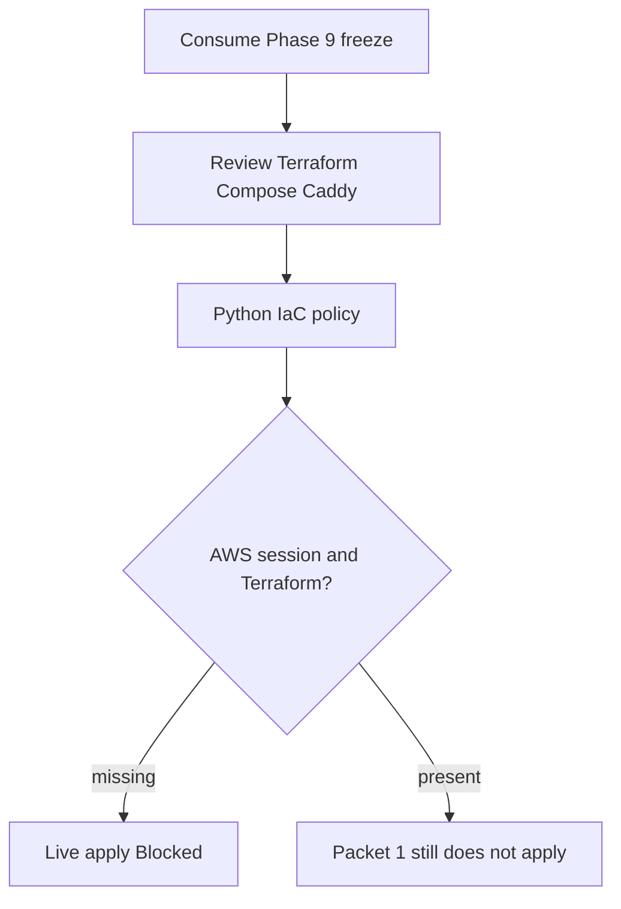

# Phase 10 managed staging evidence

Canonical packet evidence for Phase 10. Each packet appends its handoff. Do
not check a packet from file presence alone. Phase 10 wrapper stays
`pending`. Live AWS/Supabase/Vercel/SES apply is **Blocked** in Packet 1.

Related: [MANAGED_STAGING.md](../deployment/MANAGED_STAGING.md) ·
[QUALITY_COMMANDS.md](./QUALITY_COMMANDS.md) ·
[docs index](../README.md)

## Packet 1 — Provision isolated managed staging from reviewed IaC

Requirement ID: **P10-01**.

### Requirement (quoted)

> Provision isolated managed Supabase, SES sandbox, CloudFront/WAF, EC2
> blue/green services plus digest-pinned private ParadeDB, private
> Valkey/proxy networks, and Vercel staging from reviewed IaC.

### Concrete acceptance checks

- **P10-01-A:** Intended managed plan/features/regions and exact Phase 9
  artifacts match. Evidence: inventory. Failure: stop drift.
- **P10-01-B:** EC2 is rebuildable/encrypted/IMDSv2/SSM-only with controlled
  ingress. Evidence: IaC/runtime assertions. Failure: blocker.
- **P10-01-C:** ParadeDB/Valkey/LightRAG/private services have hard
  limits/credentials/no public path. Evidence: network scan. Failure: stop.
- **P10-01-D:** Vercel/SES separation exposes no secret. Evidence: environment
  scan. Failure: rotate/remove.
- **P10-01-E:** Only synthetic/redacted data exists. Evidence: manifest.
  Failure: purge/incident.



### Inspected paths (before edit)

| Path | Result |
| --- | --- |
| `docs/deployment/phase-09/candidate-packet7-promotion-manifest.json` | Exact image ids consumed |
| `docs/deployment/phase-09/candidate-corpus-manifest.json` | `holdout_opened: false` |
| `infra/ec2/` | Did not exist; created reviewed IaC |
| `infra/caddy/Caddyfile` | Local 90s contract; staging Caddy is `infra/ec2/Caddyfile` |
| Terraform / OpenTofu | Not installed. Policy parses committed files |
| `aws sts get-caller-identity` | Failed / session expired. Did not run `aws login` |

### Files changed (allowed outputs only)

| File | Action |
| --- | --- |
| `packages/core/src/smart_rag_core/release/phase10_*.py` | Created — constants, topology parser, classifier |
| `scripts/ci/check_phase10_packet1.py` | Created — zero-collection fail-closed gate |
| `scripts/phase10_staging.py` | Created — inventory / assert-iac / classify / probe |
| `tests/unit/test_phase10_packet1.py` | Created — negatives always run |
| `tests/contract/test_phase10_packet1.py` | Created — committed IaC/inventory/corpus |
| `infra/ec2/` | Created — Terraform, Compose, Caddy, user-data, inventory |
| `docs/deployment/phase-10/packet1-*.json` | Created by the Packet 1 gate (no secrets) |
| `docs/deployment/MANAGED_STAGING.md` | Created |
| `docs/deployment/STREAMING_TIMEOUTS.md` | CloudFront 90s now asserted in IaC |
| `docs/architecture/04-deployment.md` | Staging mermaid matches IaC |
| `docs/architecture/02-containers.md` | Staging mermaid matches IaC |
| `docs/adr/ADR-private-service-tls.md` | Staging revisit: TLS still omitted on private Docker net |
| `.cursor/plans/.../10-phase-managed-staging.md` | Wrapper remains pending; Packet 1 checkbox unchecked |

### Identities frozen

No secrets. Live project/distribution ids are absent because apply is Blocked.

| Field | Value |
| --- | --- |
| Phase 9 api | `sha256:a65f1aa43fbf6fd353257a75fa9462e79a5bb187741d75e36a0429216e3633ec` |
| Phase 9 worker | `sha256:e6259d06f129ec14158e90acf1807dbaed0baa040bef9781fac60d46a97fe96e` |
| Phase 9 frontend | `sha256:e47efc373a151c7c79039009fd04f459f997127beafb00747cd91c4a9b96a5c1` |
| Phase 9 crawl-proxy | `sha256:7d78834e21cc87d2ba133d4d131f1aa6d05b2de808d80296bf6658a8e04e62d3` |
| Phase 9 parser-sandbox | `sha256:f7717ab4ec1e06d8113a19c080a05c1db6050b3b70e3bcfd73d61dd013ed6e0a` |
| ParadeDB | `sha256:dca046b8a0ddd070c368d5254cbb7f596b3b7bc67bc2efa7c0fbe881087883bb` |
| Valkey | `sha256:a038175878d66b9d274fbf8be73c0305e93798b83917647f167e18cef3c71eec` |
| Envelope | QT-CAP-001-P9=8, QT-CAP-002-P9=16, QT-CAP-005-P8=15 |
| AWS / Supabase region | intended `us-east-1` |
| `MOCK_MODEL_MODE` | `true` locally; holdout denied |
| IaC policy sha256 | `bf09959e2f70b89b10851245691992d28a4e4dcae79b2d476a6eff6fa2dcac1f` |

### Classifications

Packet 1 **does not** mark the wrapper complete. P10-01-B runtime and
P10-01-C network scan are **Blocked**, so the Packet 1 checkbox stays
unchecked.

| Check | Classification | Notes |
| --- | --- | --- |
| P10-01-A inventory | Passed | Intended Pro / us-east-1 / PITR / Supavisor / Phase 9 ids match. Live projects not created |
| P10-01-B EC2 | Blocked | IaC policy Passed (encrypted, IMDSv2 hop 1, SSM-only, CloudFront prefix list). Runtime assertions Blocked: no Terraform/OpenTofu, AWS session expired |
| P10-01-C private path | Blocked | Compose/IaC policy Passed (no host ports, digest pins, limits, credentials via env). No network scan artifact |
| P10-01-D Vercel/SES | Passed | Committed allow-list is API URL, Supabase URL, publishable key only. Live Vercel/SES apply Blocked |
| P10-01-E synthetic data | Passed | Phase 9 open-split corpus identity; `holdout_opened: false`; production flags false. Live staging seed not applied |

### Commands and exit codes

```powershell
uv run ruff format packages/core/src/smart_rag_core/release/phase10_constants.py packages/core/src/smart_rag_core/release/phase10_topology.py packages/core/src/smart_rag_core/release/phase10_packet1.py scripts/ci/check_phase10_packet1.py scripts/phase10_staging.py tests/unit/test_phase10_packet1.py tests/contract/test_phase10_packet1.py
uv run ruff check packages/core/src/smart_rag_core/release/phase10_constants.py packages/core/src/smart_rag_core/release/phase10_topology.py packages/core/src/smart_rag_core/release/phase10_packet1.py scripts/ci/check_phase10_packet1.py scripts/phase10_staging.py tests/unit/test_phase10_packet1.py tests/contract/test_phase10_packet1.py
uv run python -m pytest tests/unit/test_phase10_packet1.py tests/contract/test_phase10_packet1.py -q
uv run python scripts/ci/check_phase10_packet1.py
```

| Command | Exit | Notes |
| --- | --- | --- |
| `uv run ruff format` on Packet 1 Python | 0 | 7 files left unchanged after the first format |
| `uv run ruff check` on Packet 1 Python | 0 | All checks passed |
| `uv run pyright` on Packet 1 Python | 0 | 0 errors |
| `uv run python -m pytest tests/unit/test_phase10_packet1.py tests/contract/test_phase10_packet1.py -q` | 0 | 16 passed, 0 skipped |
| `uv run python scripts/ci/check_phase10_packet1.py` | 0 | tests=16 failures=0 errors=0 skipped=0; IaC policy Passed; live apply Blocked |

Artifacts: `docs/deployment/phase-10/packet1-{gate-matrix,inventory,iac-policy,live-providers,negatives}.json`.

Packet 1 checkbox stays **unchecked** because P10-01-B runtime and P10-01-C
network scan are Blocked. Packet file `status` stays `pending`. Phase 10
wrapper `status` remains `pending`. Holdout was not opened.

### Unverified / Blocked

- Live managed Supabase Pro project, PITR, JWKS, Storage buckets, Supavisor.
- Live SES sandbox verification and SMTP.
- Live CloudFront/WAF distribution, origin header, prefix-list ingress.
- Live EC2 instance, SSM session, Compose health, IMDS hop-1 runtime.
- Live private-port and metadata network scan.
- Live Vercel project env.
- Terraform/OpenTofu plan/apply (tools not installed; not downloaded).
- Packets 2–7 (OIDC, egress proof, JWKS/origin rotation, KMS, restore,
  external assessment).

### Deviations

None versus Packet 1 scope. CloudFront origin timeouts remain 90 seconds in
IaC despite the Terraform AWS provider website still documenting a 60s
default upper bound; live apply uses the AWS API contract (OriginReadTimeout
max 120).
