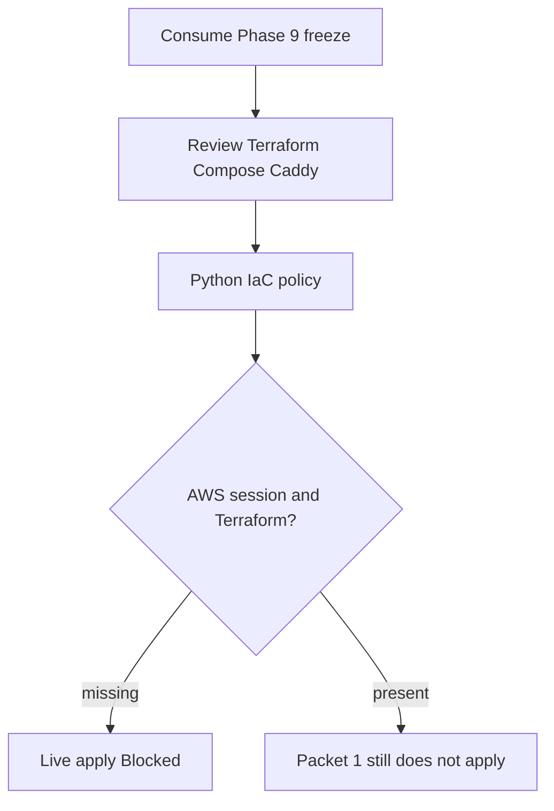
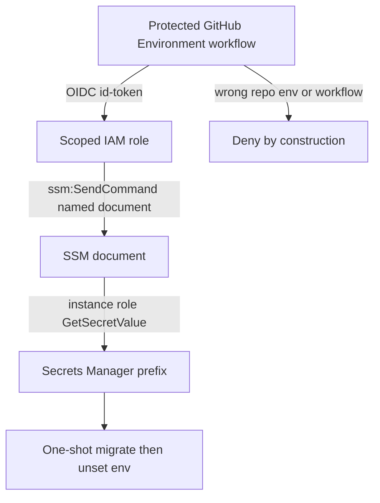
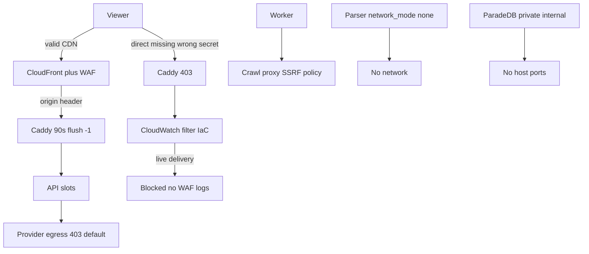

# Phase 10 managed staging evidence

Canonical packet evidence for Phase 10. Each packet appends its handoff. Do
not check a packet from file presence alone. Phase 10 wrapper stays
`pending`. Live AWS/Supabase/Vercel/SES apply is **Blocked** in Packet 1.

Related: [MANAGED_STAGING.md](../deployment/MANAGED_STAGING.md) ·
[QUALITY_COMMANDS.md](./QUALITY_COMMANDS.md) ·
[docs index](../README.md)

## Packet 1 — Provision isolated managed staging from reviewed IaC

Requirement ID: **P10-01**.

### Requirement (quoted)

> Provision isolated managed Supabase, SES sandbox, CloudFront/WAF, EC2
> blue/green services plus digest-pinned private ParadeDB, private
> Valkey/proxy networks, and Vercel staging from reviewed IaC.

### Concrete acceptance checks

- **P10-01-A:** Intended managed plan/features/regions and exact Phase 9
  artifacts match. Evidence: inventory. Failure: stop drift.
- **P10-01-B:** EC2 is rebuildable/encrypted/IMDSv2/SSM-only with controlled
  ingress. Evidence: IaC/runtime assertions. Failure: blocker.
- **P10-01-C:** ParadeDB/Valkey/LightRAG/private services have hard
  limits/credentials/no public path. Evidence: network scan. Failure: stop.
- **P10-01-D:** Vercel/SES separation exposes no secret. Evidence: environment
  scan. Failure: rotate/remove.
- **P10-01-E:** Only synthetic/redacted data exists. Evidence: manifest.
  Failure: purge/incident.



### Inspected paths (before edit)

| Path | Result |
| --- | --- |
| `docs/deployment/phase-09/candidate-packet7-promotion-manifest.json` | Exact image ids consumed |
| `docs/deployment/phase-09/candidate-corpus-manifest.json` | `holdout_opened: false` |
| `infra/ec2/` | Did not exist; created reviewed IaC |
| `infra/caddy/Caddyfile` | Local 90s contract; staging Caddy is `infra/ec2/Caddyfile` |
| Terraform / OpenTofu | Not installed. Policy parses committed files |
| `aws sts get-caller-identity` | Failed / session expired. Did not run `aws login` |

### Files changed (allowed outputs only)

| File | Action |
| --- | --- |
| `packages/core/src/smart_rag_core/release/phase10_*.py` | Created — constants, topology parser, classifier |
| `scripts/ci/check_phase10_packet1.py` | Created — zero-collection fail-closed gate |
| `scripts/phase10_staging.py` | Created — inventory / assert-iac / classify / probe |
| `tests/unit/test_phase10_packet1.py` | Created — negatives always run |
| `tests/contract/test_phase10_packet1.py` | Created — committed IaC/inventory/corpus |
| `infra/ec2/` | Created — Terraform, Compose, Caddy, user-data, inventory |
| `docs/deployment/phase-10/packet1-*.json` | Created by the Packet 1 gate (no secrets) |
| `docs/deployment/MANAGED_STAGING.md` | Created |
| `docs/deployment/STREAMING_TIMEOUTS.md` | CloudFront 90s now asserted in IaC |
| `docs/architecture/04-deployment.md` | Staging mermaid matches IaC |
| `docs/architecture/02-containers.md` | Staging mermaid matches IaC |
| `docs/adr/ADR-private-service-tls.md` | Staging revisit: TLS still omitted on private Docker net |
| `.cursor/plans/.../10-phase-managed-staging.md` | Wrapper remains pending; Packet 1 checkbox unchecked |

### Identities frozen

No secrets. Live project/distribution ids are absent because apply is Blocked.

| Field | Value |
| --- | --- |
| Phase 9 api | `sha256:a65f1aa43fbf6fd353257a75fa9462e79a5bb187741d75e36a0429216e3633ec` |
| Phase 9 worker | `sha256:e6259d06f129ec14158e90acf1807dbaed0baa040bef9781fac60d46a97fe96e` |
| Phase 9 frontend | `sha256:e47efc373a151c7c79039009fd04f459f997127beafb00747cd91c4a9b96a5c1` |
| Phase 9 crawl-proxy | `sha256:7d78834e21cc87d2ba133d4d131f1aa6d05b2de808d80296bf6658a8e04e62d3` |
| Phase 9 parser-sandbox | `sha256:f7717ab4ec1e06d8113a19c080a05c1db6050b3b70e3bcfd73d61dd013ed6e0a` |
| ParadeDB | `sha256:dca046b8a0ddd070c368d5254cbb7f596b3b7bc67bc2efa7c0fbe881087883bb` |
| Valkey | `sha256:a038175878d66b9d274fbf8be73c0305e93798b83917647f167e18cef3c71eec` |
| Envelope | QT-CAP-001-P9=8, QT-CAP-002-P9=16, QT-CAP-005-P8=15 |
| AWS / Supabase region | intended `us-east-1` |
| `MOCK_MODEL_MODE` | `true` locally; holdout denied |
| IaC policy sha256 | `bf09959e2f70b89b10851245691992d28a4e4dcae79b2d476a6eff6fa2dcac1f` |

### Classifications

Packet 1 **does not** mark the wrapper complete. P10-01-B runtime and
P10-01-C network scan are **Blocked**, so the Packet 1 checkbox stays
unchecked.

| Check | Classification | Notes |
| --- | --- | --- |
| P10-01-A inventory | Passed | Intended Pro / us-east-1 / PITR / Supavisor / Phase 9 ids match. Live projects not created |
| P10-01-B EC2 | Blocked | IaC policy Passed (encrypted, IMDSv2 hop 1, SSM-only, CloudFront prefix list). Runtime assertions Blocked: no Terraform/OpenTofu, AWS session expired |
| P10-01-C private path | Blocked | Compose/IaC policy Passed (no host ports, digest pins, limits, credentials via env). No network scan artifact |
| P10-01-D Vercel/SES | Passed | Committed allow-list is API URL, Supabase URL, publishable key only. Live Vercel/SES apply Blocked |
| P10-01-E synthetic data | Passed | Phase 9 open-split corpus identity; `holdout_opened: false`; production flags false. Live staging seed not applied |

### Commands and exit codes

```powershell
uv run ruff format packages/core/src/smart_rag_core/release/phase10_constants.py packages/core/src/smart_rag_core/release/phase10_topology.py packages/core/src/smart_rag_core/release/phase10_packet1.py scripts/ci/check_phase10_packet1.py scripts/phase10_staging.py tests/unit/test_phase10_packet1.py tests/contract/test_phase10_packet1.py
uv run ruff check packages/core/src/smart_rag_core/release/phase10_constants.py packages/core/src/smart_rag_core/release/phase10_topology.py packages/core/src/smart_rag_core/release/phase10_packet1.py scripts/ci/check_phase10_packet1.py scripts/phase10_staging.py tests/unit/test_phase10_packet1.py tests/contract/test_phase10_packet1.py
uv run python -m pytest tests/unit/test_phase10_packet1.py tests/contract/test_phase10_packet1.py -q
uv run python scripts/ci/check_phase10_packet1.py
```

| Command | Exit | Notes |
| --- | --- | --- |
| `uv run ruff format` on Packet 1 Python | 0 | 7 files left unchanged after the first format |
| `uv run ruff check` on Packet 1 Python | 0 | All checks passed |
| `uv run pyright` on Packet 1 Python | 0 | 0 errors |
| `uv run python -m pytest tests/unit/test_phase10_packet1.py tests/contract/test_phase10_packet1.py -q` | 0 | 16 passed, 0 skipped |
| `uv run python scripts/ci/check_phase10_packet1.py` | 0 | tests=16 failures=0 errors=0 skipped=0; IaC policy Passed; live apply Blocked |

Artifacts: `docs/deployment/phase-10/packet1-{gate-matrix,inventory,iac-policy,live-providers,negatives}.json`.

Packet 1 checkbox stays **unchecked** because P10-01-B runtime and P10-01-C
network scan are Blocked. Packet file `status` stays `pending`. Phase 10
wrapper `status` remains `pending`. Holdout was not opened.

### Unverified / Blocked

- Live managed Supabase Pro project, PITR, JWKS, Storage buckets, Supavisor.
- Live SES sandbox verification and SMTP.
- Live CloudFront/WAF distribution, origin header, prefix-list ingress.
- Live EC2 instance, SSM session, Compose health, IMDS hop-1 runtime.
- Live private-port and metadata network scan.
- Live Vercel project env.
- Terraform/OpenTofu plan/apply (tools not installed; not downloaded).
- Packets 3–7 (egress proof, JWKS/origin rotation, KMS, restore,
  external assessment). Packet 2 committed OIDC/SSM/workflow policy is
  appended below; live OIDC assume/SSM migrate remains Blocked.

### Deviations

None versus Packet 1 scope. CloudFront origin timeouts remain 90 seconds in
IaC despite the Terraform AWS provider website still documenting a 60s
default upper bound; live apply uses the AWS API contract (OriginReadTimeout
max 120).

## Packet 2 — GitHub OIDC, protected migrations, and secrets custody

Requirement ID: **P10-02**.

### Requirement (quoted)

> Implement GitHub OIDC, protected immutable expand/contract migrations,
> short-lived credential retrieval, environment separation, and secrets
> custody.

### Concrete acceptance checks

- **P10-02-A:** OIDC assumes only scoped role/SSM targets. Evidence:
  allow/deny policy tests. Failure: narrow/stop.
- **P10-02-B:** No persistent secret in GitHub/Vercel/log/image/process.
  Evidence: scans/lifecycle. Failure: revoke/rotate.
- **P10-02-C:** Approved immutable expansion runs; incompatible DDL is
  rejected. Evidence: approval/audit. Failure: block.
- **P10-02-D:** Old API remains healthy and contraction absent. Evidence:
  drain smoke/diff. Failure: redesign.
- **P10-02-E:** Staging/production credentials separate and rotate ≤90
  days/after exposure. Evidence: custody policy. Failure: block.



### Inspected paths (before edit)

| Path | Result |
| --- | --- |
| `infra/ec2/iam.tf` | Packet 1 instance role; staging prefix GetSecretValue |
| `scripts/ci/check_migrations.py` | Reused `find_migration_violations`; no second regex table |
| `docs/adr/ADR-expand-contract-migrations.md` | Accepted expand/contract |
| `docs/deployment/phase-09/candidate-old-api-new-schema-smoke.json` | Passed; requested `sha256:1d9f569b…`; freeze `sha256:a65f1aa4…` |
| `phase10_constants.PHASE09_IMAGE_IDS` | Freeze ids unchanged |
| GitHub workflows | `permissions: contents: read` only; no `AWS_ACCESS_KEY` / `id-token` until this packet’s dedicated workflows |
| `hashicorp/aws` 5.100 `aws_secretsmanager_secret_rotation` | Requires a Lambda for non-RDS secrets; not invented |

### Files changed (allowed outputs only)

| File | Action |
| --- | --- |
| `infra/ec2/oidc.tf` | Created — GitHub OIDC provider and staging/production roles |
| `infra/ec2/ssm.tf` plus `infra/ec2/ssm-documents/` | Created — named migrate/deploy documents |
| `infra/ec2/secrets.tf` | Created — secret resources without values; 90-day local |
| `infra/ec2/iam.tf` / `ec2.tf` / `variables.tf` / `outputs.tf` | Extended carefully |
| `.github/workflows/staging-migrate.yml` | Created — OIDC, not added to `pr-fast.yml` |
| `.github/workflows/staging-deploy.yml` | Created |
| `.github/workflows/production-migrate.yml` | Created — live remains Blocked |
| `packages/core/src/smart_rag_core/release/phase10_oidc.py` | Created |
| `packages/core/src/smart_rag_core/release/phase10_packet2.py` | Created |
| `scripts/ci/check_phase10_packet2.py` | Created — zero-collection fail-closed gate |
| `tests/unit/test_phase10_packet2.py` | Created — listed negatives |
| `tests/contract/test_phase10_packet2.py` | Created |
| `docs/deployment/phase-10/packet2-*.json` | Written by the Packet 2 gate |
| `.cursor/plans/.../10-phase-managed-staging.md` | Wrapper remains pending; Packet 1 and Packet 2 checkboxes unchecked |

### Identities frozen

No secrets. Live role ARNs and command ids are absent because assume/migrate
are Blocked.

| Field | Value |
| --- | --- |
| GitHub repository | `Nagdy8888/Demo_Project_3` |
| OIDC issuer | `https://token.actions.githubusercontent.com` |
| OIDC audience | `sts.amazonaws.com` |
| configure-aws-credentials | `7474bc4690e29a8392af63c5b98e7449536d5c3a` (`v4.3.1`) |
| checkout | `actions/checkout@3d3c42e5aac5ba805825da76410c181273ba90b1` |
| Envelope | QT-CAP-001-P9=8, QT-CAP-002-P9=16, QT-CAP-005-P8=15 |
| Phase 9 api freeze | `sha256:a65f1aa43fbf6fd353257a75fa9462e79a5bb187741d75e36a0429216e3633ec` |
| Old-API requested digest | `sha256:1d9f569b54c6012c4e9b1087979b409a9e2517ac9cce7c1f81d8917d9870f3d7` |
| Staging secret prefix | `smart-rag/staging/` |
| Production secret prefix | `smart-rag/production/` |
| Rotation custody | 90 days; Lambda absent |
| Packet 2 OIDC policy sha256 | `67cd8ba7e5188f355b2b6681df228ff71e9d8fdbcd7c31d2914f6e8e018b043f` |
| Migration hash | `f967d4814d272c9d8f62d9f01501ab64963f02076fe4a2dd5ef99f8a9366ed87` (52 files) |
| Packet 1 IaC sha256 after added tf | `702cc8484b8cc5de33dee154f49ad72aba551743d95c75dc60588621a92418ba` |

### Classifications

Packet 2 **does not** mark the wrapper complete. Live OIDC assume and SSM
migrate are **Blocked**, so the Packet 2 checkbox stays unchecked. Packet 1
checkbox stays unchecked and is not required for Packet 2 classify.

| Check | Classification | Notes |
| --- | --- | --- |
| P10-02-A OIDC allow/deny | Passed | Trust pins repo/environment/workflow/ref; staging cannot assume production; `repo:*` absent; SendCommand is named documents plus Environment-tagged instances. Live assume Blocked |
| P10-02-B secret scan | Passed | No long-lived keys in `.github`; no secret values in Terraform; Vercel allow-list unchanged. Live log/image/process scans not run |
| P10-02-C approved expand | Blocked | `check_migrations.py` clean; immutable hash recorded; GitHub Environment wiring present. Live SSM migrate Blocked (no session / Terraform, and this packet does not send-command) |
| P10-02-D old API / no contraction | Passed | Existing smoke artifact Passed with prior digest, freeze still matches Phase 9, requested id is not the freeze; contraction DDL absent |
| P10-02-E custody | Passed | Distinct prefixes; 90-day policy encoded; staging Deny of production ARNs. Live Secrets Manager rotation Blocked (no Lambda) |

### Commands and exit codes

```powershell
uv run ruff format packages/core/src/smart_rag_core/release/phase10_constants.py packages/core/src/smart_rag_core/release/phase10_oidc.py packages/core/src/smart_rag_core/release/phase10_packet2.py scripts/ci/check_phase10_packet2.py tests/unit/test_phase10_packet2.py tests/contract/test_phase10_packet2.py
uv run ruff check packages/core/src/smart_rag_core/release/phase10_constants.py packages/core/src/smart_rag_core/release/phase10_oidc.py packages/core/src/smart_rag_core/release/phase10_packet2.py scripts/ci/check_phase10_packet2.py tests/unit/test_phase10_packet2.py tests/contract/test_phase10_packet2.py
uv run python -m pytest tests/unit/test_phase10_packet2.py tests/contract/test_phase10_packet2.py tests/unit/test_phase10_packet1.py tests/contract/test_phase10_packet1.py -q
uv run python scripts/ci/check_migrations.py
uv run python scripts/ci/check_phase10_packet1.py
uv run python scripts/ci/check_phase10_packet2.py
```

| Command | Exit | Notes |
| --- | --- | --- |
| `uv run ruff format` on Packet 2 Python | 0 | Files formatted then left unchanged |
| `uv run ruff check` on Packet 2 Python | 0 | All checks passed |
| `uv run python -m pyright` on Packet 2 Python | 0 | 0 errors |
| `uv run python -m pytest tests/unit/test_phase10_packet2.py tests/contract/test_phase10_packet2.py tests/unit/test_phase10_packet1.py tests/contract/test_phase10_packet1.py -q` | 0 | 31 passed, 0 skipped |
| `uv run python scripts/ci/check_migrations.py` | 0 | 52 reviewed files; no destructive DDL |
| `uv run python scripts/ci/check_phase10_packet1.py` | 0 | tests=16; IaC policy Passed; wrapper pending; Packet 1 unchecked; live apply Blocked |
| `uv run python scripts/ci/check_phase10_packet2.py` | 0 | tests=15; OIDC policy Passed; live OIDC assume Blocked; P10-02-C Blocked |

Artifacts: `docs/deployment/phase-10/packet2-{gate-matrix,inventory,iac-policy,live-providers,negatives,migration-hash}.json`.

Packet 2 checkbox stays **unchecked** because P10-02-C live SSM migrate is
Blocked. Packet file `status` stays `pending`. Phase 10 wrapper `status`
remains `pending`. Holdout was not opened. Packet 1 stays unchecked.

### Unverified / Blocked

- Live GitHub OIDC `AssumeRoleWithWebIdentity` against the staging or
  production role.
- Live `ssm:SendCommand` for `SmartRagStagingMigrate` /
  `SmartRagStagingDeploy` / `SmartRagProductionMigrate`.
- Live Secrets Manager values and 90-day Lambda rotation.
- GitHub Environment required reviewers (UI), which must exist before a
  real migrate.
- Packets 3–7.

### Deviations

`aws_secretsmanager_secret` in hashicorp/aws 5.100 does not host
`rotation_rules`. Those rules live on `aws_secretsmanager_secret_rotation`,
which needs a rotation Lambda for this non-RDS secret. Packet 2 encodes the
90-day custody policy in inventory/IAM deny of access-key minting and
classifies live rotation **Blocked** instead of faking a Lambda.

Packet 1 `assert_committed_policy` hashes every `infra/ec2/*.tf` file, so
its `iac_sha256` changed when Packet 2 added OIDC/SSM/secret Terraform.
Packet 1 classify still Passed/Blocked as before; the checkbox stays
unchecked.

## Packet 3 — Origin rejection, egress, private ports, WAF, and 90s timeouts

Requirement ID: **P10-03**.

### Requirement (quoted)

> Prove direct-origin rejection, provider/crawl/parser egress boundaries,
> private ports, WAF controls, and 90-second streaming timeout
> configuration.

### Concrete acceptance checks

- **P10-03-A:** Valid CDN succeeds; direct/missing/wrong-secret origin
  fails. Evidence: request matrix. Failure: blocker.
- **P10-03-B:** Private/metadata/management ports unreachable. Evidence:
  scan. Failure: stop.
- **P10-03-C:** Provider/crawl/parser/ParadeDB egress boundaries hold.
  Evidence: matrix/logs. Failure: stop/approved ADR only.
- **P10-03-D:** WAF/Caddy controls and ≥90-second assertions pass.
  Evidence: IaC/runtime/drift. Failure: block streaming.
- **P10-03-E:** Denial telemetry reaches monitoring. Evidence: synthetic
  alert. Failure: repair.



### Inspected paths (before edit)

| Path | Result |
| --- | --- |
| `infra/ec2/cloudfront_waf.tf` | origin_read/keepalive 90, CachingDisabled, WAF CLOUDFRONT, custom header |
| `infra/ec2/vpc.tf` | origin SG prefix list only, no SSH |
| `infra/ec2/Caddyfile` | 90s, flush_interval -1, origin header placeholders, 403 default |
| `infra/ec2/docker-compose.staging.yml` | no host ports on private services; parser `network_mode: none`; caddy 443 only |
| `infra/ec2/user-data.sh` | iptables DROP 169.254.169.254, DOCKER-USER |
| `infra/ec2/provider-egress/` | deny-by-default Caddy stub + hostname allowlist |
| `tests/unit/test_crawl_policy.py` / `tests/contract/test_crawl_ssrf.py` | reused, not duplicated |
| `docs/adr/ADR-private-service-tls.md` | TLS still omitted on private Docker net; no new accepted-risk ADR |
| Live CloudFront / EC2 / WAF logs | Absent. Live rows classified Blocked |

### Files changed (allowed outputs only)

| File | Action |
| --- | --- |
| `packages/core/src/smart_rag_core/release/phase10_egress.py` | Created — origin/egress/timeout/telemetry parser |
| `packages/core/src/smart_rag_core/release/phase10_packet3.py` | Created — honest A–E classifier |
| `scripts/ci/check_phase10_packet3.py` | Created — zero-collection fail-closed gate plus crawl subset |
| `tests/unit/test_phase10_packet3.py` | Created — listed negatives always run |
| `tests/contract/test_phase10_packet3.py` | Created — committed IaC |
| `tests/contract/test_streaming_timeout_contract.py` | Extended — staging Caddy + Terraform 90s |
| `infra/ec2/Caddyfile` | Header/body/slow-client/connection caps |
| `infra/ec2/cloudwatch.tf` | Log group, metric filters, alarm with actions disabled |
| `docs/deployment/phase-10/packet3-*.json` | Written by the Packet 3 gate |
| `.cursor/plans/.../10-phase-managed-staging.md` | Wrapper remains pending; Packet 3 checkbox unchecked |

### Identities frozen

No secrets. Live distribution ids, scan outputs, and alarm ARNs are absent
because CDN/scan/alert are Blocked.

| Field | Value |
| --- | --- |
| Envelope | QT-CAP-001-P9=8, QT-CAP-002-P9=16, QT-CAP-005-P8=15 |
| Phase 9 api freeze | `sha256:a65f1aa43fbf6fd353257a75fa9462e79a5bb187741d75e36a0429216e3633ec` |
| CloudFront OriginReadTimeout | 90 (AWS API max 120; 60 rejected) |
| Caddy flush_interval | -1 |
| Caddy max_header_size | 16KB |
| Caddy request_body | 16MB (FastAPI envelope) |
| WAF rate limit | 2000 |
| Packet 3 IaC sha256 | `ce29b1775468d4ebebdd0a82b7e72937097b1b3eca091258db03ab7a9c5c2bf4` |
| Crawl subset | 29 collected, 0 skipped |
| Accepted-risk ADR | none |

### Classifications

Packet 3 **does not** mark the wrapper complete. Live CDN requests, live
port scan, and live CloudWatch alarm delivery are **Blocked**, so the
Packet 3 checkbox stays unchecked. Packets 1 and 2 stay unchecked and are
not required for Packet 3 classify.

| Check | Classification | Notes |
| --- | --- | --- |
| P10-03-A origin | Blocked | Caddy 403 / prefix-list / custom header policy Passed. No live CDN request artifact; request-matrix HTTP statuses are null |
| P10-03-B ports | Blocked | Compose unpublished + IMDS hop 1 + metadata DROP policy Passed. No live scan artifact |
| P10-03-C egress | Passed | Provider 403, public allowlist, parser none, ParadeDB internal private, crawl SSRF subset required |
| P10-03-D timeouts | Passed | CloudFront/Caddy 90s, flush -1, CachingDisabled, WAF, Caddy caps. origin_read_timeout 60 rejected. Live runtime drift Blocked |
| P10-03-E telemetry | Blocked | WAF visibility_config metric names and CloudWatch filters exist. Live synthetic alarm not delivered |

### Commands and exit codes

```powershell
uv run ruff format packages/core/src/smart_rag_core/release/phase10_constants.py packages/core/src/smart_rag_core/release/phase10_topology.py packages/core/src/smart_rag_core/release/phase10_egress.py packages/core/src/smart_rag_core/release/phase10_packet3.py scripts/ci/check_phase10_packet3.py tests/unit/test_phase10_packet3.py tests/contract/test_phase10_packet3.py tests/contract/test_streaming_timeout_contract.py
uv run ruff check packages/core/src/smart_rag_core/release/phase10_constants.py packages/core/src/smart_rag_core/release/phase10_topology.py packages/core/src/smart_rag_core/release/phase10_egress.py packages/core/src/smart_rag_core/release/phase10_packet3.py scripts/ci/check_phase10_packet3.py tests/unit/test_phase10_packet3.py tests/contract/test_phase10_packet3.py tests/contract/test_streaming_timeout_contract.py
uv run python -m pytest tests/unit/test_phase10_packet1.py tests/contract/test_phase10_packet1.py tests/unit/test_phase10_packet2.py tests/contract/test_phase10_packet2.py tests/unit/test_phase10_packet3.py tests/contract/test_phase10_packet3.py tests/contract/test_streaming_timeout_contract.py -q
uv run python scripts/ci/check_phase10_packet1.py
uv run python scripts/ci/check_phase10_packet2.py
uv run python scripts/ci/check_phase10_packet3.py
```

| Command | Exit | Notes |
| --- | --- | --- |
| `uv run ruff format` on Packet 3 Python | 0 | Files formatted then left unchanged |
| `uv run ruff check` on Packet 3 Python | 0 | All checks passed |
| `uv run python -m pyright` on Packet 3 Python | 0 | 0 errors |
| `uv run python -m pytest` Packet 1-3 plus streaming timeout | 0 | 47 passed, 0 skipped |
| `uv run python scripts/ci/check_phase10_packet1.py` | 0 | tests=16; IaC policy Passed; live apply Blocked; checkbox unchecked |
| `uv run python scripts/ci/check_phase10_packet2.py` | 0 | tests=15; OIDC policy Passed; live OIDC assume Blocked; P10-02-C Blocked |
| `uv run python scripts/ci/check_phase10_packet3.py` | 0 | tests=42 crawl_subset=29 skipped=0; IaC Passed; P10-03-A/B/E Blocked; C/D Passed |

Artifacts: `docs/deployment/phase-10/packet3-{gate-matrix,origin,egress,timeouts,scans,negatives}.json`.

Packet 3 checkbox stays **unchecked** because P10-03-A live CDN, P10-03-B live scan, and P10-03-E live alert are Blocked. Packet file `status` stays `pending`. Phase 10 wrapper `status` remains `pending`. Holdout was not opened. Packets 1 and 2 stay unchecked.

### Unverified / Blocked

- Live CloudFront distribution request matrix (valid CDN 200 plus direct
  origin 403).
- Live nmap/metadata reachability of private and management ports.
- Live CloudWatch metric-filter hits and alarm notifications.
- Packets 4–7.

### Deviations

None versus Packet 3 scope. Deny-by-default provider egress is asserted in
committed Caddy/allowlist/Compose rather than waived with a new ADR.
Private Docker TLS remains omitted under
[ADR-private-service-tls.md](../adr/ADR-private-service-tls.md); live scan
proof is still Blocked. CloudWatch alarm `actions_enabled = false` because
Packet 5 owns alert routing; that is recorded as live Blocked, not Passed.

Packet 1 `assert_committed_policy` hashes every `infra/ec2/*.tf` file, so
its `iac_sha256` changed when Packet 3 added `cloudwatch.tf`. Packet 1
classify still Passed/Blocked as before; the checkbox stays unchecked.


