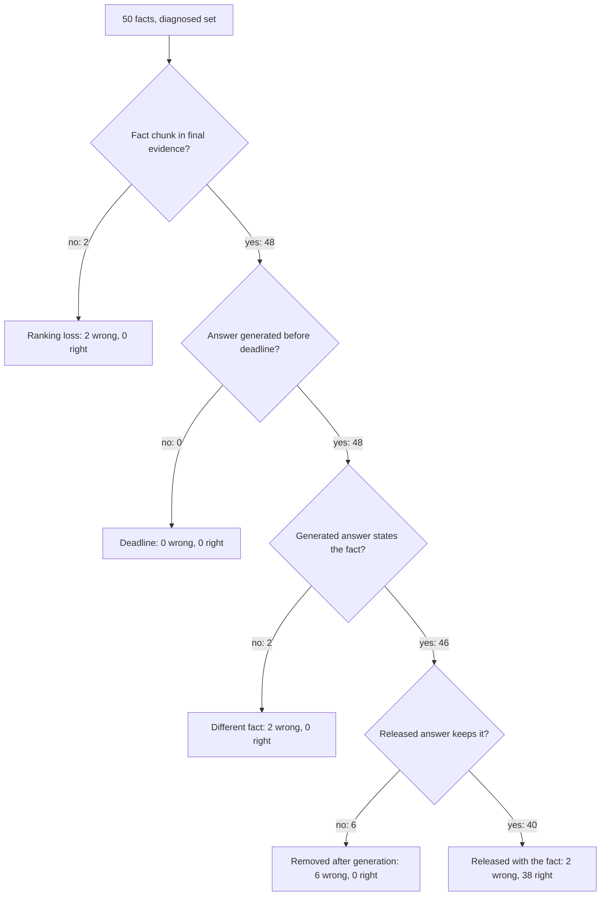

# Answer-loss repair evidence (2026-09)

Decision record:
[ADR-retrieved-answer-loss-repair.md](../adr/ADR-retrieved-answer-loss-repair.md).
Diagnosis this repair targets:
[ANSWER_ONLY_50_ROOT_CAUSES_2026-09-24.md](./ANSWER_ONLY_50_ROOT_CAUSES_2026-09-24.md).
Baseline score:
[ANSWER_ONLY_50_2026-09-24.md](./ANSWER_ONLY_50_2026-09-24.md).

This record holds counts and question IDs only. Questions, gold phrases,
answers, and book text stay in the gitignored `.private-eval/` folder.

## Verdict

**Fail.** Unseen right 26/50 and diagnosed right 38/50 are both below 40.
The released-claim review and the negative question also fail. Bookkeeping,
rerank completion, final evidence, deadlines, p90, the regression tests,
and the freeze pass.

## Provenance

| Pin | Value |
| --- | --- |
| Branch | `fix/answer-loss-repair` |
| Commit measured | `d66b227` |
| `api` image | `6b69762653e3`, created 13 hours before the probe (layers cached; probe A1-A7 present) |
| Probe | A1 to A7 `present` |
| Health | `query_ready: true` |
| Book | document `b56d5774-8810-4ee9-a4d3-f3c93fa90ea7`, version `d7e3206a-b262-44d7-90bc-b1572d864c35`, `parser_v1_pdf_reflow_v4` |
| Previous book version | `e119bf87-1c70-4e10-abb1-5666c4f728c4`, row `soft_deleted` |
| Diagnosed set | `answer50-v1.json`, 50 questions, diagnosed 2026-09-24 |
| Unseen set | `unseen50-v1.json`, 50 questions, sealed in A0, SHA-256 `f0abf149eb00f840cff59de49f3ff35d1128b369a4d28982aeaf7acf1219a3dd` |
| Scorer | `dual_metric.py` unchanged since the A0 commit |

## Scoring

A question is right when the scorer's strict pass is true, or when a
reviewer read the answer against the gold page and it states the same fact
in other words. A refusal or a deadline is never right. A nearby topic
that names a different fact is wrong. The same rules scored the unseen
baseline from A0 and both A9 runs.

## Acceptance

| Target (ADR, approved 2026-09-24) | Set | Baseline | A9 | Pass |
| --- | --- | ---: | ---: | --- |
| At least 40 of 50 right | unseen | 14/50 | 26/50 | no |
| At least 40 of 50 right | diagnosed | 21/50 | 38/50 | no |
| No generated right answer removed by bookkeeping | diagnosed | 7 | 0 | yes |
| Rerank completes, fully or partially, on at least 45 of 50 | diagnosed | 14/50 | 50/50 | yes |
| Fact chunk reaches final evidence on at least 43 of 50 | diagnosed | 35/50 | 48/50 | yes |
| No deadlines | diagnosed | 3 | 0 | yes |
| p90 run total at most 45 s | diagnosed | 49.9 s | 22.3 s | yes |
| Invented-expansion regression still refuses | tests | pass | 3 passed | yes |
| Verifier and release tests still pass | tests | pass | pass | yes |
| No released unseen claim unsupported by its cited span | unseen | not reviewed | 20 of 37 claims unsupported | no |
| Out-of-scope negative question refuses (`ka-12`) | negative | not measured | `run_failed` | no |
| Frozen profile digests and prompt bytes unchanged | freeze | pass | pass | yes |

Diagnosed-set baselines come from the root-cause doc and were recomputed
with the same scripts. The baseline bookkeeping kills are a02, a09, a10,
a17, a34, a38, and a45.

## Comparison with the baselines

| Set | Run | Strict | Right in other words | Right | Deadlines |
| --- | --- | ---: | ---: | ---: | ---: |
| Diagnosed | 2026-09-24 baseline | 19 | 2 | 21 | 3 |
| Diagnosed | A9 | 38 | 0 | 38 | 0 |
| Unseen | A0 baseline, before any fix | 10 | 4 | 14 | 0 |
| Unseen | A9 | 20 | 6 | 26 | 0 |

Right in other words: diagnosed none; unseen u03, u04, u12, u13, u16, u44.
Unseen-set information without a target: rerank completed 49/50 (not
completed: u01), p90 run total 20.5 s, deadlines 0. Unseen facts still on
their page in the re-ingested version: `valid=yes` (50/50, failures 0).

## Loss waterfall (diagnosed set)



Ranking loss (evidence missing): a04, a07. Deadline: none. Different fact:
a32, a39. Removed after generation: a01, a13, a19, a22, a37, a47. None of
those six carried a bookkeeping failure code (`bookkeeping_kills=0`).

## Stage survival (diagnosed set)

| Stage | 2026-09-24 | A9 |
| --- | ---: | ---: |
| Stored chunk text holds the fact | 50 | 50 |
| Dense list | 50 | 50 |
| Fused list | 48 | 48 |
| Rerank pool | 44 | 48 |
| Final evidence | 35 | 48 |
| Generated answer states the fact | 28 | 46 |
| Right | 21 | 38 |

## Latency (report only)

```text
a9-answer50
server_total_s n=50 mean=19.261 median=18.895 p90=21.838
wall_seconds n=50 mean=25.835 median=25.438 p90=28.594
deadline_exhausted=0

a9-unseen50
server_total_s n=50 mean=18.038 median=18.08 p90=20.4
wall_seconds n=50 mean=24.753 median=24.742 p90=27.781
deadline_exhausted=0
```

L6 (pooled query connections) and L7 (shorter answers) were not part of
this plan. The latency image probe printed L0-L3 and L5 `present`, L4
`MISSING` (the pipeline gate failed and that code was not kept), and L6
and L7 `MISSING`. `rerank_prompt_version=rerank_v2`.

## Safety review

- Invented-expansion regression: the three MCP expansion tests in
  `tests/unit/test_answer_verifier.py` passed.
- Verifier and release tests: `test_answer_verifier.py` and
  `test_answer_citations_persist.py` passed.
- Released-claim review on the unseen set: 37 claims on 34 answered
  questions. Markers: `CITED:37`. Unsupported: 20
  (u04:claim-1, u04:claim-2, u07:claim-1, u12:claim-1, u13:claim-1,
  u14:claim-1, u15:claim-1, u19:claim-1, u20:claim-1, u22:claim-1,
  u24:claim-1, u25:claim-1, u28:claim-1, u34:claim-1, u39:claim-1,
  u41:claim-1, u44:claim-1, u45:claim-1, u47:claim-1, u50:claim-1).
  0 claims reached the user after their citation was dropped before
  release.
- Out-of-scope negative `ka-12`: status `run_failed`, origin none.
  The executor raised `FusionError` on two attempts. That is not a refusal.

## Freeze

| Check | Result |
| --- | --- |
| `tests/unit/test_phase4_freeze.py` | passed (exit 0) |
| Prompt and profile pin tests (7 files) | passed (exit 0) |
| Frozen prompt and profile bytes versus `origin/main` | no diff |

## Commands

| Command | Exit |
| --- | ---: |
| Docker rebuild and `health/ready` | 0 |
| 00-rules probe | 0 |
| `a9_metrics.py version` | 0 |
| `run_company_ask.py` diagnosed set | 0 |
| `run_company_ask.py` unseen set | 0 |
| `run_company_ask.py` negative `ka-12` | 0 |
| `answer50_stage_trace.py` | 0 |
| `answer50_checkpoint_dump.py summary` | 0 |
| `latency_probe.py stages` (both runs) | 0 |
| Safety tests | 0 |
| Freeze tests and byte diff | 0 |
| `scripts/check.py --tier docs` | 0 |

## Limits

- Right-in-other-words verdicts and the released-claim review are manual
  readings against the book page; one reviewer made them.
- One run per set. Model output varies between runs, so a count can move
  by a few questions on a rerun.
- The stage trace matches the gold phrase with a simple normalizer. A
  fact written differently in the new parse can be missed.
- The run total is the time from the first to the last `app.run_events`
  row of each run.
- The diagnosed set shaped the fixes, so only the unseen set shows how
  well they generalize.
- `ka-12` failed in the graph (`FusionError`) twice. The runner exit code
  was 0 because it recorded the error; `negative_target=fail`.

## Reproduce

Requires `OPERATOR_SUPABASE_DB_URL` in `.env` or `.env.compose`, the
private gold files, and the A9 run folders under `.private-eval/runs/`.

```powershell
$env:PYTHONIOENCODING = "utf-8"
$env:PYTHONPATH = ".private-eval"
.venv\Scripts\python.exe .private-eval/a9_metrics.py version
.venv\Scripts\python.exe .private-eval/a9_metrics.py run --summary .private-eval/runs/a9-answer50/summary.json --answers .private-eval/runs/a9-answer50/answers.json
.venv\Scripts\python.exe .private-eval/a9_metrics.py latency --probe-output .private-eval/runs/a9-answer50/latency.txt
.venv\Scripts\python.exe .private-eval/a9_metrics.py claims --review .private-eval/runs/a9-unseen50/claim-review.json
```

[docs index](../README.md)
