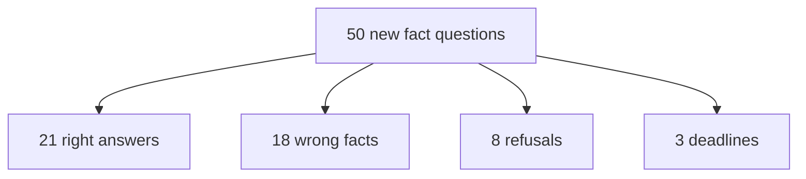

# Answer-only 50 (2026-09-24)

This run asks whether the live RAG stated the fact that is on the PDF page.
Citations, rerank, and page selection are not scored. The questions are a
third set, on pages that
[FRESH_KNOWN_ANSWER_50_2026-09-23.md](./FRESH_KNOWN_ANSWER_50_2026-09-23.md)
and
[KNOWN_ANSWER_50_REPAIR_EVIDENCE_2026-09-22.md](./KNOWN_ANSWER_50_REPAIR_EVIDENCE_2026-09-22.md)
do not use. The book is *Building Applications with AI Agents*. The private
question file is `.private-eval/answer50-v1.json`. Expected-answer and
answer-text columns were removed before commit (plan decision D4); the
private run files keep them.

## Result

The answer is right on **21 of 50** questions.

| Outcome | Count |
| --- | ---: |
| Right answer, required wording present | 19 |
| Right answer, same fact in different words | 2 |
| Wrong fact | 18 |
| Refused: insufficient evidence | 8 |
| Deadline: no answer generated | 3 |

A right answer states the fact from that page. A refusal or a deadline is
not a right answer. A nearby topic that names a different fact is wrong.

The two wording differences that still count as right:

| ID | Page |
| --- | ---: |
| a14 | 98 |
| a19 | 143 |

## Wrong answers

| ID | Page |
| --- | ---: |
| a03 | 30 |
| a04 | 34 |
| a07 | 59 |
| a08 | 67 |
| a11 | 84 |
| a12 | 89 |
| a22 | 167 |
| a23 | 172 |
| a24 | 177 |
| a25 | 186 |
| a26 | 195 |
| a27 | 206 |
| a28 | 210 |
| a34 | 242 |
| a35 | 248 |
| a36 | 258 |
| a39 | 273 |
| a40 | 277 |

## No answer

Refused with "Insufficient authorized evidence": a02, a09, a10, a17, a33,
a38, a45, a48.

Deadline, no generated answer: a31, a32, a37.

## Question-by-question

| ID | Page | Verdict |
| --- | ---: | --- |
| a01 | 20 | Right |
| a02 | 25 | Refused |
| a03 | 30 | Wrong |
| a04 | 34 | Wrong |
| a05 | 45 | Right |
| a06 | 49 | Right |
| a07 | 59 | Wrong |
| a08 | 67 | Wrong |
| a09 | 75 | Refused |
| a10 | 80 | Refused |
| a11 | 84 | Wrong |
| a12 | 89 | Wrong |
| a13 | 94 | Right |
| a14 | 98 | Right |
| a15 | 110 | Right |
| a16 | 116 | Right |
| a17 | 129 | Refused |
| a18 | 138 | Right |
| a19 | 143 | Right |
| a20 | 147 | Right |
| a21 | 152 | Right |
| a22 | 167 | Wrong |
| a23 | 172 | Wrong |
| a24 | 177 | Wrong |
| a25 | 186 | Wrong |
| a26 | 195 | Wrong |
| a27 | 206 | Wrong |
| a28 | 210 | Wrong |
| a29 | 219 | Right |
| a30 | 223 | Right |
| a31 | 228 | Deadline |
| a32 | 233 | Deadline |
| a33 | 237 | Refused |
| a34 | 242 | Wrong |
| a35 | 248 | Wrong |
| a36 | 258 | Wrong |
| a37 | 263 | Deadline |
| a38 | 269 | Refused |
| a39 | 273 | Wrong |
| a40 | 277 | Wrong |
| a41 | 281 | Right |
| a42 | 285 | Right |
| a43 | 290 | Right |
| a44 | 297 | Right |
| a45 | 303 | Refused |
| a46 | 311 | Right |
| a47 | 318 | Right |
| a48 | 321 | Refused |
| a49 | 325 | Right |
| a50 | 328 | Right |

## Limits

The 19 exact hits are a case-insensitive substring of the required fact.
The two extra right answers were judged by reading the reply against the
page. Short facts such as "noise" and "Accountability" pass when that word
appears in the right sentence. This file does not record citation pages.

## Root causes

Where each miss was lost:
[ANSWER_ONLY_50_ROOT_CAUSES_2026-09-24.md](./ANSWER_ONLY_50_ROOT_CAUSES_2026-09-24.md).
Proposed repair:
[ADR-retrieved-answer-loss-repair.md](../adr/ADR-retrieved-answer-loss-repair.md).
