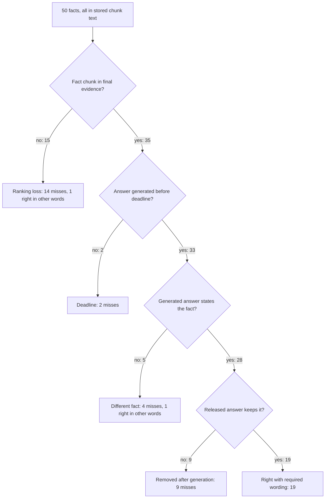

# Answer-only 50 root causes (2026-09-24)

Source run:
[ANSWER_ONLY_50_2026-09-24.md](./ANSWER_ONLY_50_2026-09-24.md).
Proposed repair:
[ADR-retrieved-answer-loss-repair.md](../adr/ADR-retrieved-answer-loss-repair.md).
Retrieval contract:
[HYBRID_RETRIEVAL_CONTRACT.md](../retrieval/HYBRID_RETRIEVAL_CONTRACT.md).
Answer contract:
[ANSWER_VERIFICATION.md](../agent/ANSWER_VERIFICATION.md).
Earlier diagnosis on a different question set:
[KNOWN_ANSWER_50_ROOT_CAUSES_2026-09-22.md](./KNOWN_ANSWER_50_ROOT_CAUSES_2026-09-22.md).

The run document scores what each answer said. This document follows each
of the 50 facts through the stored chunks, the retrieval stages, the
generated answer, and the released answer, and names the first stage that
lost it.

All 50 questions ran `hybrid_long_document_v2`, unscoped, against book
version `e119bf87-1c70-4e10-abb1-5666c4f728c4` (1,016 chunks, 656 leaves).
Every run had a 50 s deadline.

## Summary

Ingestion is not the main loss. Every fact is in the stored chunk text,
and dense search puts a chunk holding it in its first 12 results on 45
of 50 questions. The answers are lost later:

- 15 questions lose the fact chunk between dense search and the final
  evidence passages. 11 of them had it in the dense top 12.
- 9 questions generated the right fact and then had it removed by the
  answer bookkeeping contract or by the claims-only release.
- 4 questions had the chunk in evidence and the model stated a different
  fact.
- 2 questions had the chunk at evidence rank 1 and hit the deadline before
  an answer was generated.

The reranker completed on 14 of 50 runs. When it completed, every fact
chunk in its pool reached the final evidence (12 of 12). When it did not,
9 of the 32 fact chunks in the pool were dropped.

| Stage | Fact survives |
| --- | ---: |
| Stored chunk text holds the fact | 50 |
| Dense top 100 | 50 |
| Fused top 100 (dense, BM25, term; RRF) | 48 |
| Rerank pool (20 passages) | 44 |
| Final evidence (at most 12) | 35 |
| Generated answer states the fact | 28 |
| Scored right in the run document | 21 |

For comparison, the dense top 12 alone holds the fact on 45.



The two answers counted right in other words are a14 and a19.

## First losing stage per miss

| First losing stage | Misses | Question IDs | Proposed fix |
| --- | ---: | --- | --- |
| Generated, then removed by the paragraph/link/citation contract | 7 | a02, a09, a10, a17, a34, a38, a45 | Fix 1 |
| Generated, then the released claims dropped the asked term | 2 | a08, a28 | Fix 3 |
| In the rerank pool, rerank did not complete, fallback order dropped it | 8 | a03, a11, a12, a24, a25, a32, a40, a48 | Fix 2 |
| Fused rank put the chunk outside the 20-passage rerank pool | 4 | a22, a26, a27, a33 | Fix 2 (a22, a26 only) |
| In evidence, answer stated a different fact | 4 | a23, a35, a36, a39 | Fix 3 |
| In evidence, deadline before generation | 2 | a31, a37 | Fix 2 time budget |
| Dense rank below 60 | 2 | a04, a07 | Not addressed |

## 1. Right answers removed after generation (9)

`answer_v3` asks the model for three cross-referenced lists. Paragraphs
carry `paragraph_index` and `link_ids`. Atomic links carry `link_id` and
`chunk_ids`. Citations carry `paragraph_index`, `atomic_link_id`,
`chunk_id`, and an exact span. `apply_paragraph_contract` in
`packages/core/src/smart_rag_core/query_answer/paragraphs.py` then:

- refuses the whole answer when the sorted paragraph indices are not
  exactly `0..n-1` (`paragraph_index_invalid`);
- drops a paragraph when any link it lists has no citation with the same
  paragraph index and link ID (`paragraph_unmapped`);
- refuses when no paragraph survives.

`render_verified_company_answer` in `query_answer/release.py` then
releases only the surviving atomic claims, not the paragraph text. That
claims-only release is a deliberate safety rule from
[ADR-live-rag-failure-remediation.md](../adr/ADR-live-rag-failure-remediation.md).

| ID | Evidence rank of fact chunk | Recorded failure | What the model returned |
| --- | ---: | --- | --- |
| a09 | 1 | `paragraph_index_invalid` | Paragraph indices 0, 2, 2; one link ID used twice |
| a10 | 1 | `paragraph_index_invalid` | Indices 2, 2, 2; all three links share one link ID |
| a45 | 1 | `paragraph_index_invalid` | Indices 2, 2, 2; all three citations name the first link |
| a02 | 7 | `paragraph_unmapped` | Both paragraphs list two links, each has one citation |
| a17 | 1 | `paragraph_unmapped` | One paragraph lists two links and has one citation |
| a34 | 1 | `paragraph_unmapped` | Paragraphs 0 and 1 each miss a citation; only paragraph 2 survived and it is not the answer |
| a38 | 12 | `paragraph_unmapped` | One paragraph, one link, zero citations |
| a08 | 4 | none | Paragraph text named the asked item; the atomic claims did not |
| a28 | 1 | none | Same as a08 |

In 5 of the 7 contract failures (a02, a09, a17, a34, a45) the model used a
chunk UUID as a `link_id`. The two UUID namespaces are easy to confuse.
Across all 50 runs the contract recorded `paragraph_unmapped` on 10 runs
and `paragraph_index_invalid` on 3.

## 2. Ranking loses dense hits when the reranker does not finish (14)

### 2.1 The reranker rarely completes

| Rerank outcome | Runs | Calls sent | Output tokens per call |
| --- | ---: | ---: | --- |
| Completed (`none`) | 14 | 1 each | 570 to 800, mean 711 |
| `rerank_schema_invalid` | 15 | 1 each | 681 to 788, mean 743 |
| `rerank_timeout` | 21 | 0 | none sent |

**Timeout.** `select_hybrid_context` in `retrieval/context.py` starts the
rerank only when at least `RERANK_RESERVED_SECONDS` (3.0) remain of the
retrieval slice (`RETRIEVAL_SLICE_SECONDS`, 10.0). `hybrid_run/retriever.py`
measures that remainder from the start of the channel phase. It includes
channel work, fusion, temporal record loading, and the rerank-pool
context preload. The 21 timeout runs spent longer in `company_scope`
(mean 15.1 s) than the 14 completed runs (13.7 s), so the slice went to
channel and loading work, not to the rerank call. Per-channel timings are
not persisted, so which step is slow is unknown.

**Schema invalid.** 15 responses failed `validate_rerank_payload` in
`retrieval/rerank.py`. The response must echo a 64-character `input_hash`
and a complete permutation of 20 chunk UUIDs. `retrieval/reranker.py` maps
every `ValueError` to `rerank_schema_invalid`, and the raw payload is not
stored, so which check failed is unknown. About 700 output tokens per call
is consistent with twenty 36-character UUIDs plus the hash.

The earlier budget repair
([ADR-ask-evidence-budget-repair.md](../adr/ADR-ask-evidence-budget-repair.md))
raised the slice to 10 s and the reserve to 3 s. It did not change what
consumes the slice. The next run after it
([FRESH_KNOWN_ANSWER_50_2026-09-23.md](./FRESH_KNOWN_ANSWER_50_2026-09-23.md))
recorded `rerank_timeout` on 42 of 50 runs.

Side observation, not investigated: each timeout run has an `app.llm_usage`
rerank row of exactly 12,000 prompt and 2,000 completion tokens with no
call sent. That looks like the reservation ceiling being recorded as
usage, which would overstate reported cost.

### 2.2 The fallback order demotes dense-only hits

Without a completed rerank the pool and the selection keep the RRF fused
order, plus the channel-head pins (`CHANNEL_HEAD_PIN = 5` in
`retrieval/rerank.py`). With `rrf_k = 60` and equal weights, a chunk that
two channels found outranks a chunk that only dense found, even when dense
ranked it first. BM25 missed most of these chunks.

| ID | Dense | BM25 | Fused | Pool | Rerank outcome |
| --- | ---: | ---: | ---: | ---: | --- |
| a40 | 1 | none | 17 | 14 | timeout |
| a03 | 2 | none | 11 | 11 | schema invalid |
| a25 | 2 | none | 10 | 10 | schema invalid |
| a32 | 2 | none | 15 | 11 | timeout |
| a12 | 3 | none | 17 | 13 | timeout |
| a24 | 3 | 27 | 12 | 11 | timeout |
| a48 | 3 | none | 28 | 16 | schema invalid |
| a11 | 5 | none | 19 | 19 | timeout |
| a22 | 6 | none | 24 | none | completed |
| a26 | 10 | none | 27 | none | completed |
| a27 | 16 | none | 36 | none | schema invalid |
| a33 | 16 | none | 40 | none | schema invalid |
| a04 | 62 | none | none | none | timeout |
| a07 | 79 | none | none | none | timeout |

a14 has the same pattern (dense 1, fused 11, pool 11, timeout) but is
scored right in other words.

The first eight had dense rank 1 to 5 and were still in the pool, but
without rerank the selection kept higher fused ranks. a22 and a26 were
reranked but never offered to the reranker. Their fused ranks put them
outside the 20-passage pool, and their dense ranks (6 and 10) are below
the five-passage dense pin.

When rerank does complete, it corrects fused order: a16 and a20 went from
fused rank 21 to rerank rank 1, a30 from 8 to 1, and a42 from 5 to 1.

### 2.3 Dense recall

a04 and a07 had dense ranks 62 and 79. No fix in the ADR targets them.

## 3. The answer states a different fact (4, plus a08 and a28)

a23 (evidence rank 8), a35 (6), a36 (8), and a39 (5) had the fact chunk
in the 12 passages, and the answer named a nearby topic from another
passage. a08 and a28 generated paragraph text naming the asked item, but
their atomic claims did not, so the release dropped it. `answer_v3.md`
tells the model how to structure claims. It does not tell the model to
answer the asked question first or to use the passage's own words for
the asked item.

## 4. Deadlines (2, plus a32)

| Measure | Mean | Median | p90 | Max |
| --- | ---: | ---: | ---: | ---: |
| Run total (s) | 43.9 | 43.5 | n/a | 56.5 |
| `company_scope` (s) | 14.5 | 14.3 | 15.6 | 18.3 |
| `generate_answer` (s) | 8.8 | 8.9 | 13.8 | 16.9 |
| `verify_answer` (s) | 3.3 | 3.3 | 5.5 | 9.1 |

Eight other graph nodes (`prepare_query`, `load_memory`, `compile_plan`,
`enforce_admission`, `apply_correction`, `disclose_optional_tools`,
`compose_tables`, `fuse_evidence`) each averaged 0.5 to 0.6 s. The time
between one node completing and the next starting summed to a mean of
6.8 s per run (max 17.6 s). So about 11 s per run goes to graph and
persistence overhead rather than retrieval or model calls. a31 and a37
had the fact chunk at evidence rank 1 and ran out of time before
generation. a32 also hit the deadline, but it had already lost the chunk
at selection.

## 5. Ingestion defects (secondary)

### 5.1 Unicode hyphen line breaks

The book hyphenates line ends with U+2010 HYPHEN. `join_pdf_lines` in
`packages/core/src/smart_rag_core/ingestion/parser/helpers.py` removes only
an ASCII `-` at a line end. Every other join inside a block inserts a
space, so `com‐` + `plexity` is stored as `com‐ plexity`. 719 of 1,016
chunks contain a letter, U+2010, a space, and a letter, 2,732 times in
total. Only 11 chunks contain the ASCII form.

The split breaks BM25 tokens and exact-phrase matching. a38's fact is
split this way in chunk `3f840a5e` (page 269). That chunk was dense rank
1, absent from BM25, and evidence rank 12, and then the answer cited
nothing.

### 5.2 Navigation pages in evidence

The table of contents is 13 chunks on pages 7 to 13. The back-of-book
index is 74 chunks on pages 341 to 353, which the heading detector split
into one-letter sections. These 87 chunks (8.6% of the version) hold
topic words and page numbers but no answer text. They took:

- 66 of the 600 BM25 top-12 slots;
- 13 of the 600 dense top-12 slots;
- 46 of the 575 final evidence slots (18 table of contents in 15
  questions, 28 index in 12 questions).

The glossary on pages 337 to 340 is real content and is not counted.

## Method and limits

- Private, read-only scripts under the gitignored `.private-eval/`:
  `answer50_stage_trace.py` (stage ranks), `answer50_checkpoint_dump.py`
  (generated versus released text from `langgraph.checkpoint_writes`), and
  `latency_probe.py` (stage timings from `app.run_events`).
- A chunk holds the fact when its text contains the gold phrase after
  lowercasing, whitespace collapse, soft-hyphen removal, and re-joining
  letter, U+2010, space, letter. The parent and children of a matching
  chunk also count.
- Short gold phrases match many chunks (a17: 28, a18: 29, a19: 21, a44: 36,
  a50: 48), so their ranks may be earlier than the true fact passage.
- The generated-text check is also a substring match. It misses a01, which
  the run document scores right.
- Channel timings, the rerank validation sub-code, and the invalid rerank
  payloads are not stored. Those causes are inferred from code paths,
  token counts, and stage durations.
- This diagnosis used these 50 questions, so they cannot also prove that a
  fix generalizes. The ADR acceptance requires an unseen set.

## Reproduce

Requires `OPERATOR_SUPABASE_DB_URL` in `.env` or `.env.compose` and the
private files `.private-eval/answer50-v1.json` and
`.private-eval/answer50-answers.json`.

```powershell
$env:PYTHONIOENCODING = "utf-8"
.venv\Scripts\python.exe .private-eval/answer50_stage_trace.py
.venv\Scripts\python.exe .private-eval/answer50_checkpoint_dump.py summary
$env:PYTHONPATH = ".private-eval"
.venv\Scripts\python.exe .private-eval/latency_probe.py stages .private-eval/answer50-answers.json
```

If `psycopg` is missing, the system Python was used instead of `.venv`.
If a `UnicodeEncodeError` appears, `PYTHONIOENCODING` is not set.

[docs index](../README.md)
