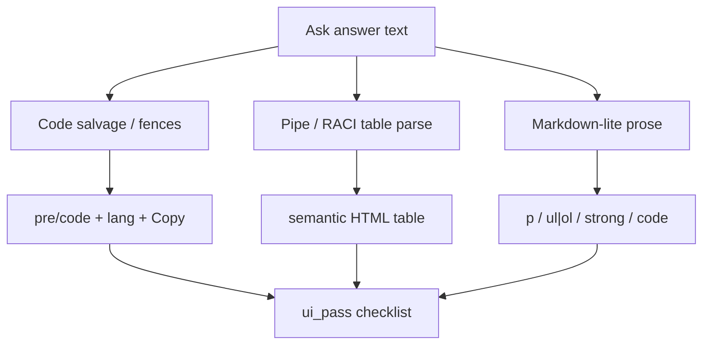

# Answer UI samples 24 (2026-10-01)

**Primary way to see formatting:** open Ask with an empty chat. The
**See answer formatting** gallery (Code / Table / RACI / Prose / Mixed)
renders canned answers through the live answer surface — no Ask call
required. Implementation:
`apps/frontend/src/components/chat/answer-format-gallery.tsx`.

The private gold below is optional for **live** company/general/web asks
that exercise the same shapes end-to-end. Prefer the in-app gallery when
the goal is “does the UI look right?”

Private gold: [`.private-eval/answer-ui-24-v1.json`](../../.private-eval/answer-ui-24-v1.json)
(gitignored). Expected phrase facts stay private (plan decision D4). Each
item carries `ui_pass` checks meant for live browser review.

Related: [CODE_TABLE_KNOWN_ANSWER_20_2026-09-29.md](./CODE_TABLE_KNOWN_ANSWER_20_2026-09-29.md)
· [DUAL_METRIC_SCORING.md](./DUAL_METRIC_SCORING.md)
· [frontend/CORE_RAG_SURFACES.md](../frontend/CORE_RAG_SURFACES.md)

## Why this set exists

Content-only gold (phrase + citation) can pass while the UI still shows:

- raw ` ``` ` fences and orphan closers
- pipe tables as monospace pre walls
- literal `**bold**` and `` `inline` `` instead of strong/code
- OCR salvage tables with duplicate junk rows
- mixed answers that flatten code or lists into one paragraph

This set forces those shapes on purpose.



## Mix

| `ui_kind` | Count | What cool UI means |
| --- | ---: | --- |
| `code` | 8 | Real code chrome; no visible fences; newlines kept |
| `table` | 7 | `<table>` grid; not a pre dump; RACI without OCR dupes |
| `prose` | 2 | Bold + inline code rendered |
| `list` | 2 | `ul` / `ol` list semantics |
| `mixed` | 4 | Prose + code and/or table in one answer |
| `safety` | 1 | Hostile tags stay inert text |

| `scope` | Count | How to ask |
| --- | ---: | --- |
| `company_documents` | 14 | Company documents (or Auto with company PDF indexed) |
| `general` | 9 | General — prompts dictate exact Markdown |
| `web` | 1 | Web — short public fact + bold |

## How to run

1. Frontend on `http://localhost:3000`, API healthy, company PDF indexed
   for the company rows.
2. Open a **new chat** per question (or clear context) so formatting is not
   contaminated by prior turns.
3. Set the Ask scope radio to match `scope`.
4. Paste `prompt` from the private gold file.
5. When the answer finishes, score **content** (optional dual-metric) and
   **UI** (`ui_pass` in gold).

Optional API batch for company/general phrase checks only (does not score
DOM):

```bash
uv run python scripts/run_company_ask.py \
  --gold .private-eval/answer-ui-24-v1.json \
  --out .private-eval/answer-ui-24-summary.json \
  --credentials .private-eval/eval-credentials.json \
  --progress .private-eval/answer-ui-24-progress.json \
  --answers-out .private-eval/answer-ui-24-answers.json \
  --stage-export .private-eval/answer-ui-24-stages.json \
  --verbose
```

General and web rows need the matching Ask scope in the UI; the company
runner alone is not enough for full coverage.

## Browser pass bar (DOM)

| Kind | Pass if you see | Fail if you see |
| --- | --- | --- |
| Code | `pre`/`code`, language header, Copy | Visible ` ``` `, one-line flatten, HTML entities as the main body |
| Table | `table` + header cells + ≥2 data rows | Pipe wall in `pre`, caption-only dump, RACI row that is only `call delays)` |
| Prose | `strong` / inline `code` | Literal `**…**` or raw backticks as the visual |
| List | `ul`/`ol` with `li` | Dashes/numbers as plain paragraphs only |
| Mixed | Prose **and** code/table siblings | Everything smashed into one pre or one paragraph |
| Safety | Tags visible as text | Script/img handlers execute |

## Question index

Prompts for company rows mirror the proven code/table asks; general rows
are deterministic Markdown fixtures. Full prompts and `ui_pass` live in
the private gold file.

| ID | Scope | Kind | Topic |
| --- | --- | --- | --- |
| ui01 | company | code | `cancel_order` tool |
| ui02 | company | code | `query_wolfram_alpha` tool |
| ui03 | company | code | `coordinate_operations` tool |
| ui04 | company | code | `construct_graph` cancel-order wiring |
| ui05 | company | code | `call_mcp_tools` heuristic |
| ui06 | company | code | `build_model` / BitsAndBytes |
| ui07 | company | table | Table 2-1 open-weight models |
| ui08 | company | table | Table 8-2 coordination techniques |
| ui09 | company | table | Table 10-2 observability stacks |
| ui10 | company | table | Table 10-3 RACI matrix |
| ui11 | company | table | Table 13-1 human-agent roles |
| ui12 | company | table | Table 13-2 agent scopes |
| ui13 | general | prose | Bold + inline code refund note |
| ui14 | general | list | Unordered refund steps |
| ui15 | general | list | Ordered Ask stream steps |
| ui16 | general | code | Fenced Python `greet` |
| ui17 | general | code | Fenced JS `reduce` |
| ui18 | general | table | Tiny Model/Score/Size pipe table |
| ui19 | general | mixed | Prose + Python + bullets + inline code |
| ui20 | general | mixed | Prose + stack comparison table |
| ui21 | company | mixed | RACI explanation + Table 10-3 |
| ui22 | company | mixed | Sentence + `cancel_order` code |
| ui23 | general | safety | Inert `<script>` / `onerror` text |
| ui24 | web | prose | Gold symbol **Au** |

## Suggested triage order

Run general fixtures first (`ui13`–`ui20`, `ui23`) — they isolate the
frontend parsers. Then company tables (`ui07`–`ui12`, especially `ui10`
RACI), then company code, then mixed (`ui21`–`ui22`), then web (`ui24`).

## Result

Not run yet. Record pass/fail per `ui_pass` item in a private results file
(for example `.private-eval/answer-ui-24-ui-score.json`) when a smoke pass
completes.

## Limits

- UI scoring is human/browser (or future Playwright); phrase runners do not
  prove DOM quality.
- Company rows still depend on retrieval and generation; a UI fail can be
  “model returned prose” rather than a renderer bug — note which.
- General rows assume the model obeys “Reply with ONLY …”; if it adds a
  preface, still score whether the markdown that remains renders correctly.
