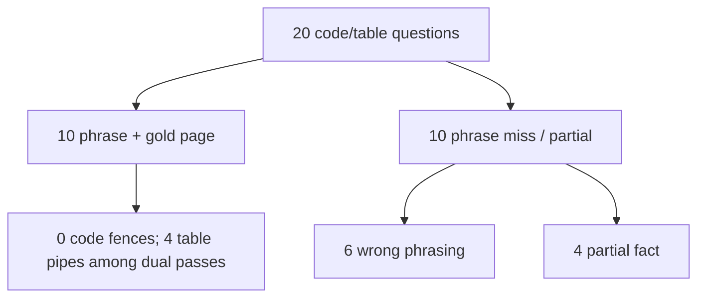

# Code and table known-answer 20 (2026-09-29)

Twenty questions whose answers must look like **code** or **tables**, not
prose restatements. Fourteen ask for a fenced Python snippet from *Building
Applications with AI Agents*; six ask for a Markdown pipe table from a named
book table. Pages are disjoint from prior known-answer gold files under
`.private-eval/*v1.json`. The private gold file is
`.private-eval/code-table-20-v1.json`. Expected phrases stay private (plan
decision D4).

Scoring uses [DUAL_METRIC_SCORING.md](./DUAL_METRIC_SCORING.md) for required
phrases, plus gold-page citation scoring and a format check (fenced code /
Markdown table shape).

## Result

Indexed document `b56d5774-8810-4ee9-a4d3-f3c93fa90ea7`. Each question was a
new `company_documents` conversation against `http://127.0.0.1:8000` with
`query_ready: true`. Profile on the run was `hybrid_long_document_v3`. Wall
clock for 20 questions was about 12 minutes.

| Metric | Count |
| --- | ---: |
| Required phrases present and citation on the gold page | **10 / 20** |
| Required phrases present (phrase check alone) | **10 / 20** |
| Gold page among persisted citations | **18 / 20** |
| Code answers with a Markdown fenced block (` ``` `) | **0 / 14** |
| Code answers with raw/indented code shape (no fence) | **7 / 14** |
| Table answers with a Markdown pipe table | **5 / 6** |
| Refused or deadline | **0** |
| Run crashed | **0** |

By the dual bar (required phrases + gold-page citation) the agent is right on
**10 of 20**. Every phrase pass also cited the gold page; the two citation
misses were also phrase misses.



Private run files: `code-table-20-answers.json`, `code-table-20-summary.json`,
`code-table-20-stages.json`, `code-table-20-citation-score.json`,
`code-table-20-format-score.json`, `code-table-20-progress.json`.

## Split by question kind

| Kind | Questions | Phrase + gold page | Requested format present |
| --- | ---: | ---: | ---: |
| Code (fenced snippet) | 14 | 6 | 0 fenced; 7 raw/indent code |
| Table (Markdown pipe) | 6 | 4 | 5 pipe tables |

### Dual passes (10)

| ID | Kind | Gold page | Format note |
| --- | --- | ---: | --- |
| ct02 | code | 40 | Raw `construct_graph` lines; HTML-escaped quotes; no fence |
| ct03 | code | 74 | Literals present; not a fenced block |
| ct06 | code | 118 | Dense one-line tool body; no fence |
| ct08 | code | 178 | Raw `build_model` shape; no fence |
| ct12 | code | 209 | Raw `search` loop; no fence |
| ct19 | code | 220 | Raw `SessionManager`; no fence |
| ct14 | table | 225 | Markdown pipe table (Table 8-2) |
| ct15 | table | 252 | Markdown pipe table (Table 10-2) |
| ct16 | table | 262 | Markdown pipe table (Table 10-3) |
| ct17 | table | 320 | Markdown pipe table (Table 13-1) |

### Phrase misses (10)

| ID | Kind | Gold page | Cited gold? | Bucket |
| --- | --- | ---: | --- | --- |
| ct01 | code | 40 | yes | Wrong snippet (nearby cancel-order example, not `cancel_order` tool) |
| ct04 | code | 105 | yes | Wrong / rewritten MCP heuristic |
| ct05 | code | 117 | yes | Wrong / incomplete Wolfram tool body |
| ct07 | code | 122 | yes | Partial (`determine_parameters` without `#general`) |
| ct09 | code | 188 | **no** | Wrong tool page (185/192/194) |
| ct10 | code | 190 | yes | Partial (app name without `AgentState` TypedDict) |
| ct11 | code | 198 | yes | Partial (routing without conditional-edges literal) |
| ct13 | table | 44 | yes | Prose / header residue; not Table 2-1 rows |
| ct18 | table | 324 | yes | Pipe table present; missing `Table 13-2` title phrase |
| ct20 | code | 189 | **no** | Wrong tool page (193/195) |

## What this set shows

1. **Tables can be rendered as tables.** When retrieval hits the right table
   page, answers often use Markdown pipes (`ct14`–`ct17`, and `ct18` shape).
2. **Code is almost never fenced.** Even when the prompt asks for a fenced
   Python block, generation returns bare lines or a single compacted line,
   sometimes with HTML entities (`&quot;`, `-&gt;`). Phrase scoring can still
   pass after unescape, but the UX is not a code snippet.
3. **Citation is strong relative to content.** Gold page was cited on 18/20;
   the weak spot is exact code literals and tool selection among similar
   `@tool` pages, not empty retrieval.
4. **Near-duplicate tool pages confuse code asks.** `ct09` / `ct20` cite
   sibling logistics-tool pages instead of the gold page.

## Comparison to prior sets

| Set | Questions | Phrase pass | Phrase + gold page |
| --- | ---: | ---: | ---: |
| Fresh 50 (2026-09-23) | 50 | 19 | 13 |
| Hard 50 (2026-09-28) | 50 | 29 | 27 |
| Fresh 25 (2026-09-29) baseline | 25 | 19 | 13 |
| This code/table 20 | 20 | 10 | 10 |

Content accuracy on this format-stressed set is lower than Fresh 25 / Hard 50
phrase rates. Table format compliance is high when facts pass; code fence
compliance is zero.

## Wrong-phrasing repair (2026-10-01)

Re-ask of the six **wrong_phrasing** IDs (`ct01`, `ct04`, `ct05`, `ct09`,
`ct13`, `ct20`) after named code-definition / named-table promote +
extractive salvage (wired through the live gateway answer path as well as
verify). Private slice:
`.private-eval/code-table-wrong-6.json`.

| Metric | Count |
| --- | ---: |
| Phrase pass on the repair slice | **6 / 6** |
| Phrase + gold-page dual pass | **6 / 6** |
| Prior wrong-phrasing class remaining on this slice | **0** |

Failure-class change on this slice only: all six moved from wrong
phrasing / sibling-tool citation / header-only table into dual pass.
Code-fence and Markdown-table **UI format** scores were not re-targeted
in this repair (explicit non-goal). The four **partial** IDs (`ct07`,
`ct10`, `ct11`, `ct18`) were not reopened.

### UI presentation repair (2026-10-01)

Chat answer surface updates (display-only; stored answer text unchanged):

- Multiline code salvage keeps newlines inside a `<pre><code>` block
  instead of being flattened by the one-liner reformatter.
- Detected pipe tables render as a semantic `<table>` with React text
  cells; `Table N-M` salvage bodies without clear column gaps render as
  a captioned preformatted block.
- No Markdown/HTML injection: cells and code stay `UserText` nodes.

Stored-answer fence/pipe **eval format scores** are unchanged until a
later backend wrap (out of scope here).

Private repair artifacts: `code-table-wrong-6-answers.json`,
`code-table-wrong-6-summary.json`, `code-table-wrong-6-stages.json`,
`code-table-wrong-6-citation-score.json`.

## Limits

- Gold phrases remain private. This report uses ids, pages, and failure
  classes only.
- One document only; generalization across other corpora is unverified.
- Format checks look for Markdown fences/pipes (plus a raw-indent heuristic
  for code). They do not score visual UI rendering in the frontend.
- HTML entity encoding in stored answers may understate “looks like code”
  quality even when dual-metric unescape makes the phrase check pass.
