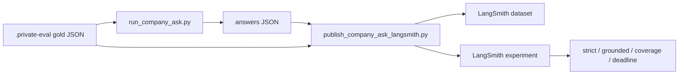

# Company-Ask LangSmith experiments

Turn a private gold file + `run_company_ask.py` answers into a **LangSmith
dataset and experiment** with dual-metric feedback. Use this when local JSON
summaries are not enough and you want a scored board in the LangSmith UI.

Related: [DUAL_METRIC_SCORING.md](./DUAL_METRIC_SCORING.md) ·
[LANGSMITH_TRACING.md](../development/LANGSMITH_TRACING.md) ·
[ADR-local-langsmith-export-io.md](../adr/ADR-local-langsmith-export-io.md) ·
[PHASE6_EVAL_REGISTRY.md](./PHASE6_EVAL_REGISTRY.md) ·
[docs index](../README.md)



## What this is / is not

| Is | Is not |
| --- | --- |
| Unattended dual-metric scoreboard in LangSmith | Manual Ask-of-50 in chat |
| Versioned dataset keyed by gold content hash | Phase 4 sealed holdout |
| Local-only private content upload | Staging/production export |
| Operator tool for regression compare | Combined +10pp quality claim |

Production Ask traces still land in `LANGSMITH_PROJECT` (often
`smart-rag-demo-3`) as redacted `query.run.sse` runs. **Experiments** for
this publisher default to project `smart-rag-company-ask-eval`. Open that
project’s **Datasets / Experiments** tabs.

## Security gates

- Gold and answers must live under `.private-eval/`.
- Live upload requires `APP_ENV=local` and `--upload-private-content`.
- Staging/production fail closed.
- Uploaded payloads include prompts, full answers, and gold phrases so you
  can inspect failures in LangSmith. Do not enable this outside the local
  waiver.
- Holdout stays sealed (`holdout_opened=false` in dataset metadata).

## Commands

Dry-run (no LangSmith writes):

```powershell
uv run python scripts/publish_company_ask_langsmith.py `
  --gold .private-eval/your-gold.json `
  --answers .private-eval/runs/tag/answers.json `
  --dry-run
```

Ask all questions, score locally, then publish one experiment:

```powershell
$env:APP_ENV = "local"
$env:LANGSMITH_TRACING = "true"
$env:LANGSMITH_API_KEY = "<your key>"
$env:LANGSMITH_PROJECT = "smart-rag-company-ask-eval"

uv run python scripts/run_company_ask.py `
  --gold .private-eval/your-gold.json `
  --out .private-eval/runs/tag/summary.json `
  --credentials .private-eval/eval-credentials.json `
  --answers-out .private-eval/runs/tag/answers.json `
  --stage-export .private-eval/runs/tag/stages.json `
  --progress .private-eval/runs/tag/progress.json `
  --langsmith-publish `
  --upload-private-content `
  --langsmith-project smart-rag-company-ask-eval
```

Publish from answers already on disk (no re-ask):

```powershell
uv run python scripts/publish_company_ask_langsmith.py `
  --gold .private-eval/your-gold.json `
  --answers .private-eval/runs/tag/answers.json `
  --stage-export .private-eval/runs/tag/stages.json `
  --out .private-eval/runs/tag/langsmith-summary.json `
  --project smart-rag-company-ask-eval `
  --upload-private-content
```

## Feedback keys

| Key | Meaning |
| --- | --- |
| `strict_pass` | 1 when every canonical phrase is present |
| `grounded_fact_pass` | 1 when every required fact is covered (aliases allowed) |
| `fact_coverage` | Fraction of facts covered |
| `no_deadline_failure` | 1 when the run did not die on product deadline |
| `gold_page_cited` | 1 when a persisted citation is on the gold page |
| `gold_in_fused` | 1 when the gold page appears in Hybrid ``fused_ids`` |
| `failure_bucket` | Pass/fail score; `value`/`comment` carry the drop bucket (`pass`, `retrieval_miss`, `rerank_pool_drop`, `selection_drop`, `citation`, `phrasing`, …) |
| `estimated_cost_usd` | Sum of `app.llm_usage.cost_usd` for the Ask run |
| `total_tokens` | Sum of `app.llm_usage.total_tokens` for the Ask run |

Diagnosis enrichment reads LangGraph checkpoints + `app.citations` when the
operator DB is reachable. Without that, `gold_page_*` may be unknown and
`failure_bucket` falls back to the dual-metric outcome.

Cost/Usage columns come from attaching LangSmith `usage_metadata` (tokens +
USD) on each experiment LLM run, loaded from `app.llm_usage` for the stored
`run_id`.

## Verification

```powershell
uv run python -m pytest tests/unit/test_company_ask_langsmith.py tests/unit/test_company_ask_diagnosis.py -q
uv run python scripts/publish_company_ask_langsmith.py --gold .private-eval/your-gold.json --answers .private-eval/runs/tag/answers.json --dry-run
```

Live LangSmith UI inspection remains operator-verified after the first upload
with a real API key.
