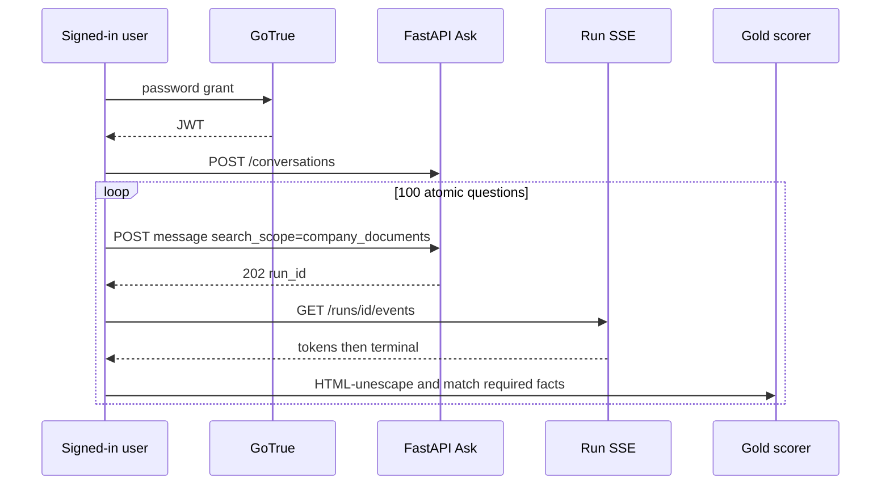
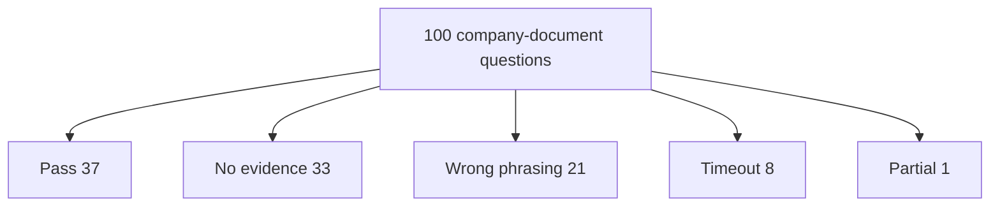

# Company-documents RAG accuracy (100 atomic questions)

Live Ask accuracy for **100 atomic questions** whose gold answers are facts
from the uploaded *Building Applications with AI Agents* PDF (Albada;
ISBN 978-1-098-17650-1). The agent was used as a signed-in user on
**company documents only**. This is a product eval, not the sealed Phase 4
holdout and not a unit test.

**Headline: 37 of 100 questions fully correct (37% strict pass).**
Pass-or-partial is 38%. Required-fact recall is 50 / 143 (35%).

Related: [PDF_HYBRID_EVALUATION.md](./PDF_HYBRID_EVALUATION.md) ·
[PDF_EVAL_WORKSPACE.md](./PDF_EVAL_WORKSPACE.md) ·
[hybrid-pdf-accuracy-remediation.md](../development/hybrid-pdf-accuracy-remediation.md) ·
[ANSWER_VERIFICATION.md](../agent/ANSWER_VERIFICATION.md) ·
[QUERY_ROUTING.md](../agent/QUERY_ROUTING.md) ·
[SSE.md](../api/SSE.md) ·
[AUTH_AND_STREAMING.md](../frontend/AUTH_AND_STREAMING.md) ·
[ADR-live-rag-failure-remediation.md](../adr/ADR-live-rag-failure-remediation.md) ·
[docs index](../README.md)

## Verdict

The agent often refuses or paraphrases past the gold phrase. Strict pass is
37%. Another 1% was partial. The rest missed because retrieval returned no
authorized evidence (33), the answer used different wording than the book
(21), or the run hit the product time-limit message (8), mostly late in a
long chat.

This run does **not** claim generalization to other PDFs, web search, Combined
scope, or graph-only questions.

## How the test was run

| Item | Value |
| --- | --- |
| Date | 2026-09-17 |
| Identity | `mu@admin.com` (local admin) |
| Answer source | `company_documents` only |
| Route family | `composite` on every question |
| Client | Ask HTTP + SSE (`X-Client-Version: 0.1.0`), same path as the UI |
| Conversation | `d2c5e8e1-a5f2-4372-8dfd-e91d2bcc21ad` |
| Corpus | Uploaded O’Reilly book already in the company-documents index |
| Gold set | 100 short, single-intent questions; 143 required fact phrases |
| HTTP | 100 / 100 accepted as `202` |

Questions are atomic on purpose. An earlier 30-question live-UI set used
compound prompts and hit the ~90s query deadline before generation on several
items. This 100-question set asks one book fact at a time.

The first pass stopped at question 71 when the access token expired (~1 hour).
A resume after re-login completed questions 71–100. Question 4 was first scored
wrong because the answer contained HTML-escaped `O&#x27;Reilly`; rescoring after
HTML unescape flipped it to pass.

Median latency was **44.4 s** (min 39.0 s, max 67.9 s). Wall time was about
75 minutes plus a ~27-minute resume. Recorded model cost for the 100 answers
was about **$0.08**.

## Scoring contract

Each gold item has one or more **required** phrases taken from the book
(short facts, not page excerpts). The scorer HTML-unescapes the streamed
answer, casefolds it, and checks whether every required phrase is a
substring.

| Status | Meaning |
| --- | --- |
| Pass | Every required phrase appears in the answer |
| Partial | At least one required phrase appears, but not all |
| No evidence | Product limitation `insufficient_evidence`, or the answer is the authorized-evidence refusal, and no gold phrase hit |
| Wrong phrasing | The agent answered, but none of the required phrases appear |
| Timeout | The answer is the product time-limit message (or a deadline limitation) and no gold phrase hit |
| Error | Terminal `error` and no gold phrase hit |

Credit score = (pass + 0.5 × partial) / 100 = **0.375**.

### Scoring limits

- Matching is **lexical**, not semantic. Question 22 said “enumerate all
  decision branches in advance” but missed gold `known branches`.
- Only the captured **answer excerpt** (about the first 500 characters) is
  scored. Facts that appear only later in a long answer can be missed.
- When the product tags `insufficient_evidence` and no gold phrase hits, the
  row is “No evidence” even if some text was generated (question 51).
- Truncated agent answers in this file are for comparison. They are not a
  substitute for the PDF and are not a license to copy book chapters.

## Headline metrics

| Metric | Value |
| --- | --- |
| Questions scored | 100 |
| Strict pass | 37 / 100 (37%) |
| Pass or partial | 38 / 100 (38%) |
| Partial | 1 / 100 |
| No authorized evidence | 33 / 100 |
| Wrong phrasing | 21 / 100 |
| Timeout | 8 / 100 |
| Error | 0 / 100 |
| Required-fact hits | 50 / 143 (35%) |
| Credit score | 0.375 |

## Outcome mix

| Outcome | Count | Share | Median time (s) |
| --- | --- | ---: | ---: |
| Pass | 37 | 37% | 43.1 |
| No evidence | 33 | 33% | 43.0 |
| Wrong phrasing | 21 | 21% | 45.8 |
| Timeout | 8 | 8% | 53.1 |
| Partial | 1 | 1% | 47.4 |

SSE terminals were `completed` on 50 questions and `partial` on 50. That
product terminal is not the gold “Partial” score. Gold Partial is only
question 34.

Every question requested `search_scope=company_documents`. None used web or
general chat.

## Scores by book section

Strict pass count in each band of the 100-question set:

| Section | Questions | Pass | Pass rate |
| --- | ---: | ---: | ---: |
| Front matter and preface (1–12) | 12 | 9 | 75% |
| Ch. 1 Introduction (13–29) | 17 | 5 | 29% |
| Ch. 2 Design (30–34) | 5 | 1 | 20% |
| Ch. 3 UX (35–37) | 3 | 0 | 0% |
| Ch. 4 Tool use / MCP (38–43) | 6 | 1 | 17% |
| Ch. 5 Orchestration (44–56) | 13 | 6 | 46% |
| Ch. 6 Knowledge / RAG (57–65) | 9 | 4 | 44% |
| Ch. 7 Learning (66–72) | 7 | 3 | 43% |
| Ch. 8 Multiagent (73–85) | 13 | 4 | 31% |
| Ch. 9–13 Eval, monitor, security, humans (86–100) | 15 | 4 | 27% |

Front-matter bibliographic facts are the easiest. UX (Ch. 3), MCP acronyms,
and late-book security/human-role names are the hardest.

## What it got right

Short bibliographic and definitional facts from well-indexed pages:

- Author, ISBN, publisher, first-edition date, copyright holder, acquisitions
  editor
- Four cover capabilities (tools, knowledge, memory, learning)
- True-agent test; autonomous-agent definition; intended audience
- CrewAI quick setup; OpenAI function calling; three core components
- MCP USB-C analogy; Reflex if-then; ReAct Reasoning/Action
- Parallel tools; graph conditional edges; knowledge vs memory via RAG
- FIFO rolling window; vector databases; DPO name; ExpeL
- Swarm robustness; democratic equal power and communication overhead
- Temporal; Grafana + OpenTelemetry; Arize Phoenix; Kolmogorov-Smirnov;
  self-healing fallback

Pass IDs: 1, 2, 4, 5, 6, 7, 8, 11, 12, 13, 14, 19, 28, 29, 30, 40, 44, 45,
48, 49, 53, 55, 57, 59, 60, 62, 67, 71, 72, 73, 74, 75, 85, 87, 89, 94, 95.

## Failure modes

### No authorized evidence (33)

The company-documents refusal fired even though the gold pages are in the
uploaded book. Typical misses: subtitle, Arun Rao blurb, “agentic system”,
The Information, HELM, rolling context windows, interaction modalities,
MCP expansion / server / client / JSON-RPC, planner-executor, self-ask,
GraphRAG name, Reflexion “without ever retraining”, A2A Agent Card, ELK,
SigNoz, DSPy, Lakera PINT, MAESTRO expansion, executor-to-governor roles.

This is the largest bucket. Retrieval did not surface a passage the
authorizer would treat as sufficient, so the agent correctly refused rather
than guessing from the public web.

### Wrong phrasing or swapped chunk (21)

The agent produced an answer, but not the required book wording, or it
grounded on a nearby but wrong topic:

| ID | Topic | What went wrong |
| ---: | --- | --- |
| 10 | Not an AI/ML intro | Called the book a comprehensive introduction; gold is that it is not an AI/ML basics intro |
| 17 | Seven practical types | Named “seven types” without listing them |
| 18 | Business-task examples | Talked about support automation; missed UiPath and Zapier |
| 21–23 | When to use code / workflow / RAG | Semantically close, gold phrase absent |
| 26–27 | LangGraph / AutoGen | Generic multiagent text; missed the book’s trade-off and AutoGen strength |
| 33 | Long-term memory | Described long-term memory; missed “knowledge graphs” |
| 36 | Autonomy slider | Described the slider; missed Karpathy |
| 39 | Who introduced MCP | Returned generic book promo; missed Anthropic |
| 43 | Least power | Returned the five design principles instead |
| 50 | Semantic tool selection | Missed “vector” |
| 64–65 | GraphRAG | 65 named LangGraph / AutoGen / CrewAI as GraphRAG components |
| 70 | Reflexion buffer | Described replay; missed “memory buffer” |
| 80 | Meta Agent Search | Called it “MAS” |
| 84 | Ray / Orleans / Akka | Generic architecture blurb |
| 91 | Langfuse | Repeated Phoenix features |
| 92 | Shadow mode | Shadow *deployments* wording; missed “alongside” / “without serving” |
| 99 | Cloud Security Alliance | Returned author bio instead of MAESTRO publisher |

### Deadline in a long chat (8)

The product returned “This run ran out of time before a company answer could
be generated” even though wall times were 47–68 s (below the ~90 s hard
deadline). Cluster: questions 24, 66, 76, 77, 78, 79, 81, 82 — five
principles, nonparametric learning, manager / hierarchical coordination,
actor-critic, ADAS, and A2A. Most of these sit after many Composite
retrieves in the same conversation.

## Partial (question 34)

Gold required Performance, Scalability, Reliability, and Costs. The answer
named performance, scalability, reliability, and “cost” (singular). Strict
substring `Costs` missed, so the row is Partial (3 / 4 facts).

## Operational notes

- Duplicate ingest of the same PDF (parser-bakeoff copy and private-pdf copy)
  can still appear in citations.
- `COST_MUTATION` is 20 requests / 60 s. The runner stayed under that cap.
- JWT lifetime is about one hour; a long eval must refresh.
- Time-limit answers are a product message, not a gold fact.

## Security and privacy

Scope was forced to company documents. The agent did not use web research for
these 100 questions. Insufficient-evidence refusals are an authorization
success when retrieval is empty; they are an accuracy failure against gold
that exists in the corpus.

Do not commit the PDF, page extracts, or full streamed answers. This report
keeps short gold phrases and truncated agent text only. The live result JSON
stays gitignored under `.private-eval/`.

## What this is not

- Not official Recall@10, locator correctness, or Phase 4/6 holdout.
- Not an Admin exam-board score.
- Not a claim that Combined or web modes would score the same.

## Verification

Proven 2026-09-17 against local Ask `http://127.0.0.1:8000` with
`query_ready: true`. Re-run requires the book already ingested, a valid
admin session, and the gitignored gold/results files under `.private-eval/`.
Do not paste passwords into docs or logs.

Docs lint: `uv run python scripts/check.py --tier docs`.

## Item scores

Pass = every required gold fact present. Partial = some facts. Agent answers
are truncated to about 160 characters.

| # | Topic | PDF page | Score | Required facts | Hits | Misses | Agent answer (truncated) | Time (s) |
| --- | --- | ---: | --- | --- | --- | --- | --- | ---: |
| 1 | Author | 1 | Pass | Michael Albada | Michael Albada | -- | Building Applications with AI Agents by Michael Albada Michael Albada is a seasoned machine learning engineer... | 47.4 |
| 2 | ISBN | 2 | Pass | 978-1-098-17650-1 | 978-1-098-17650-1 | -- | The ISBN of the book is 978-1-098-17650-1. | 46.0 |
| 3 | Subtitle | 1 | No evidence | Designing and Implementing Multiagent Systems | -- | Designing and Implementing Multiagent Systems | Insufficient authorized evidence. | 39.9 |
| 4 | Publisher | 6 | Pass | O'Reilly | O'Reilly | -- | Building Applications with AI Agents is published by O'Reilly Media, Inc. | 41.9 |
| 5 | First edition date | 6 | Pass | September 2025 | September 2025 | -- | The first edition of *Building Applications with AI Agents* was released in September 2025. | 41.2 |
| 6 | Copyright holder | 6 | Pass | Advance AI LLC | Advance AI LLC | -- | Copyright © 2025 Advance AI LLC. All rights reserved. | 40.8 |
| 7 | Acquisitions editor | 6 | Pass | Nicole Butterfield | Nicole Butterfield | -- | The acquisitions editor for *Building Applications with AI Agents* is Nicole Butterfield. | 40.5 |
| 8 | Four capabilities | 2 | Pass | tools; knowledge; memory; learning | tools; knowledge; memory; learning | -- | AI agents combine tools, knowledge, memory, and learning with advanced foundation models. | 40.4 |
| 9 | Arun Rao quote | 2 | No evidence | Arun Rao | -- | Arun Rao | Insufficient authorized evidence. | 42.0 |
| 10 | Not an AI/ML intro | 17 | Wrong phrasing | isn't an introduction to AI or ML | -- | isn't an introduction to AI or ML | It provides guidance through the complex landscape of AI agent systems. The book is praised as a comprehensive introduction to AI agent systems. | 41.9 |
| 11 | Not a tool tutorial | 17 | Pass | not a step-by-step tutorial | not a step-by-step tutorial | -- | This book is not a step-by-step tutorial for specific tools, as technologies evolve rapidly. Instead, it offers guidance on evaluating and selecting tools, wit... | 40.4 |
| 12 | Intended audience | 17 | Pass | engineers; developers; technical leaders | engineers; developers; technical leaders | -- | This book is for engineers, developers, and technical leaders aiming to build AI agent-based applications. You may also benefit if you’re a tool builder identi... | 43.6 |
| 13 | True-agent test | 23 | Pass | real decision making; static scripts | real decision making; static scripts | -- | The key test of a true agent is whether it demonstrates real decision making rather than following static scripts. | 41.1 |
| 14 | Autonomous-agent definition | 23 | Pass | independently analyze | independently analyze | -- | Autonomous agents are intelligent systems designed to independently analyze data, interpret their environment, and make context-driven decisions. | 45.9 |
| 15 | Agentic system term | 23 | No evidence | agentic system | -- | agentic system | Insufficient authorized evidence. | 40.0 |
| 16 | The Information source | 25 | No evidence | The Information | -- | The Information | Insufficient authorized evidence. | 42.0 |
| 17 | Seven practical types | 25 | Wrong phrasing | Business-task; Conversational; Research; Analytics; Developer; Domain-specific; Browser-using | -- | Business-task; Conversational; Research; Analytics; Developer; Domain-specific; Browser-using | The Information categorizes agents into seven practical types. | 41.1 |
| 18 | Business-task examples | 25 | Wrong phrasing | UiPath; Zapier | -- | UiPath; Zapier | Customer support agents can enhance efficiency and reduce operational costs by managing inquiries and processing transactions. Automation allows human workers... | 45.8 |
| 19 | Open-weight models | 27 | Pass | Mistral; Gemma | Mistral; Gemma | -- | Open-weight models mentioned alongside Llama include Mistral and Gemma. Open-weight models like Llama, Mistral, and Gemma are highlighted for their capabilitie... | 44.9 |
| 20 | HELM leaderboard | 28 | No evidence | HELM | -- | HELM | Insufficient authorized evidence. | 39.1 |
| 21 | When to write simple code | 33 | Wrong phrasing | fixed, deterministic | -- | fixed, deterministic | A handful of lines of procedural code are often faster, cheaper, and far easier to test than an ML-based pipeline. Deterministic workflows provide clearer cont... | 47.5 |
| 22 | When to use a workflow | 33 | Wrong phrasing | known branches | -- | known branches | Use a deterministic workflow when you can enumerate all decision branches in advance. Deterministic workflows allow for clear error handling and better control. | 44.7 |
| 23 | When to use RAG | 33 | Wrong phrasing | question-answering over a corpus | -- | question-answering over a corpus | A traditional chatbot or RAG approach is suitable for question-answering tasks with limited decision-making needs. RAG systems can embed documents into a vecto... | 48.8 |
| 24 | Five principles | 33 | Timeout | scalability; modularity; continuous learning; resilience; future-proofing | -- | scalability; modularity; continuous learning; resilience; future-proofing | This run ran out of time before a company answer could be generated. Narrow the question and try again. | 47.5 |
| 25 | LangGraph directed graphs | 35 | No evidence | directed graphs | -- | directed graphs | Insufficient authorized evidence. | 41.8 |
| 26 | LangGraph multiagent trade-off | 35 | Wrong phrasing | less built-in support for multiagent | -- | less built-in support for multiagent | Collaboration among agents leads to efficiency through specialization, where each agent may focus on specific tasks. The trade-off in multiagent collaboration... | 47.7 |
| 27 | AutoGen strength | 36 | Wrong phrasing | multiagent orchestration | -- | multiagent orchestration | Agents designed via AutoGen maintain high performance across diverse domains. Agents created through AutoGen embody general principles that enhance their flexi... | 42.7 |
| 28 | CrewAI quick setup | 36 | Pass | quick setup | quick setup | -- | CrewAI is easy to learn and use; quick setup for prototyping; useful abstractions like 'crew' and 'tasks'. CrewAI is best for developers who want to get starte... | 41.4 |
| 29 | OpenAI function calling | 36 | Pass | function calling | function calling | -- | The OpenAI Agents SDK provides deep integration with OpenAI's tool ecosystem, safe function calling, memory primitives, and tool routing. | 41.0 |
| 30 | Core components | 42 | Pass | foundation model; tools; memory | foundation model; tools; memory | -- | The three core components of an agent system are the foundation model, tools, and memory. | 39.0 |
| 31 | Tool categories | 46 | No evidence | Local tools; API-based tools | -- | Local tools; API-based tools | Insufficient authorized evidence. | 40.4 |
| 32 | Rolling context windows | 48 | No evidence | rolling context windows | -- | rolling context windows | Insufficient authorized evidence. | 43.9 |
| 33 | Long-term memory via graphs | 48 | Wrong phrasing | knowledge graphs | -- | knowledge graphs | Long-term memory enables agents to store knowledge and experiences over extended periods, informing future actions based on past information. A healthcare moni... | 43.7 |
| 34 | Design trade-offs | 49 | Partial | Performance; Scalability; Reliability; Costs | Performance; Scalability; Reliability | Costs | A key trade-off in agent design is balancing speed and accuracy. Designing agent-based systems involves balancing multiple trade-offs to optimize performance,... | 47.4 |
| 35 | Interaction modalities | 64 | No evidence | Text-Based; Graphical; Speech; Video | -- | Text-Based; Graphical; Speech; Video | Insufficient authorized evidence. | 46.2 |
| 36 | Autonomy slider / Karpathy | 77 | Wrong phrasing | Karpathy | -- | Karpathy | The autonomy slider is described as a trust-building mechanism that allows users to control the level of autonomy an agent exercises. | 40.3 |
| 37 | Manual / Ask / Agent modes | 77 | No evidence | Manual; Ask; Agent | -- | Manual; Ask; Agent | Insufficient authorized evidence. | 41.4 |
| 38 | MCP expansion | 103 | No evidence | Model Context Protocol | -- | Model Context Protocol | Insufficient authorized evidence. | 42.3 |
| 39 | MCP introduced by Anthropic | 103 | Wrong phrasing | Anthropic | -- | Anthropic | The book provides a practical and research-based approach to designing and implementing single- and multiagent systems. The book explores the distinct features... | 44.4 |
| 40 | MCP USB-C analogy | 103 | Pass | USB-C | USB-C | -- | MCP is likened to a USB-C port for AI. | 42.3 |
| 41 | MCP server and client | 103 | No evidence | MCP server; MCP client | -- | MCP server; MCP client | Insufficient authorized evidence. | 41.3 |
| 42 | MCP JSON-RPC | 103 | No evidence | JSON-RPC | -- | JSON-RPC | Insufficient authorized evidence. | 41.0 |
| 43 | Least-power tool design | 107 | Wrong phrasing | least power | -- | least power | Creating successful autonomous agents requires an approach that prioritizes scalability, modularity, continuous learning, resilience, and future-proofing. Befo... | 44.5 |
| 44 | Reflex agents | 112 | Pass | if-condition, then-action | if-condition, then-action | -- | Reflex agents implement a direct mapping from input to action without any internal reasoning trace. Simple reflex agents follow "if-condition, then-action" rul... | 48.4 |
| 45 | ReAct interleaving | 112 | Pass | Reasoning; Action | Reasoning; Action | -- | ReAct agents interleave Reasoning and Action in an iterative loop: the model generates a thought, selects and invokes a tool, observes the result, and repeats... | 45.6 |
| 46 | Planner-executor split | 113 | No evidence | planning; execution | -- | planning; execution | Insufficient authorized evidence. | 43.0 |
| 47 | Self-ask pattern | 113 | No evidence | self-ask | -- | self-ask | Insufficient authorized evidence. | 43.7 |
| 48 | Deep research agents | 114 | Pass | open-ended | open-ended | -- | Deep research agents specialize in tackling open-ended, highly complex investigations that require extensive external knowledge gathering, hypothesis testing,... | 42.2 |
| 49 | Standard tool selection | 116 | Pass | tool | tool | -- | Standard tool selection offers a fast, intuitive way to integrate tools into your agent system without additional infrastructure or training overhead. By combi... | 43.1 |
| 50 | Semantic tool selection | 119 | Wrong phrasing | vector | -- | vector | Semantic tool selection involves integrating knowledge, memory, and learning within AI agents to sequence model inferences. The author's approach emphasizes th... | 44.4 |
| 51 | Hierarchical tool selection | 123 | No evidence | large number of tools | -- | large number of tools | Hierarchical tool selection is needed when there are many semantically similar tools. Hierarchical tool selection is useful for improving tool selection accura... | 43.6 |
| 52 | Single tool execution | 128 | No evidence | Single Tool Execution | -- | Single Tool Execution | Insufficient authorized evidence. | 45.9 |
| 53 | Parallel tool execution | 129 | Pass | parallel | parallel | -- | Parallel tool execution allows multiple tools to be executed simultaneously to gather data from various sources, enhancing efficiency and reducing latency. | 42.4 |
| 54 | Chains | 129 | No evidence | sequences of actions | -- | sequences of actions | Insufficient authorized evidence. | 44.3 |
| 55 | Graph conditional edges | 131 | Pass | conditional edges | conditional edges | -- | Graph topologies model complex, nonhierarchical flows and allow for both conditional edges and consolidation edges. By consolidating outputs from multiple bran... | 47.0 |
| 56 | Context engineering | 134 | No evidence | assembling | -- | assembling | Insufficient authorized evidence. | 45.5 |
| 57 | Knowledge vs memory | 137 | Pass | retrieval-augmented generation | retrieval-augmented generation | -- | Knowledge is implemented via retrieval-augmented generation, which allows the agent to access factual or domain-specific content at generation time. Memory cap... | 42.6 |
| 58 | 1000 tokens ≈ 750 words | 138 | No evidence | 750 | -- | 750 | Insufficient authorized evidence. | 42.8 |
| 59 | FIFO rolling window | 139 | Pass | first-in, first-out | first-in, first-out | -- | A rolling context window drops old text by using a first-in, first-out method as interactions fill the context. Effective context management involves prioritiz... | 44.7 |
| 60 | Vector databases | 141 | Pass | vector databases | vector databases | -- | The leading way to implement semantic memory is by using vector databases. Semantic experience memory allows agents to tailor their responses based on accumula... | 44.9 |
| 61 | RAG chunking | 143 | No evidence | chunks | -- | chunks | Insufficient authorized evidence. | 47.5 |
| 62 | RAG vector index | 143 | Pass | vector database | vector database | -- | RAG chunk embeddings are stored in a vector database after conversion into dense embeddings. | 41.7 |
| 63 | GraphRAG name | 145 | No evidence | Graph retrieval-augmented generation | -- | Graph retrieval-augmented generation | Insufficient authorized evidence. | 40.5 |
| 64 | GraphRAG knowledge graph | 145 | Wrong phrasing | knowledge graph | -- | knowledge graph | GraphRAG is an advanced extension of the RAG model, incorporating graph-based data structures to enhance the retrieval process. Baseline RAG systems operate by... | 50.6 |
| 65 | GraphRAG components | 146 | Wrong phrasing | Knowledge graph; Retrieval system; Generative model | -- | Knowledge graph; Retrieval system; Generative model | LangGraph, AutoGen, and CrewAI are the key components of GraphRAG. GraphRAG enhances the retrieval process using graph structures. | 48.8 |
| 66 | Nonparametric learning | 157 | Timeout | without changing the parameters | -- | without changing the parameters | This run ran out of time before a company answer could be generated. Narrow the question and try again. | 52.0 |
| 67 | Parametric fine-tuning | 157 | Pass | fine-tune | fine-tune | -- | Parametric learning refers to techniques in which we specifically train or fine-tune the parameters of the foundation model. | 42.4 |
| 68 | Few-shot exemplars | 157 | No evidence | few-shot | -- | few-shot | Insufficient authorized evidence. | 46.7 |
| 69 | Reflexion does not retrain | 159 | No evidence | without ever retraining | -- | without ever retraining | Insufficient authorized evidence. | 47.1 |
| 70 | Reflexion memory buffer | 159 | Wrong phrasing | memory buffer | -- | memory buffer | Reflexion reflections are injected on the next run of the agent when it attempts the same or a similar task. | 42.4 |
| 71 | ExpeL | 163 | Pass | ExpeL | ExpeL | -- | The experiential-learning system mentioned after Reflexion is ExpeL. | 44.6 |
| 72 | DPO name | 180 | Pass | Direct Preference Optimization | Direct Preference Optimization | -- | DPO stands for Direct Preference Optimization. DPO is a fine-tuning technique that trains a model to prefer better outputs over worse ones by learning from ran... | 43.0 |
| 73 | Swarm robustness | 199 | Pass | no single point of failure | no single point of failure | -- | Swarms can adapt in real time to changing goals or environments. Swarm systems allow for distributed problem-solving. Swarm systems exhibit robustness, as ther... | 49.2 |
| 74 | Democratic equal power | 202 | Pass | equal decision-making power | equal decision-making power | -- | In democratic coordination, each agent possesses equal decision-making power, which aids in reaching a consensus on actions and solutions. However, democratic... | 48.9 |
| 75 | Democratic communication overhead | 203 | Pass | communication overhead | communication overhead | -- | Democratic coordination has extensive communication overhead and slow decision-making processes. Implementing democratic coordination is complex and requires w... | 52.9 |
| 76 | Manager coordination centralized | 203 | Timeout | centralized | -- | centralized | This run ran out of time before a company answer could be generated. Narrow the question and try again. | 57.0 |
| 77 | Hierarchical multiple levels | 204 | Timeout | multiple levels | -- | multiple levels | This run ran out of time before a company answer could be generated. Narrow the question and try again. | 56.1 |
| 78 | Actor generates candidates | 204 | Timeout | candidate outputs | -- | candidate outputs | This run ran out of time before a company answer could be generated. Narrow the question and try again. | 67.9 |
| 79 | ADAS name | 206 | Timeout | Automated Design of Agentic Systems | -- | Automated Design of Agentic Systems | This run ran out of time before a company answer could be generated. Narrow the question and try again. | 48.1 |
| 80 | Meta Agent Search | 206 | Wrong phrasing | Meta Agent Search | -- | Meta Agent Search | ADAS utilizes a framework that allows agents to define complex behaviors through code. The search algorithm associated with ADAS is the MAS algorithm. | 49.7 |
| 81 | A2A name | 211 | Timeout | Agent-to-Agent | -- | Agent-to-Agent | This run ran out of time before a company answer could be generated. Narrow the question and try again. | 50.5 |
| 82 | A2A / Google | 211 | Timeout | Google | -- | Google | This run ran out of time before a company answer could be generated. Narrow the question and try again. | 54.3 |
| 83 | A2A Agent Card | 211 | No evidence | Agent Card | -- | Agent Card | Insufficient authorized evidence. | 52.4 |
| 84 | Ray, Orleans, Akka | 217 | Wrong phrasing | Ray; Orleans; Akka | -- | Ray; Orleans; Akka | The book discusses design and implementation of agent systems, core components like model selection. Includes best practices for scalability and multi-agent co... | 47.4 |
| 85 | Temporal workflows | 221 | Pass | Temporal | Temporal | -- | Temporal provides durable, stateful workflows with long-running tasks, retries, and failure recovery. Temporal ensures the workflow resumes from the last succe... | 47.5 |
| 86 | Hallucination evaluation | 240 | No evidence | Hallucination | -- | Hallucination | Insufficient authorized evidence. | 47.5 |
| 87 | Grafana + OpenTelemetry | 249 | Pass | OpenTelemetry | OpenTelemetry | -- | Grafana with OpenTelemetry, Loki, and Tempo offers high composability for custom observability around agents. Initialize OpenTelemetry in your LangGraph applic... | 52.2 |
| 88 | ELK expansion | 249 | No evidence | Elasticsearch; Logstash; Kibana | -- | Elasticsearch; Logstash; Kibana | Insufficient authorized evidence. | 44.2 |
| 89 | Arize Phoenix | 250 | Pass | Phoenix | Phoenix | -- | Arize Phoenix focuses on LLM tracing and evaluation, providing a debug-oriented extension for agent monitoring in existing environments. It utilizes a Python S... | 48.9 |
| 90 | SigNoz | 251 | No evidence | SigNoz | -- | SigNoz | Insufficient authorized evidence. | 44.4 |
| 91 | Langfuse | 251 | Wrong phrasing | Langfuse | -- | Langfuse | Arize Phoenix's key features include structured tracing with evals for measurement of LLM quality, support for OTel export, and integration with Jupyter for ML... | 47.2 |
| 92 | Shadow mode | 257 | Wrong phrasing | alongside; without serving | -- | alongside; without serving | Shadow deployments allow for real-world validation without user exposure to risk. Shadow systems expose discrepancies that controlled test environments may mis... | 45.8 |
| 93 | Canary 1% / 5% | 257 | No evidence | 1%; 5% | -- | 1%; 5% | Insufficient authorized evidence. | 41.6 |
| 94 | Self-healing fallback | 258 | Pass | fallback | fallback | -- | Self-healing agents can monitor telemetry and implement fallback mechanisms during failures. Self-healing behaviors are most effective when supported by detail... | 44.1 |
| 95 | Kolmogorov-Smirnov | 259 | Pass | Kolmogorov-Smirnov | Kolmogorov-Smirnov | -- | The Kolmogorov-Smirnov (KS) test is used for detecting distribution shifts. | 42.6 |
| 96 | DSPy expansion | 267 | No evidence | Declarative Self-Improving Language Programs | -- | Declarative Self-Improving Language Programs | Insufficient authorized evidence. | 42.8 |
| 97 | Lakera PINT | 300 | No evidence | PINT | -- | PINT | Insufficient authorized evidence. | 42.5 |
| 98 | MAESTRO expansion | 303 | No evidence | Multi-Agent Environment, Security, Threat, Risk, and Outcome | -- | Multi-Agent Environment, Security, Threat, Risk, and Outcome | Insufficient authorized evidence. | 44.5 |
| 99 | Cloud Security Alliance | 303 | Wrong phrasing | Cloud Security Alliance | -- | Cloud Security Alliance | Michael Albada has expertise in deploying large-scale solutions for major tech firms, including Uber, ServiceNow, and Microsoft. | 46.2 |
| 100 | Executor to governor roles | 320 | No evidence | executor; reviewer; collaborator; governor | -- | executor; reviewer; collaborator; governor | Insufficient authorized evidence. | 45.7 |

## Question wording

Exact prompts sent to the company-documents Ask path:

| # | Question |
| ---: | --- |
| 1 | Who wrote Building Applications with AI Agents? |
| 2 | What is the ISBN printed in Building Applications with AI Agents? |
| 3 | What is the subtitle of Building Applications with AI Agents? |
| 4 | Which publisher released Building Applications with AI Agents? |
| 5 | In what month and year was the first edition of Building Applications with AI Agents released? |
| 6 | Which company holds the copyright for Building Applications with AI Agents? |
| 7 | Who is the acquisitions editor named in Building Applications with AI Agents? |
| 8 | According to Building Applications with AI Agents, what four capabilities combine with foundation models to form AI agents? |
| 9 | Who said Building Applications with AI Agents is the best single-volume introduction to building AI agent systems? |
| 10 | According to the preface of Building Applications with AI Agents, is this book an introduction to AI or ML basics? |
| 11 | According to the preface of Building Applications with AI Agents, is the book a step-by-step tutorial for specific tools? |
| 12 | Who is Building Applications with AI Agents written for? |
| 13 | According to Building Applications with AI Agents, what is the key test of a true agent? |
| 14 | How does Building Applications with AI Agents define autonomous agents? |
| 15 | What term does Building Applications with AI Agents use for the full supporting functionality around an agent? |
| 16 | Which publication categorizes agents into seven practical types in Building Applications with AI Agents? |
| 17 | Name the seven practical agent types The Information lists in Building Applications with AI Agents. |
| 18 | What example platforms does Building Applications with AI Agents give for business-task agents? |
| 19 | Which open-weight models does Building Applications with AI Agents name alongside Llama? |
| 20 | Which benchmark leaderboard table appears in Chapter 1 of Building Applications with AI Agents? |
| 21 | According to Building Applications with AI Agents, when should you write simple code instead of an agent? |
| 22 | According to Building Applications with AI Agents, when should you use a deterministic workflow? |
| 23 | According to Building Applications with AI Agents, when should you choose a chatbot or RAG architecture? |
| 24 | What five principles does Building Applications with AI Agents list for effective agentic systems? |
| 25 | How does Building Applications with AI Agents describe LangGraph's core structure? |
| 26 | What LangGraph trade-off does Building Applications with AI Agents mention about multiagent collaboration? |
| 27 | What does Building Applications with AI Agents say is a strength of AutoGen? |
| 28 | What does Building Applications with AI Agents say CrewAI is easy for? |
| 29 | What OpenAI Agents SDK strength does Building Applications with AI Agents mention? |
| 30 | What three core components of an agent system does Chapter 2 of Building Applications with AI Agents name? |
| 31 | What three main tool categories does Building Applications with AI Agents describe? |
| 32 | How is short-term memory often implemented in Building Applications with AI Agents? |
| 33 | How is long-term memory often implemented in Building Applications with AI Agents? |
| 34 | What design trade-offs does Chapter 2 of Building Applications with AI Agents name after orchestration? |
| 35 | Which interaction modalities does Chapter 3 of Building Applications with AI Agents discuss? |
| 36 | Who described the autonomy slider in Building Applications with AI Agents? |
| 37 | What example modes does the autonomy slider show in Building Applications with AI Agents? |
| 38 | What does MCP stand for in Building Applications with AI Agents? |
| 39 | Who introduced MCP according to Building Applications with AI Agents? |
| 40 | What analogy does Building Applications with AI Agents use for MCP? |
| 41 | What two MCP roles does Building Applications with AI Agents define? |
| 42 | What protocol does MCP use under the hood in Building Applications with AI Agents? |
| 43 | What principle should guide stateful tool design in Building Applications with AI Agents? |
| 44 | How do Reflex agents work in Building Applications with AI Agents? |
| 45 | What do ReAct agents interleave in Building Applications with AI Agents? |
| 46 | How do planner-executor agents split a task in Building Applications with AI Agents? |
| 47 | What pattern is query-decomposition often called in Building Applications with AI Agents? |
| 48 | What do Deep Research agents specialize in according to Building Applications with AI Agents? |
| 49 | What is standard tool selection in Building Applications with AI Agents? |
| 50 | How does semantic tool selection retrieve tools in Building Applications with AI Agents? |
| 51 | When does Building Applications with AI Agents recommend hierarchical tool selection? |
| 52 | What is the simplest tool topology in Building Applications with AI Agents? |
| 53 | What does parallel tool execution do in Building Applications with AI Agents? |
| 54 | What are chains in Building Applications with AI Agents tool topologies? |
| 55 | What do graph topologies allow that chains do not, according to Building Applications with AI Agents? |
| 56 | What is context engineering according to Building Applications with AI Agents? |
| 57 | How does Building Applications with AI Agents distinguish knowledge from memory? |
| 58 | About how many English words do 1,000 tokens correspond to in Building Applications with AI Agents? |
| 59 | How does a rolling context window drop old text in Building Applications with AI Agents? |
| 60 | What is the leading way to implement semantic memory in Building Applications with AI Agents? |
| 61 | In RAG according to Building Applications with AI Agents, what happens to documents first? |
| 62 | Where are RAG chunk embeddings stored according to Building Applications with AI Agents? |
| 63 | What does GraphRAG stand for in Building Applications with AI Agents? |
| 64 | What does GraphRAG construct according to Building Applications with AI Agents? |
| 65 | What three GraphRAG components does Building Applications with AI Agents name? |
| 66 | How does Building Applications with AI Agents define nonparametric learning? |
| 67 | How does Building Applications with AI Agents define parametric learning? |
| 68 | What is nonparametric exemplar learning used as in Building Applications with AI Agents? |
| 69 | Does Reflexion retrain model weights according to Building Applications with AI Agents? |
| 70 | Where do Reflexion reflections live according to Building Applications with AI Agents? |
| 71 | What experiential-learning system name does Building Applications with AI Agents mention after Reflexion? |
| 72 | What does DPO stand for in Building Applications with AI Agents? |
| 73 | What is a key advantage of swarm systems in Building Applications with AI Agents? |
| 74 | How does democratic coordination assign power in Building Applications with AI Agents? |
| 75 | What is a key drawback of democratic coordination in Building Applications with AI Agents? |
| 76 | Is manager coordination centralized or decentralized in Building Applications with AI Agents? |
| 77 | How are agents organized in hierarchical coordination in Building Applications with AI Agents? |
| 78 | In the actor-critic pattern in Building Applications with AI Agents, what does the actor generate? |
| 79 | What does ADAS stand for in Building Applications with AI Agents? |
| 80 | What search algorithm name is associated with ADAS in Building Applications with AI Agents? |
| 81 | What does A2A stand for in Building Applications with AI Agents? |
| 82 | Who introduced the A2A protocol according to Building Applications with AI Agents? |
| 83 | What machine-readable descriptor is at the core of A2A in Building Applications with AI Agents? |
| 84 | Which actor frameworks does Building Applications with AI Agents name? |
| 85 | Which workflow engine does Building Applications with AI Agents highlight for durable multiagent tasks? |
| 86 | Which holistic evaluation concern is a section title in Chapter 9 of Building Applications with AI Agents? |
| 87 | Which monitoring stack pairs Grafana with Loki and Tempo in Building Applications with AI Agents? |
| 88 | What does ELK stand for in Building Applications with AI Agents? |
| 89 | Which LLM tracing tool does Building Applications with AI Agents name as Arize Phoenix? |
| 90 | Which unified OTel-native platform does Building Applications with AI Agents name after Phoenix? |
| 91 | Which LLM-native observability product does Building Applications with AI Agents describe after SigNoz? |
| 92 | What is shadow mode in Building Applications with AI Agents? |
| 93 | How does a canary deployment work in Building Applications with AI Agents? |
| 94 | What can self-healing agents do according to Building Applications with AI Agents? |
| 95 | Which statistical test does Building Applications with AI Agents mention for distribution-shift detection? |
| 96 | What does DSPy stand for in Building Applications with AI Agents? |
| 97 | Which prompt-injection benchmark does Building Applications with AI Agents name from Lakera? |
| 98 | What does MAESTRO stand for in Building Applications with AI Agents? |
| 99 | Who released MAESTRO according to Building Applications with AI Agents? |
| 100 | What four human roles does Building Applications with AI Agents list as agents gain autonomy? |
