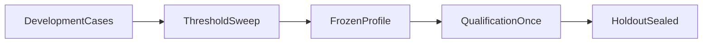

# Coverage and refusal calibration

Development-only sweep of `coverage_score` thresholds. Qualification
is confirmed separately and is not a tuning set. Holdout stays sealed.

Related: [HYBRID_RETRIEVAL_CONTRACT.md](../retrieval/HYBRID_RETRIEVAL_CONTRACT.md)
 · [HYBRID_TUNING.md](../retrieval/HYBRID_TUNING.md)
 · [COVERAGE_QUALIFICATION.md](./COVERAGE_QUALIFICATION.md)
 · [PHASE4_FREEZE.md](./PHASE4_FREEZE.md)
 · [docs index](../README.md)

## Formula

```text
coverage_score = min(
  required_term_entity_coverage,
  subquestion_coverage,
  min(1, distinct_evidence_count / profile_minimum),
  support_confidence
)
```

Development baseline `0.65`. False-supported
answers carry loss weight 2; unnecessary refusals carry weight 1.
Unequal RRF channel weights were **not selected** (no ranked-ID
evidence to retune `rrf_k=60` or equal weights).

## Frozen artifact

- Profile `hybrid_default_v1` SHA-256 `def45b691e64707d07d3c7ea47f45eb1b23b5d2d2546c37a19a514f316c5940c`
- Rollback id `hybrid_packet5_v1` (Packet 5 signals only)
- Frozen threshold `0.65` for every class

## Frozen thresholds at baseline

Occupancy scores non-exact winners with `support_confidence=0.60`
because channel mix is unknown. That value is the plan's weak-coverage
feature, so a freeze below `0.65` would permit single-channel answers
without rerank and would let a one-unit relationship score (`0.50`)
pass the two-unit rule. Sweep values below the baseline are rejected.

| Class | Frozen | Occupancy sweep | n | Weighted loss | False supported | Unnecessary refusal |
| --- | --- | --- | --- | --- | --- | --- |
| `acl_negative` | 0.65 | 0.65 | 11 | 0.000 | 0 | 0 |
| `alias` | 0.65 | 0.65 | 11 | 0.000 | 0 | 0 |
| `arabic_mixed` | 0.65 | 0.60 | 11 | 1.000 | 0 | 11 |
| `broad_synthesis` | 0.65 | 0.65 | 8 | 1.000 | 0 | 8 |
| `document_summary` | 0.65 | 0.65 | 5 | 0.600 | 0 | 3 |
| `exact_code` | 0.65 | 0.65 | 13 | 0.000 | 0 | 0 |
| `graph_mapping` | 0.65 | 0.65 | 11 | 0.000 | 0 | 0 |
| `insufficient_refusal` | 0.65 | 0.65 | 11 | 0.000 | 0 | 0 |
| `latest_as_of` | 0.65 | 0.60 | 8 | 1.000 | 0 | 8 |
| `media_limitation` | 0.65 | 0.65 | 2 | 0.000 | 0 | 0 |
| `mixed_locale_temporal` | 0.65 | 0.60 | 5 | 1.000 | 0 | 5 |
| `multi_hop` | 0.65 | 0.65 | 16 | 0.000 | 0 | 0 |
| `multi_part` | 0.65 | 0.50 | 11 | 1.000 | 0 | 11 |
| `negation` | 0.65 | 0.65 | 5 | 0.000 | 0 | 0 |
| `profile_fidelity` | 0.65 | 0.60 | 11 | 1.000 | 0 | 11 |
| `prompt_injection` | 0.65 | 0.60 | 16 | 1.000 | 0 | 16 |
| `relationship` | 0.65 | 0.65 | 16 | 0.000 | 0 | 0 |
| `selective_metadata_filter` | 0.65 | 0.60 | 8 | 1.000 | 0 | 8 |
| `semantic_factual` | 0.65 | 0.60 | 18 | 1.000 | 0 | 18 |
| `tabular_aggregation` | 0.65 | 0.65 | 11 | 0.000 | 0 | 0 |
| `typo` | 0.65 | 0.65 | 8 | 0.000 | 0 | 0 |

Overall development weighted loss at frozen `0.65`: `0.4583` on `216` cases.

## Rejected occupancy candidates

These occupancy-loss minima sit below the weak-coverage floor and were not frozen:

| Class | Rejected sweep | Reason |
| --- | --- | --- |
| `arabic_mixed` | 0.60 | below baseline 0.65 |
| `latest_as_of` | 0.60 | below baseline 0.65 |
| `mixed_locale_temporal` | 0.60 | below baseline 0.65 |
| `multi_part` | 0.50 | below baseline 0.65 |
| `profile_fidelity` | 0.60 | below baseline 0.65 |
| `prompt_injection` | 0.60 | below baseline 0.65 |
| `selective_metadata_filter` | 0.60 | below baseline 0.65 |
| `semantic_factual` | 0.60 | below baseline 0.65 |

## First-failing stage

| Stage | Count | Ranking claim allowed |
| --- | --- | --- |
| `authorization` | 11 | no |
| `candidate` | 6 | no |
| `coverage` | 167 | yes |
| `none` | 32 | yes |

Ranking quality is not claimed when profile, candidate,
authorization, fusion, or context failed first.

## Sweep note

Occupancy features are taken from visible gold evidence links and
profile fields, not a live Hybrid run. Live ranked-ID recall for
depth/skip tightening remains Packet 5 counterfactuals; this packet
does not retune channel depths.



[docs index](../README.md)
