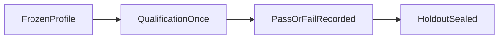

# Coverage qualification confirmation

One frozen confirmation on qualification cases. Thresholds were not
retuned. Holdout stays sealed.

## Result

Recorded `PASS`. False supported `0`.

- Profile `hybrid_default_v1` SHA-256 `def45b691e64707d07d3c7ea47f45eb1b23b5d2d2546c37a19a514f316c5940c`
- Qualification n `77`
- Weighted loss `0.4416`
- False supported `0`

| Class | n | Weighted loss | False supported | Unnecessary refusal |
| --- | --- | --- | --- | --- |
| `acl_negative` | 4 | 0.000 | 0 | 0 |
| `alias` | 4 | 0.000 | 0 | 0 |
| `arabic_mixed` | 4 | 1.000 | 0 | 4 |
| `broad_synthesis` | 2 | 1.000 | 0 | 2 |
| `document_summary` | 2 | 0.500 | 0 | 1 |
| `exact_code` | 5 | 0.000 | 0 | 0 |
| `graph_mapping` | 4 | 0.000 | 0 | 0 |
| `insufficient_refusal` | 4 | 0.000 | 0 | 0 |
| `latest_as_of` | 2 | 1.000 | 0 | 2 |
| `media_limitation` | 1 | 0.000 | 0 | 0 |
| `mixed_locale_temporal` | 2 | 1.000 | 0 | 2 |
| `multi_hop` | 6 | 0.000 | 0 | 0 |
| `multi_part` | 4 | 1.000 | 0 | 4 |
| `negation` | 2 | 0.000 | 0 | 0 |
| `profile_fidelity` | 4 | 1.000 | 0 | 4 |
| `prompt_injection` | 6 | 1.000 | 0 | 6 |
| `relationship` | 6 | 0.000 | 0 | 0 |
| `selective_metadata_filter` | 2 | 1.000 | 0 | 2 |
| `semantic_factual` | 7 | 1.000 | 0 | 7 |
| `tabular_aggregation` | 4 | 0.000 | 0 | 0 |
| `typo` | 2 | 0.000 | 0 | 0 |

## First-failing stage

| Stage | Count |
| --- | --- |
| `authorization` | 4 |
| `candidate` | 1 |
| `coverage` | 61 |
| `none` | 11 |

A failed confirmation is evidence, not a license to tune on
qualification or to relabel the run as pass.

[COVERAGE_CALIBRATION.md](./COVERAGE_CALIBRATION.md)
[docs index](../README.md)
