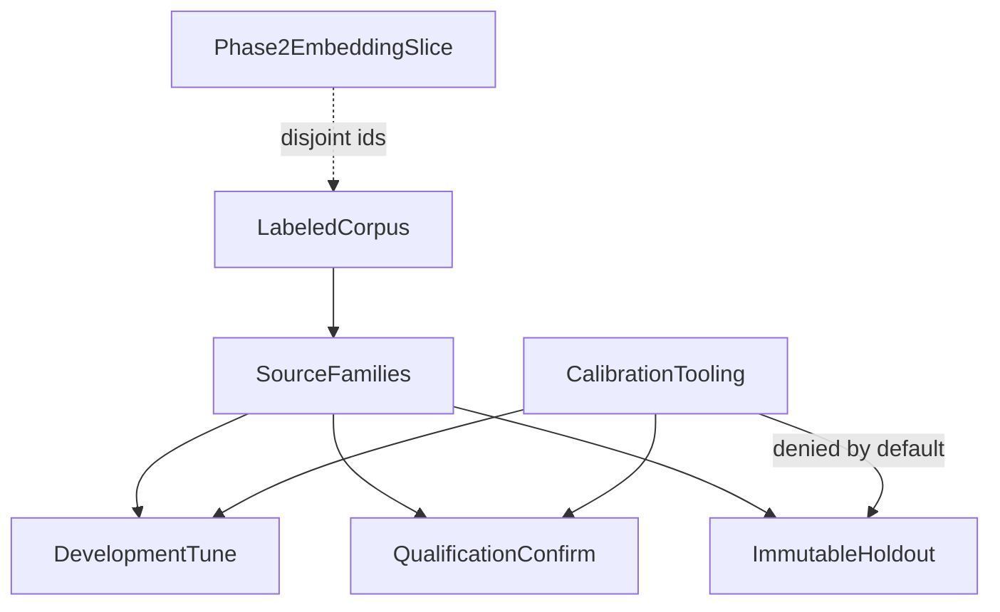
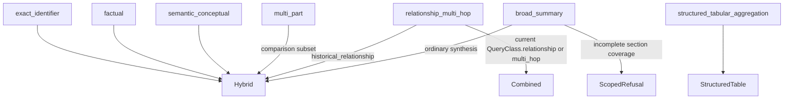

# Evaluation dataset specification (Phase 4 Packet 1)

Canonical labeled-corpus contract for Hybrid RAG. Runtime retrieval is Packet 2+. This file freezes schema, class minima, split isolation, holdout access, and synthetic SME posture.

Related: [QUALITY_TARGETS.md](../QUALITY_TARGETS.md) · [QUERY_PROFILE_LABELING.md](./QUERY_PROFILE_LABELING.md) · [QUERY_PROFILE_EVAL.md](./QUERY_PROFILE_EVAL.md) · [EMBEDDING_QUALIFICATION_REPORT.md](./EMBEDDING_QUALIFICATION_REPORT.md) · [COVERAGE_CALIBRATION.md](./COVERAGE_CALIBRATION.md) · [COVERAGE_QUALIFICATION.md](./COVERAGE_QUALIFICATION.md) · [PHASE4_FREEZE.md](./PHASE4_FREEZE.md) · [PHASE4_HOLDOUT.md](./PHASE4_HOLDOUT.md) · [PHASE4_RANKED_IDS.md](./PHASE4_RANKED_IDS.md) · [PHASE5_GRAPH_EVAL.md](./PHASE5_GRAPH_EVAL.md) · [ADR-phase4-engineering-close.md](../adr/ADR-phase4-engineering-close.md) · [GLOSSARY_IMPORT.md](../api/GLOSSARY_IMPORT.md) · [phase-04-hybrid-rag-evidence.md](../development/phase-04-hybrid-rag-evidence.md)

## Schema version

| Field | Value |
| --- | --- |
| Schema | `phase4-dataset-v1` |
| Label revision | `phase4-labels-synthetic-v1` |
| Normalizer | `arabic_norm_v1` |
| Date parser | `gregorian_v1` |
| Redaction class | `synthetic` |
| Split allocation | 50% development, 25% qualification, remainder holdout |

Every case has an immutable `case_id`, a `source_family_id` that cannot cross splits, an ACL actor snapshot, complete expected profile fields, adjudication status, and either canonical evidence links or explicit refusal truth.

## Class matrix (405)

| Class | Minimum | Runtime owner |
| --- | --- | --- |
| exact_code | 25 | Phase 4 |
| alias | 20 | Phase 4 |
| typo | 15 | Phase 4 |
| semantic_factual | 35 | Phase 4 |
| arabic_mixed | 20 | Phase 4 |
| selective_metadata_filter | 15 | Phase 4 |
| latest_as_of | 15 | Phase 4 |
| multi_part | 20 | Phase 4 |
| relationship | 30 | Phase 5/6 label only |
| multi_hop | 30 | Phase 5/6 label only |
| broad_synthesis | 15 | Phase 4 |
| tabular_aggregation | 20 | Phase 4 |
| insufficient_refusal | 20 | Phase 4 |
| graph_mapping | 20 | Phase 5 label only |
| acl_negative | 20 | Phase 4 |
| profile_fidelity | 20 | Phase 4 |
| negation | 10 | Phase 4 |
| document_summary | 10 | Phase 4 (5 full / 5 scoped) |
| mixed_locale_temporal | 10 | Phase 4 |
| media_limitation | 5 | Phase 4 |
| prompt_injection | 30 | Phase 6 label only |

Graph, Combined, tool, and frontend labels do not make Phase 4 pass. The frozen `QueryType` values those classes carry still have a Phase 6 family in [QueryType to Phase 6 family](#querytype-to-phase-6-family); executing Combined or inspection is not a Phase 4 pass.

## Split isolation



Families never split across development, qualification, and holdout. The Phase 2 embedding-qualification slice is disjoint by case id, source id, and query text. Holdout manifests store ordered ids and content hashes only.

## Holdout access

Default access is denied. Authorized materialization requires:

- `SMART_RAG_HOLDOUT_ACCESS=true`
- `SMART_RAG_HOLDOUT_ACCESS_PURPOSE` in `{packet8_immutable_holdout, dataset_seal_verify}`
- `SMART_RAG_HOLDOUT_ACCESS_ACTOR` non-empty

`smart_rag_core.evaluation.calibration.load_tuning_cases` returns **development
cases only**. Qualification is a separate one-shot confirmation after freeze.
Neither entrypoint requests holdout, even when holdout environment variables
are set.

Related calibration reports: [COVERAGE_CALIBRATION.md](./COVERAGE_CALIBRATION.md)
· [COVERAGE_QUALIFICATION.md](./COVERAGE_QUALIFICATION.md).

## Adjudication

Ambiguous labels retain alternatives. `disagreement_open` cases keep notes and more than one acceptable answer. Developers and models must not silently choose a gold answer.

## Glossary and identifier rules

Private glossary values live in authorized Postgres, not Git. Owner/admin import is pending until approval projects rows into `search_aliases`. Term-channel coverage fixtures store SHA-256 of normalized terms only.

Identifier rules are sampled from the synthetic corpus (`INV-SR-\d{4}`, `PRJ-[A-Z]{5,12}`, `SKU-P4-[A-Z0-9]{3}`, `P4-[A-Z]{2}-\d{3}`). High-collision patterns such as `\d{1,3}` are recorded as rejected.

## SME posture

This Packet 1 corpus is synthetic and provisionally accepted so Hybrid packets can proceed. Named Knowledge Owner hours (12–20) remain unverified. Packet 8 recorded a holdout **no-go**. [ADR-phase4-engineering-close.md](../adr/ADR-phase4-engineering-close.md) allows Phase 4 **engineering-complete** acceptance from Packet 9 open-split ranked-ID gates without opening this holdout. Launch claims still require a newly collected, independently SME-sealed holdout. Relationship, multi-hop, graph_mapping, and prompt_injection remain later-phase runtime.

Phase 4 Recall@10 / code Recall@5 / alias Recall@10 population is `runtime_owner=phase_4` cases on development then qualification only. Ranked-ID formulas, locator/ACL/table/p95 lanes, and the fail-closed sidecar rule live in [PHASE4_RANKED_IDS.md](./PHASE4_RANKED_IDS.md). This Packet 1 schema is unchanged.

## Ranked-ID eval (Packet 9 Wave 2)

Holdout-blind Recall@K, locator correctness, ACL, table dispatch, and first-evidence p95 are defined in [PHASE4_RANKED_IDS.md](./PHASE4_RANKED_IDS.md). Gold `p4-chk-*` ids join through the Wave 1B sidecar; occupancy in `coverage_eval` is not Recall@K. Packet 1 schema, manifests, and class matrix above are unchanged.

## Bounded LangSmith agent eval (development only)

`scripts/eval_query_agent_langsmith.py` publishes a LangSmith dataset named
`smart-rag-agent-eval-{schema}-{labels}-development-{manifest12}` from the
selected synthetic development subset. Qualification and holdout ids fail
closed. Dataset identity includes the selected-set manifest hash, so a
different `--limit` is a different dataset. Example metadata carries
`case_content_hash`; remote drift or extra example ids fail closed. This
does not change Packet 1 labels, does not open holdout, and is not a
Combined +10pp claim. See [LANGSMITH_TRACING.md](../development/LANGSMITH_TRACING.md)
and [PHASE6_EVAL_REGISTRY.md](./PHASE6_EVAL_REGISTRY.md).

## QueryType to Phase 6 family

Frozen Phase 4 `QueryType` members do not change. Packet 9 records the Phase 6 route family each member selects so later routing can consume a typed contract. Implementation: `packages/core/src/smart_rag_core/query_profile/phase6_map.py`. Field meanings live in [QUERY_PROFILE_LABELING.md](./QUERY_PROFILE_LABELING.md). QT-QP still requires `model_calls == 0` on the deterministic extract path; see [QUERY_PROFILE_EVAL.md](./QUERY_PROFILE_EVAL.md).

This section does not implement Phase 6 routing. `graph_inspection` and `no_retrieval` are Phase-6-only family names on the map output type; they are not Phase 4 `QueryType` values and cannot be produced from `QueryType` alone.



| Phase 4 `QueryType` | Phase 6 family | Notes |
| --- | --- | --- |
| `exact_identifier` | Hybrid | Phase 4 may execute when `runtime_owner=phase_4` |
| `factual` | Hybrid | Same |
| `semantic_conceptual` | Hybrid | Same |
| `multi_part` | Hybrid | Comparison is a subset of `multi_part`, not its own `QueryType`. Phase 6 may label Composite when mixed families are required |
| `relationship_multi_hop` | Combined, or Hybrid + `temporal_graph_limitation` | `QueryClass.relationship` versus `multi_hop` distinguish kind; historical/`as_of` stays Hybrid. Runtime owner is Phase 5/6 |
| `broad_summary` | Hybrid or scoped refusal | Whole-document claims need `section_coverage_ratio=1.0` |
| `structured_tabular_aggregation` | StructuredTable | Numeric aggregation |

Phase 4 may execute the mapped family only when `class_runtime_owner` is `phase_4`. Relationship, multi-hop, graph-mapping, and prompt-injection labels remain later-phase runtime even though their `QueryType` still maps.

## Verification

```powershell
uv run python scripts/seal_phase4_dataset.py
uv run python scripts/validate_phase4_dataset.py
uv run python scripts/eval_coverage_calibration.py
uv run python scripts/eval_coverage_qualification.py
uv run pytest tests/unit/test_phase4_dataset.py tests/unit/test_hybrid_coverage.py tests/unit/test_glossary_validation.py tests/unit/test_glossary_openapi.py tests/unit/test_phase6_querytype_map.py tests/unit/test_phase4_ranked_ids.py -q
uv run python scripts/eval_phase4_ranked_ids.py --split development --limit 3
```

[docs index](../README.md)
