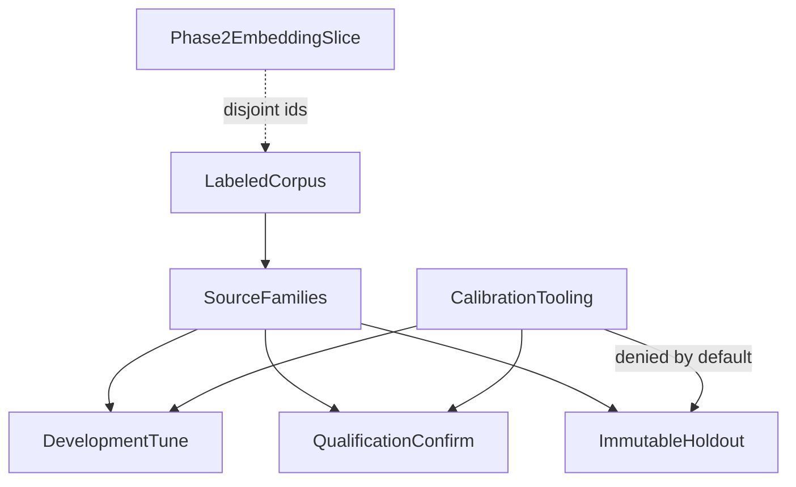

# Evaluation dataset specification (Phase 4 Packet 1)

Canonical labeled-corpus contract for Hybrid RAG. Runtime retrieval is Packet 2+. This file freezes schema, class minima, split isolation, holdout access, and synthetic SME posture.

Related: [QUALITY_TARGETS.md](../QUALITY_TARGETS.md) · [QUERY_PROFILE_LABELING.md](./QUERY_PROFILE_LABELING.md) · [EMBEDDING_QUALIFICATION_REPORT.md](./EMBEDDING_QUALIFICATION_REPORT.md) · [GLOSSARY_IMPORT.md](../api/GLOSSARY_IMPORT.md) · [phase-04-hybrid-rag-evidence.md](../development/phase-04-hybrid-rag-evidence.md)

## Schema version

| Field | Value |
| --- | --- |
| Schema | `phase4-dataset-v1` |
| Label revision | `phase4-labels-synthetic-v1` |
| Normalizer | `arabic_norm_v1` |
| Date parser | `gregorian_v1` |
| Redaction class | `synthetic` |
| Split allocation | 50% development, 25% qualification, remainder holdout |

Every case has an immutable `case_id`, a `source_family_id` that cannot cross splits, an ACL actor snapshot, complete expected profile fields, adjudication status, and either canonical evidence links or explicit refusal truth.

## Class matrix (405)

| Class | Minimum | Runtime owner |
| --- | --- | --- |
| exact_code | 25 | Phase 4 |
| alias | 20 | Phase 4 |
| typo | 15 | Phase 4 |
| semantic_factual | 35 | Phase 4 |
| arabic_mixed | 20 | Phase 4 |
| selective_metadata_filter | 15 | Phase 4 |
| latest_as_of | 15 | Phase 4 |
| multi_part | 20 | Phase 4 |
| relationship | 30 | Phase 5/6 label only |
| multi_hop | 30 | Phase 5/6 label only |
| broad_synthesis | 15 | Phase 4 |
| tabular_aggregation | 20 | Phase 4 |
| insufficient_refusal | 20 | Phase 4 |
| graph_mapping | 20 | Phase 5 label only |
| acl_negative | 20 | Phase 4 |
| profile_fidelity | 20 | Phase 4 |
| negation | 10 | Phase 4 |
| document_summary | 10 | Phase 4 (5 full / 5 scoped) |
| mixed_locale_temporal | 10 | Phase 4 |
| media_limitation | 5 | Phase 4 |
| prompt_injection | 30 | Phase 6 label only |

Graph, Combined, tool, and frontend labels do not make Phase 4 pass.

## Split isolation



Families never split across development, qualification, and holdout. The Phase 2 embedding-qualification slice is disjoint by case id, source id, and query text. Holdout manifests store ordered ids and content hashes only.

## Holdout access

Default access is denied. Authorized materialization requires:

- `SMART_RAG_HOLDOUT_ACCESS=true`
- `SMART_RAG_HOLDOUT_ACCESS_PURPOSE` in `{packet8_immutable_holdout, dataset_seal_verify}`
- `SMART_RAG_HOLDOUT_ACCESS_ACTOR` non-empty

`smart_rag_core.evaluation.calibration.load_tuning_cases` never requests holdout, even when those variables are set.

## Adjudication

Ambiguous labels retain alternatives. `disagreement_open` cases keep notes and more than one acceptable answer. Developers and models must not silently choose a gold answer.

## Glossary and identifier rules

Private glossary values live in authorized Postgres, not Git. Owner/admin import is pending until approval projects rows into `search_aliases`. Term-channel coverage fixtures store SHA-256 of normalized terms only.

Identifier rules are sampled from the synthetic corpus (`INV-SR-\d{4}`, `PRJ-[A-Z]{5,12}`, `SKU-P4-[A-Z0-9]{3}`, `P4-[A-Z]{2}-\d{3}`). High-collision patterns such as `\d{1,3}` are recorded as rejected.

## SME posture

This Packet 1 corpus is synthetic and provisionally accepted so later Hybrid packets can proceed. Named Knowledge Owner hours (12–20) remain unverified. Packet 8 launch claims still require SME-sealed holdout approval.

## Verification

```powershell
uv run python scripts/seal_phase4_dataset.py
uv run python scripts/validate_phase4_dataset.py
uv run pytest tests/unit/test_phase4_dataset.py tests/unit/test_glossary_validation.py tests/unit/test_glossary_openapi.py -q
```

[docs index](../README.md)
