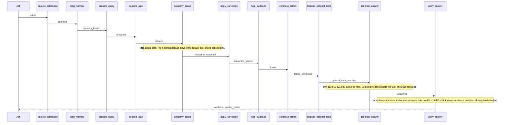
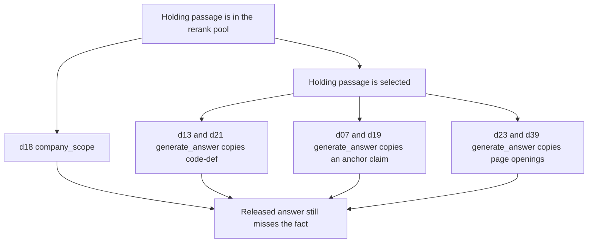

# dev40-v3 checkpoint trace

Where the seven misses on `.private-eval/runs/dev40-v3-baseline` leave the company-ask graph. Counts and question ids only. The run is the kept drafted-openings image: stage strict 33/40, `4_rerank_select` 1, `5a_draft_missing` 6, `5b_removed_after_draft` 0. The later page-window run is a rejected experiment and is not this trace.

Each miss has a LangGraph thread. `langgraph.checkpoint_writes` has 635 rows for every one of those threads. The `answer` channel is written twice: once by `generate_answer`, once by `verify_answer`.

## Graph path

Every miss took the same company path. No node was skipped, and none stopped early.

`company_scope` is the node that runs hybrid retrieval and rerank (`hybrid_long_document_v4` on all seven). `fuse_evidence` only fits passages that node already selected.

## Where each miss drops

Thousand-buckets count collapsed characters in the holding chunk. Bucket 0 is the first thousand. `opening_holds` means the fact sits inside that first thousand of at least one selected holder.

| Id | Kind | Node that loses the fact | Checkpoint evidence | Later node |
| --- | --- | --- | --- | --- |
| `d18` | code | `company_scope` | Pool holds it in bucket 6. Selected does not. One other passage on the cited page is selected. | `generate_answer` writes `anchor-claim` and `claim` (1152 characters). `verify_answer` keeps both. Neither holds the fact. |
| `d13` | code | `generate_answer` | Selected holder, bucket 0, and the first thousand holds the fact. | Both checkpoints are one `code-def` link, 118 characters. Verify does not change it. |
| `d21` | code | `generate_answer` | Selected holders in buckets 0 and 3. The first thousand holds the fact. | Both checkpoints are one `code-def` link, 453 characters. Verify does not change it. |
| `d19` | code | `generate_answer` | Selected holders in buckets 0 and 6. The first thousand holds the fact. | Draft is `anchor-claim` plus `claim`, 471 characters. Verify shortens that to 369. Neither holds the fact. |
| `d07` | table | `generate_answer` | Selected holders in buckets 0 and 3. The first thousand holds the fact. | Draft is one `anchor-claim`, 997 characters. Verify replaces it with one `table-block`, 943 characters. Neither holds the fact. |
| `d23` | text | `generate_answer` | Two selected holders, both bucket 0, and the first thousand holds the fact. | Draft is two `page-opening` links plus one `claim`, 638 characters. Verify shortens the text to 332 and drops one paragraph. The fact was already absent. |
| `d39` | text | `generate_answer` | One selected holder, bucket 1. The first thousand does not hold the fact. | Draft is two `page-opening` links plus one `claim`, 1188 characters. Verify refuses one opening and releases 375 characters as `partial`. The fact was already absent. |

`d07`, `d13`, `d21`, and `d23` still finish as `completed`. A completed verify status is not evidence that the fact was present.

## Do the nodes need to change?

The topology does not. Admission, memory, planning, fusion, tables, and tool disclosure all ran, and retrieval loss on this set is 0. Adding a node or a branch would not put these facts into the draft.

`company_scope` needs a selection change for `d18` only. The holding passage is already in the pool, on the cited page, and the selected passage is a different one from that page. The fact itself starts in the seventh thousand characters. A second window of 1000 characters cannot reach it. Pinning every cited-page passage was tried in the rejected windows run: rerank loss went from 1 to 0, and `d18` remained a draft miss.

`generate_answer` is the node behind the six draft misses. The selected passage already holds the fact, and the draft copies a shorter span: a `code-def` block, an anchor claim, or page openings. For `d13`, `d19`, `d21`, and `d23` that fact is inside the first thousand characters and still outside the copied span. For `d39` it starts in the second thousand, past the opening cap.

`verify_answer` does not create these misses. `5b_removed_after_draft` is 0. On `d07` it swaps the anchor claim for a table block that also misses the fact. On `d19`, `d23`, and `d39` it shortens text that already missed the fact. A verifier-only keep was tried earlier on `dev40-v2` and reverted because draft misses rose.

The page-window change edited both `company_scope` pinning and the `generate_answer` page fill. On this set, `5a_draft_missing` rose from 6 to 10 and table passes fell from 7/8 to 4/8, so that change was reverted. The later continuation packet appends the text that starts where each named-page opening ends, for source-word and code-reproduce asks, and leaves table pinning unchanged. That packet is kept: `5a_draft_missing` 6→3 and stage strict 33→35. Counts are in [GENERAL_ANSWER_QUALITY_2026-10.md](./GENERAL_ANSWER_QUALITY_2026-10.md).

## Limits

Checkpoint text, gold phrases, and page numbers are not in this file. Character buckets are collapsed offsets, so a fact in bucket 0 can still sit after the sentence boundary that ends a 1000-character opening. The sealed holdout was not read.

## Verification

- Stage report: `uv run python scripts/eval_stage_loss.py --run .private-eval/runs/dev40-v3-baseline --gold .private-eval/dev40-2026-10-v3.json`
- Checkpoint reads used `langgraph.checkpoint_writes` for the seven baseline `conversation_id` values, channel `answer`, ordered by `checkpoint_id`.
- Related counts: [GENERAL_ANSWER_QUALITY_2026-10.md](./GENERAL_ANSWER_QUALITY_2026-10.md).
