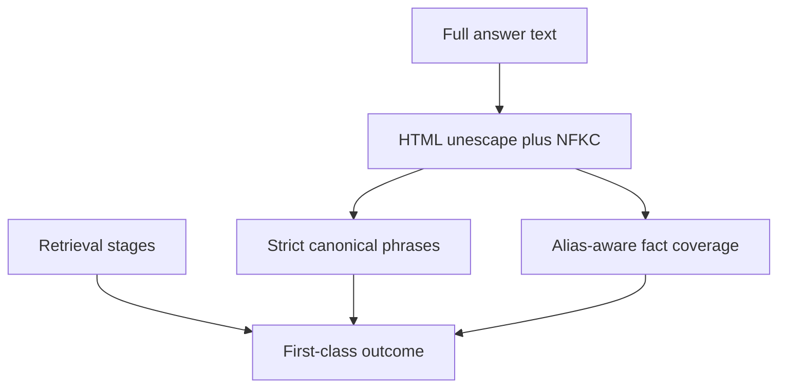

# Dual-metric company Ask scoring

Private-safe scoring for company-document answers. Strict phrase match and
approved-alias fact coverage are reported separately. Product deadline
failures and verifier refusals after fusion are first-class stages, not
empty retrieval.

Related: [COMPANY_DOCUMENTS_RAG_100.md](./COMPANY_DOCUMENTS_RAG_100.md) ·
[PDF_HYBRID_EVALUATION.md](./PDF_HYBRID_EVALUATION.md) ·
[ADR-hybrid-retrieval-accuracy.md](../adr/ADR-hybrid-retrieval-accuracy.md) ·
[docs index](../README.md)



## Contract

- Score the **full** answer. Truncated excerpts are not an accuracy proof.
- HTML-unescape before matching so encoded apostrophes cannot flip a pass.
- Strict pass requires every canonical phrase as a substring.
- Grounded fact pass allows approved aliases for the same fact.
- Deadline copy or `answer_deadline_reserve_exhausted` is a deadline
  failure even when fusion was non-empty.
- `Insufficient authorized evidence.` after `fused_count > 0` is a
  verifier-stage refusal, not proven empty retrieval.
- Empty retrieval requires zero fused survivors and no dense/BM25/term hit.

## Runner policy

- Credentials come from `SMART_RAG_EVAL_EMAIL`,
  `SMART_RAG_EVAL_PASSWORD`, and `SMART_RAG_EVAL_BASE_URL`.
- Each question uses a **fresh conversation** and records `run_id`.
- Stage fields come from checkpoint `HybridBranchDiagnostics` plus
  `llm_usage` via `scripts/eval_ask_stage_export.py`. Missing required
  fields are `unknown` and increment `unknown_required_fields`.
- `run_company_ask.py` must not hard-code `source_resolution`,
  `bm25_degraded_explicit`, or `rerank_accounting_ok`.
- Private gold stays under gitignored `.private-eval/`.
- Redacted summaries persist outcomes and counts only.

## Commands

```powershell
uv run python -m pytest tests/unit/test_retrieval_dual_metric_scorer.py tests/unit/test_accuracy_promotion.py -q
uv run python scripts/run_company_ask.py --gold .private-eval/pdf-gold-100.json --out .private-eval/p06-64-dual-summary.json --credentials .private-eval/eval-credentials.json --answers-out .private-eval/p06-64-answers.json --stage-export .private-eval/p06-68-stage-export.json
uv run python scripts/eval_ask_stage_export.py --answers .private-eval/p06-64-answers.json --out .private-eval/p06-68-stage-export.json
uv run python scripts/rescore_company_ask.py --gold .private-eval/gold.json --answers .private-eval/answers.json --stage-export .private-eval/p06-68-stage-export.json --out .private-eval/dual-summary.json
```

Do not paste passwords, DSNs, or unrestricted source text into docs or
committed tests.

## Limits

This scorer does not replace citation, Recall@10, faithfulness, ACL,
latency, or cost gates. Generalization remains unverified until disjoint
real documents are scored. Packet 64 records that claim explicitly.
Packet 72 records the 2026-09-21 honest overlay 100-question Ask:
grounded 28/100, deadlines 9, promotion false. P06-17 remains open.
