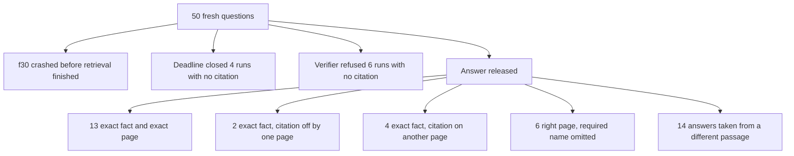

# Fresh known-answer 50 (2026-09-23)

This is a new 50-question test of the live company-documents RAG against
*Building Applications with AI Agents*. It is a different question set from
[KNOWN_ANSWER_50_REPAIR_EVIDENCE_2026-09-22.md](./KNOWN_ANSWER_50_REPAIR_EVIDENCE_2026-09-22.md).
Scoring rules for the phrase check are in
[DUAL_METRIC_SCORING.md](./DUAL_METRIC_SCORING.md).
A later answer-only run, on a third set of pages, is
[ANSWER_ONLY_50_2026-09-24.md](./ANSWER_ONLY_50_2026-09-24.md).
Expected-answer and answer-text columns were removed before commit
(plan decision D4); the private run files keep them.

## Result

The required fact appears in 19 of 50 answers (38%). A question is fully
correct only when that fact is present and at least one persisted citation
points at the page that contains it. By that bar the RAG is right on
**13 of 50**.

The 50 runs split like this:

| Outcome | Count | Share |
| --- | ---: | ---: |
| Fact present and citation on the gold page | 13 | 26% |
| Fact present, citation one page away | 2 | 4% |
| Fact present, citation on some other page | 4 | 8% |
| Gold page cited, required name omitted | 6 | 12% |
| Answer drawn from a different passage | 14 | 28% |
| Refused as insufficient evidence, no citation | 6 | 12% |
| Deadline, canned unsupported answer, no citation | 4 | 8% |
| Run crashed before an answer | 1 | 2% |

The earlier known-answer file scored 29 of 50 on its own questions. These
two files do not share questions or pages, so 19 of 50 here is a new
measurement, not a rescore of that 29.

## What was asked

The source PDF is
`dataset/building-applications-with-ai-agents-designing-and-implementing-multiagent-systems-1 (1).pdf`,
indexed as document `95e6c763-24ca-444b-b667-cd075d4f40cd` (348 pages with
chunk text). Each question uses a page that the 2026-09-22 known-answer
file does not use. The required fact is a short phrase that is on that
page. The private question file is `.private-eval/fresh50-v1.json`.

Each question was a new conversation on `company_documents` against
`http://127.0.0.1:8000`. The API image had the P0–P5 repair symbols
present, and `/health/ready` reported `query_ready: true`. The 50-question
runner took 47.5 minutes (mean about 57 seconds). One question, f30,
failed inside `company_scope` and was retried once. The retry failed the
same way.

Citation pages come from persisted `app.citations` rows joined to
`app.document_chunks.page_number`. A citation counts as exact when that
page equals the gold page.

## How the misses happen

### The reranker times out on most questions

42 of 50 runs recorded `rerank_fallback=rerank_timeout`. Two more recorded
`rerank_schema_invalid` (f05, f09). Two finished reranking (`rerank_fallback=none`:
f12, f47). Four runs did not store a rerank field (f01, f02, f03, f30).

When the reranker times out, hybrid still fuses dense and BM25, then the
pool and the final evidence are chosen without a finished cross-encoder
score. The gold page is often in the fused list and then absent from the
rerank pool or from the passages the answer is allowed to use. The model
answers from whatever did survive, and the citation points at that
surviving page.

Recorded profile on the runs that stored one is `hybrid_long_document_v2`,
resolution `unscoped`.

### Right page, missing label

Six answers cite the gold page and restate the paragraph, and still fail
the phrase check because the question asked for the section name:

| ID | Page |
| --- | ---: |
| f06 | 42 |
| f18 | 107 |
| f36 | 227 |
| f37 | 231 |
| f47 | 287 |
| f48 | 294 |

The citation is the right page. The answer is about the right paragraph.
The required heading is absent, so the strict check fails.

### Correct fact, citation on the wrong page

| ID | Gold page | Cited pages |
| --- | ---: | --- |
| f05 | 37 | 68 |
| f09 | 56 | 54, 185 |
| f11 | 72 | 68, 18 |
| f34 | 217 | 218 |
| f35 | 222 | 221 |
| f44 | 270 | 272, 273, 266 |

f34 and f35 are one page off, which is a chunk that starts or ends on the
neighboring page. f05, f09, f11, and f44 cite a page that is not the page
the fact was taken from.

### Answer taken from a different passage

These replies are about a nearby topic, or they repeat the question, and
the citation is not the gold page.

| ID | Gold page | Cited pages |
| --- | ---: | --- |
| f01 | 18 | 23 |
| f02 | 23 | 135, 134 |
| f04 | 32 | 294, 269 |
| f07 | 47 | 79, 77 |
| f08 | 52 | 49, 50 |
| f12 | 76 | 320–326 |
| f13 | 81 | 80, 86 |
| f19 | 114 | 113, 112 |
| f20 | 119 | 100 |
| f21 | 135 | 49 |
| f22 | 140 | 134, 103, 139, 19 |
| f40 | 247 | 275, 278 |
| f43 | 265 | 246, 342 |
| f45 | 279 | 107 |

f13, f19, and f22 reached an adjacent page and still answered a different
clause than the one the question asked for.

### Refusal after the page was already retrieved

Six runs ended `insufficient_evidence` with no saved citation.

| ID | Gold page in fused list | Gold page in rerank pool | Gold page in final evidence |
| --- | ---: | --- | --- |
| f10 | yes | no | no |
| f17 | yes | yes | no |
| f25 | yes | yes | yes |
| f26 | yes | no | no |
| f42 | yes | yes | no |
| f50 | yes | yes | yes |

f25 is the sharp case. The stored answer text contains the required fact
about dynamic knowledge graphs. The product status is still
`insufficient_evidence`, strict credit is withheld, and no citation row was
saved. The words were right and the run did not release a cited answer.

f17 and f42 had the gold page in the rerank pool and then dropped it before
the answer. f50 had the gold page in the final evidence and still refused.

### Deadline

Four runs hit `deadline_exhausted` after generation had already returned
insufficient evidence. The user-facing text is the canned line that company
evidence could not support the answer. No citation was saved.

| ID | Gold page in fused list | In rerank pool | In final evidence |
| --- | ---: | --- | --- |
| f14 | yes | yes | no |
| f33 | yes | no | no |
| f39 | yes | yes | no |
| f41 | yes | yes | yes |

f41 had already selected page 254, the page that names Loki and Tempo, and
the deadline still closed the run before that answer was released.

### Crash

f30 (specialization as a benefit of multiagent systems, page 192) died
twice at `company_scope:started`. The first executor error was
`OperationalError` with a closed database connection. The retry was
`ValueError`. The SSE error payload is only `{"code": "run_failed"}`.
There is no answer and no citation. The diagnostic bucket calls this a
retrieval miss because no fusion checkpoint was written. The run never
reached retrieval.

## Question-by-question

| ID | Page | Answer | Citation |
| --- | ---: | --- | --- |
| f01 | 18 | Wrong | 23 |
| f02 | 23 | Wrong | 135, 134 |
| f03 | 27 | Correct | 27 |
| f04 | 32 | Partial | 294, 269 |
| f05 | 37 | Correct | 68 |
| f06 | 42 | Paraphrase | 42 |
| f07 | 47 | Wrong | 79, 77 |
| f08 | 52 | Wrong | 49, 50 |
| f09 | 56 | Correct | 54, 185 |
| f10 | 63 | Refused | none |
| f11 | 72 | Correct | 68, 18 |
| f12 | 76 | Wrong | 320–326 |
| f13 | 81 | Partial | 80, 86 |
| f14 | 86 | Deadline | none |
| f15 | 90 | Correct | 90 |
| f16 | 95 | Correct | 95 |
| f17 | 101 | Refused | none |
| f18 | 107 | Paraphrase | 107 |
| f19 | 114 | Partial | 113, 112 |
| f20 | 119 | Wrong | 100 |
| f21 | 135 | Wrong | 49 |
| f22 | 140 | Wrong | 134, 103, 139, 19 |
| f23 | 145 | Correct | 145 |
| f24 | 150 | Correct | 150 |
| f25 | 154 | Refused | none |
| f26 | 163 | Refused | none |
| f27 | 170 | Correct | 170 |
| f28 | 174 | Correct | 174 |
| f29 | 181 | Correct | 181 |
| f30 | 192 | Crash | none |
| f31 | 202 | Correct | 202 |
| f32 | 207 | Correct | 207 |
| f33 | 212 | Deadline | none |
| f34 | 217 | Correct | 218 |
| f35 | 222 | Correct | 221 |
| f36 | 227 | Paraphrase | 227 |
| f37 | 231 | Paraphrase | 231 |
| f38 | 236 | Correct | 236 |
| f39 | 241 | Deadline | none |
| f40 | 247 | Wrong | 275, 278 |
| f41 | 254 | Deadline | none |
| f42 | 259 | Refused | none |
| f43 | 265 | Partial | 246, 342 |
| f44 | 270 | Correct | 272, 273, 266 |
| f45 | 279 | Wrong | 107 |
| f46 | 283 | Correct | 283 |
| f47 | 287 | Paraphrase | 287 |
| f48 | 294 | Paraphrase | 294 |
| f49 | 299 | Correct | 299 |
| f50 | 306 | Refused | none |

## What still fails, in order

1. Rerank timeout (42 runs) drops the gold page between fusion and the
   evidence the model is allowed to read. That is the largest source of
   wrong-passage answers and of refusals where the page was fused and then
   lost.
2. When the right page is in the answer, heading questions still fail
   because the model paraphrases the paragraph and leaves the section title
   out (f06, f18, f36, f37, f47, f48).
3. A correct sentence is sometimes cited to a different page (f05, f09,
   f11, f44) or to the neighboring page (f34, f35).
4. The hybrid deadline still closes runs whose gold page is already in the
   pool or already selected (f14, f39, f41).
5. Verification can refuse a run whose stored text already contains the
   fact and whose gold page was selected (f25, f50), and it saves no
   citation in that case.
6. f30 crashes in `company_scope` before any retrieval. The SSE payload
   does not include the `ValueError` message.

## Limits

The phrase check is a case-insensitive substring. A paraphrase that is
faithful to the page and omits the heading fails. A short fact such as
"rejected" can pass when that word appears. Citation judgment uses the
saved page number, so a citation chip that the product could not bind to a
leaf still counts when the row's page is the gold page (f28, f32).

Stage diagnostics were missing for f01, f02, and f03, so their rerank and
profile fields are unknown. Their citation pages were stored and are used
above. f03 cited page 27 and passed.
