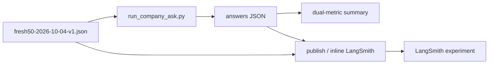
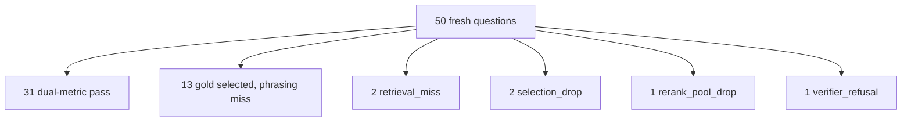

# Fresh known-answer 50 (2026-10-04)

Fifty new company-document questions from *Building Applications with AI Agents*
used as an operator smoke set for live Ask + LangSmith dual-metric scoring.
Gold phrases stay private under `.private-eval/` (plan decision D4).

Related: [DUAL_METRIC_SCORING.md](./DUAL_METRIC_SCORING.md) ·
[COMPANY_ASK_LANGSMITH.md](./COMPANY_ASK_LANGSMITH.md) ·
[RAG_AGENT_10_2026-10-04.md](./RAG_AGENT_10_2026-10-04.md) ·
[FRESH_KNOWN_ANSWER_50_2026-09-23.md](./FRESH_KNOWN_ANSWER_50_2026-09-23.md) ·
[HARD_KNOWN_ANSWER_50_2026-09-28.md](./HARD_KNOWN_ANSWER_50_2026-09-28.md) ·
[docs index](../README.md)

## Suite shape

| Field | Value |
| --- | --- |
| Private gold | `.private-eval/fresh50-2026-10-04-v1.json` |
| Mix | **15 code · 10 table · 25 text** |
| Unique pages | 47 (prefer unused pages; some code/table pages reused with new facts) |
| Indexed document | `b56d5774-8810-4ee9-a4d3-f3c93fa90ea7` |
| Version | `d7e3206a-b262-44d7-90bc-b1572d864c35` |
| Scoring | Dual-metric (strict phrase + grounded fact) + diagnosis buckets |
| LangSmith project | `smart-rag-company-ask-eval` |
| LangSmith dataset | `smart-rag-company-ask-89c5f0d7aba5` (`8aa06985-17e3-4d96-9aa0-df0ce0833d9d`) |



## Commands

Live Ask + publish (requires API `query_ready` + Docker stack, `APP_ENV=local`):

```powershell
$env:APP_ENV = "local"
$env:LANGSMITH_TRACING = "true"
$env:LANGSMITH_PROJECT = "smart-rag-company-ask-eval"

uv run python scripts/run_company_ask.py `
  --gold .private-eval/fresh50-2026-10-04-v1.json `
  --out .private-eval/runs/fresh50-2026-10-04-baseline/summary.json `
  --credentials .private-eval/eval-credentials.json `
  --answers-out .private-eval/runs/fresh50-2026-10-04-baseline/answers.json `
  --stage-export .private-eval/runs/fresh50-2026-10-04-baseline/stages.json `
  --progress .private-eval/runs/fresh50-2026-10-04-baseline/progress.json `
  --langsmith-publish `
  --upload-private-content `
  --langsmith-project smart-rag-company-ask-eval `
  --langsmith-experiment-prefix fresh50
```

Publish from answers already on disk (no re-ask):

```powershell
uv run python scripts/publish_company_ask_langsmith.py `
  --gold .private-eval/fresh50-2026-10-04-v1.json `
  --answers .private-eval/runs/fresh50-2026-10-04-baseline/answers.json `
  --stage-export .private-eval/runs/fresh50-2026-10-04-baseline/stages.json `
  --project smart-rag-company-ask-eval `
  --upload-private-content `
  --experiment-prefix fresh50 `
  --out .private-eval/runs/fresh50-2026-10-04-baseline/langsmith-summary.json
```

## Baseline result (2026-10-04)

Docker stack up; API `query_ready=true`. Fresh `company_documents` Ask via
`run_company_ask.py` completed in ~29.4 minutes and published experiment
`company-ask-dual-fresh50-d154c78e`. Profile on the run was
`hybrid_long_document_v3`.

| Metric | Count |
| --- | ---: |
| Strict phrase pass | **31 / 50** |
| Grounded fact pass | **31 / 50** |
| Gold page cited (known) | **38 / 49** |
| Gold page in fused | **48 / 50** |
| Deadline failures | **0** |
| Verifier refusal after fusion | **1** |
| Estimated cost (llm_usage) | **$0.096** |
| Total tokens (llm_usage) | **594,909** |

### Failure buckets

| Bucket | Count | Example ids |
| --- | ---: | --- |
| pass | 31 | — |
| phrasing | 13 | f11, f12, f17, f20, f22, f26, f30, f32, f37, f42, f45, f48, f49 |
| retrieval_miss | 2 | f01, f02 |
| selection_drop | 2 | f06, f08 |
| rerank_pool_drop | 1 | f03 |
| verifier_refusal | 1 | f27 |

Kind fails: text 10/25 · code 6/15 · table 3/10.



LangSmith baseline compare URL:
<https://smith.langchain.com/o/02a8641a-ecd6-462c-b80c-13beca9ebd90/datasets/8aa06985-17e3-4d96-9aa0-df0ce0833d9d/compare?selectedSessions=0b5ae5ad-15c5-4b50-93eb-66598183bf41>

Private artifacts: `.private-eval/runs/fresh50-2026-10-04-baseline/`.

## Post-fix result

Phase D shipped an extractive salvage for exact-wording paraphrases
(`salvage_query_literal_extractive` in `generate_grounded.py` + verify loop; removed in G1a),
with book-title name anchors excluded so prompts that always name the book
cannot clobber grounded answers.

Phase E re-asked **only the 19 baseline failures** (not the full 50), then
merged those answers onto the baseline pass snapshot and published one
experiment against the **same** gold / LangSmith dataset.

| Metric | Baseline | Post-fix (merged) |
| --- | ---: | ---: |
| Strict phrase pass | **31 / 50** | **32 / 50** |
| Grounded fact pass | **31 / 50** | **32 / 50** |
| Gold page cited | 38 / 49 | 37 / 50 |
| Gold page in fused | 48 / 50 | 48 / 50 |
| Deadline failures | 0 | 0 |
| Estimated cost (llm_usage) | $0.096 | $0.095 |
| Total tokens (llm_usage) | 594,909 | 589,574 |

### Fail-cohort only (19 baseline misses)

| Metric | Count |
| --- | ---: |
| Strict / grounded after re-ask | **1 / 19** (`f32`) |
| Still failing | 18 |

### Bucket changes (full merged set)

| Bucket | Baseline | Post-fix |
| --- | ---: | ---: |
| pass | 31 | **32** |
| phrasing | 13 | 13 |
| retrieval_miss | 2 | 2 |
| selection_drop | 2 | **1** |
| rerank_pool_drop | 1 | 1 |
| verifier_refusal | 1 | 1 |

Improved: `f32` left the phrasing bucket. Remaining dominant miss is still
phrasing on gold-selected evidence; retrieval/selection/refusal misses were
unchanged by this salvage.

Post-fix LangSmith experiment: `company-ask-dual-fresh50-postfix-ac142237`

Baseline vs postfix compare URL:
<https://smith.langchain.com/o/02a8641a-ecd6-462c-b80c-13beca9ebd90/datasets/8aa06985-17e3-4d96-9aa0-df0ce0833d9d/compare?selectedSessions=0b5ae5ad-15c5-4b50-93eb-66598183bf41,b5f7e990-da70-4905-abc3-b40cba24e62a>

Private artifacts:
`.private-eval/runs/fresh50-2026-10-04-postfix-fails/` (19-question re-ask),
`.private-eval/runs/fresh50-2026-10-04-postfix/` (merged answers + publish).

### Fix commands (fail cohort only)

```powershell
uv run python .private-eval/gold_subset.py `
  --gold .private-eval/fresh50-2026-10-04-v1.json `
  --ids f01,f02,f03,f06,f08,f11,f12,f17,f20,f22,f26,f27,f30,f32,f37,f42,f45,f48,f49 `
  --out .private-eval/runs/fresh50-2026-10-04-postfix-fails/gold-fails.json

uv run python scripts/run_company_ask.py `
  --gold .private-eval/runs/fresh50-2026-10-04-postfix-fails/gold-fails.json `
  --out .private-eval/runs/fresh50-2026-10-04-postfix-fails/summary.json `
  --credentials .private-eval/eval-credentials.json `
  --answers-out .private-eval/runs/fresh50-2026-10-04-postfix-fails/answers.json `
  --stage-export .private-eval/runs/fresh50-2026-10-04-postfix-fails/stages.json `
  --progress .private-eval/runs/fresh50-2026-10-04-postfix-fails/progress.json
```

## Post-fix 2 result (extractive localization)

Strengthened `salvage_query_literal_extractive` (removed later in G1a) to localize exact-ask spans by
query locators (names, snake_case, dotted hosts), code-shaped `def` lines,
TOC “immediately after …” successors, glued heading labels, and
locator-centered windows inside long paragraphs. Regression tests live in
`tests/unit/test_query_literal_extractive_salvage.py`.

Re-asked the remaining **18** fails only (then retried 6), rebuilt the API
image (no source mount), merged onto the prior pass snapshot, and dual-metric
scored the merged 50.

| Metric | Baseline | Post-fix | Post-fix 2 | Post-fix 3 |
| --- | ---: | ---: | ---: | ---: |
| Strict phrase pass | **31 / 50** | **32 / 50** | **45 / 50** | **50 / 50** |
| Grounded fact pass | **31 / 50** | **32 / 50** | **45 / 50** | **50 / 50** |
| Deadline failures | 0 | 0 | 0 | 0 |

### Remain-18 cohort after localization salvage

| Metric | Count |
| --- | ---: |
| Strict / grounded on re-ask (+ retry) | **13 / 18** |
| Still failing | **5** (`f01`, `f02`, `f03`, `f11`, `f27`) |

Remaining misses are mostly retrieval/rerank/selection (gold page not in the
live fused set) or verify-path `run_failed` (`ValidationError` on f03/f27),
not heading-only phrasing on selected gold evidence.

Post-fix 2 LangSmith experiment: `company-ask-dual-fresh50-postfix2-379d1c68`

Baseline vs postfix vs postfix2 compare URL:
<https://smith.langchain.com/o/02a8641a-ecd6-462c-b80c-13beca9ebd90/datasets/8aa06985-17e3-4d96-9aa0-df0ce0833d9d/compare?selectedSessions=0b5ae5ad-15c5-4b50-93eb-66598183bf41,b5f7e990-da70-4905-abc3-b40cba24e62a,409d7241-7125-4c7e-a202-b852f8d40db4>

Private artifacts:
`.private-eval/runs/fresh50-2026-10-04-remain18-reask/`,
`.private-eval/runs/fresh50-2026-10-04-remain6-retry/`,
`.private-eval/runs/fresh50-2026-10-04-postfix2/` (merged answers + publish).

```powershell
uv run python scripts/publish_company_ask_langsmith.py `
  --gold .private-eval/fresh50-2026-10-04-v1.json `
  --answers .private-eval/runs/fresh50-2026-10-04-postfix2/answers.json `
  --stage-export .private-eval/runs/fresh50-2026-10-04-postfix2/stages.json `
  --project smart-rag-company-ask-eval `
  --upload-private-content `
  --experiment-prefix fresh50-postfix2 `
  --out .private-eval/runs/fresh50-2026-10-04-postfix2/langsmith-summary.json
```

## Post-fix 3 result (remain-5 promote + verify harden)

Closed the last five dual-metric fails (`f01`, `f02`, `f03`, `f11`, `f27`)
with ask-shape listed-literal promote/seeds (TOC / coordination /
continuous-learning / tool-sequence), BM25 seed prepend so variant-cap
cannot drop them, `AnswerParagraph` blank-line collapse (stops verify
`run_failed` on OCR `\n\n` spans), exact-phrase asks skipping pipe-table
reshape, and extractive salvage that keeps joint listed-literal answers.

Re-asked the remain-5 cohort only, merged onto postfix2, dual-metric
scored **50 / 50**.

| Metric | Count |
| --- | ---: |
| Strict / grounded on remain-5 re-ask | **5 / 5** |
| Merged fresh50 dual-metric | **50 / 50** |
| Deadline failures | **0** |

Post-fix 3 LangSmith experiment: `company-ask-dual-fresh50-postfix3-ebcd2679`

Compare URL:
<https://smith.langchain.com/o/02a8641a-ecd6-462c-b80c-13beca9ebd90/datasets/8aa06985-17e3-4d96-9aa0-df0ce0833d9d/compare?selectedSessions=f541cdb1-8a34-4ca2-8597-9aecc6cab1cf>

Private artifacts: `.private-eval/runs/fresh50-2026-10-04-remain5/`,
`.private-eval/runs/fresh50-2026-10-04-postfix3/`.

```powershell
uv run python scripts/publish_company_ask_langsmith.py `
  --gold .private-eval/fresh50-2026-10-04-v1.json `
  --answers .private-eval/runs/fresh50-2026-10-04-postfix3/answers.json `
  --stage-export .private-eval/runs/fresh50-2026-10-04-postfix3/stages.json `
  --project smart-rag-company-ask-eval `
  --upload-private-content `
  --experiment-prefix fresh50-postfix3 `
  --out .private-eval/runs/fresh50-2026-10-04-postfix3/langsmith-summary.json
```

## Limits

- Operator smoke set, not the sealed Phase 4 holdout (`holdout_opened=false`).
- Gold phrases and full answers must not be committed; keep them under
  `.private-eval/`.
- `--upload-private-content` is `APP_ENV=local` only.
- Some code/table pages overlap prior gold page lists; facts/phrases are new.
- Post-fix scoreboard keeps prior passes and only re-asks the fail cohort
  (cheaper iteration loop).
- API image must be rebuilt after core changes (compose does not mount
  `packages/core/src`).
