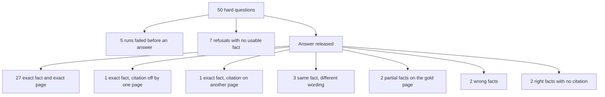

# Hard known-answer 50 (2026-09-28)

Fifty questions whose answers are specific figures, names, or code literals
on one page of *Building Applications with AI Agents*. Several questions
sit next to a similar number or name, so a nearby passage is the wrong
answer. The private gold file is `.private-eval/hard50-v1.json`. Expected
phrases and answer text stay in that private tree (plan decision D4).

This is a different question set from
[FRESH_KNOWN_ANSWER_50_2026-09-23.md](./FRESH_KNOWN_ANSWER_50_2026-09-23.md)
and
[ANSWER_ONLY_50_2026-09-24.md](./ANSWER_ONLY_50_2026-09-24.md).
Every prompt named the book. Scoring rules for the phrase check are in
[DUAL_METRIC_SCORING.md](./DUAL_METRIC_SCORING.md).

## Result

The indexed document is `b56d5774-8810-4ee9-a4d3-f3c93fa90ea7`, version
`d7e3206a-b262-44d7-90bc-b1572d864c35`. Each question was a new
`company_documents` conversation against `http://127.0.0.1:8000`.
`/health/ready` reported `query_ready: true`.

A question is fully correct only when every required phrase is in the
stored answer and at least one persisted citation is on the gold page.
By that bar the agent is right on **27 of 50**. The runner's phrase
check, before the page check, is **29 of 50**.

| Outcome | Count |
| --- | ---: |
| Required phrases present and citation on the gold page | 27 |
| Required phrases present, citation one page away | 1 |
| Required phrases present, citation on another page | 1 |
| Gold page cited, wording differs but the same fact is stated | 3 |
| Gold page cited, only part of a multi-part fact | 2 |
| Wrong fact stated (hallucination) | 2 |
| Right fact in the prose, no citation, marked insufficient | 2 |
| Refused, no usable fact | 7 |
| Run failed before an answer | 5 |

Two of the 27 exact hits were still marked partial because a citation
leaf could not be bound (`h40`, `h43`). The gold page was persisted and
the required phrases were present.

## Hallucinations

Two answers state a fact that is not the fact on the gold page.

| ID | Gold page | Cited pages | What went wrong |
| --- | ---: | --- | --- |
| h10 | 79 | 77 | Autonomy-mode labels. The page says Manual, Assist, and Auto. The answer says Manual, Ask, and Agent. |
| h33 | 208 | 28, 195 | Asked for the ADAS example's model id and temperature. The answer is a different code sample: `gpt-4o` at temperature 0. |

The other misses do not substitute a competing figure. `h45` states the
incident cost from its page and omits the second required percentage. It
does not use the different cost on the next page. `h08` states the
speaking rate from its page and omits the reading and skimming rates.

## Citations

Persisted citation pages come from `app.citations` joined to
`app.document_chunks.page_number` for this document. 32 runs cite the
gold page. 27 of those also contain every required phrase.

| ID | Gold page | Cited pages | Note |
| --- | ---: | --- | --- |
| h50 | 322 | 321 | Fact present, one page away |
| h24 | 159 | 162 | Fact present, other page |
| h10 | 79 | 77 | Wrong labels, wrong page |
| h33 | 208 | 28, 195 | Wrong code sample |

`h40` and `h43` cite the gold page and contain the fact, and the run
status is `citation_leaf_unresolved`. One citation leaf failed to bind,
so a correct answer was released as partial.

`h41` (page 261) and `h48` (page 304) contain the required fact in the
stored prose and have no persisted citation. Both runs are
`insufficient_evidence`. `h41` also starts mid-sentence.

## Refusals and crashes

Refused with no usable fact: `h04` (31), `h05` (33), `h18` (115),
`h23` (152), `h35` (216), `h44` (293). Those six use
`Insufficient authorized evidence.`

`h25` (page 160) stops in correction, before fusion, and uses a different
sentence: company sources could not support an answer.

Crashed with an empty answer and `run_failed`:

| ID | Page | Last recorded stage |
| --- | ---: | --- |
| h01 | 28 | `company_scope` started. API log: `FusionError` |
| h02 | 28 | `company_scope` started. API log: `FusionError` |
| h20 | 116 | No stage path |
| h21 | 123 | `load_memory` started |
| h34 | 213 | `compile_plan` planned |

There were no deadline refusals and no empty-retrieval outcomes. No
answer body was a raw claims JSON object.

## Wording that is still the right fact

These cite the gold page. The strict phrase check fails. The statement
matches the page.

| ID | Page |
| --- | ---: |
| h06 | 54 |
| h32 | 205 |
| h39 | 250 |

## Question results

| ID | Page | Result | Cited pages |
| --- | ---: | --- | --- |
| h01 | 28 | Crashed before an answer (`FusionError` in company scope) | none |
| h02 | 28 | Crashed before an answer (`FusionError` in company scope) | none |
| h03 | 31 | Right fact and gold page | 31 |
| h04 | 31 | Refused: insufficient evidence | none |
| h05 | 33 | Refused: insufficient evidence | none |
| h06 | 54 | Same fact, different wording | 54 |
| h07 | 61 | Right fact and gold page | 61 |
| h08 | 73 | Partial: speaking rate only | 73 |
| h09 | 73 | Right fact and gold page | 73 |
| h10 | 79 | Wrong fact: Manual, Ask, and Agent | 77 |
| h11 | 87 | Right fact and gold page | 87 |
| h12 | 97 | Right fact and gold page | 97 |
| h13 | 97 | Right fact and gold page | 97 |
| h14 | 103 | Right fact and gold page | 103 |
| h15 | 109 | Right fact and gold page | 109 |
| h16 | 112 | Right fact and gold page | 112 |
| h17 | 115 | Right fact and gold page | 115 |
| h18 | 115 | Refused: insufficient evidence | none |
| h19 | 116 | Right fact and gold page | 115, 116 |
| h20 | 116 | Crashed before an answer (no stage path) | none |
| h21 | 123 | Crashed before an answer (`load_memory` started) | none |
| h22 | 144 | Right fact and gold page | 144 |
| h23 | 152 | Refused: insufficient evidence | none |
| h24 | 159 | Right fact, citation on another page | 162 |
| h25 | 160 | Refused before fusion | none |
| h26 | 161 | Right fact and gold page | 161 |
| h27 | 175 | Right fact and gold page | 175 |
| h28 | 182 | Right fact and gold page | 180, 182 |
| h29 | 186 | Right fact and gold page | 186, 189 |
| h30 | 187 | Right fact and gold page | 187 |
| h31 | 199 | Right fact and gold page | 199 |
| h32 | 205 | Same fact, different wording | 205 |
| h33 | 208 | Wrong fact: different code sample | 28, 195 |
| h34 | 213 | Crashed before an answer (`compile_plan` planned) | none |
| h35 | 216 | Refused: insufficient evidence | none |
| h36 | 230 | Right fact and gold page | 229, 230 |
| h37 | 233 | Right fact and gold page | 233 |
| h38 | 234 | Right fact and gold page | 234 |
| h39 | 250 | Same fact, different wording | 249, 250 |
| h40 | 256 | Right fact and gold page; citation leaf unresolved | 256 |
| h41 | 261 | Right fact, no citation, marked insufficient | none |
| h42 | 261 | Right fact and gold page | 261 |
| h43 | 286 | Right fact and gold page; citation leaf unresolved | 286 |
| h44 | 293 | Refused: insufficient evidence | none |
| h45 | 293 | Partial: cost only, percentage omitted | 293 |
| h46 | 296 | Right fact and gold page | 296 |
| h47 | 304 | Right fact and gold page | 304 |
| h48 | 304 | Right fact, no citation, marked insufficient | none |
| h49 | 305 | Right fact and gold page | 305 |
| h50 | 322 | Right fact, citation one page away | 321 |

## How the run was executed

The first session stored 19 answers, then `POST /conversations` returned
HTTP 500 and the runner aborted. `scripts/run_company_ask.py` now treats
`HTTPStatusError` like the existing transport retry: one fresh login and
conversation, then a timeout row if the second attempt also fails.
Resuming the same gold file finished questions 20–50. Asking time was
about 11 minutes plus about 17 minutes. Private outputs:
`.private-eval/hard50-answers.json`, `hard50-summary.json`,
`hard50-stages.json`, and `hard50-citation-score.json`.

## Limits

Naming the book in every prompt is not the same condition as the
unscoped September runs, so 27 of 50 is not a rescore of those files.
Generalization to another document was not measured. The two
`FusionError` crashes were taken from the API log at the time of `h01`
and `h02`; the run event payload only stores `run_failed`.
